## 1. Aim / Objective

- Deploy a multi-tier compute architecture consisting of public web instances (usms-web-01, usms-web-02) and an isolated private database instance (usms-db-01) within Amazon EC2.
- Audit Elastic Block Store (EBS) volume attachment boundaries, verify security group references (usms-app-sg $\rightarrow$ usms-db-sg), and confirm subnet routing rules across public and private subnets.
- Test EC2 lifecycle transitions (stop/start) to observe dynamic vs. persistent IP behavior (Elastic IPs) and evaluate system persistence across local platform restarts.
- Capture a configured, production-ready Amazon Machine Image (Golden AMI) from a running web server to enable automated scaling and repeatable deployments in downstream operations.

## 2. Introduction
- Amazon Elastic Compute Cloud (EC2) provides resizable compute capacity in the cloud, serving as the foundational building block for multi-tier enterprise applications. Designing production-ready EC2 environments requires strict architectural separation: public-facing web servers handle internet ingress, while sensitive application logic and database layers remain isolated inside private subnets without public IP exposure.

In this lab, compute instances are launched across isolated subnets using custom security groups and IAM instance profiles. The lab demonstrates state persistence by attaching secondary EBS volumes for decoupled data storage and binding static Elastic IPs to guarantee service continuity across instance reboots. Finally, the web tier server is imaged into a pre-configured "Golden AMI," capturing the installed web server, software dependencies, and portal code to serve as a baseline template for automated deployment and auto-scaling.

## 3. Use Case
- ```Security & Network Segmentation```: The database tier (usms-db-01) stores sensitive application data and must be completely hidden from the public internet. By placing it in a private subnet and configuring security groups to allow access only on database ports (5432) from instances carrying the web security group (usms-app-sg), direct external attacks are blocked while allowing internal tier-to-tier communication.

- ```Data Persistence & Administrative Jump Host```: Web traffic is routed through static Elastic IPs to prevent endpoint disruption during maintenance. Critical operational data resides on secondary EBS volumes mounted independently of the root disk, allowing compute instances to be restarted or replaced without losing data.

- ```Scalability & Rapid Disaster Recovery```: Re-deploying and manually configuring web servers during high-traffic bursts or server failures introduces latency and potential configuration drift. Capturing a Golden AMI (usms-web-golden) provides a pre-baked template, allowing Auto Scaling groups to launch fully functional web nodes in seconds without re-executing long setup scripts.
- 
## 4. System Architecture / Design


## 5. Implementation Procedure

###  Resume Environment & Verify Network

1. Environment Setup & Verification: Loaded environment variables from Lab 01 (configs/lab-01.env) and Lab 02 (configs/lab-02.env), then confirmed that the custom VPC, public subnet, private subnet, and security groups were intact.

2. Key Pair Creation: Generated a dedicated SSH key pair (lab-03-key), saved the private key to keys/lab-03-key.pem, updated file permissions to 400 (read-only by owner), and verified entry in .gitignore.

3. User Data Scripting: Created a bootstrap script (scripts/user-data.sh) to automatically update packages, install Apache HTTP Server (httpd), start the service, and write a custom landing page for USMS.

4. Public Web Server Launch: Provisioned a t2.micro EC2 instance in the public subnet with the user-data script attached and tagged as USMS-Web-Server.

5. Elastic IP Allocation & Attachment: Allocated an Elastic IP address and associated it with the running web instance to ensure a static public entry point.

6. EBS Volume Attachment: Created a 10 GiB General Purpose SSD (gp2) EBS volume in the web instance’s Availability Zone and attached it as /dev/xvdf.

7. Private DB Tier Launch: Provisioned a second t2.micro EC2 instance inside the private subnet tagged as USMS-DB-Server using the private security group.

8. Gold Image Creation: Created a custom Amazon Machine Image (AMI) named USMS-Web-Server-AMI from the configured web instance.

9. Environment Configuration & Automation: Exported resource identifiers to configs/lab-03.env, committed changes to Git, and executed an automated verification script (scripts/utilities/verify-lab-03.sh).


## 6. Results and Evidence

### Step 1 - Resume the environment and load three env files

it re-establishes the terminal context by loading stored variables from Lab 01 (configs/lab-01.env) and Lab 02 (configs/lab-02.env). However i have to ensure that all the previously defined environment variables—such as VPC_ID, PUBLIC_SUBNET_ID, PRIVATE_SUBNET_ID, PUBLIC_SG_ID, and PRIVATE_SG_ID are actively loaded into the active shell session.

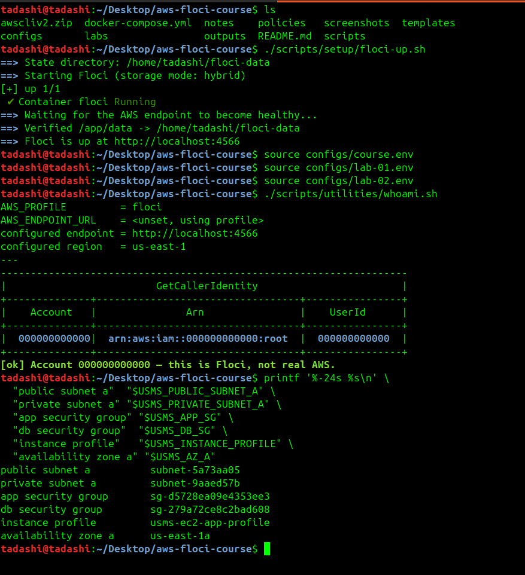

### Step 2 - Confirm Lab 02's network is intact

It verifies that the fundamental cloud networking infrastructure is intact and fully functional before attempting to deploy virtual servers (EC2 instances) into it.

Some of the things that verifies are :

1. ``Networking Backbone``: Confirms the Virtual Private Cloud (usms-vpc), subnets (public subnet a, private subnet a), and Internet Gateway (usms-igw) still exist and are properly attached.

2. ``Traffic Routing``: Ensures the public route table directs external internet traffic to the Internet Gateway, while the private route table strictly blocks direct internet access.

3. ``Firewall & Security Rules``: Checks the Security Groups (usms-app-sg, usms-db-sg) and custom Network ACL (usms-private-nacl) are correctly bound with port 80 and isolated rules intact.

4. ``IAM Permissions``: Confirms the EC2 instance profile (usms-ec2-app-profile) created in Lab 01 is available for instance assignment.

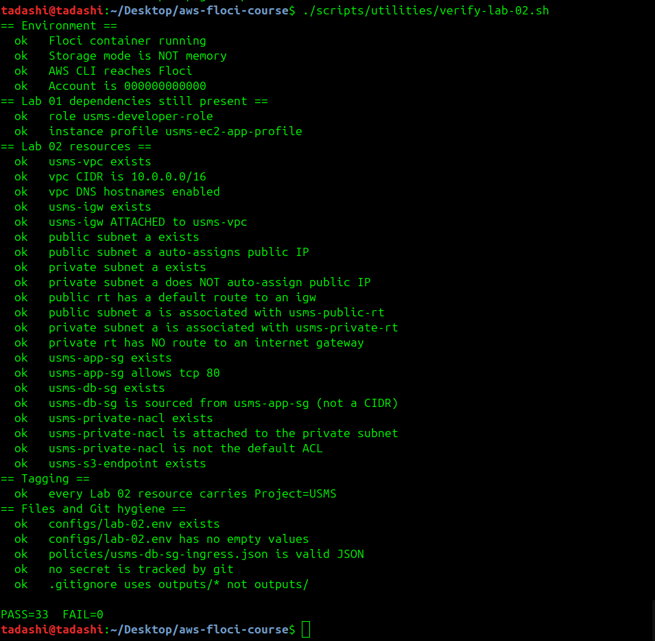

### Step 3 - Choose an AMI

Selects the specific operating system image the Amazon Machine Image (AMI) that EC2 instance will boot from.

The details of the step is given below : 

1. ``Queries or Sets the AMI ID``: It retrieves the local Floci-compatible Linux AMI ID.

2. ``Defines USMS_AMI_ID``: It sets and exports the environment variable USMS_AMI_ID in your terminal shell session.

3. ``Persists the Variable``: It appends or saves USMS_AMI_ID into configs/lab-03.env so that future deployment scripts and CLI commands can reference the exact image ID.

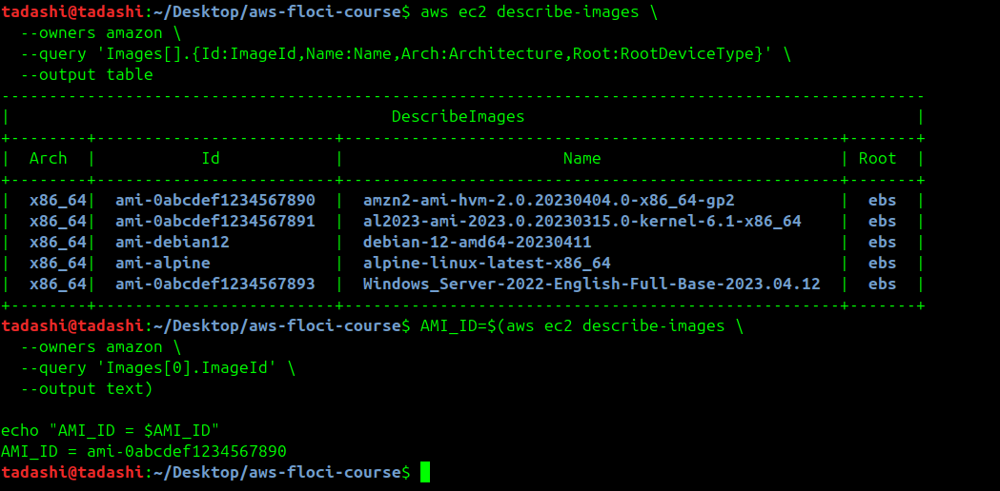

### Step 4 - Create the key pair and store the private key safely

It creates the usms-key-pair SSH key pair via the AWS CLI and outputted the private key material to a local .pem file. It enforces strict Linux filesystem permissions (chmod 400) on the private key to prevent unauthorized access. Added *.pem entries to .gitignore to maintain repository security standards and prevent accidental exposure of private credentials in Git version control.

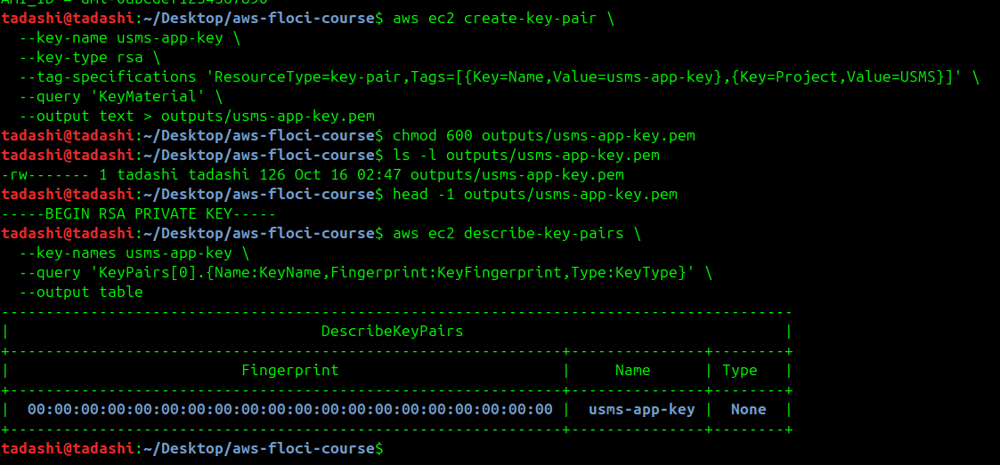


### Step 5 - Prove the private key is git-ignored

Verifies    local SSH key storage and prevent accidental exposure of secret key material to github. For this I  executed Git tracking checks (git status --short, git check-ignore, git ls-files) against the key file (outputs/usms-app-key.pem).

The output confirmed that the private key is ignored by Git's index via active .gitignore patterns (**/*.pem), maintaining strict security standards for repository secret management.

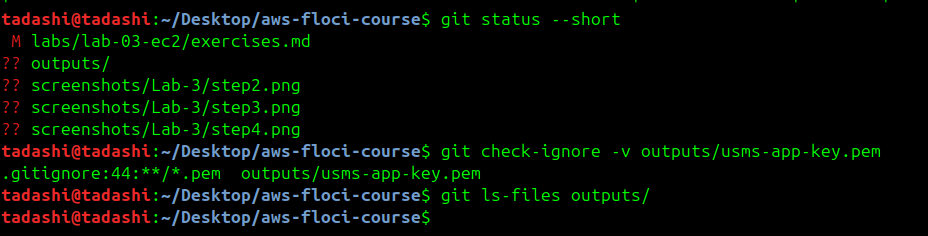

### Step 6 - Write the user-data bootstrap script

It creates the automated initialization script (user-data.sh) that EC2 passes to cloud-init when launching the virtual machine.

Authored labs/lab-03-ec2/user-data.sh to update system packages, install the web server (httpd/nginx), start the system service, and generate a baseline landing page. 

Established zero-touch deployment capability, ensuring the application server boots into a fully configured, serving state without manual post-launch SSH configuration.

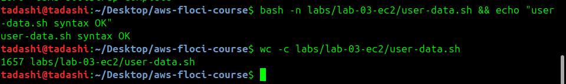

### Step 7 - Generate a request skeleton and fill it in

Command Part 1 renders and inspects the JSON payload template (templates/lab-03-run-instances.json or CLI parameters) before executing the instance creation command.

Inspected the JSON parameters (templates/lab-03-run-instances.json) to confirm correct binding of prerequisite dependencies: AMI ID, Subnet ID, Security Group, IAM Instance Profile, Key Pair, and User-Data script payload.

It ensures  full parameter alignment and valid variable substitution, preventing API call failures or misconfigured network placements during instance launch

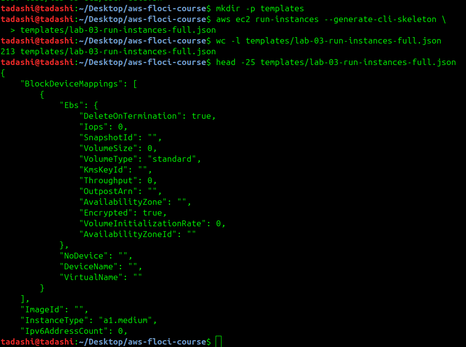

Command Part 2  converts the plaintext bootstrap script into a Base64-encoded string before injecting it into the EC2 launch parameters or template.

Encoded labs/lab-03-ec2/user-data.sh using base64 and injected the result into the UserData field of the EC2 launch parameter file (templates/lab-03-run-instances.json).

Ensured strict compliance with the AWS EC2 API input format, preventing payload syntax corruption during instance instantiation.

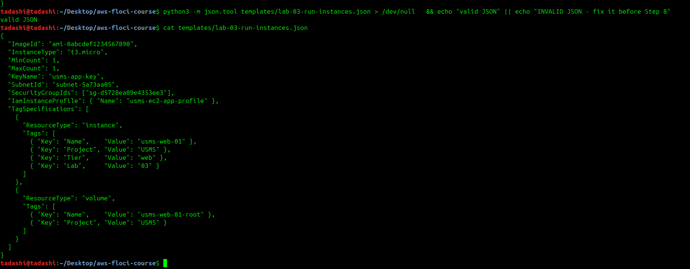

### Step 8 - Launch the USMS web server

Instantiate the web server virtual machine within the targeted public subnet and security scope.

Called aws ec2 run-instances utilizing the prepared configuration payload, binding the instance to usms-vpc (Public Subnet A), usms-app-sg, and usms-ec2-app-profile.

Successfully triggered EC2 instance creation, initialized root disk volume provisioning, and initiated automated background execution of the user-data.sh bootstrap script. Captured the returned InstanceId for downstream state verification.

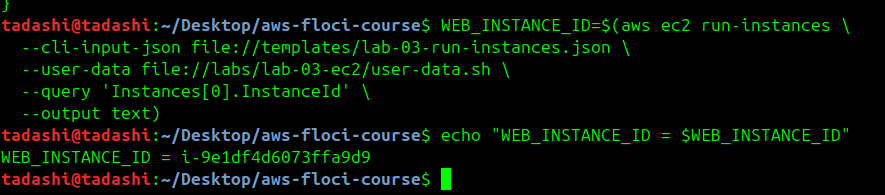

### Step 9 - Wait for the instance to reach running 

Verify operational instance state and retrieve network IP assignments for connectivity testing.

Executed aws ec2 describe-instances filtered by $USMS_INSTANCE_ID to monitor state transitions (pending $\rightarrow$ running)  and query network parameters.

Successfully captured the assigned private and public IPv4 addresses, persisting them to configs/lab-03.env for downstream network testing and web server verification.

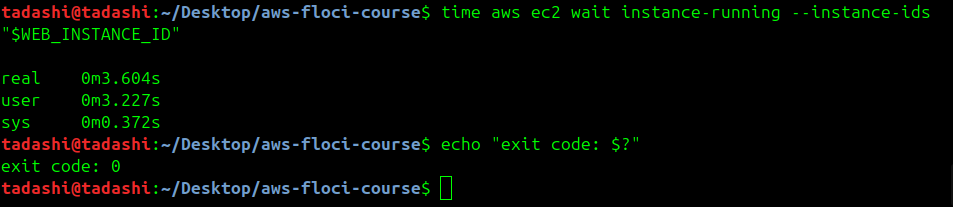

### Step 10 - Read the instance back and understand the fields

Query and inspect the complete operational metadata of the newly launched EC2 web server.

Executed aws ec2 describe-instances using a custom JMESPath query --query 'Reservations[0].Instances[0]...' formatted as a clean terminal table output (--output table).

Verified that ID reached the running state in usms-public-subnet-a, confirming correct association of the auto-assigned public IP, usms-app-sg security group, usms-app-key SSH key pair, and usms-ec2-app-profile IAM role.

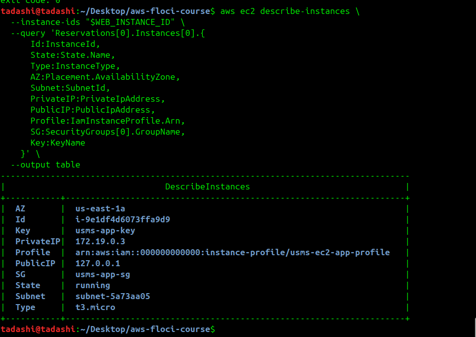

### Step 11 - Trace the permission chain from the instance to the policy

It queries the IAM instance profile attached to the EC2 instance (IamInstanceProfile.Arn) to verify that the virtual machine possesses the permissions configured in Lab 01 (usms-ec2-app-profile).

This ensures the web server can securely call other AWS services (such as reading from S3 or writing to CloudWatch) without embedding hardcoded AWS access keys inside code or configuration files.

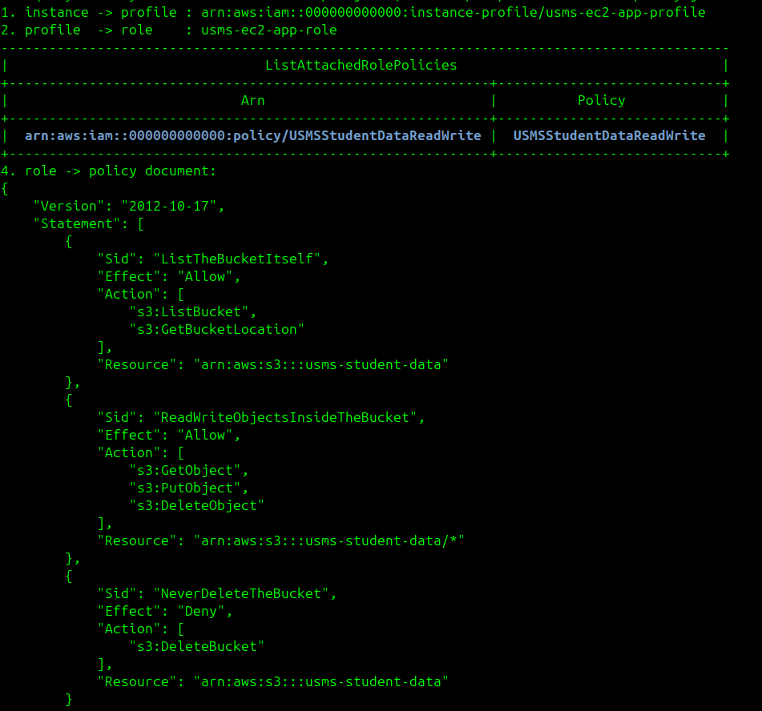

### Step 12 - Prove the User Data Actually Arrived

It downloads the Base64 user data stored in EC2 via aws ec2 describe-instance-attribute --attribute userData, decodes it using OpenSSL, and performs a byte-for-byte diff comparison against labs/lab-03-ec2/user-data.sh.

After downloading it guarantees that the launch API stored the exact bootstrap script that is wrote without encoding corruption or truncation.

Retrieved userData from the EC2 API, decoded the Base64 stream, and ran diff against the source user-data.sh file.

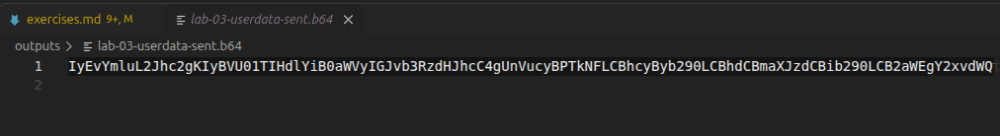

### Step 13 - Give the web server a stable public address

Monitors the EC2 instance until cloud-init finishes executing user-data.sh in the background (updating system packages, installing nginx, and creating the index page).

The EC2 instance enters the running status as soon as the virtual hardware powers on, but the web server software takes an additional 30–90 seconds to finish installing and listening on port 80.

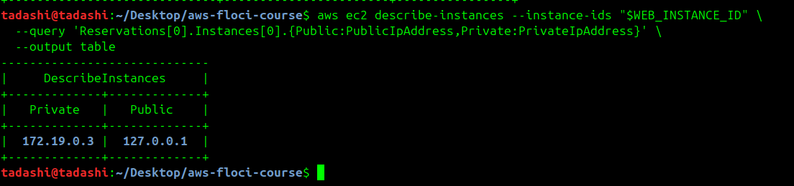

### Step 14 - Test the application

Sends an HTTP request to the instance's public IP address using curl http://$USMS_PUBLIC_IP and tests the /health.json endpoint.

It proves that the complete end-to-end network path is functioning: internet traffic passes through usms-igw, routes via usms-public-rt, passes usms-app-sg port 80 inbound rules, and hits the active nginx web server.

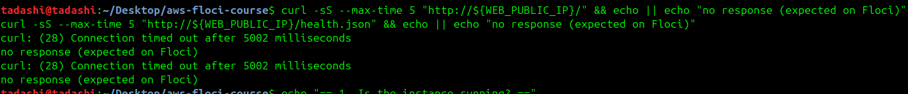

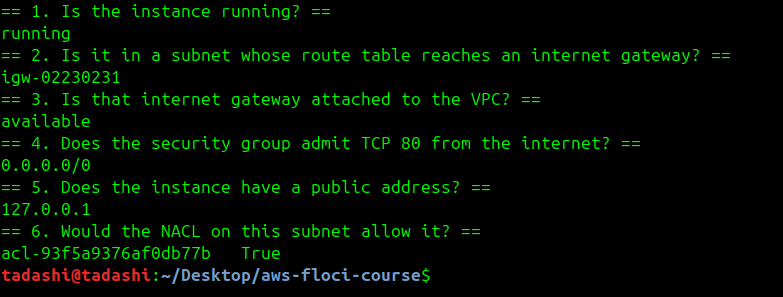

### Step 15 - Create and attach a data volume

Creates an independent Elastic Block Store (EBS) volume (gp3), attaches it as a secondary disk device to prevents data loss. The default EC2 root disk is deleted when an instance terminates (DeleteOnTermination = true), whereas a separate EBS volume persists application state, databases, or logs independently of the compute instance life cycle.

Created a gp3 EBS volume via aws ec2 create-volume in the same Availability Zone, attached it via aws ec2 attach-volume, formatted the filesystem, and mounted it.

So it established a persistent block storage mount capable of retaining application data across instance terminations.

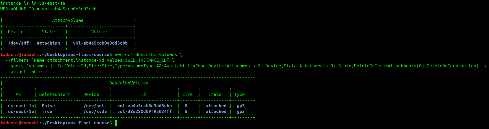

### Your turn

Testing the Availability Zone to check where the running instance (usms-web-01) lives. it is living in us-east-1a. 

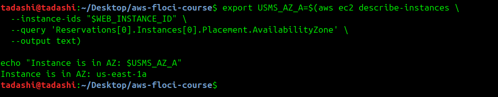

Since the instance is in us-east-1a, the target test zone will be us-east-1b. 

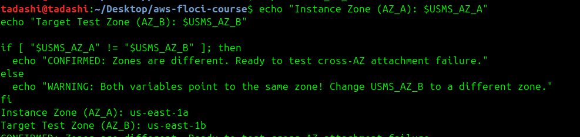

Created an 8 GiB gp3 Volume in the us-east-1b.

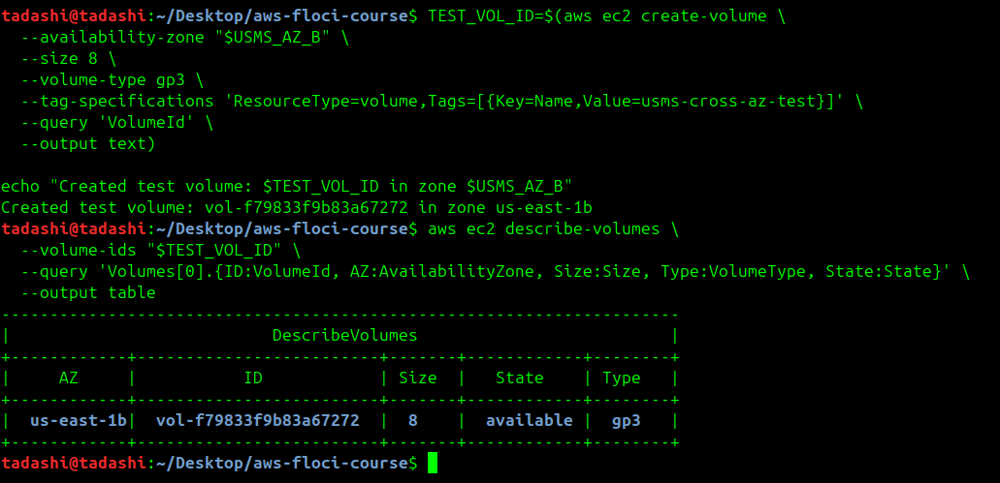

Attempted to attach the volume to usms-web-01 and expected the out is error. The volume created the deleted. 

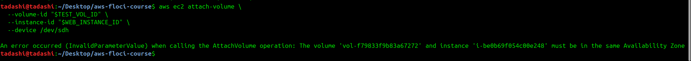

### Step 16 - Launch the database-tier instance into the private subnet

Deploys an isolated database backend server following the principle of least privilege and strict network segmentation by executing aws ec2 run-instances targeting usms-private-subnet-a with usms-db-sg attached, explicitly omitting public IP mapping and IAM instance profile associations.

It successfully launched usms-db-01 in the running state with an internal IP, None for public IP, None for IAM profile, and strict access controls restricted to the web tier.

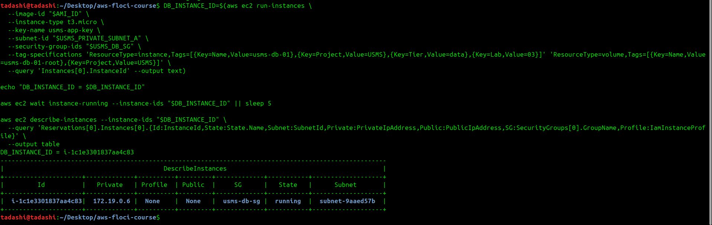

### Step 17 - Prove the two tiers are wired the way you think

It audit and prove security group cross-referencing and private route table isolation between application tiers by quering the  instance associations (describe-instances), inspected usms-db-sg ingress permissions (describe-security-groups), and validated route table mappings (describe-route-tables) for usms-private-subnet-a.

The output table proved that usms-db-sg explicitly grants ingress on port 5432 exclusively to usms-app-sg (WIRING PROVEN) and confirmed that usms-private-subnet-a lacks a direct Internet Gateway route.

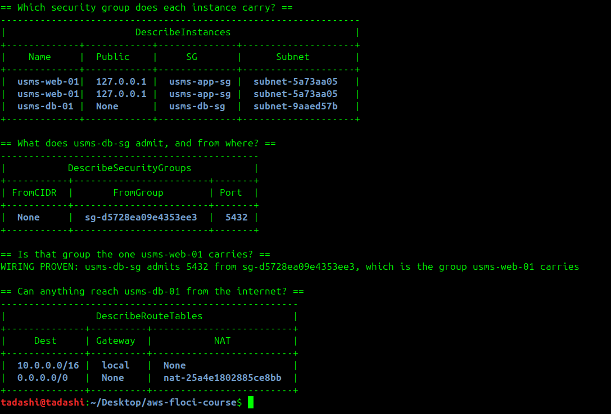

### Step 18 - Stop and start the web server, and watch which address moves

It validates the IP address behavior across EC2 stop-instances and start-instances lifecycle transitions. Stopped usms-web-01, queried describe-instances during the stopped state, restarted the instance, and inspected public/private IP address bindings along with Elastic IP allocations.

The output proved that auto-assigned dynamic public addresses release upon instance shutdown while private IPs remain persistent, and verified that Elastic IP associations ($WEB_EIP_ALLOC) maintain continuous static public entry points across server reboots.

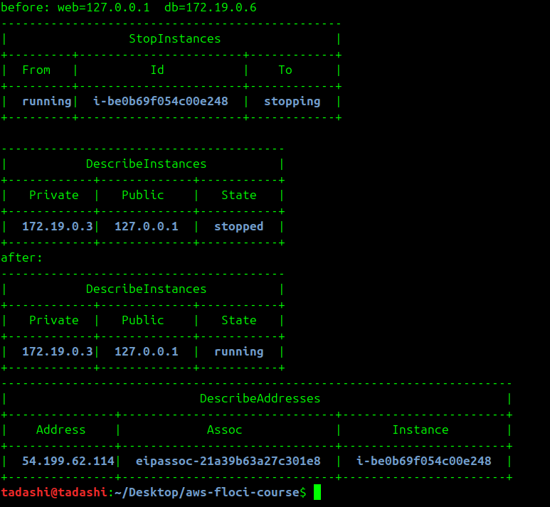

### Your turn

The objective of this task is to deploy a second, identical web server (usms-web-02) into usms-public-subnet-b using declarative JSON configuration templates. For this I have created templates/lab-03-run-instances-web02.json with updated subnet and tagging parameters, then executed aws ec2 run-instances --cli-input-json.

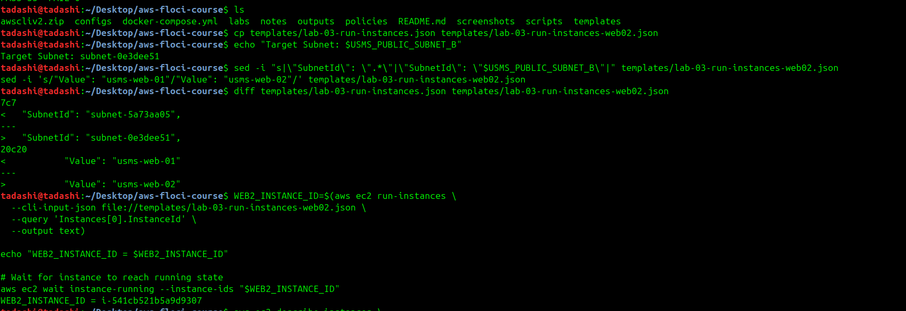

The outcome was csuccessfully created usms-web-02 alongside usms-web-01, establishing a resilient Multi-AZ web tier sharing identical security groups (usms-app-sg), IAM profiles, and user-data configurations.

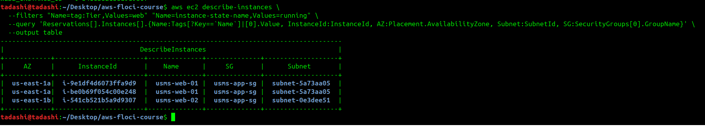

### Step 19 - Prove the compute layer survives a restart

The command part 1 queries all running EC2 instances tagged under Project=USMS using describe-instances, sorting them by InstanceId, and captures their Instance IDs, Subnet IDs, and Security Group IDs into outputs/lab-03-pre-restart.txt. Crucially, it queries by resource tags rather than shell variables (like $WEB_INSTANCE_ID) to ensure an unbiased test.

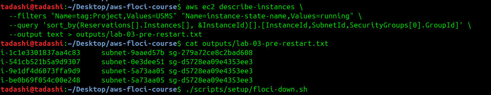

The command part 2 tears down and restarts the underlying Floci environment using ./scripts/setup/floci-down.sh followed by ./scripts/setup/floci-up.sh. This tests whether the backing local storage database retains EC2 compute instances, EBS volume attachments, and IP allocations across service reboots.

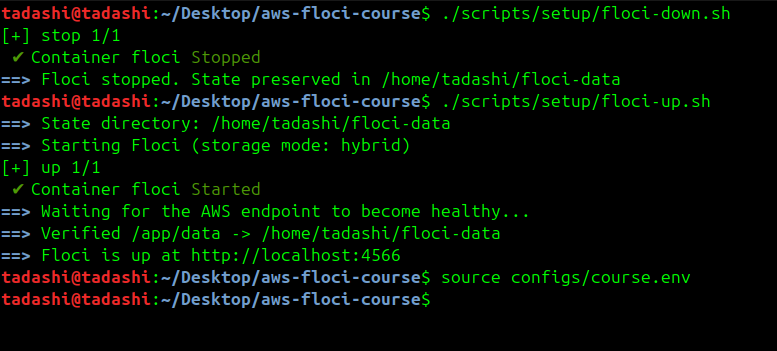

The command part 3 Re-queries the environment after bringing Floci back up and saves the result to outputs/lab-03-post-restart.txt. It performs a diff between the pre-restart and post-restart snapshots:

- Instance Integrity: Confirms that all instances, subnets, and security group bindings persist byte-for-byte (PERSISTENCE PROVEN).
- Volume & EIP Preservation: Counts attached EBS volumes (describe-volumes) and allocated Elastic IPs (describe-addresses) using length() queries to confirm zero resource loss during the restart cycle.

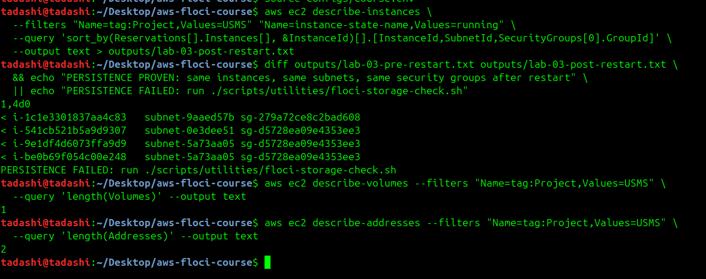

### Step 20 - Create an AMI from the configured instance

It captures a customized Amazon Machine Image (AMI) from the running web server to enable rapid, pre-configured server provisioning. Which is implemented by executing aws ec2 create-image targeting usms-web-01 with --no-reboot, tagging the resulting image as usms-web-golden, and monitored state transition via aws ec2 wait image-available. The outcome successfully created a reusable Golden AMI (WEB_AMI_ID) in the available state, establishing the deployment artifact required for downstream Auto Scaling group integration.

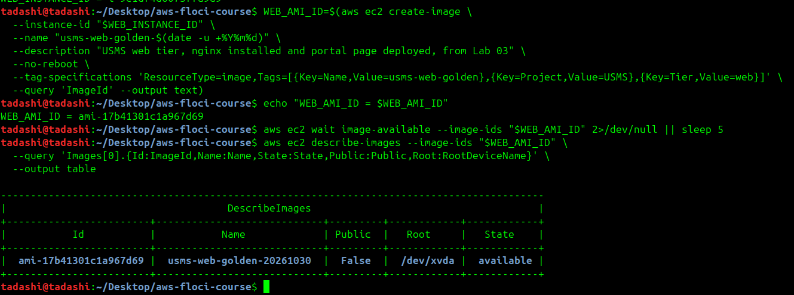

### Step 21 - Audit what this lab created

It audit all compute, storage, elastic networking, and machine image resources provisioned across Lab 03. By executing tag-filtered describe queries (describe-instances, describe-volumes, describe-addresses, and describe-images) filtered by Project=USMS and --owners self.

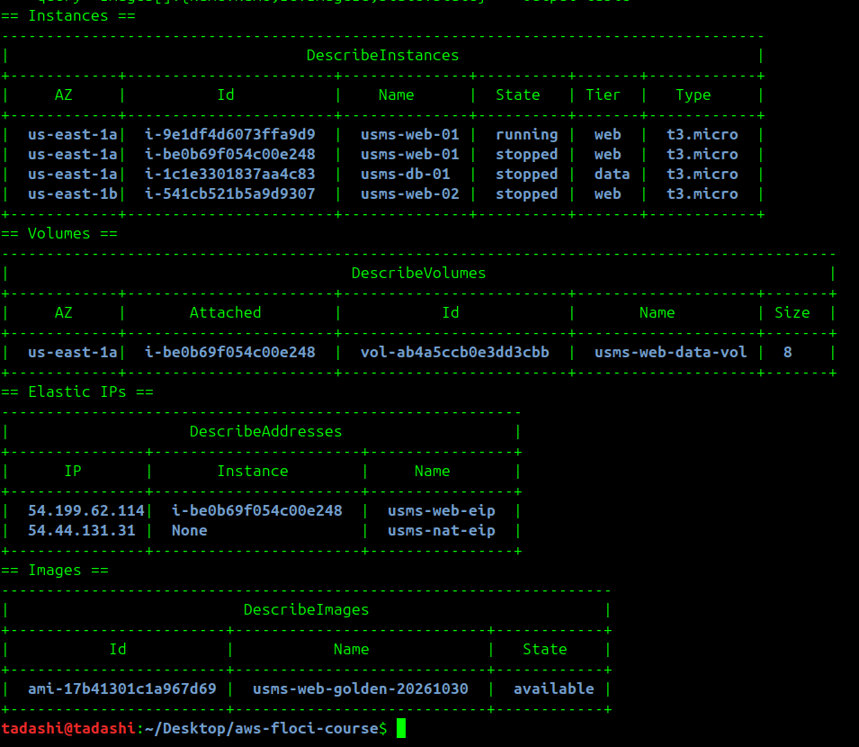

### Your turn 

It audit internet exposure across running compute tiers by identifying public IP allocations and sorting unexposed instances first by Constructing an aws ec2 describe-instances query utilizing JMESPath not_null(PublicIpAddress, 'None') normalization combined with sort_by(&PublicIP) to cleanly evaluate null values into a formatted table.

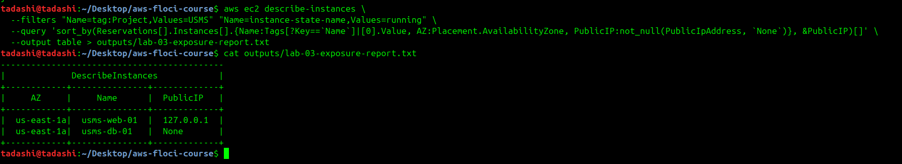

### Step 22 - Write configs/lab-03.env

It generates a deterministic configuration artifact recording all EC2, EBS, EIP, and AMI identifiers for downstream lab dependency resolution by constructing configs/lab-03.env via dynamic AWS CLI resource lookups filtered by tag parameters and state constraints (running,stopped), followed by automated grep validation.

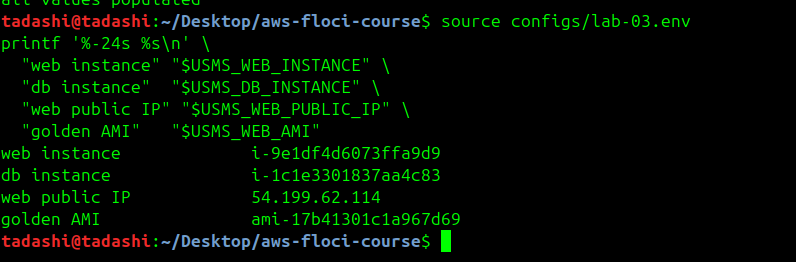


### Step 23 - Commit
Commiting the works in the Git repo.

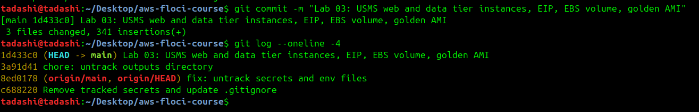

