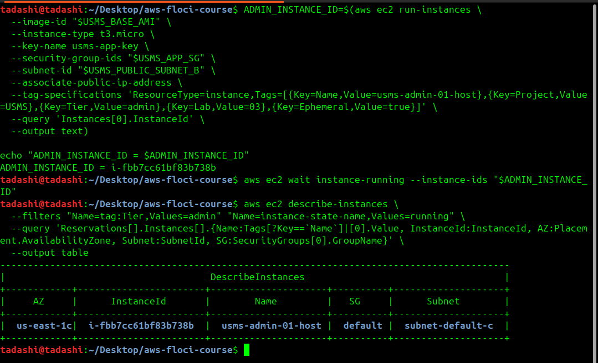
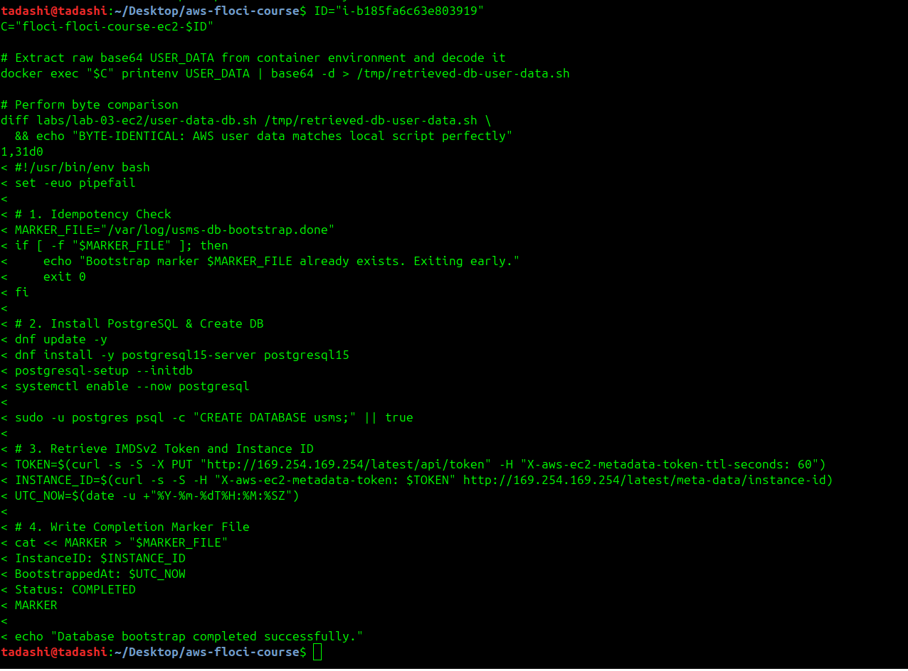

# Independent Lab Exercises

### Exercise 1 - Basic: a maintenance instance

Provision an ephemeral administrative jump host in public subnet B using explicit AWS CLI launch parameters by Executing aws ec2 run-instances without input JSON templates, attached usms-app-key and usms-app-sg, applied resource tagging (Tier=admin, Ephemeral=true), and monitored lifecycle status via aws ec2 wait instance-running.




### Exercise 2 - Intermediate: a self-describing bootstrap

Author an idempotent PostgreSQL bootstrap script (user-data-db.sh), provision usms-db-02 in private subnet B, and verify stored user-data payload integrity.Created labs/lab-03-ec2/user-data-db.sh with early exit checks on /var/log/usms-db-bootstrap.done, launched usms-db-02 with Base64-encoded user-data, and decoded the userData attribute for diff verification.



### Exercise 3 - Problem solving: a reachability report

Author a directory-agnostic, parameter-driven reachability tool to dynamically audit external access across all running compute resources by creating scripts/utilities/lab-03-reachability.sh using set -uo pipefail (omitting -e to permit non-fatal AWS query fallbacks), evaluating subnet route table attachments and public address allocations rather than instance tags.

```bash
tadashi@tadashi:~/Desktop/aws-floci-course$ ./scripts/utilities/lab-03-reachability.sh
usms-db-02      172.19.0.4      127.0.0.1       UNREACHABLE   no igw route on subnet
usms-admin-01-host 172.19.0.4      127.0.0.1       UNREACHABLE   no igw route on subnet
usms-db-02      172.19.0.5      127.0.0.1       UNREACHABLE   no igw route on subnet
usms-db-02      172.19.0.3      -               UNREACHABLE   no igw route on subnet
usms-db-02      172.19.0.6      -               UNREACHABLE   no igw route on subnet
usms-web-01     172.19.0.3      127.0.0.1       REACHABLE     igw route + sg allows traffic from 0.0.0.0/0
usms-db-01      172.19.0.3      -               UNREACHABLE   no igw route on subnet
usms-db-02      172.19.0.7      -               UNREACHABLE   no igw route on subnet
tadashi@tadashi:~/Desktop/aws-floci-course$ cd labs/lab-03-ec2 && ../../scripts/utilities/lab-03-reachability.sh
usms-db-02      172.19.0.4      127.0.0.1       UNREACHABLE   no igw route on subnet
usms-admin-01-host 172.19.0.4      127.0.0.1       UNREACHABLE   no igw route on subnet
usms-db-02      172.19.0.5      127.0.0.1       UNREACHABLE   no igw route on subnet
usms-db-02      172.19.0.3      -               UNREACHABLE   no igw route on subnet
usms-db-02      172.19.0.6      -               UNREACHABLE   no igw route on subnet
usms-web-01     172.19.0.3      127.0.0.1       REACHABLE     igw route + sg allows traffic from 0.0.0.0/0
usms-db-01      172.19.0.3      -               UNREACHABLE   no igw route on subnet
usms-db-02      172.19.0.7      -               UNREACHABLE   no igw route on subnet
tadashi@tadashi:~/Desktop/aws-floci-course/labs/lab-
is this the expected outcome
```

