# Lab 04: Amazon ECS report

## 1. Aim / Objective

The aim of this practical is to containerise the University Student Management System (USMS) enrolment service onto Amazon ECS on Fargate, inside the private subnets built in Lab 2, using the AWS CLI.

The objectives are:

1. Build an ECS cluster, a CloudWatch log group, a task definition and a service that holds a fixed `desiredCount` of 2 across two Availability Zones.
2. Separate the task execution role (pulls the image, writes logs) from the task role (the application's identity), and reuse Lab 1's `USMSStudentDataReadWrite` on the task role.
3. Source the service's security group from the web tier's `usms-app-sg`, and explain how a private-subnet task pulls its image.
4. Record every name and ARN in `configs/lab-04.env` for Labs 05 and 06.

## 2. Introduction

Amazon Elastic Container Service (ECS) is AWS's managed container orchestration service. Its purpose is to run containers without building a scheduler, and on the Fargate launch type without managing servers either. It works through four objects: a cluster is a namespace, a task definition is an immutable versioned blueprint, a task is one running copy of that blueprint, and a service keeps the number of running tasks equal to the desired count. ECS matters in cloud computing because it replaces a hand-managed server with a declared state that the platform maintains and repairs, while each task keeps its own network interface, security group and IAM identity. It is typically used for web APIs, microservices and background workers.

### Key Features

- Clusters, services and tasks with a continuous reconciliation loop
- Immutable, versioned task definitions
- Fargate serverless compute, sized per task
- `awsvpc` networking, giving each task its own interface and security group
- Separate IAM execution and task roles
- CloudWatch Logs integration through the `awslogs` driver

## 3. Use Case

The USMS enrolment service is the endpoint the student portal calls when a student clicks "Register for this module". Traffic is very uneven: most of a week's requests arrive in the first minutes after enrolment opens. Running it on ECS means a failed copy is replaced without anyone logging in, and the capacity is one number that can later be changed automatically.

ECS is commonly used for:

| Use case | Why ECS fits |
|---|---|
| University or business web APIs | The service keeps a fixed number of healthy copies across Availability Zones |
| Microservices | Each service has its own task definition, IAM role and security group |
| Scheduled and background workers | Tasks run on demand and stop when finished |
| Workloads moving off single servers | No hosts to patch when running on Fargate |

## 4. System Architecture / Design

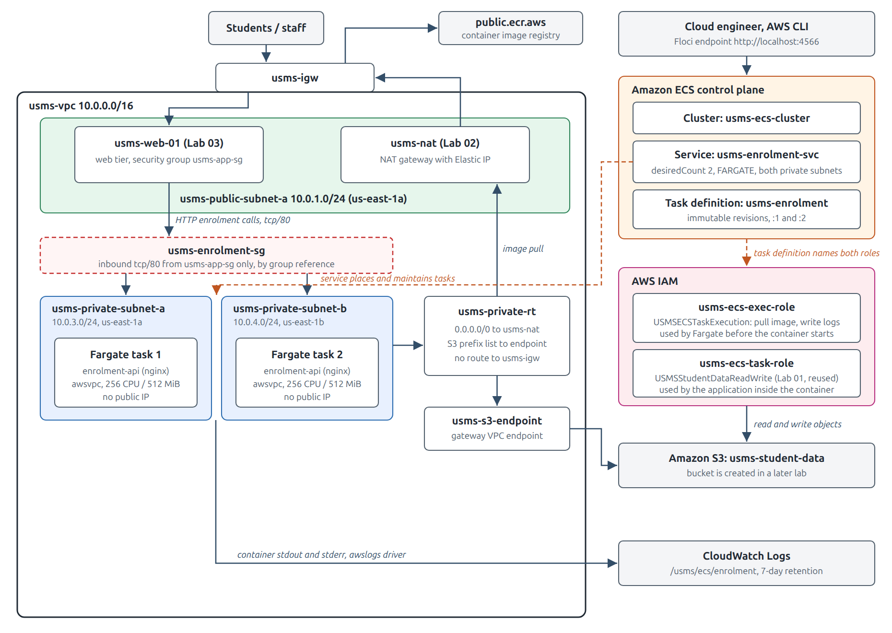

*Students reach the web tier through the internet gateway. Only the web tier may call the two private Fargate tasks on port 80. Tasks reach the image registry outbound through the NAT gateway, and the engineer controls ECS through the AWS CLI. Source: own diagram of the resources built in this lab.*

## 5. Implementation Procedure

All commands were run from the repository root (`~/Desktop/aws-floci-course`) in one terminal session. Each step below records why it was done, what was done, what the output showed, and the screenshot of that output. Long flags are shortened in the code blocks; the screenshots show each command in full.

### Preparation - Lab folder and tools

**Purpose:** Make sure the lab has a folder and that the tools used throughout are installed.

**What I did:** Created `labs/lab-04-ecs` and checked for `jq`, `python3`, `docker` and the AWS CLI.

```bash
mkdir -p labs/lab-04-ecs
for t in jq python3 docker; do command -v "$t" || echo MISSING; done
aws --version
```

**Result:** All three tools were found, nothing printed `MISSING`, and the AWS CLI is version 2.31.24.

**Screenshot 1 - Lab folder created and tools confirmed**

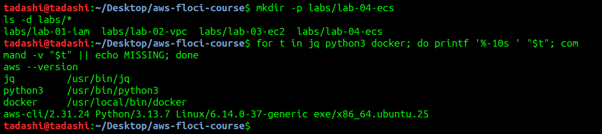

### Step 1 - Resume the environment and load the env files

**Purpose:** Start Floci and load the values recorded by Labs 1 to 3, because this lab builds on the VPC, subnets, NAT gateway and security group created there.

**What I did:** Started Floci, sourced `course.env` and the three earlier lab env files, confirmed my identity, and printed the eight values this lab depends on.

```bash
./scripts/setup/floci-up.sh
source configs/course.env; source configs/lab-01.env
source configs/lab-02.env; source configs/lab-03.env
./scripts/utilities/whoami.sh
```

**Result:** Floci came up in `hybrid` storage mode, with state stored in `/home/tadashi/floci-data`. The identity is `arn:aws:iam::000000000000:root`, which confirms the commands go to Floci and not to real AWS. All eight values are present, including both private subnets (`subnet-9aaed57b`, `subnet-1bac5476`) and `usms-app-sg` (`sg-d5728ea09e4353ee3`).

**Note:** The output shows `configured region = ap-south-1` while the course region is `us-east-1`. This caused the failures in Step 2.

**Screenshot 2 - Floci started, identity confirmed, eight required values present**

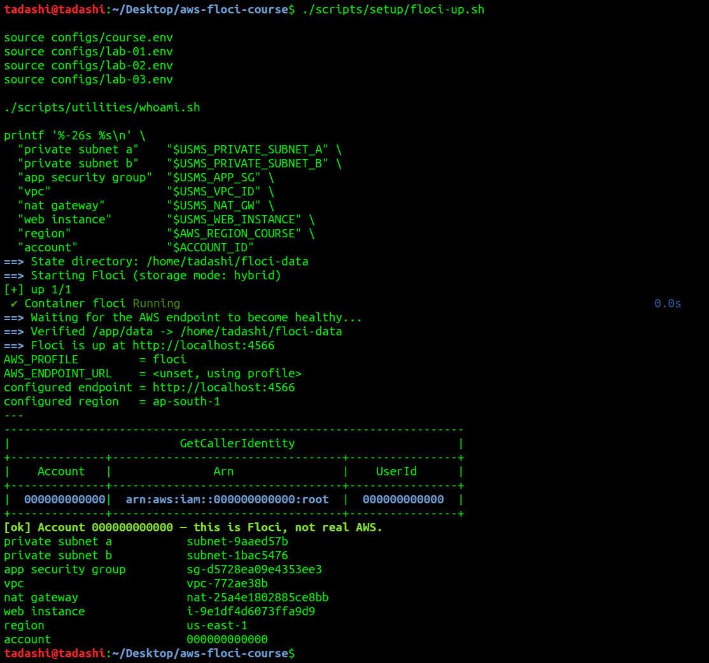

### Step 2 - Confirm Labs 2 and 3 are still intact

**Purpose:** Check that the earlier work still exists before building on it, so a missing subnet or security group is found now and not halfway through the lab.

**What I did:** Ran both verification scripts. They failed, so I compared the CLI's configured region with the course region before assuming the resources were gone.

```bash
./scripts/utilities/verify-lab-02.sh
./scripts/utilities/verify-lab-03.sh
aws configure get region          # ap-south-1
echo "$AWS_REGION_COURSE"         # us-east-1
export AWS_DEFAULT_REGION="$AWS_REGION_COURSE"
```

**Result:** The first run gave `PASS=18 FAIL=15` for Lab 2 and `PASS=17 FAIL=19` for Lab 3. The `floci` profile points to `ap-south-1`, and all course resources are in `us-east-1`, so the scripts were looking in an empty region. After setting `AWS_DEFAULT_REGION` for this session only, `usms-vpc` was found and the scripts gave `PASS=32 FAIL=1` for Lab 2 and `PASS=36 FAIL=0` for Lab 3.

**Note:** Lab 2's one remaining failure is `no secret is tracked by git`. It is the same false positive explained in [Section 7](#7-analysis-and-discussion). I did not change `~/.aws/config`, so any new terminal needs the same `export`.

**Screenshot 3 - First verification failing because of the wrong region**

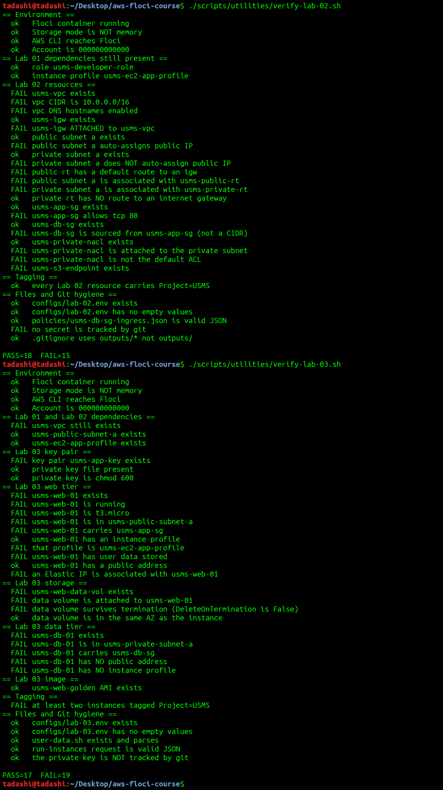

**Screenshot 4 - Region mismatch found and fixed for this session; usms-vpc is visible again**

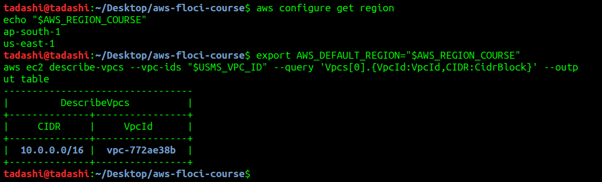

**Screenshot 5 - Verification after the fix (Lab 2 PASS=32 FAIL=1, Lab 3 PASS=36 FAIL=0)**

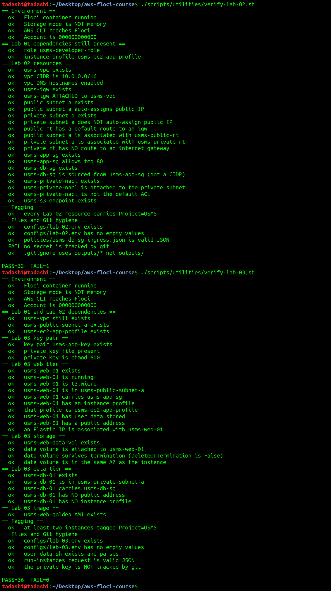

### Step 3 - Probe what this Floci build supports

**Purpose:** Find out which ECS, Application Auto Scaling, CloudWatch and Logs calls this Floci version answers, so a missing feature is known now and not discovered in Lab 6.

**What I did:** Defined the lab's `probe()` function, which runs a command and prints `SUPPORTED` or `not available`, and ran it against ten calls.

```bash
probe() {
  printf '%-46s ' "$1"
  if eval "$2" >/dev/null 2>&1; then echo "SUPPORTED"; else echo "not available"; fi
}
probe "ecs list-clusters" "aws ecs list-clusters"
```

**Result:** Eight of the ten printed `SUPPORTED`. I recorded Path A (full), with caveats, at the top of `notes/lab-04-notes.md`.

**Note:** `ecs describe-services` printed `not available`, but only because the probe uses a cluster called `probe` that does not exist, and the resulting error counts as a failure. Steps 10 and 11 show the real call working. `describe-scheduled-actions` really did not answer, which the course's Known Issues page lists for Lab 06.

**Screenshot 6 - Floci support probe**

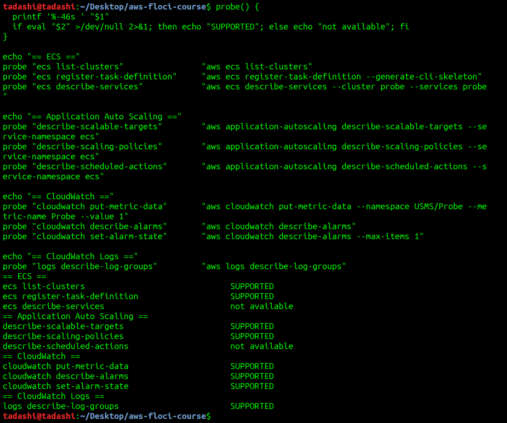

### Step 4 - Create the ECS cluster as the developer role

**Purpose:** Create the cluster, which is the namespace that holds the service and tasks. It is created with Lab 1's `usms-developer-role`, so the work uses a scoped role and not root. Container Insights is requested because Lab 6's scaling policy needs its metrics.

**What I did:** Assumed the role and exported its temporary credentials. Then I created the cluster, unset the credentials to return to my normal identity, and read the cluster back.

```bash
aws sts assume-role --role-arn "$ROLE_ARN" --role-session-name "lab04-ecs-build" \
  --profile usms-dev > outputs/lab-04-assumed-role.json
chmod 600 outputs/lab-04-assumed-role.json
aws ecs create-cluster --cluster-name usms-ecs-cluster \
  --settings name=containerInsights,value=enabled
unset AWS_ACCESS_KEY_ID AWS_SECRET_ACCESS_KEY AWS_SESSION_TOKEN
```

**Result:** The identity changed to `assumed-role/usms-developer-role/...`. The cluster `arn:aws:ecs:us-east-1:000000000000:cluster/usms-ecs-cluster` was created and reads `ACTIVE` with 0 services and 0 tasks. After `unset`, the identity returned to root.

**Note:** There are two Floci limitations here. The session name came back as `floci-session` instead of `lab04-ecs-build`, and `Settings` came back `null`, so Container Insights could not be confirmed. Real AWS returns both.

**Screenshot 7 - Developer role assumed**

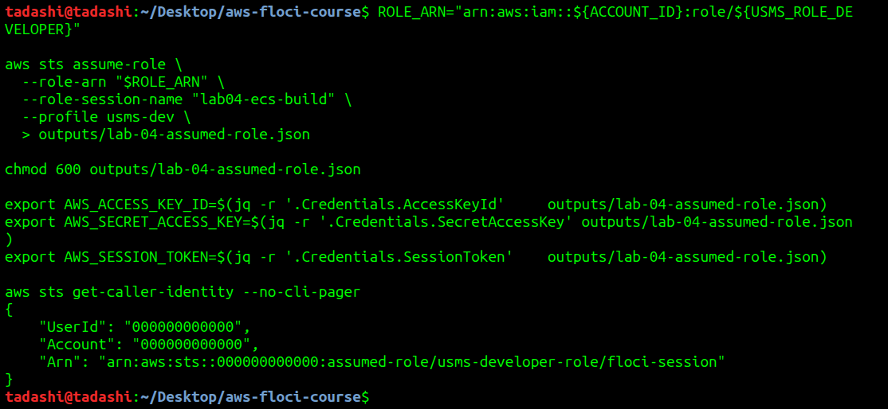

**Screenshot 8 - Cluster created, identity restored, cluster ACTIVE**

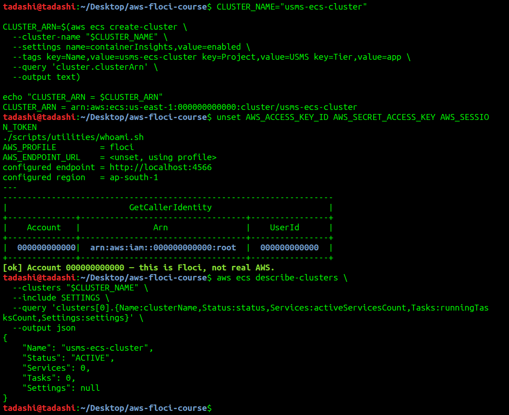

### Step 5 - Create the log group

**Purpose:** The `awslogs` driver in Step 9 writes to a log group that must already exist, because ECS does not create it. Retention is set separately, since otherwise logs are kept forever and cost money indefinitely.

**What I did:** Created `/usms/ecs/enrolment`, set a 7-day retention, and listed the log groups.

```bash
aws logs create-log-group --log-group-name /usms/ecs/enrolment \
  --tags Project=USMS,Name=usms-enrolment-logs,Tier=app
aws logs put-retention-policy --log-group-name /usms/ecs/enrolment --retention-in-days 7
```

**Result:** The table shows one log group with `Retention = 7` and `Bytes = 0`. Zero is correct, because no task has run yet.

**Screenshot 9 - Log group with 7-day retention (Checkpoint 2)**

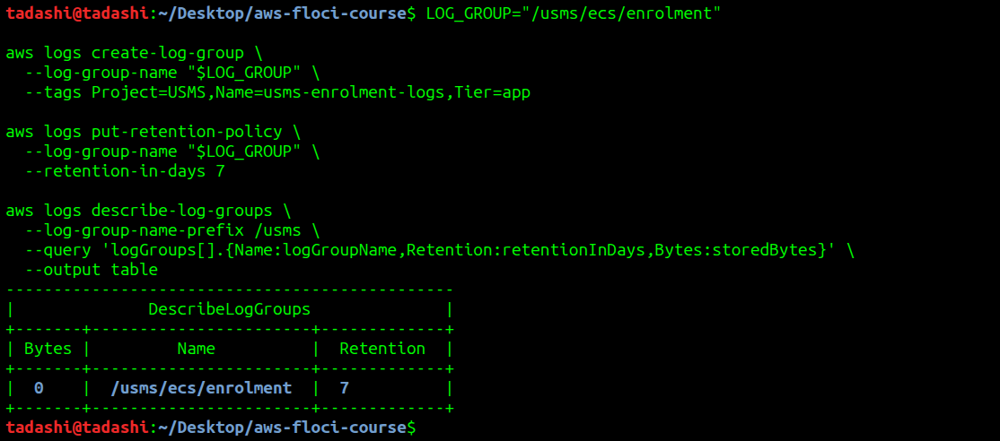

### Step 6 - Create the task execution role

**Purpose:** The execution role is used by the ECS platform before my code starts: it pulls the image and opens the log stream. If this role is wrong, the task never starts.

**What I did:** Wrote a trust policy for `ecs-tasks.amazonaws.com` and created `usms-ecs-exec-role` with it. Then I wrote `USMSECSTaskExecution`, created the policy, attached it to the role, and read both back.

```bash
aws iam create-role --role-name usms-ecs-exec-role \
  --assume-role-policy-document file://policies/trust-ecs-tasks.json
aws iam create-policy --policy-name USMSECSTaskExecution \
  --policy-document file://policies/usms-ecs-task-execution-policy.json
aws iam attach-role-policy --role-name usms-ecs-exec-role --policy-arn "$EXEC_POLICY_ARN"
```

**Result:** Both JSON files validated. The role's principal reads back as `ecs-tasks.amazonaws.com`, and `USMSECSTaskExecution` is attached.

**Why the policy is least privilege:** The ECR pull actions use `Resource: "*"` because `ecr:GetAuthorizationToken` cannot be limited to a resource. The two log actions are limited to the one log group from Step 5, so the task cannot write to any other group.

**Screenshot 10 - Trust policy written and execution role created**

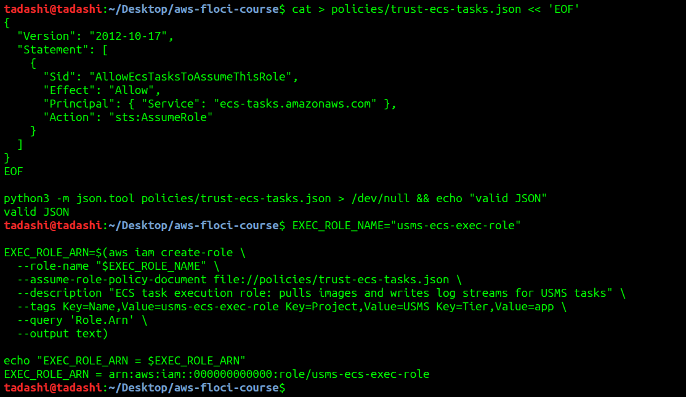

**Screenshot 11 - Least-privilege policy attached and verified (Checkpoint 2)**

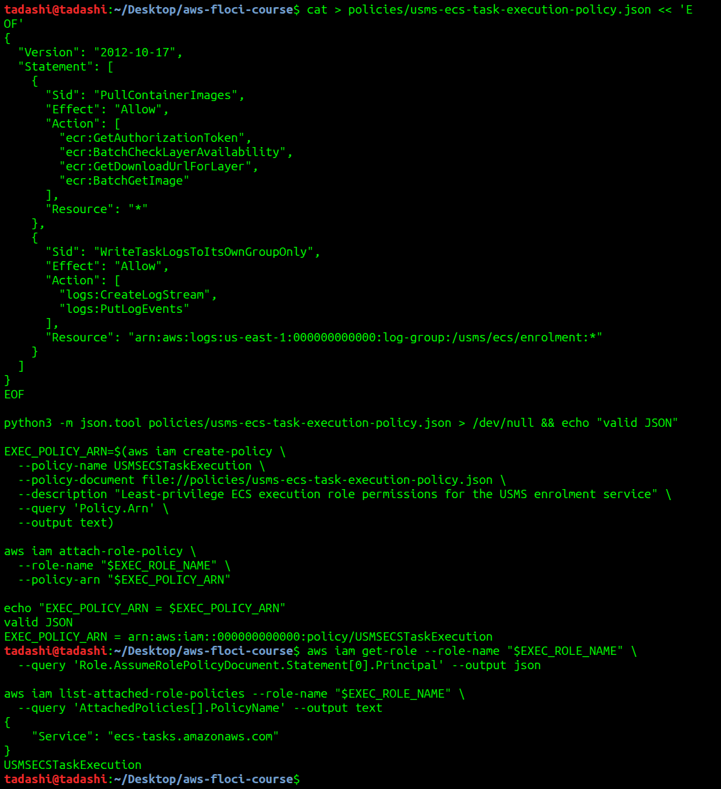

### Step 7 - Create the task role and reuse Lab 1's policy

**Purpose:** The task role is the identity of the application inside the container. It reuses `USMSStudentDataReadWrite` unchanged, the same policy Lab 3's EC2 instance uses, so both get the same S3 permissions without a new policy or a stored access key.

**What I did:** Created `usms-ecs-task-role` with the same trust policy. The attach command failed the first time, so I inspected the variable, used the correct value, and read the policy back.

```bash
echo "$USMS_POLICY_S3_RW"   # arn:aws:iam::000000000000:policy/USMSStudentDataReadWrite
aws iam attach-role-policy --role-name usms-ecs-task-role --policy-arn "$USMS_POLICY_S3_RW"
```

**Result:** The role was created, and `USMSStudentDataReadWrite` is attached. The policy allows listing `usms-student-data`, allows get, put and delete on its objects, and explicitly denies `s3:DeleteBucket`. The bucket itself is created later, in Lab 10.

**Problem and fix:** The first attempt failed with `NoSuchEntity`, because the path read `policy/arn:aws:iam::000000000000:policy/USMSStudentDataReadWrite`. In this repository `configs/lab-01.env` stores the variable as a full ARN, so the lab's command added the prefix a second time. Using the variable directly fixed it.

**Screenshot 12 - First attempt failing with NoSuchEntity because the ARN prefix was doubled**

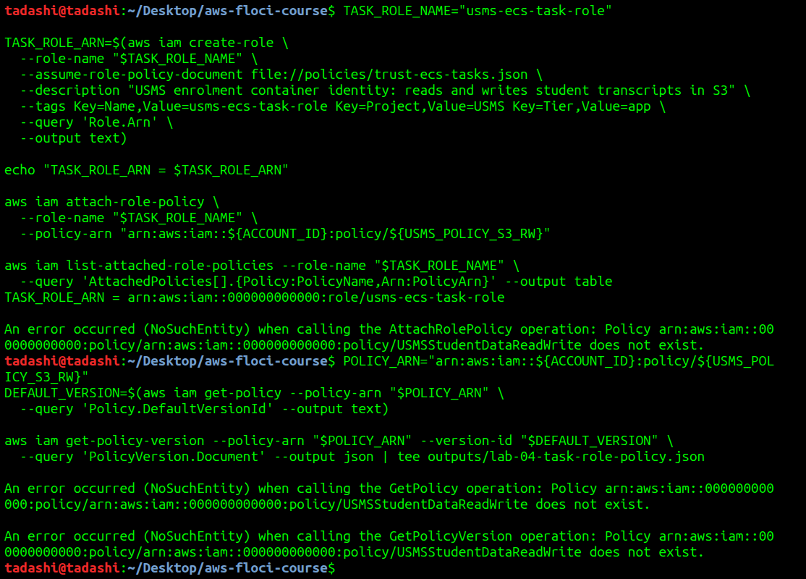

**Screenshot 13 - Policy attached using the stored ARN, and the policy read back (Checkpoint 2)**

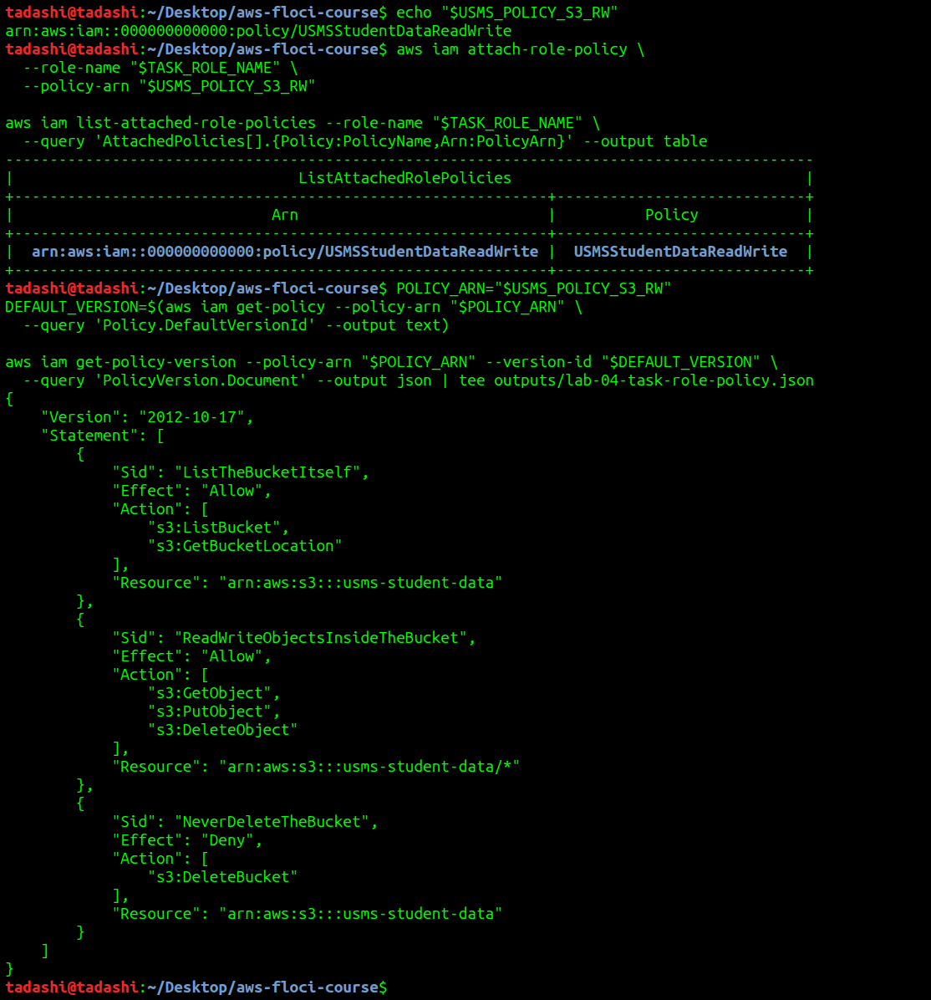

### Step 8 - Create the enrolment security group

**Purpose:** With `awsvpc` networking each task has its own network interface and security group. This group allows HTTP only from the web tier, using a group reference and not an IP range, so the rule stays correct as addresses change.

**What I did:** Created `usms-enrolment-sg` in the Lab 2 VPC, wrote the ingress rule to a JSON file with an unquoted heredoc so `$USMS_APP_SG` expanded, applied it, and read the group back.

```bash
aws ec2 authorize-security-group-ingress --group-id "$ENROLMENT_SG" \
  --ip-permissions file://policies/usms-enrolment-sg-ingress.json
```

**Result:** `usms-enrolment-sg` is `sg-991bcc8cec264ef44`, with rule `sgr-8c8cb13c0c7bb1156`. The read-back shows one inbound rule on port 80, `FromGroup` is `usms-app-sg` and `FromCIDR` is `null`, so no IP range is admitted. There is one outbound rule, the default allow-all.

**Screenshot 14 - Security group sourced from usms-app-sg, FromCIDR null**

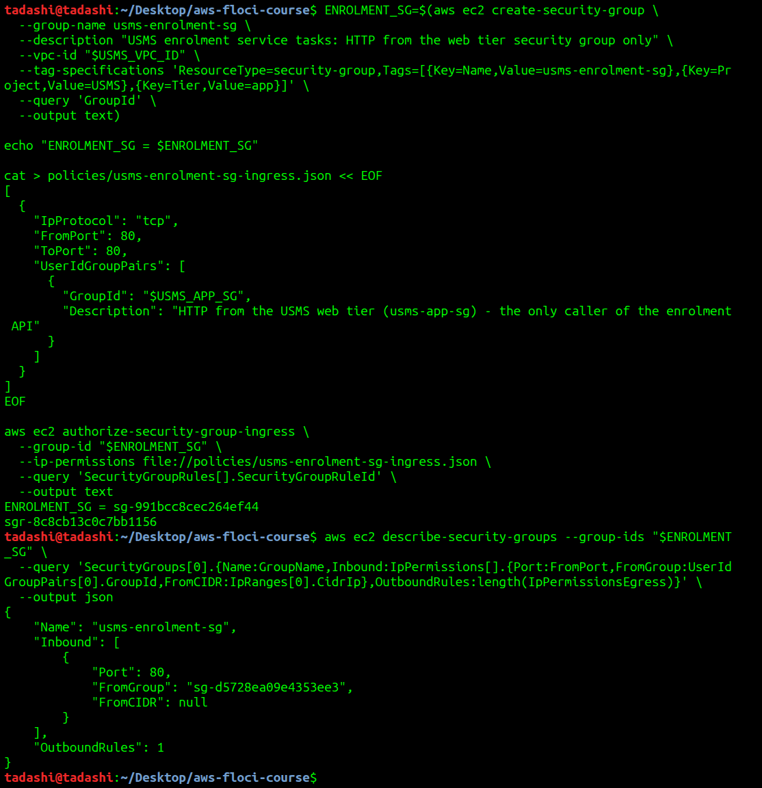

### Step 9 - Write and register the task definition

**Purpose:** The task definition is the immutable, versioned blueprint of the container. It sets the launch compatibility, the network mode, the CPU and memory, both IAM roles, the image and the logging.

**What I did:** Wrote `templates/lab-04-taskdef.json` with an unquoted heredoc, so the role ARNs and log group expanded into it. I checked that it was valid JSON with no leftover `$`, registered it, and read it back.

```bash
python3 -m json.tool templates/lab-04-taskdef.json > /dev/null && echo "valid JSON"
grep -c '\$' templates/lab-04-taskdef.json     # must print 0
aws ecs register-task-definition --cli-input-json file://templates/lab-04-taskdef.json
```

**Result:** The file printed `valid JSON` and `0`. `usms-enrolment:1` is `ACTIVE`, with `awsvpc` networking, `FARGATE` compatibility, 256 CPU and 512 MiB. The container `enrolment-api` uses `public.ecr.aws/nginx/nginx:stable-alpine` as a placeholder image. `Exec` and `Task` are two different role ARNs, which is the point of Steps 6 and 7.

**Note:** `LogGroup` reads `null`. Screenshot 17 confirms that Floci accepted `logConfiguration` at registration and dropped it on read-back. The block is present in the template (Screenshot 15), and real AWS returns it.

**Screenshot 15 - Task definition written, valid JSON, no unexpanded variables**

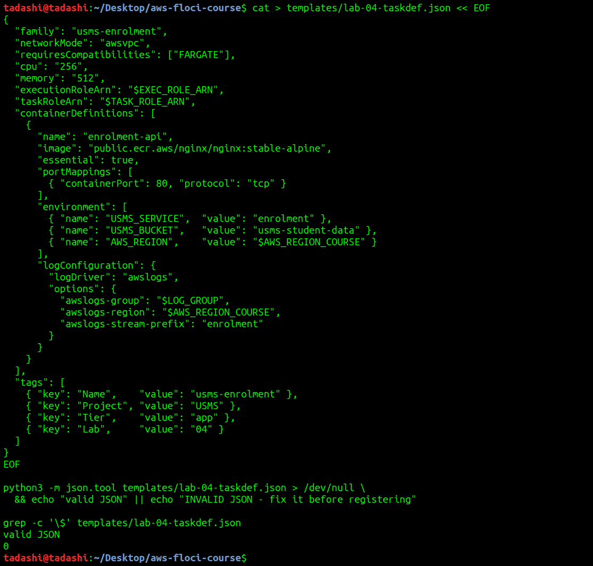

**Screenshot 16 - usms-enrolment:1 registered with two different role ARNs (Checkpoint 3)**

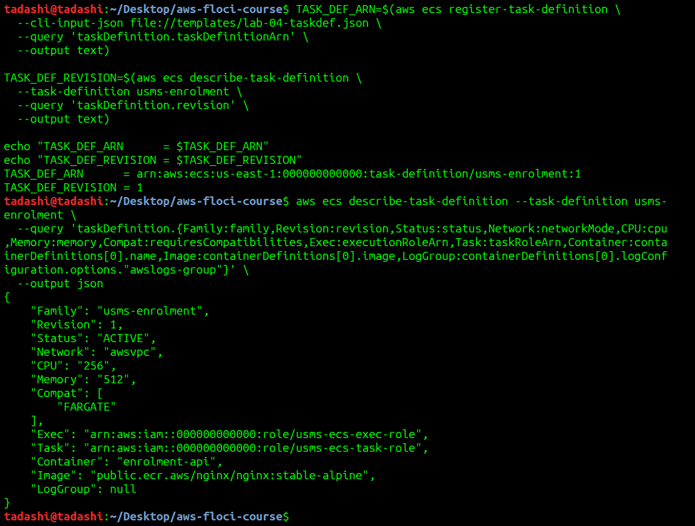

**Screenshot 17 - logConfiguration reads back as null, a Floci limitation**

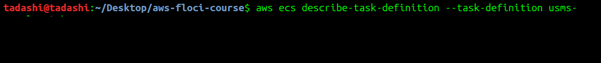

### Step 10 - Create the service in the private subnets

**Purpose:** The service is the object that keeps the requested number of tasks running and replaces any that fail. A desired count of 2 across two subnets places one task in each Availability Zone. `assignPublicIp=DISABLED` keeps the tasks off the internet.

**What I did:** Created `usms-enrolment-svc`, then polled the counts every 5 seconds. The lab warns that the `services-stable` waiter can return immediately or never on Floci, so I used its polling loop.

```bash
aws ecs create-service --cluster "$CLUSTER_NAME" --service-name "$SERVICE_NAME" \
  --task-definition usms-enrolment --desired-count 2 --launch-type FARGATE \
  --network-configuration "awsvpcConfiguration={subnets=[$USMS_PRIVATE_SUBNET_A,$USMS_PRIVATE_SUBNET_B],securityGroups=[$ENROLMENT_SG],assignPublicIp=DISABLED}"
```

**Result:** The service was created, and `running` went from 0 to 2 on the fourth poll. Floci started real nginx containers for this.

**Note:** On real AWS a task in a private subnet pulls its image outbound through Lab 2's `usms-nat`. Floci runs containers on local Docker, so that path was not exercised here.

**Screenshot 18 - Service created, running count reaches 2**

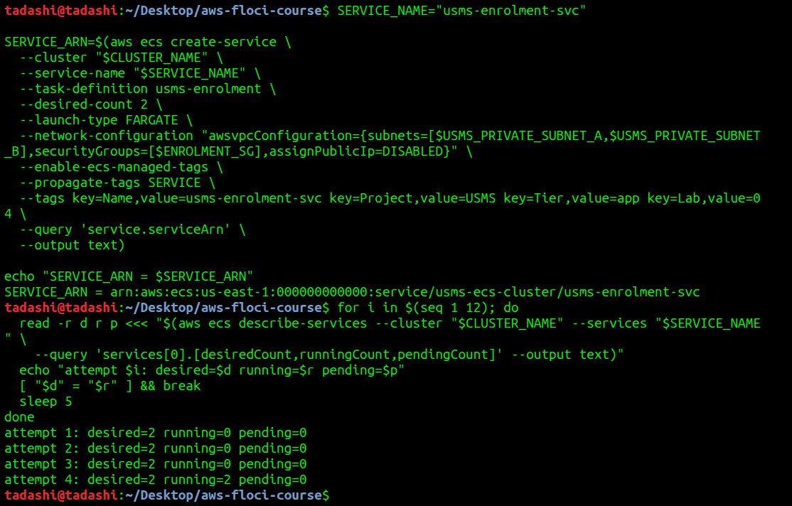

### Step 11 - Read the service back and change the desired count

**Purpose:** Learn the fields that describe a service's health: `Desired` is what I asked for, `Running` is what is actually running, `Pending` is what is starting, and `Status` is the state of the service itself. The "Your turn" task shows the service reconciling by itself.

**What I did:** Read the service back, counted its tasks and read its events. Then I set the desired count to 3, polled until it matched, set it back to 2 and polled again.

```bash
aws ecs update-service --cluster "$CLUSTER_NAME" --service "$SERVICE_NAME" --desired-count 3
aws ecs update-service --cluster "$CLUSTER_NAME" --service "$SERVICE_NAME" --desired-count 2
```

**Result:** The service is `ACTIVE`, `Desired` 2, `Running` 2, `Pending` 0, on `FARGATE`, in both private subnets, with `PublicIP` `DISABLED`. After the change to 3, `running` caught up on the third poll. After the change back to 2, the extra task was gone by the second poll. I never touched a container directly.

**Note:** Three Floci differences appeared here. `events` returned `None`, and `TaskDef` shows only the family name where real AWS returns a full ARN. In the later check in Screenshot 21, `list-tasks` counts 3 because it includes the stopped task from the scale-down, while `docker ps` confirms only two containers are running.

**Screenshot 19 - Service read back: two private subnets, no public IP (Checkpoint 4)**

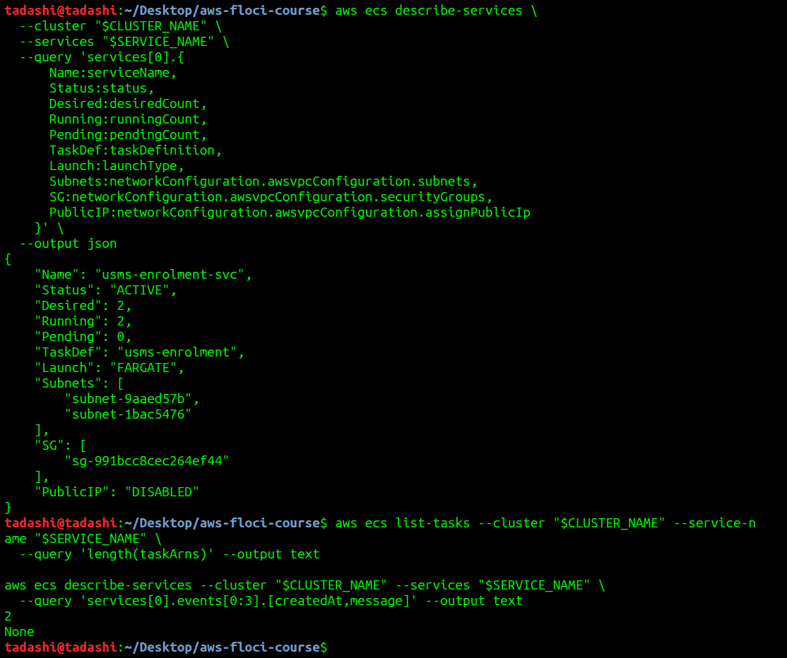

**Screenshot 20 - Desired count moved to 3 and back to 2, with running count following (Checkpoint 4)**

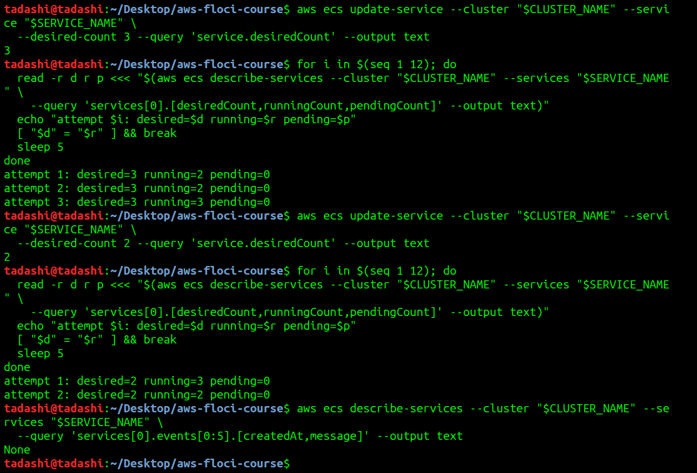

**Screenshot 21 - Later check: two running containers, although list-tasks counts 3**

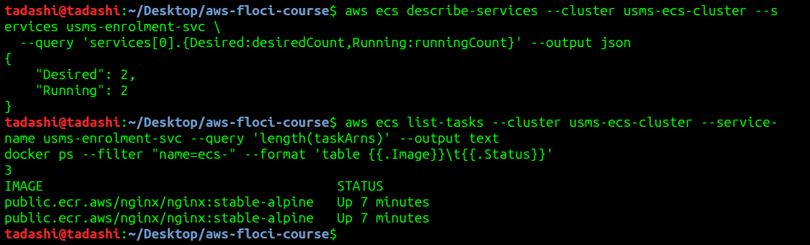

### Step 12 - Write `configs/lab-04.env`

**Purpose:** Record the names, IDs and ARNs so Labs 05 and 06 can load them. Each value is looked up live from Floci and not copied from a shell variable, so the file reflects what really exists.

**What I did:** Generated the file with a heredoc containing the lookups, checked for empty values or `None`, sourced it, and counted the exports.

```bash
grep -n 'export .*=$\|None' configs/lab-04.env || echo "all values populated"
source configs/lab-04.env
grep -c '^export' configs/lab-04.env     # 17
```

**Result:** `all values populated`, with 17 exports. The baseline desired count is 2, which Lab 06 uses as its floor.

**Screenshot 22 - Env file populated with 17 exports**

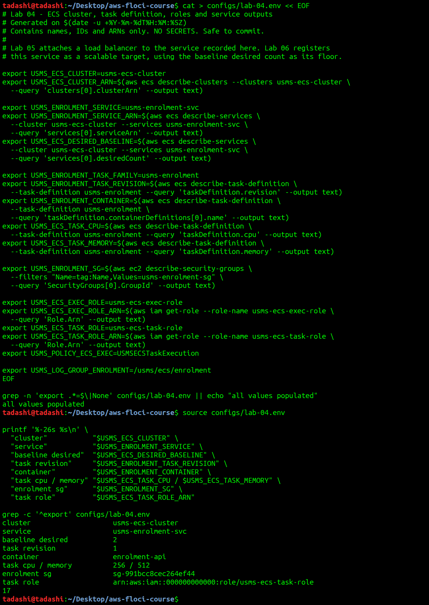

### Step 13 - Check what is safe to commit, then commit

**Purpose:** Make sure no credentials enter Git, then commit the lab's files by explicit path so nothing is added by accident. `outputs/lab-04-assumed-role.json` holds temporary credentials, so it must stay ignored.

**What I did:** Reviewed `git status`, confirmed the ignore rules and the tracked files under `outputs/`, staged each path explicitly and committed. The verification and cleanup scripts had to exist first, so I built them before this step (Screenshots 35 and 36 in Section 6.1).

```bash
git status --short
git check-ignore -v outputs/lab-04-assumed-role.json
git ls-files outputs/
```

**Result:** The assumed-role file is ignored by `.gitignore:8`, and `outputs/.gitkeep` is the only tracked file under `outputs/`. The work was committed locally as `0d91a76`.

**Note:** The lab's `git add` list includes `configs/lab-04.env`, but line 42 of `.gitignore` (`configs/*.env`) excludes it. That rule comes from an earlier decision to untrack env files, so I did not force-add it, and the file stays local. The pre-existing deletion of `templates/lab-03-run-instances-full.json` was not part of this lab and was not staged.

**Screenshot 23 - Ignore rules checked before staging**

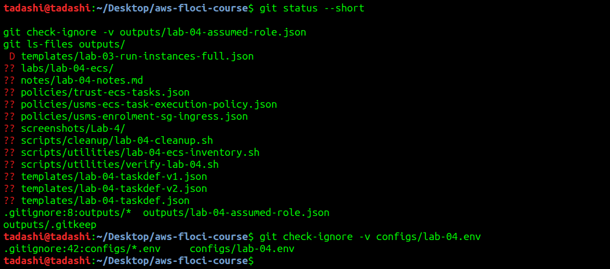

**Screenshot 24 - The commit and the files it contains (screenshots folder hidden)**

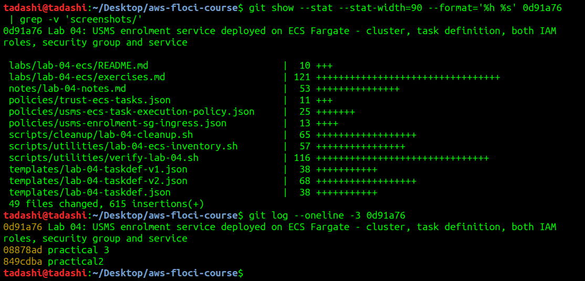

### Independent exercises

The full working, including the capacity plan and cost calculations, is in [exercises.md](exercises.md). The review questions are answered in [notes/lab-04-notes.md](../../notes/lab-04-notes.md).

#### Exercise 1 - A second service

**What I did:** Created `usms-results-svc` from the `usms-enrolment` family with a desired count of 1, in both private subnets, looking up every ID with `--query` and not typing it.

**Result:** Two `ACTIVE` Fargate services with desired counts of 2 and 1.

**Screenshot 25 - Two services in the cluster**

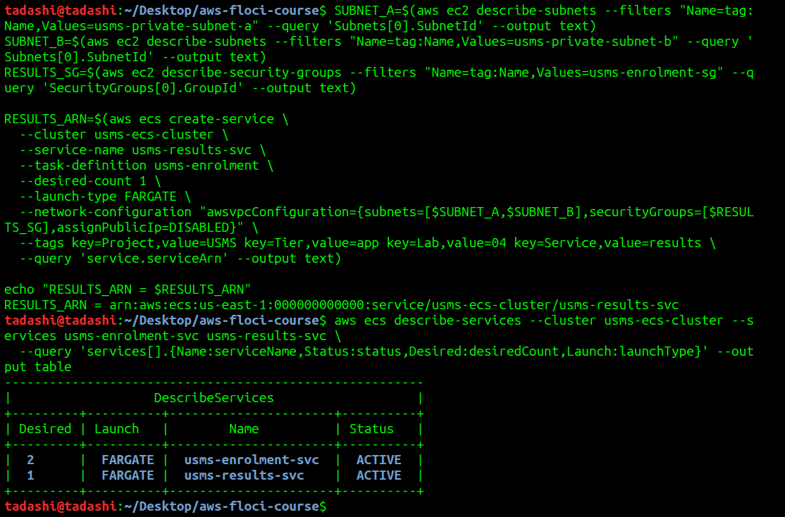

#### Exercise 2 - A new revision and a deployment

**What I did:** Generated a second template with `jq`, raising memory to 1024 MiB and adding `USMS_LOG_LEVEL=info`. I registered it and pointed the service at it. Then I forced a new deployment and polled for tasks on revision 2.

**Result:** `usms-enrolment:2` is registered, and the service's pointer moved to it. Revision 1 is unchanged and still `ACTIVE`, because a revision is immutable.

**Note:** After 18 polls, no task was running on revision 2. Both running tasks stayed on revision 1 even with `--force-new-deployment`, so Floci did not perform a rolling deployment. The tasks moved to revision 2 only after the Floci restart shown in Screenshot 41.

**Screenshot 26 - Revision 2 registered, service pointer updated, revision 1 still ACTIVE**

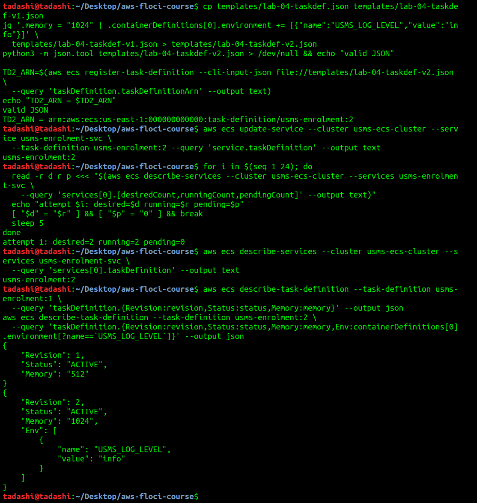

**Screenshot 27 - Forced deployment not rolled out by Floci**

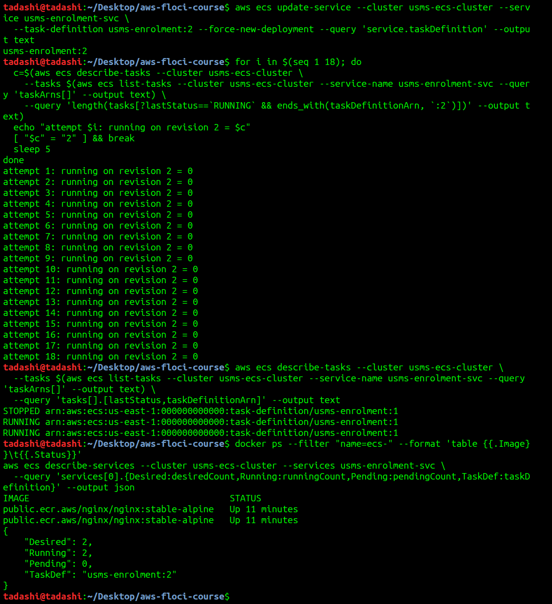

#### Exercise 3 - ECS configuration drift report

**What I did:** Wrote `scripts/utilities/lab-04-ecs-inventory.sh`, which reports each service's desired and running counts, revision, role separation and public IP setting without any hard-coded service names. I ran it from two directories to prove it does not depend on where it is started.

**Result:** Both runs were identical. Each service shows `roles=SEPARATE` and `publicip=OK`, and the same data is written to `outputs/lab-04-ecs-inventory.json`.

**Screenshot 28 - Inventory report, identical from both directories**

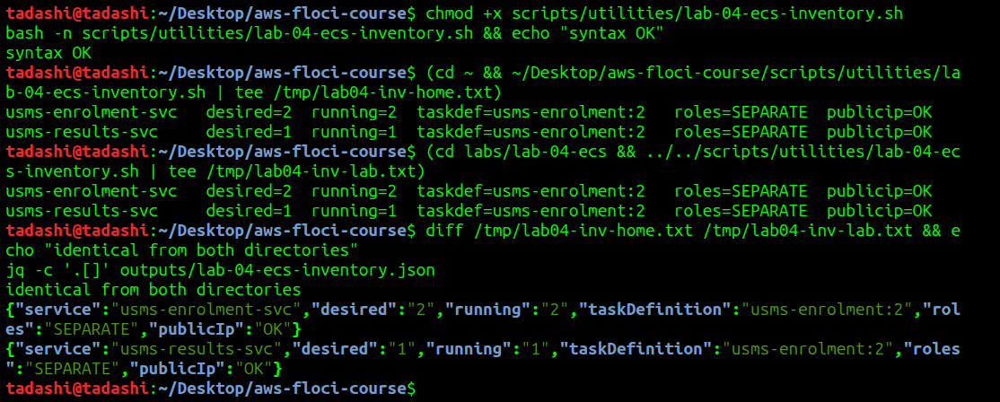

#### Exercise 4 - Enrolment week capacity plan

**What I did:** Calculated a capacity plan for Lab 06 and costed it from the AWS price list, then removed the Exercise 1 service by scaling it to 0 first and then deleting it.

**Result:** The plan is a minimum of 2 tasks, a scheduled floor of 8 from 07:45 to 08:30 on enrolment Monday, and a maximum of 12. Scheduling costs about USD 18.08 a month, compared with USD 72.08 for running 8 tasks all month. The student and request numbers are assumptions, marked as such in [exercises.md](exercises.md). After the deletion only `usms-enrolment-svc` remains, and `verify-lab-04.sh` is unchanged at `PASS=37 FAIL=1`.

**Screenshot 29 - Practice service scaled to zero and deleted**

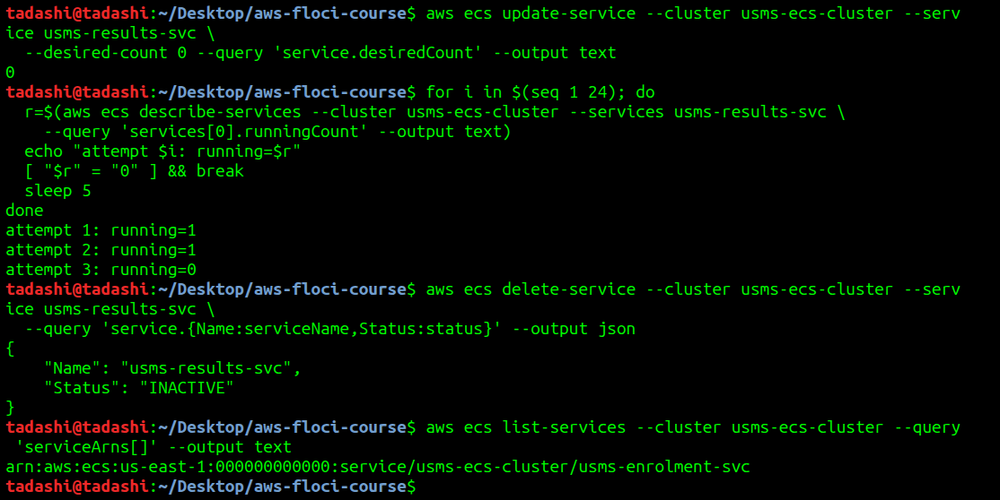

**Screenshot 30 - Verification unchanged after the deletion**

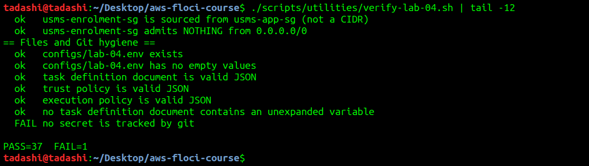

#### Exercise 5 - Close the loop back to Lab 3

**What I did:** Followed the enrolment security group's source back to an EC2 instance, compared it with Lab 3's `usms-web-01`, and confirmed the tags on both ECS resources.

**Result:** The final verdict is `LOOP CLOSED`: the source group resolves to exactly one instance, `i-9e1df4d6073ffa9d9`, which is the Lab 3 web server. Both ECS resources returned their tags.

**Problem and fix:** The first run gave `MISMATCH` because the `instance.group-id` filter returned seven instances. Printing each instance's real security groups showed that only `usms-web-01` carries `usms-app-sg`, so Floci was not applying the filter. Filtering client-side on `SecurityGroups[].GroupId` gave the correct single result.

**Screenshot 31 - First attempt: MISMATCH, seven instances returned**

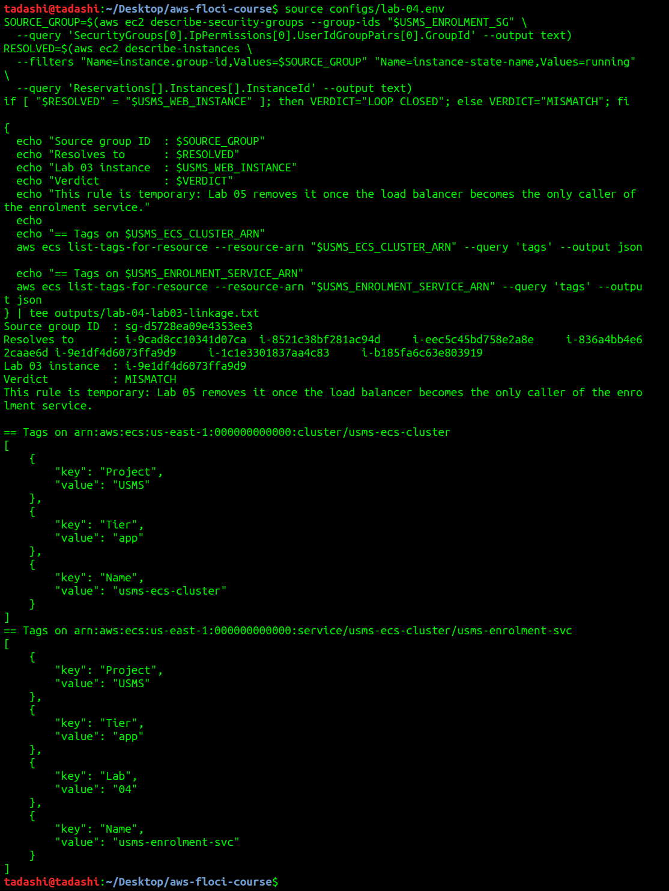

**Screenshot 32 - The seven instances returned by the filter**

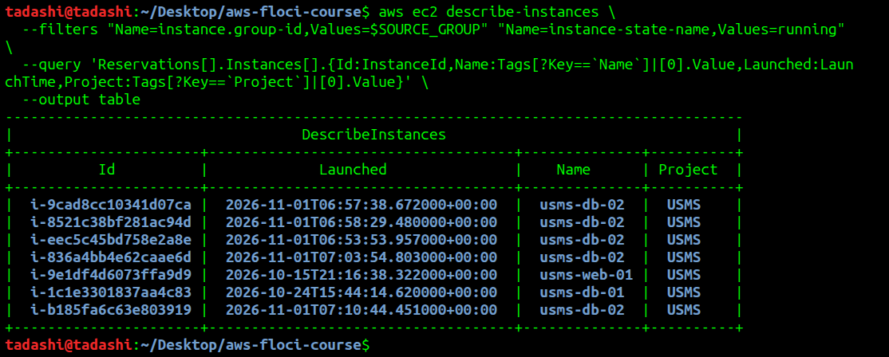

**Screenshot 33 - Each instance's real security groups: only usms-web-01 carries usms-app-sg**

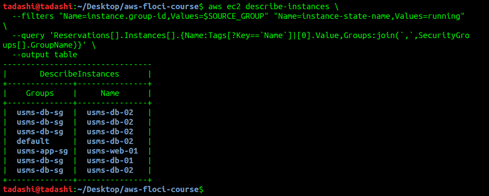

**Screenshot 34 - Client-side filter: LOOP CLOSED**

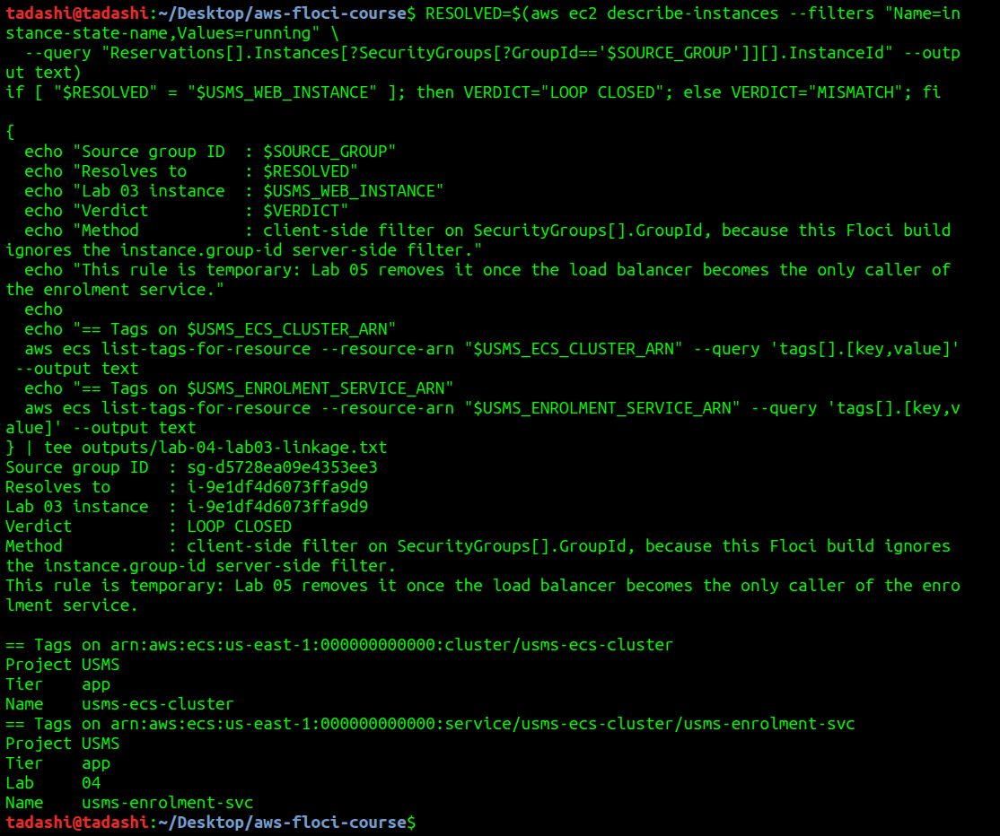

## 6. Results and Evidence

### 6.1 CLI Output

The command output for each build step is shown under that step in Section 5. This section shows the checks on the finished system.

**Lab verification script.** `verify-lab-04.sh` makes read-only checks of the environment, the earlier labs, IAM, logging, ECS, networking and Git hygiene. It reports `PASS=37 FAIL=1`, where the lab expects `PASS=38 FAIL=0`. The one failure is the false positive explained in Section 7.

**Screenshot 35 - verify-lab-04.sh (PASS=37 FAIL=1)**

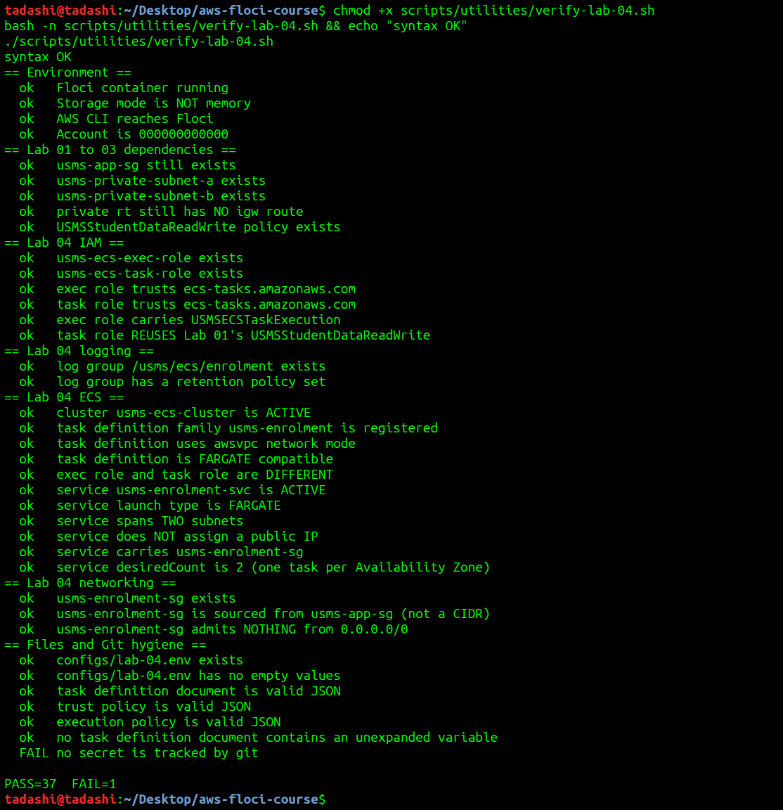

**Cleanup script.** `lab-04-cleanup.sh` is for the end of the course and must run after the Lab 05 and 06 cleanups. I only checked its syntax with `bash -n` and did not run it, because Labs 05 and 06 need these resources.

**Screenshot 36 - Cleanup script passes the syntax check and was not run**


**Storage check.** Floci is in `hybrid` mode with `/app/data` bind-mounted to `/home/tadashi/floci-data`, so state is written to disk and can survive a restart.

**Screenshot 37 - Floci storage check**

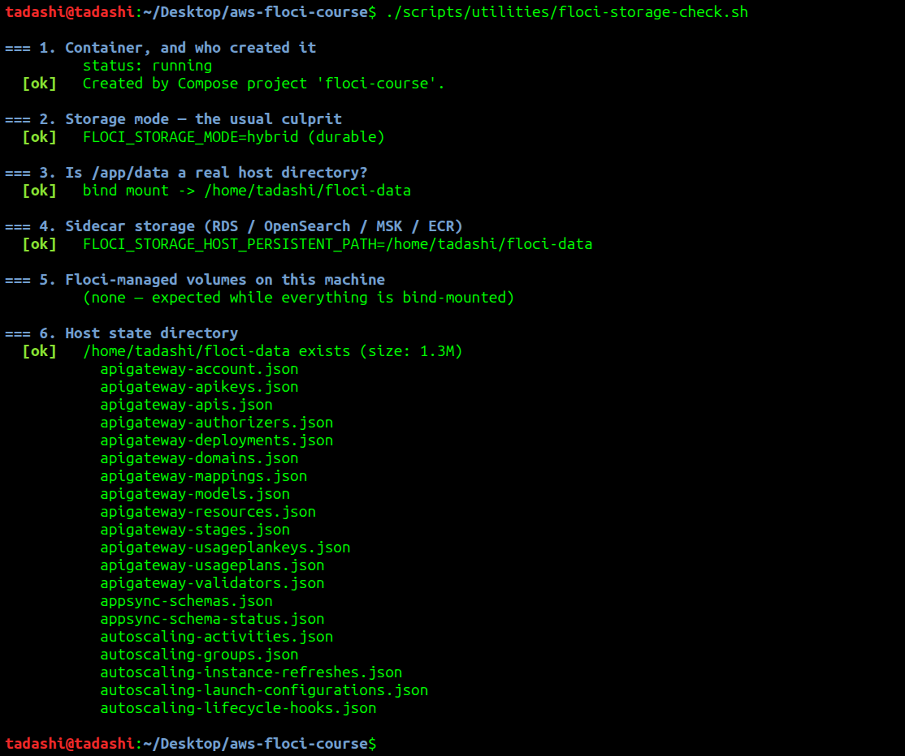

**End-of-lab backup.** `floci snapshot save` failed with HTTP 400 because the snapshot API is not available on this server version. I used the lab's fallback: stop Floci, archive the data directory, and start Floci again, which produced the 72 KB file `~/floci-data-lab-04.tar.gz`.

**Screenshot 38 - Snapshot command unavailable on this Floci server**

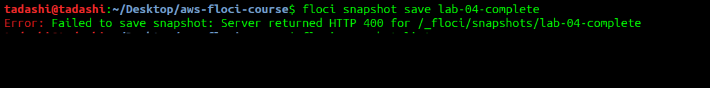

**Screenshot 39 - Filesystem fallback: Floci stopped, data archived, Floci restarted**

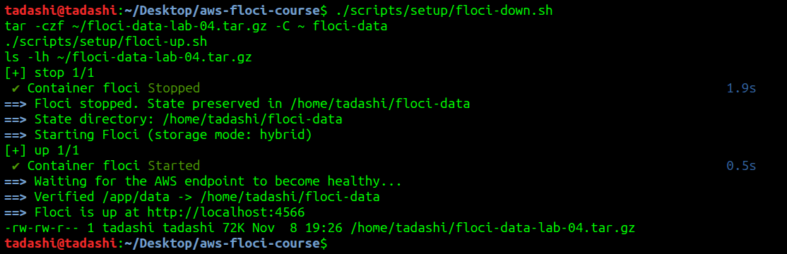

**Final readiness after the restart.** Verification is unchanged, the env file still has 17 exports, the cluster is `ACTIVE`, and the service is `ACTIVE` with `Desired` 2 and `Running` 2. This confirms that the lab's state survived a restart.

**Screenshot 40 - Final readiness after the restart: 17 exports, Desired 2, Running 2**

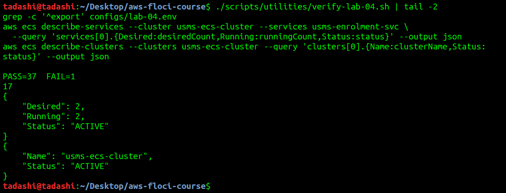

**Task revision after the restart.** Both running tasks are now on `usms-enrolment:2`, which the live deployment in Exercise 2 did not achieve.

**Screenshot 41 - After the restart both tasks run revision 2**

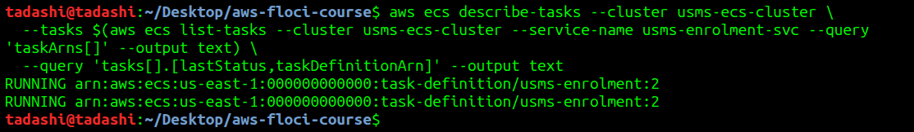

### 6.2 AWS Management Console Verification

This course runs on Floci, so there is no AWS Management Console. The Floci UI at `http://localhost:4500` is the local equivalent.

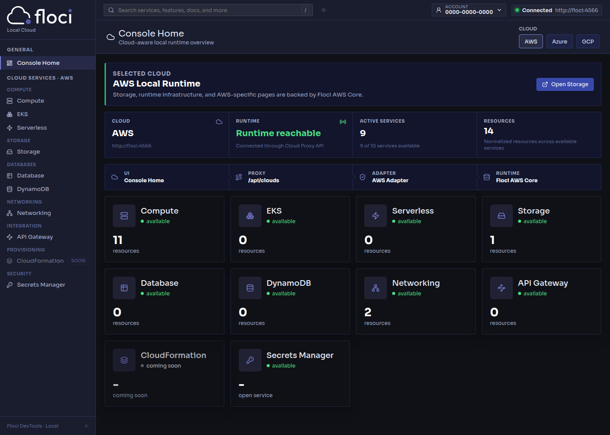

*Floci Console Home confirms the local AWS runtime is reachable under account 0000-0000-0000.*

The Floci UI has no ECS, IAM or CloudWatch pages in this version, so the cluster, service, task definition, roles and log group cannot be shown there. Their verification is the `describe` output in Section 6.1. The security group is available to the console's backend, which confirms `usms-enrolment-sg` is visible outside the CLI:

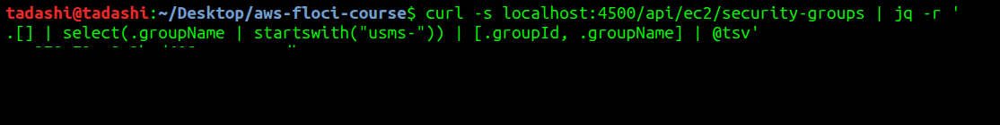

*The Floci UI's own API lists the three USMS security groups, including the one created in this lab.*

## 7. Analysis and Discussion

**What was achieved.** The enrolment service runs on ECS Fargate across two private subnets with no public IP. It uses a task definition with separate execution and task roles, and its only inbound rule references the web tier's security group. Floci started real nginx containers, so `runningCount` reached 2 and followed the manual scale to 3 and back to 2.

**Did the results match the expected outcome?** Mostly. The lab expects `PASS=38 FAIL=0` from `verify-lab-04.sh`, and I got `PASS=37 FAIL=1`. Every resource and configuration check passed. The single failure, `no secret is tracked by git`, is a false positive: the check fails on any tracked path under `outputs/`, and the only one is `outputs/.gitkeep`, which Step 13 of the lab requires to be tracked. I confirmed with `git ls-files` that no key, credential or `.env` file is tracked, and I left the instructor's script unchanged.

**Errors encountered and how they were resolved.**

| Problem | Cause | Resolution |
|---|---|---|
| `verify-lab-02.sh` gave `FAIL=15` and `verify-lab-03.sh` gave `FAIL=19` | The `floci` profile's region is `ap-south-1`, but the course resources are in `us-east-1` | Set `AWS_DEFAULT_REGION=us-east-1` for the session, without changing the shared profile |
| `NoSuchEntity` attaching the policy to the task role | `configs/lab-01.env` stores `USMS_POLICY_S3_RW` as a full ARN, so the lab's command doubled the prefix | Used `$USMS_POLICY_S3_RW` directly |
| `git add` of `configs/lab-04.env` is not possible | Line 42 of `.gitignore` ignores `configs/*.env`, a rule kept from an earlier commit that untracked env files | Left it local and did not force-add it, so the checklist item asking for it to be committed is not met |
| `floci snapshot save` failed with HTTP 400 | The snapshot API is not available on this server version | Used the lab's filesystem fallback: `~/floci-data-lab-04.tar.gz` |
| Exercise 5 first returned `MISMATCH` | Floci did not apply the `instance.group-id` filter | Filtered client-side on each instance's real groups, giving `LOOP CLOSED` |

**Observations: Floci compared with real AWS.**

| Observed in this lab | Reasoned about only |
|---|---|
| Cluster ACTIVE | Container Insights metrics |
| Task definition revisions 1 and 2, with revision 1 still ACTIVE | Fargate start latency of 20 to 60 seconds |
| Service placement across both private subnets | Task credentials from the container credentials endpoint |
| Both IAM roles and the reused policy | Security group enforcement on task traffic |
| The group-referenced inbound rule | Real cost, which Exercise 4 calculates from list prices |
| `desiredCount` changed by hand, with running containers following it | A rolling deployment that does not drop traffic |
| State surviving a Floci restart | |

Floci differed from real AWS in several ways. `Settings` came back null for Container Insights, `logConfiguration` was dropped on read-back, the assumed-role session name was replaced with `floci-session`, the service `events` list was `None`, and `list-tasks` included a STOPPED task. In Exercise 2, `update-service` moved the service's pointer to revision 2 but did not replace the running tasks, even with `--force-new-deployment`. The two tasks only came up on revision 2 after Floci was restarted, so a rolling deployment was not actually demonstrated. The restart also left one old task container running, and I left it in place.

## 8. Reflection

**What did you learn about this AWS service?** I learned that ECS is built around a very small idea: I declare a number and the service makes reality match it. The clearest moment was scaling to 3 and watching `running` catch up a few seconds later without touching a container. I also learned why there are two IAM roles. Both trust the same principal, but one is used by the platform before my code exists and the other is my code's identity.

**What challenges did you encounter?** The hardest problem looked like broken work: 34 failures across Labs 2 and 3. All of them came from one region setting in my CLI profile, so I learned to check where a command is pointed before assuming the resources are gone. A second challenge was deciding what to believe. Exercise 5's `MISMATCH` was a limitation of the filter, not of my network, and I only knew that because I printed each instance's actual groups rather than trusting the filtered list. In the same way, Exercise 2 looked successful from `describe-services` until I checked the revision each task was really running.

**How would you apply this service in a real-world cloud environment?** I would run stateless APIs such as this enrolment service on Fargate in private subnets, with one task per Availability Zone as the minimum, a load balancer as the only caller, a dedicated task role for each service, and images from a private ECR repository.

**What additional concepts or features would you like to explore?**

- Application Load Balancer integration (Lab 05)
- Application Auto Scaling with scheduled and target tracking policies (Lab 06)
- Rolling and blue/green deployments, on real AWS
- Fargate Spot and capacity providers
- ECS Exec and private ECR repositories

## 9. Conclusion

The objectives of this practical were achieved. The USMS enrolment service was deployed on ECS Fargate across two private subnets, with separated IAM roles, a group-referenced security rule and 17 recorded values for the next labs. Verification passed every check except one explained false positive, and the configuration survived a restart of the emulator. The items that could not be demonstrated on Floci are recorded above rather than assumed.

I learned the four ECS objects, the difference between the execution and task roles, and how a private task reaches a public registry. I also practised verifying what a tool reports against the underlying state. ECS matters because it turns running an application into maintaining a declared state, which is the foundation that the load balancing and auto scaling of the next two labs build on.

## 10. Appendix

**Additional Files**

- [exercises.md](exercises.md) - the five independent exercises
- [notes/lab-04-notes.md](../../notes/lab-04-notes.md) - support path, Floci limitations, review questions
- [trust-ecs-tasks.json](../../policies/trust-ecs-tasks.json)
- [usms-ecs-task-execution-policy.json](../../policies/usms-ecs-task-execution-policy.json)
- [usms-enrolment-sg-ingress.json](../../policies/usms-enrolment-sg-ingress.json)
- [lab-04-taskdef.json](../../templates/lab-04-taskdef.json), [v1](../../templates/lab-04-taskdef-v1.json), [v2](../../templates/lab-04-taskdef-v2.json)
- [verify-lab-04.sh](../../scripts/utilities/verify-lab-04.sh)
- [lab-04-ecs-inventory.sh](../../scripts/utilities/lab-04-ecs-inventory.sh)
- [lab-04-cleanup.sh](../../scripts/cleanup/lab-04-cleanup.sh) - not run, end of course only
- `configs/lab-04.env` and `outputs/lab-04-lab03-linkage.txt` - kept locally because the repository's `.gitignore` excludes them

**Sources:** [Lab 04 instructions](https://norbutlepcha25.github.io/dso303/Lab/Lab-04-ECS.html), [Report format](https://norbutlepcha25.github.io/dso303/Lab/overview.html), [AWS Price List API for ECS, us-east-1](https://pricing.us-east-1.amazonaws.com/offers/v1.0/aws/AmazonECS/current/us-east-1/index.json).
