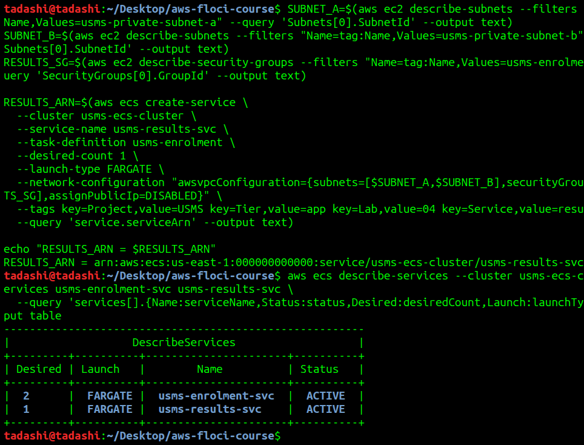
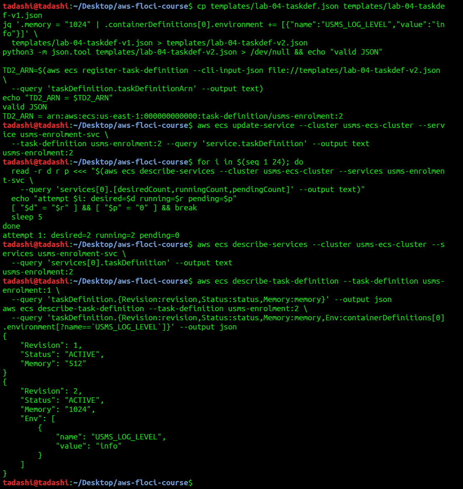
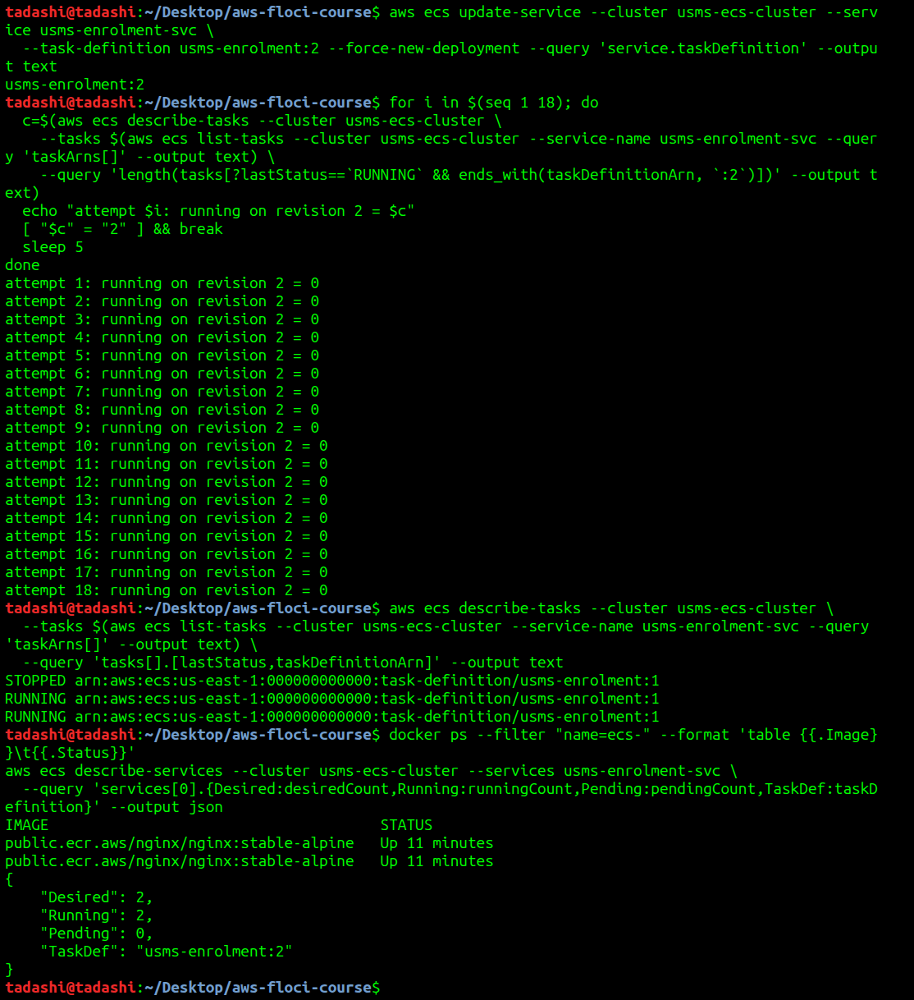
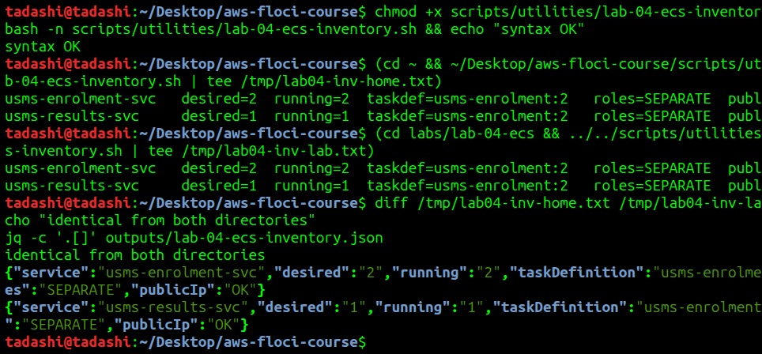
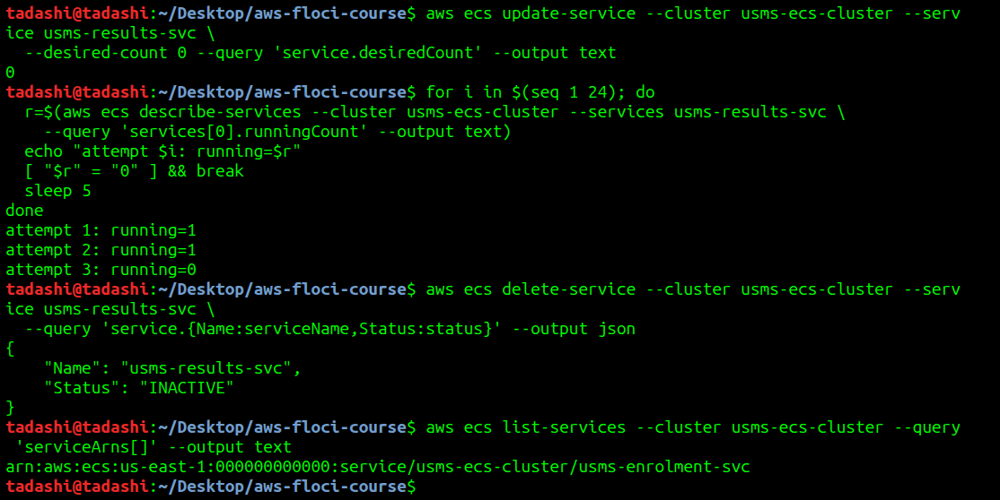
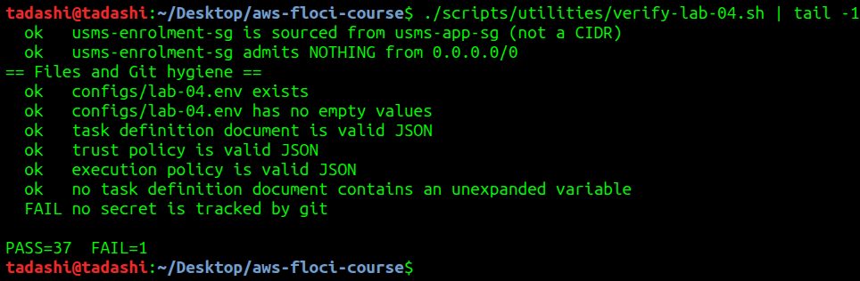
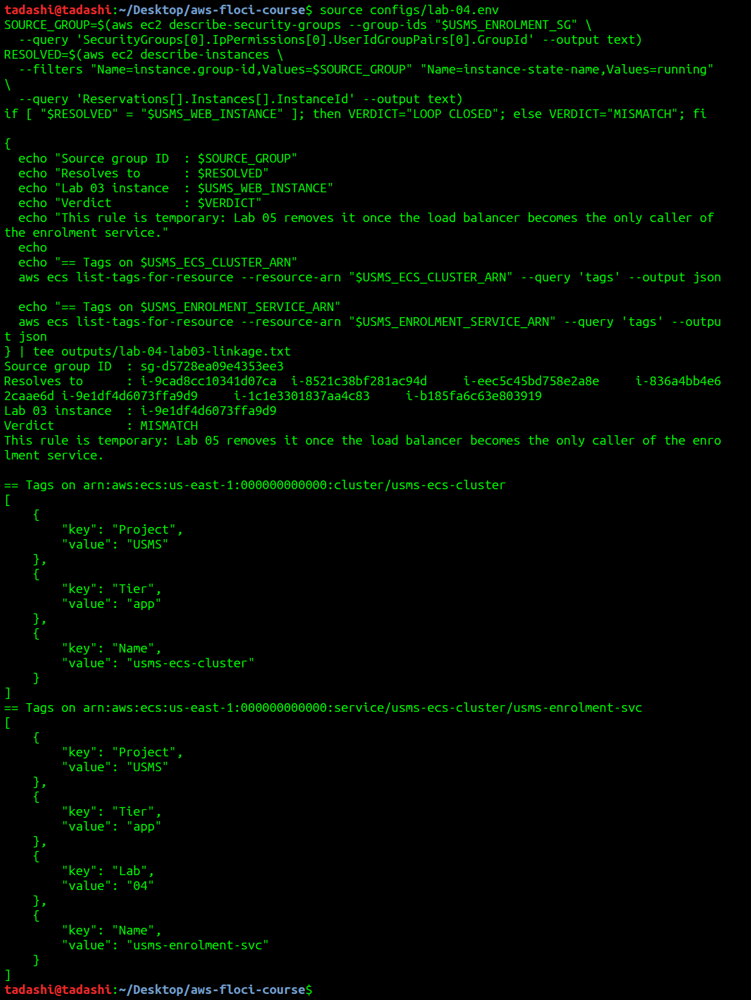
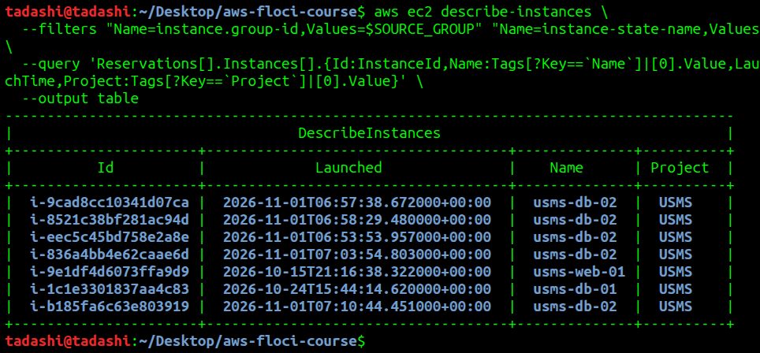
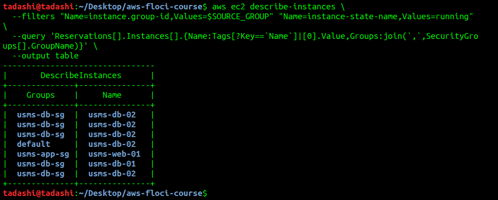
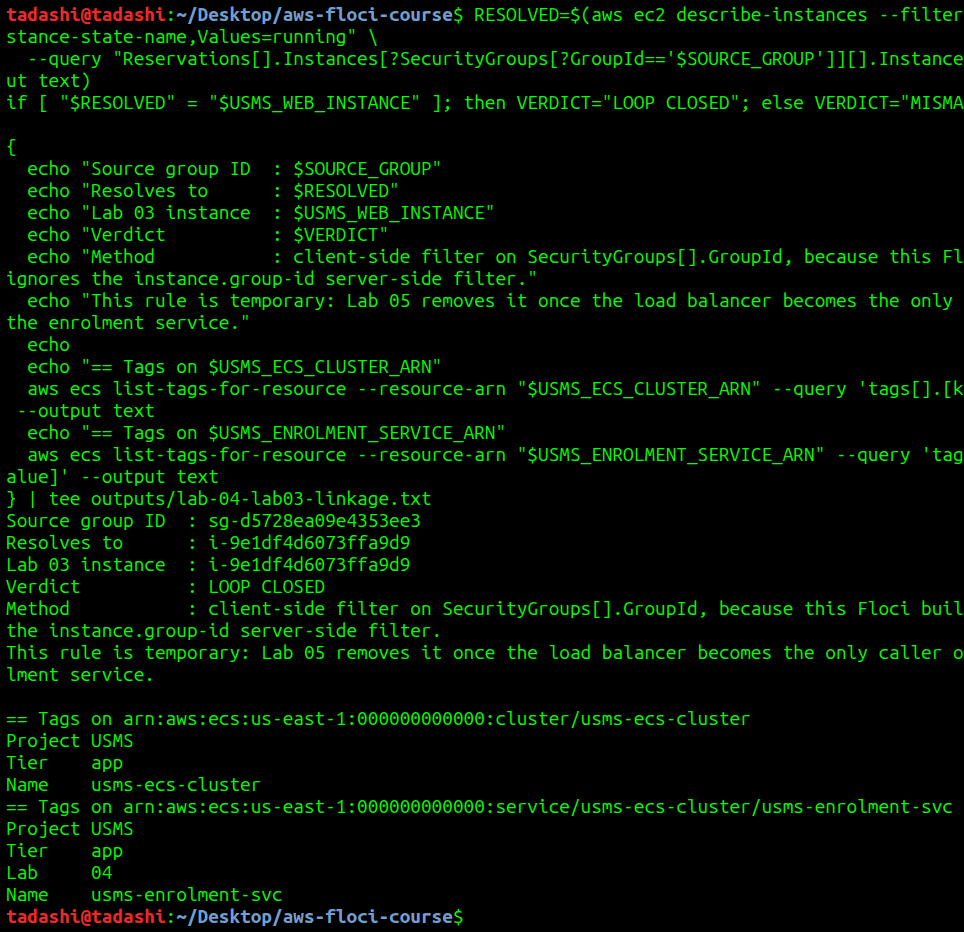

# Lab 04 - Independent Lab Exercises

Commands were run from the repository root with `AWS_DEFAULT_REGION=us-east-1` set in the shell (see notes/lab-04-notes.md).

## Exercise 1 - Basic: a second service, deployed

Created `usms-results-svc` in `usms-ecs-cluster` from the `usms-enrolment` family with a desired count of 1, in both private subnets, carrying `usms-enrolment-sg`. Every ID was captured with `$(...)` and `--query`, and the service is tagged `Project=USMS`, `Tier=app`, `Lab=04`, `Service=results`. It was deliberately not recorded in `configs/lab-04.env`.



**Outcome:** two ACTIVE services with different names and different desired counts.

## Exercise 2 - Intermediate: a new revision, and a deployment that does not drop traffic

Copied the template that produced revision 1 to `templates/lab-04-taskdef-v1.json`, and generated `templates/lab-04-taskdef-v2.json` from it with memory raised from 512 to 1024 MiB and `USMS_LOG_LEVEL=info` added. Registered `usms-enrolment:2`, updated `usms-enrolment-svc` to it, and polled until stable with the Step 10 loop rather than a fixed sleep.



**In one sentence:** the service's `taskDefinition` pointer changes to `usms-enrolment:2`, while revision 1 itself does not change and stays ACTIVE and describable because a revision is immutable.

**Floci limitation observed:** the running tasks were not replaced. `describe-tasks` still reports the two RUNNING tasks on revision 1, even after `--force-new-deployment`, and the two containers kept their original uptime. On real AWS the deployment circuit would start new tasks on revision 2 and drain the old ones while keeping the service at capacity. So the pointer change was observed here, but a rolling replacement was not.



## Exercise 3 - Problem solving: an ECS configuration drift report

Wrote `scripts/utilities/lab-04-ecs-inventory.sh`. It lists services from the cluster with no hard-coded names, computes the verdicts from `executionRoleArn`, `taskRoleArn` and `assignPublicIp`, and prints `publicip=N/A` when a service has no network configuration. It resolves `configs/` from `${BASH_SOURCE[0]}`, and uses `set -uo pipefail` without `-e` (the reason is in a comment in the script). The same data is written to `outputs/lab-04-ecs-inventory.json`.



**Outcome:** output is identical from `~` and from `labs/lab-04-ecs/`. Note that the `taskdef` column shows `:2` for `usms-results-svc` too, because that service was created from the family name and Floci resolves a bare family to the latest revision.

## Exercise 4 - Challenge: the enrolment week capacity plan

### Why a fixed desiredCount of 2 cannot answer the 08:03 problem

`usms-enrolment-svc` reads no metric and no clock. The service controller only keeps `runningCount` equal to `desiredCount`, so its capacity changes only when a person runs `update-service`. Traffic that arrives at 08:00 meets exactly the two tasks that were running at 03:00 on a Sunday.

### Traffic derivation

The figures below are planning assumptions, marked as such, and should be replaced by the Registrar's enrolment numbers and a load test before Lab 06 encodes them.

| Quantity | Value | Source or derivation |
|---|---|---|
| Students enrolling | 4,000 | **Assumption**, to be confirmed by the Registrar |
| API calls per student | 10 | **Assumption**: login, module list, about 8 register/confirm calls |
| Requests in the week | 40,000 | 4,000 x 10 |
| Requests in the first 20 minutes | 36,000 | 90 percent of the week, from the project lead's brief |
| Average rate in that window | 30 req/s | 36,000 / 1,200 s |
| Peak rate | 90 req/s | 3 x average, **assumption** for the 08:00 to 08:03 spike the brief describes |
| Capacity of one 256/512 task | 25 req/s | The lab's worked figure, to be load tested |

### Proposed plan for Lab 06 to encode

| Setting | Tasks | Derivation | Cost of too high | Cost of too low |
|---|---|---|---|---|
| Minimum | 2 | One task per Availability Zone, so one AZ can fail | Paying for idle tasks every hour of the year | A single AZ failure takes the service down |
| Scheduled floor, Monday 07:45 to 08:30 | 8 | 90 / 25 = 3.6, rounded to 4 tasks, and 4 in each AZ so either AZ alone can carry the peak | A small, short-lived cost for 45 minutes | A repeat of the 08:03 outage, because scaling reactively takes longer than the spike |
| Maximum | 12 | Floor of 8 plus 50 percent headroom (100 req/s extra), since the student count is an assumption | A runaway policy could spend more before anyone notices | Real demand above the estimate is refused during the window |

The floor starts at 07:45 because Fargate tasks take 20 to 60 seconds to start (Section 11), and 15 minutes leaves time to notice a failed image pull. The team building the policies should aim for the scheduled floor to absorb the known spike, with target tracking handling only what the estimate missed.

### Monthly cost comparison

Prices are from the AWS Price List API, `AmazonECS/current/us-east-1/index.json`, publication date 2026-10-19 (https://pricing.us-east-1.amazonaws.com/offers/v1.0/aws/AmazonECS/current/us-east-1/index.json): **USD 0.04048 per vCPU-hour** and **USD 0.004445 per GB-hour** (Linux/x86, us-east-1).

One 256 CPU / 512 MiB task costs 0.25 x 0.04048 + 0.5 x 0.004445 = USD 0.0123425 per hour, which is USD 9.01 for a 730-hour month.

| Option | Calculation | USD per month |
|---|---|---|
| Fixed at today's 2 tasks | 2 x 9.01 | 18.02 |
| Fixed at the proposed peak of 8 tasks | 8 x 9.01 | 72.08 |
| 2 tasks, plus 6 extra for 45 minutes on one enrolment Monday | 18.02 + (6 x 0.75 h x 0.0123425) | 18.08 |

Scheduling costs USD 0.06 more than today in an enrolment month and USD 54.00 less than running the peak all month. At revision 2's 1024 MiB a task costs USD 0.014565 per hour (USD 10.63 per month), which gives USD 21.26 for 2 tasks and USD 85.06 for 8. These figures cover Fargate only and exclude the NAT gateway, data transfer and logs. My USD 18.02 is higher than the roughly USD 15 quoted in Section 11 of the lab; the calculation above uses the current list price.

### What to switch off

> **DANGER**
> **What will be deleted:** the ECS service `usms-results-svc` and its one task.
> **What depends on it:** nothing. It was Exercise 1 practice and is not in `configs/lab-04.env`.
> **Reversible?** Yes, by repeating Exercise 1.
> **Effect on later labs:** none. `usms-enrolment-svc` is untouched.

```bash
aws ecs update-service --cluster usms-ecs-cluster --service usms-results-svc --desired-count 0
```

> **DANGER**
> **What will be deleted:** the `usms-results-svc` service definition, now at zero tasks.
> **What depends on it:** nothing, and scaling to zero first means no task is killed without draining.
> **Reversible?** Yes, by repeating Exercise 1.
> **Effect on later labs:** none.

```bash
aws ecs delete-service --cluster usms-ecs-cluster --service usms-results-svc
```



Afterwards `verify-lab-04.sh` reports `PASS=37 FAIL=1`, unchanged from before the deletion. The one failure is the false positive explained in the report: the check flags `outputs/.gitkeep`, the only tracked file under `outputs/`, and no secret is tracked.



## Exercise 5 - Integration: close the loop back to Lab 3, and hand Lab 05 what it needs

The server-side filter from the exercise, `Name=instance.group-id`, returned **seven** running instances, including instances that carry `usms-db-sg` and `default`. That first run wrote `MISMATCH`.





I did not treat that as the answer. Printing each returned instance's real security groups showed that only `usms-web-01` carries `usms-app-sg`, so this Floci build is not applying the `instance.group-id` filter.



Filtering client-side on `SecurityGroups[].GroupId` resolves the source group to exactly one instance, which matches `$USMS_WEB_INSTANCE` from `configs/lab-03.env`, so the verdict is **LOOP CLOSED**. Both ECS ARNs returned their tags from `list-tags-for-resource`, so nothing needed fixing with `tag-resource`.



The result is in `outputs/lab-04-lab03-linkage.txt`. The exercise calls this a committed file, but `outputs/*` is git-ignored by the course's own rule, so it stays local and its content is reproduced in the screenshot above.

The output also showed five running `usms-db-02` instances, launched on 2026-11-01 during Lab 3 Exercise 2. They do not affect this lab and were left alone.
