# Lab 05: Application Load Balancer

## 1. Aim / Objective

The aim of this practical is to give the USMS enrolment service from Lab 04 a stable name, by placing it behind an internet-facing Application Load Balancer (ALB) in the public subnets built in Lab 2.

The objectives are:

1. Create `usms-enrolment-alb` across two Availability Zones, with its own security group.
2. Create a target group of type `ip` with a deliberate health check and deregistration delay, a listener with a default action, and one listener rule.
3. Attach the existing ECS service to the target group, then cut over so the load balancer is the only thing that can reach the tasks.
4. Prove the configuration survives a restart, and record its ARNs in `configs/lab-05.env` for Lab 06.

## 2. Introduction

Elastic Load Balancing is the AWS service that distributes incoming traffic across a group of targets, and the Application Load Balancer is its layer 7 type, which understands HTTP requests. Its purpose is to give clients one stable address while the servers behind it change. Its key features are listeners that receive connections on a port, rules that route by path or header, target groups that hold the targets and their health check, and connection draining when a target is removed. It matters in cloud computing because containers and instances have temporary addresses, and a load balancer lets them be replaced, scaled and spread across Availability Zones without clients noticing. Typical applications are public websites, APIs, and microservices that share one hostname.

### Key Features

- Listeners, with exactly one default action each
- Listener rules, evaluated by priority, with forward, redirect and fixed-response actions
- Target groups with their own health check settings
- `ip` target type for `awsvpc` tasks
- Deregistration delay, so in-flight requests can finish
- Security groups on the load balancer itself

## 3. Use Case

The USMS enrolment API is the service the student portal calls when a student registers for a module. Lab 04's tasks have private, temporary addresses and no name. Putting them behind a load balancer gives the portal one name to call, keeps the tasks private, and removes a failed task from the traffic path automatically.

Application Load Balancers are commonly used for:

| Use case | Why an ALB fits |
|---|---|
| University or business web applications | One public entry point across two or more Availability Zones |
| Microservices | Path rules such as `/enrolment` and `/results` send requests to different services under one hostname |
| Zero-downtime deployments | Health checks gate new tasks, and old tasks drain before stopping |
| HTTPS termination | A free ACM certificate on the listener, with plain HTTP to private targets |

## 4. System Architecture / Design

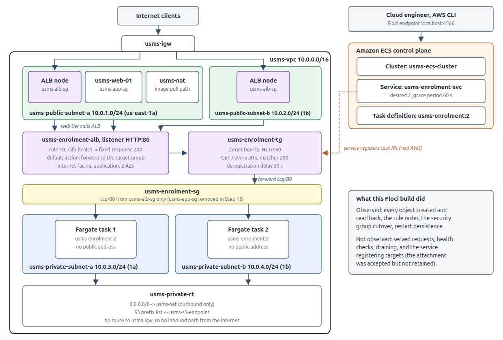

*Clients reach the load balancer nodes in the public subnets through the internet gateway. The listener applies its rule, then forwards to the target group, and `usms-enrolment-sg` admits traffic to the private Fargate tasks only from the load balancer's security group. The dashed arrow is the service registering its tasks, which this Floci build did not perform. Source: own diagram of the resources built in this lab.*

## 5. Implementation Procedure

All commands were run from the repository root (`~/Desktop/aws-floci-course`) in one terminal session. Each step below records why it was done, what was done, what the output showed, and the screenshot of that output. Long flags are shortened in the code blocks; the screenshots show each command in full.

### Preparation - Lab folder and tools

**Purpose:** Create the lab's folder and confirm the tools it needs are installed.

**What I did:** Created `labs/lab-05-ecs-alb`, checked for `jq`, `python3`, `docker` and `curl`, and printed the AWS CLI and Floci versions.

```bash
mkdir -p labs/lab-05-ecs-alb
for t in jq python3 docker curl; do command -v "$t" || echo MISSING; done
floci version
```

**Result:** All four tools were found. The Floci server is version 1.7.0, and `AWS_PROFILE` is `floci`.

**Screenshot 1 - Lab folder created and tools confirmed**

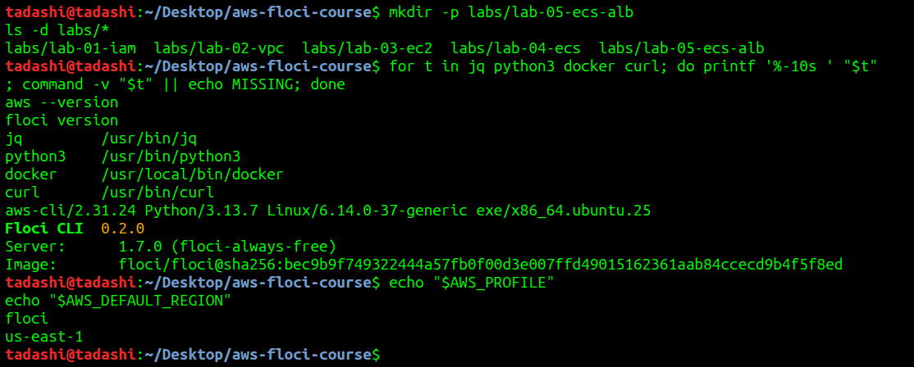

### Step 1 - Resume the environment and load five env files

**Purpose:** Start Floci and load the values recorded by Labs 1 to 4. This lab depends on the VPC, both public subnets, the service and its security group.

**What I did:** Set the course region for the session, started Floci, sourced the five env files, confirmed my identity, and printed twelve required values.

```bash
export AWS_DEFAULT_REGION=us-east-1
./scripts/setup/floci-up.sh
source configs/course.env; source configs/lab-01.env; source configs/lab-02.env
source configs/lab-03.env; source configs/lab-04.env
./scripts/utilities/whoami.sh
```

**Result:** The identity is `arn:aws:iam::000000000000:root`, confirming the commands go to Floci. All twelve values are present, including both public subnets, `subnet-5a73aa05` and `subnet-0e3dee51`, which are the values this lab most often finds missing.

**Note:** The `floci` profile's region is `ap-south-1`, while the course resources are in `us-east-1`. Lab 04 found this mismatch, so I set `AWS_DEFAULT_REGION` for this session without changing the profile.

**Screenshot 2 - Floci running, identity confirmed, twelve values present**

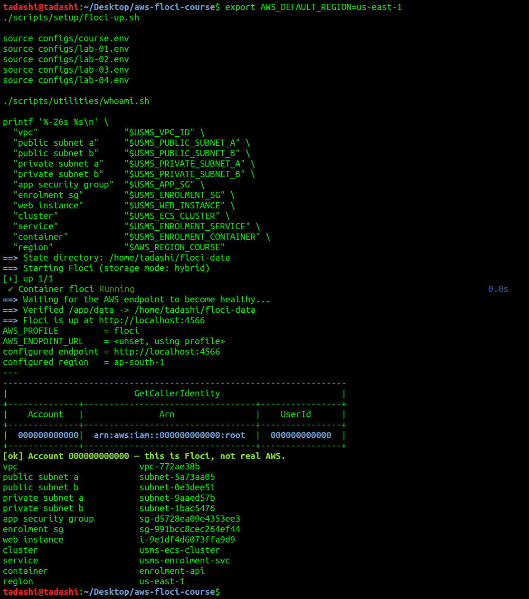

### Step 2 - Confirm Labs 2, 3 and 04 are still intact

**Purpose:** This lab changes Lab 04's security group and service, so I confirmed the earlier work was intact first. Saving Lab 04's result also gives a "before" to compare with after the cutover.

**What I did:** Ran the three verification scripts, saved Lab 04's output to `outputs/lab-05-pre-verify-04.txt`, and checked that the public subnets are in two Availability Zones.

```bash
./scripts/utilities/verify-lab-04.sh | tee outputs/lab-05-pre-verify-04.txt | tail -3
aws ec2 describe-subnets --subnet-ids "$USMS_PUBLIC_SUBNET_A" "$USMS_PUBLIC_SUBNET_B"
```

**Result:** Lab 2 reports `PASS=32 FAIL=1`, Lab 3 `PASS=36 FAIL=0`, and Lab 4 `PASS=37 FAIL=1`. The public subnets are in `us-east-1a` and `us-east-1b`.

**Note:** The lab asks for `FAIL=0` from all three. The failure in Labs 2 and 4 is the `no secret is tracked by git` check, which flags `outputs/.gitkeep`, the only tracked file under `outputs/`. It is a false positive and not a missing resource. The lab page also quotes 49 checks for Lab 04, while the script in this repository has 38.

**Screenshot 3 - Earlier labs verified, public subnets in two Availability Zones**

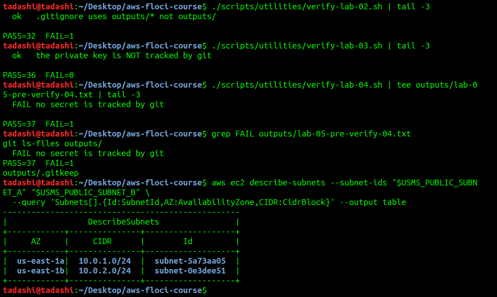

### Step 3 - Probe what this Floci build supports

**Purpose:** ELBv2 is the least reliably emulated service in the course, so I found out what this build supports before creating anything.

**What I did:** Ran the lab's `probe()` function against the ELBv2, ECS and EC2 calls used later.

```bash
probe "elbv2 describe-load-balancers" "aws elbv2 describe-load-balancers"
probe "elbv2 describe-listeners (bad arn)" "aws elbv2 describe-listeners --load-balancer-arn probe"
```

**Result:** All ten lines print `SUPPORTED`. Later steps showed the true position is **Path B, control plane only**: objects are created and read back, but no target ever registers and no request is served. I recorded this at the top of `notes/lab-05-notes.md`.

**Note:** The bad-ARN probe returned an empty listener list, where real AWS returns a `ValidationError`.

**Screenshot 4 - Floci support probe**

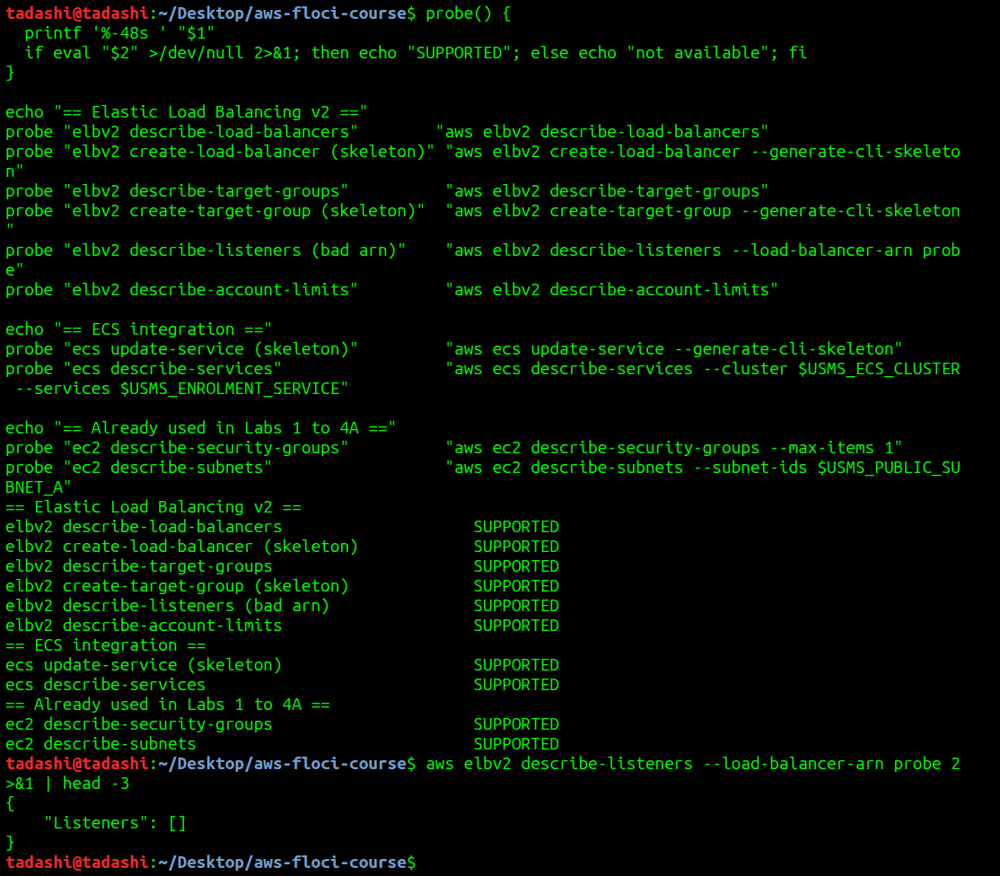

### Step 4 - Create the load balancer's security group

**Purpose:** The load balancer is its own tier, so it gets its own security group. It is the only thing the internet may reach and, after Step 13, the only thing that may reach the tasks.

**What I did:** Created `usms-alb-sg` in the Lab 2 VPC and applied the inbound rule from a JSON file written with a quoted heredoc, because the document has no variables to expand.

```bash
aws ec2 authorize-security-group-ingress --group-id "$ALB_SG" \
  --ip-permissions file://policies/usms-alb-sg-ingress.json
```

**Result:** `usms-alb-sg` is `sg-bc87928808b5cb948`, with one inbound rule, tcp/80 from `0.0.0.0/0`, and the default outbound rule. This is the only `0.0.0.0/0` ingress rule in the course, and it is deliberate.

**Screenshot 5 - usms-alb-sg created with tcp/80 from the internet**

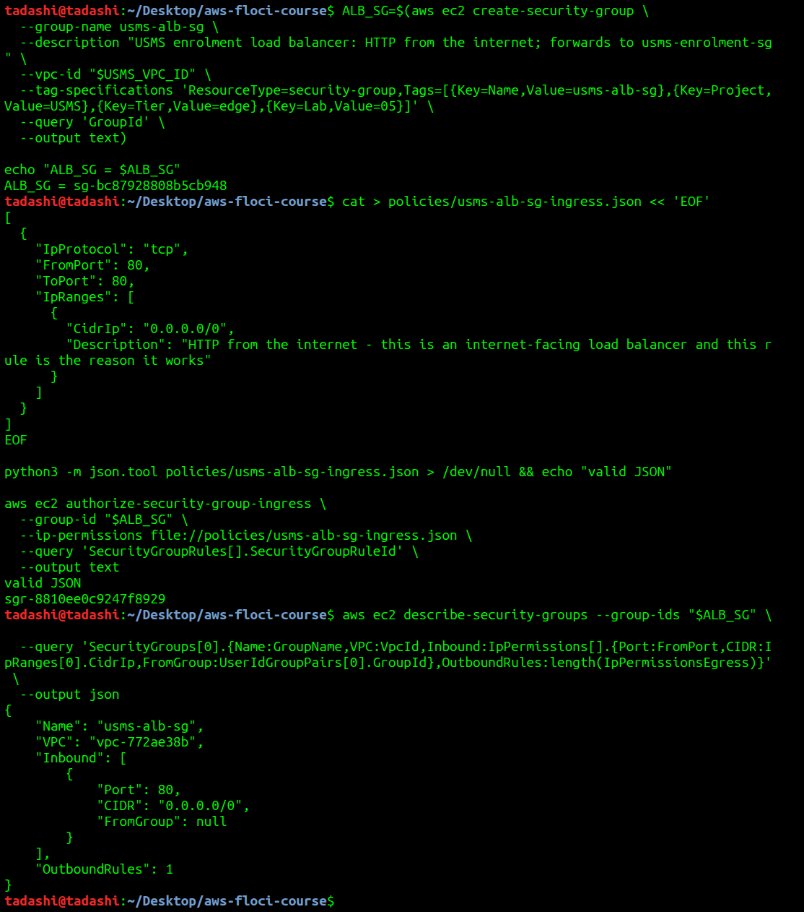

**Your turn - HTTPS rule:** I added a tcp/443 rule from a second JSON document, so the group now shows ports 80 and 443. This opens the port but makes nothing listen on it: HTTPS still needs an HTTPS listener and a certificate. My answer is in the notes.

**Screenshot 6 - Your turn: ports 80 and 443 open**

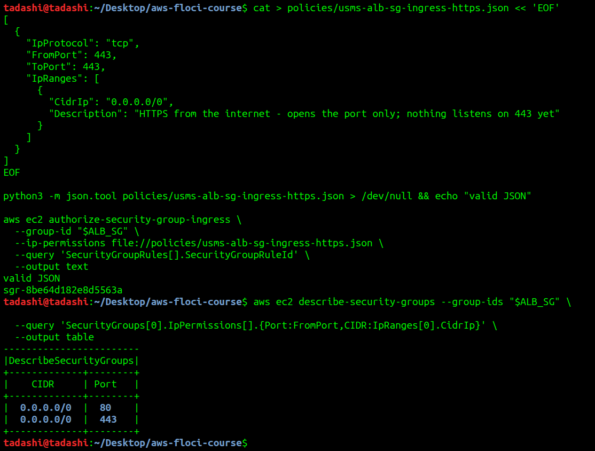

### Step 5 - Create the Application Load Balancer

**Purpose:** Create the stable name. `internet-facing` gives the nodes public addresses, and a load balancer must have subnets in at least two Availability Zones.

**What I did:** Created the load balancer in both public subnets, waited for it to become active, and read it back.

```bash
aws elbv2 create-load-balancer --name usms-enrolment-alb --type application \
  --scheme internet-facing --ip-address-type ipv4 \
  --subnets "$USMS_PUBLIC_SUBNET_A" "$USMS_PUBLIC_SUBNET_B" --security-groups "$ALB_SG"
aws elbv2 wait load-balancer-available --load-balancer-arns "$ALB_ARN"
```

**Result:** The ALB is `active`, `internet-facing`, type `application`, in `us-east-1a` and `us-east-1b`, and carries `usms-alb-sg`. Its DNS name is `usms-enrolment-alb-d296feaef42f4915.elb.floci`.

**Note:** Real AWS takes two to four minutes to provision; on Floci the state was active on the first poll.

**Screenshot 7 - Load balancer created and active in two Availability Zones (Checkpoint 2)**

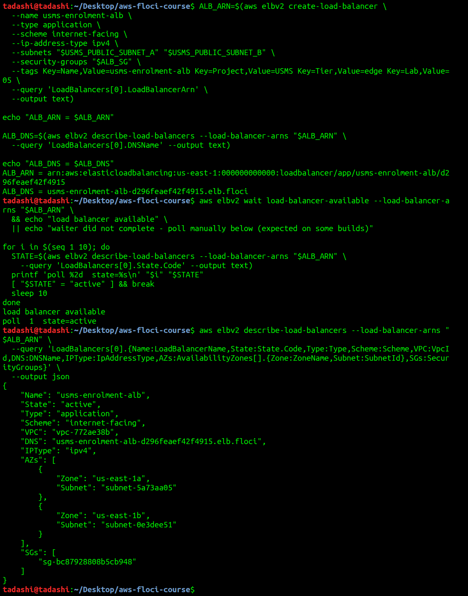

I then set two load balancer attributes: a 60-second idle timeout, and dropping invalid header fields, which is off by default and should be on for anything new. Both were returned as set.

**Screenshot 8 - Load balancer attributes set**

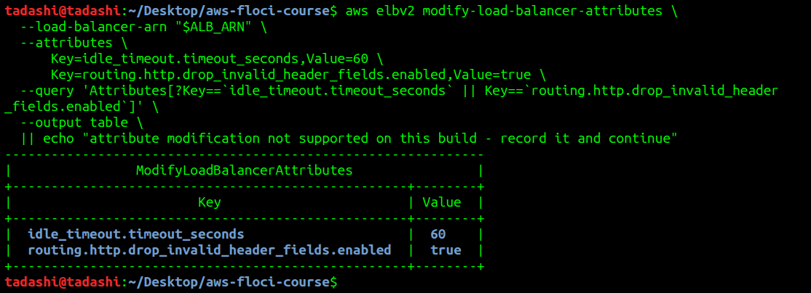

### Step 6 - Create the target group

**Purpose:** The target group holds the targets and the health check that decides which of them receive traffic. Fargate tasks use `awsvpc` and have no instance ID, so `--target-type ip` is mandatory.

**What I did:** Created `usms-enrolment-tg`, read back every health check setting, and confirmed it was empty.

```bash
aws elbv2 create-target-group --name usms-enrolment-tg --protocol HTTP --port 80 \
  --vpc-id "$USMS_VPC_ID" --target-type ip --health-check-path / \
  --health-check-interval-seconds 30 --health-check-timeout-seconds 5 \
  --healthy-threshold-count 2 --unhealthy-threshold-count 2 --matcher HttpCode=200
```

**Result:** The type is `ip`, HTTP on port 80, health check `/` every 30 seconds with a 5-second timeout, thresholds of 2 and matcher 200. `LBs` is 0 and the target list is `[]`, both correct at this point. With these numbers a dead task keeps receiving requests for up to 60 seconds (30 x 2).

**Screenshot 9 - Target group created and empty**

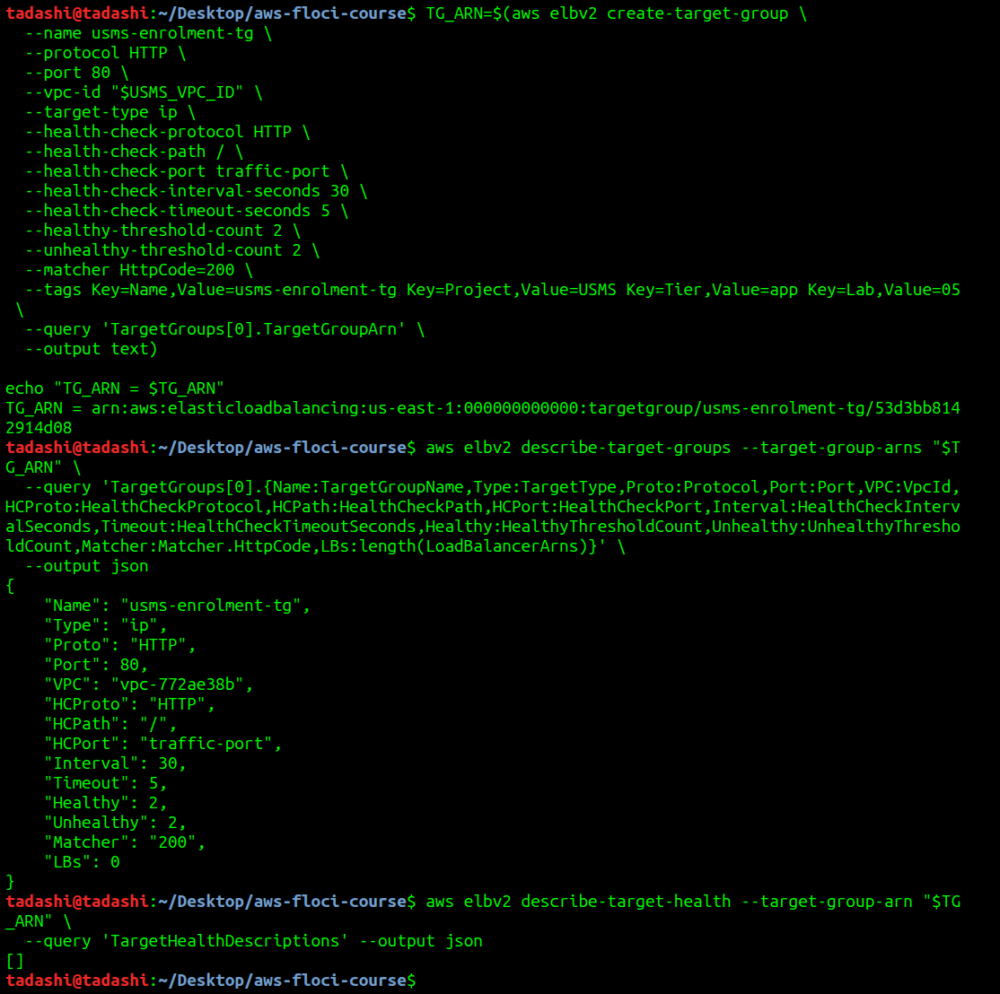

**Your turn - matcher:** I widened the matcher to `200-399`, read it back, then restored it to `200`. Both changes took effect immediately, which shows the matcher is not part of the target group's identity.

**Screenshot 10 - Your turn: matcher changed and restored**

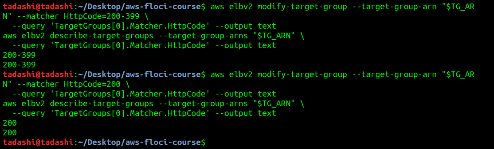

### Step 7 - Set the target group attributes

**Purpose:** `deregistration_delay.timeout_seconds` decides how long in-flight requests get when ECS stops a task. The default of 300 seconds is far too long for a fast API.

**What I did:** Set the delay to 30 seconds and the algorithm to `least_outstanding_requests`, which routes around a slow but healthy target.

```bash
aws elbv2 modify-target-group-attributes --target-group-arn "$TG_ARN" --attributes \
  Key=deregistration_delay.timeout_seconds,Value=30 \
  Key=load_balancing.algorithm.type,Value=least_outstanding_requests
```

**Result:** Both values were stored and read back. Floci returned only the two attributes I set, where real AWS returns the full list.

**Screenshot 11 - Deregistration delay and algorithm set**

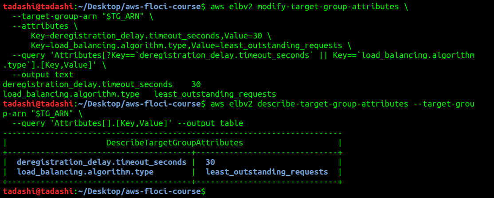

### Step 8 - Create the listener

**Purpose:** A listener is the port clients connect to. Without one the load balancer answers nothing. It has exactly one default action.

**What I did:** Wrote the default action as JSON with an unquoted heredoc so `$TG_ARN` expanded, confirmed no `$` remained, created the listener and read it back.

```bash
aws elbv2 create-listener --load-balancer-arn "$ALB_ARN" --protocol HTTP --port 80 \
  --default-actions file://templates/lab-05-listener-default-actions.json
```

**Result:** A listener on HTTP:80 forwards to `usms-enrolment-tg`, and the target group now reports one attached load balancer, up from 0.

**Note:** `SSL` read back as an empty string, where the lab expects `null`. An HTTP listener has no TLS policy in either case.

**Screenshot 12 - Listener created, target group attached to one load balancer (Checkpoint 3)**

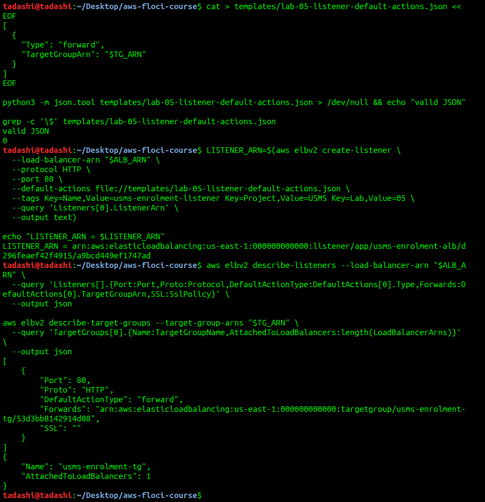

### Step 9 - Let the load balancer reach the tasks

**Purpose:** `usms-enrolment-sg` admitted only `usms-app-sg`. Without a rule for the load balancer, every target would fail its health check while looking healthy to ECS.

**What I did:** Wrote the rule with an unquoted heredoc so `$ALB_SG` expanded, applied it, and read back the group's sources.

```bash
aws ec2 authorize-security-group-ingress --group-id "$USMS_ENROLMENT_SG" \
  --ip-permissions file://policies/usms-enrolment-sg-ingress-alb.json
```

**Result:** Port 80 now has two sources, `usms-app-sg` and `usms-alb-sg`, with no CIDR. Having both is intended: build the new path, prove it, then remove the old one.

**Note:** Real AWS merges the two sources into one permission. Floci lists them as two.

**Screenshot 13 - Both source groups present on port 80**

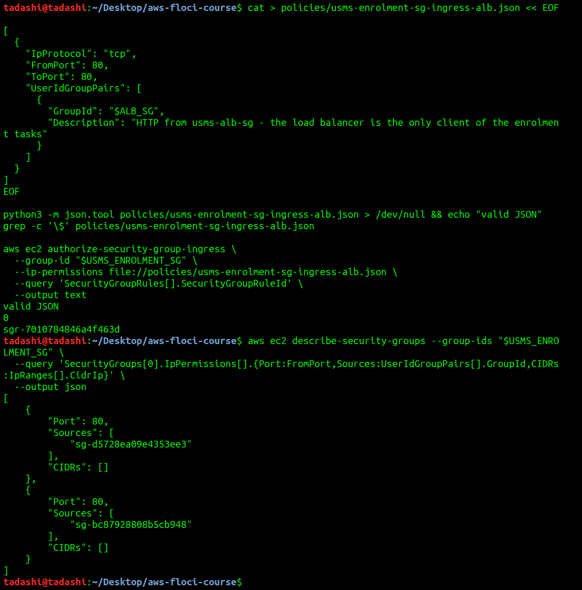

### Step 10 - Attach the existing service to the target group

**Purpose:** After this step the service should register every task it starts and deregister every task it stops. The grace period stops ECS from replacing a task that is still starting.

**What I did:** Wrote the three-field `loadBalancers` document, confirmed `containerName` was `enrolment-api`, and updated the service.

```bash
aws ecs update-service --cluster "$USMS_ECS_CLUSTER" --service "$USMS_ENROLMENT_SERVICE" \
  --load-balancers file://templates/lab-05-service-load-balancers.json \
  --health-check-grace-period-seconds 60
```

**Result:** The call was accepted, but `LB` and `Grace` came back `null`, both in the response and from `describe-services`.

**Why I did not use the lab's fallback:** The lab's delete-and-recreate path applies only if the call is rejected, and it was not. The course's Known Issues page lists this exact behaviour for Lab 05, and tells students not to rebuild to work around an emulator gap. Deleting a working service would have gained nothing, so I recorded the limitation and used the Known Issues alternative, shown in Section 6.1.

**Screenshot 14 - Attachment accepted but loadBalancers and grace period read back null**

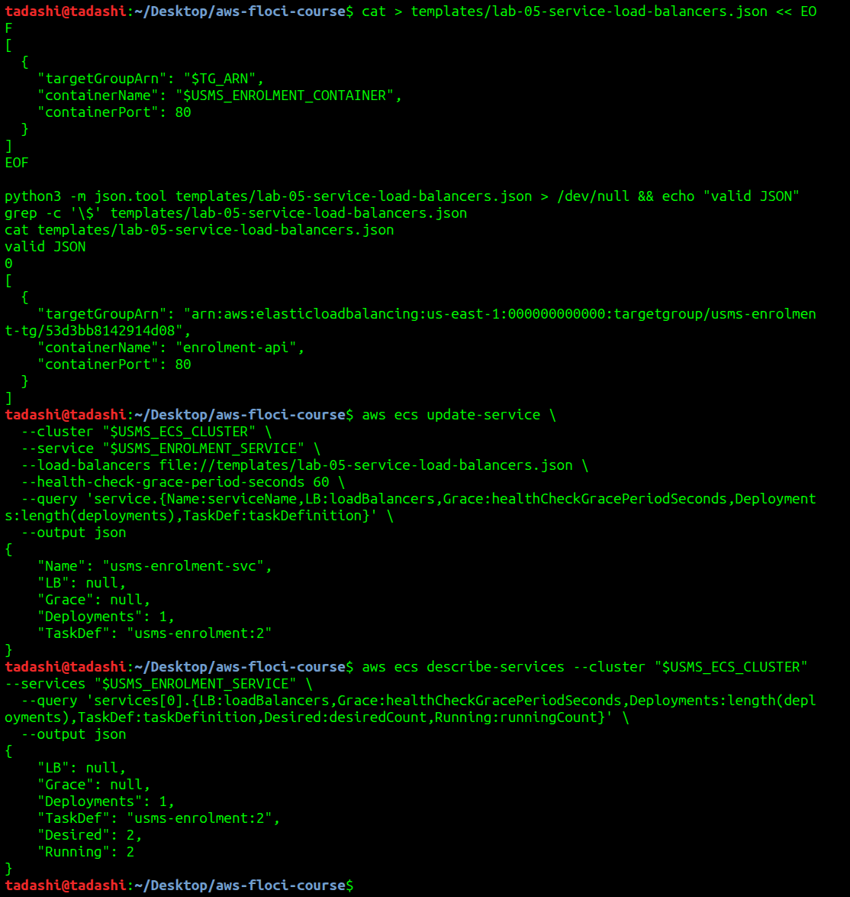

### Step 11 - Watch the targets register, and read target health

**Purpose:** Show that the service, not the engineer, fills the target group, and compare ECS's view of each task's health with the load balancer's.

**What I did:** Polled target health 12 times, read the service's own account, and printed both health views side by side.

```bash
aws elbv2 describe-target-health --target-group-arn "$TG_ARN" \
  --query 'TargetHealthDescriptions[].{Target:Target.Id,State:TargetHealth.State}' --output table
```

**Result:** All 12 polls were empty. This is a direct result of Step 10: the service has no attachment, so it registers nothing.

**Screenshot 15 - Target group stays empty across 12 polls**

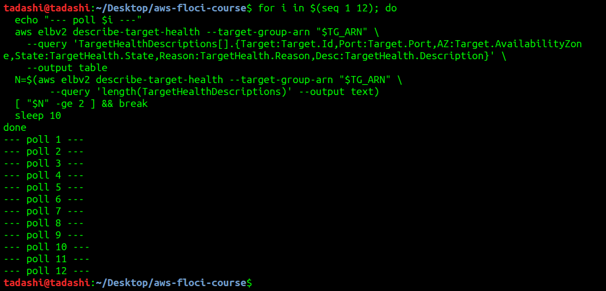

The service is `ACTIVE` with `Desired` 2, `Running` 2 and one deployment, with `LB` null and `events` `None`. In the side-by-side view, both tasks are `RUNNING`, their `healthStatus` and IP read `None`, and the target count is 0. So I could not observe the ECS-versus-target health comparison on this build; the diagnosis table is in my notes as reasoning.

**Screenshot 16 - Service state and the two health views (Checkpoint 4)**

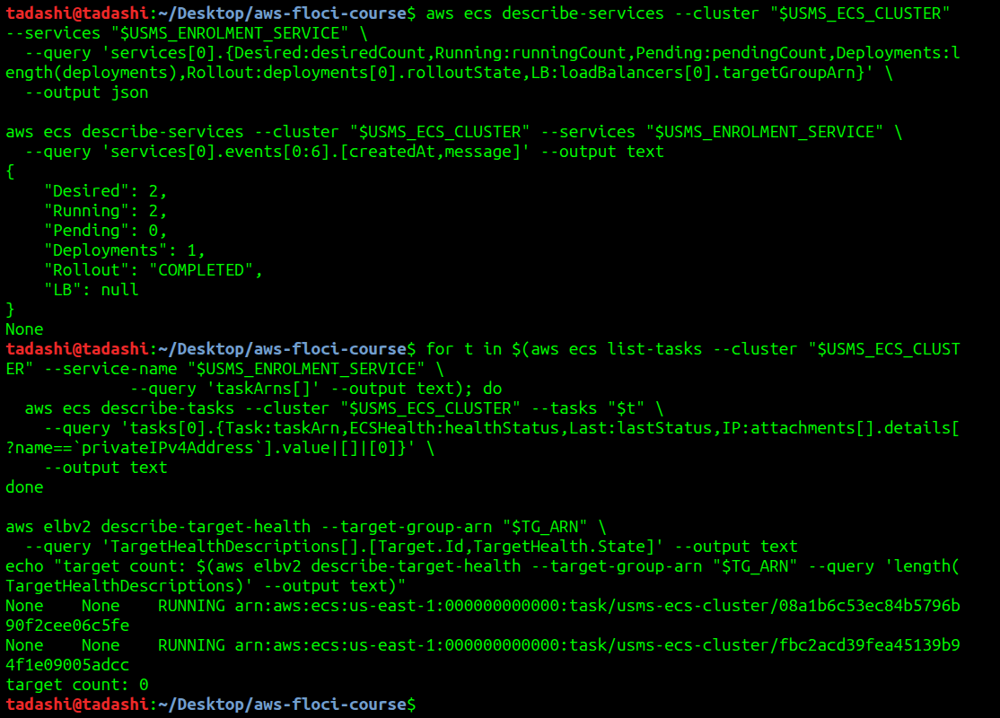

**Your turn - scale to 3 and back:** The running count followed the desired count to 3 and back to 2, but `targets` stayed 0 throughout. The scaling is real, but I did not see self-registration.

**Screenshot 17 - Your turn: running count follows, targets stay 0**

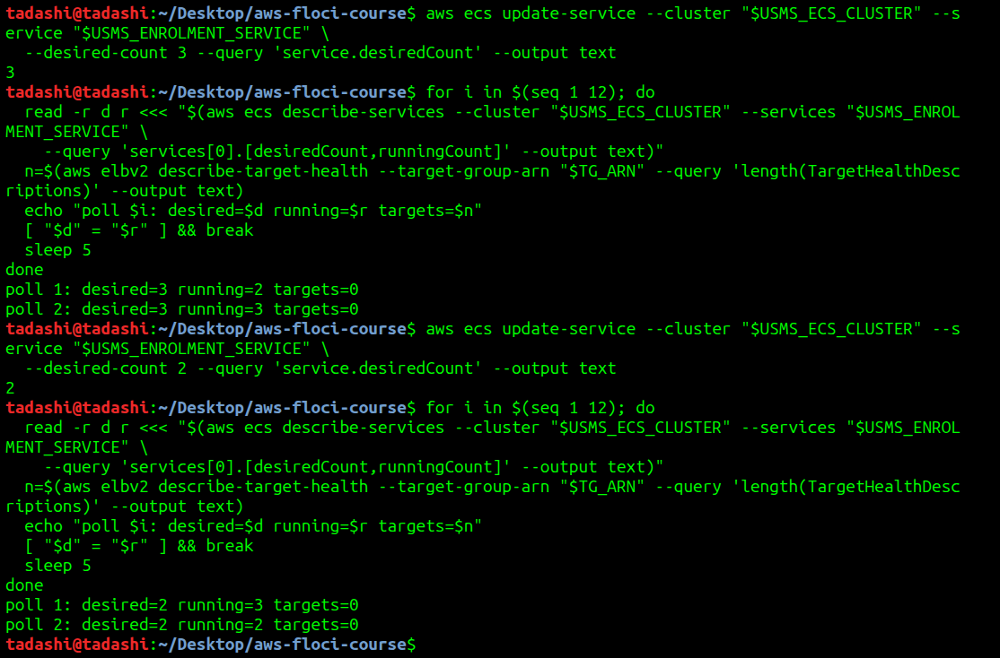

### Step 12 - Prove the path, and say which proof I got

**Purpose:** A command that appears to succeed is not proof. The lab asks me to try a real request first, then record which proof I actually obtained.

**What I did:** Tried to resolve the DNS name and send a request to it.

```bash
getent hosts "$ALB_DNS"
curl -s -o /dev/null -w 'http_code=%{http_code}\n' --max-time 10 "http://$ALB_DNS/"
```

**Result:** The name does not resolve and `curl` could not connect (`http_code=000`). **I did not observe a served request**, so the proof below is control plane only.

**Screenshot 18 - Data path unavailable on this build**

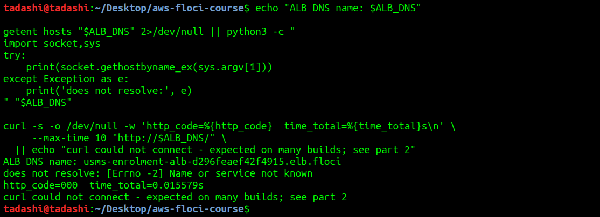

The control-plane proof walks the chain and is saved in `outputs/lab-05-path-proof.txt`. Block 1 shows the listener forwarding to the target group, block 2 shows the target group, and block 5 shows `usms-alb-sg` as a permitted source. Block 3 is empty and block 4 reads `None`, so the chain is **not complete on this build**: the link between the target group and the service is missing. The lab says to state this rather than claim the whole chain.

**Screenshot 19 - Control-plane proof, with blocks 3 and 4 empty**

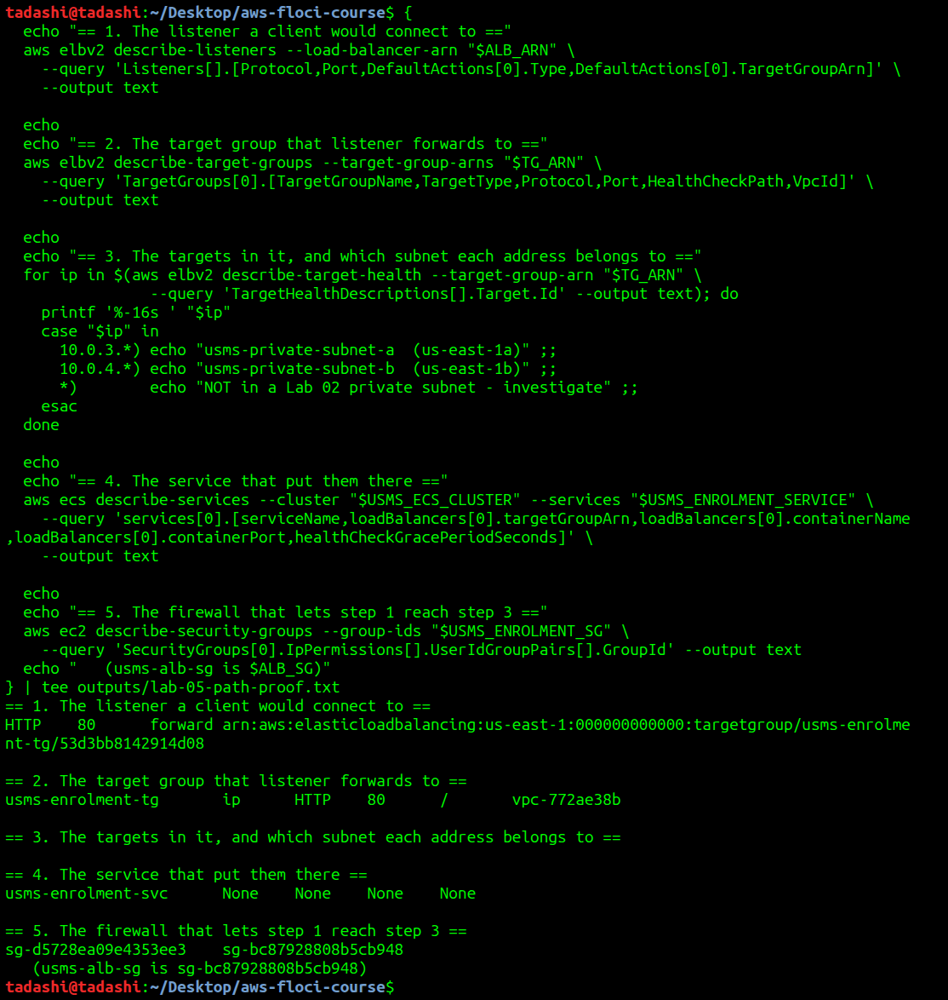

### Step 13 - The cutover: remove the direct path

**Purpose:** A migration that leaves the old path in place is a system with two behaviours, one untested. This step removes the direct rule from the web tier, so only the load balancer can reach the tasks.

**What I did:** Listed the group's rules, found the one sourced from `usms-app-sg`, and revoked it by ID.

```bash
OLD_RULE_ID=$(aws ec2 describe-security-group-rules \
  --filters "Name=group-id,Values=$USMS_ENROLMENT_SG" \
  --query "SecurityGroupRules[?IsEgress==\`false\` && ReferencedGroupInfo.GroupId=='$USMS_APP_SG'].SecurityGroupRuleId | [0]" --output text)
aws ec2 revoke-security-group-ingress --group-id "$USMS_ENROLMENT_SG" --security-group-rule-ids "$OLD_RULE_ID"
```

**Result:** The query correctly found `sgr-8c8cb13c0c7bb1156`.

**Screenshot 20 - The exact rule found before removing it**

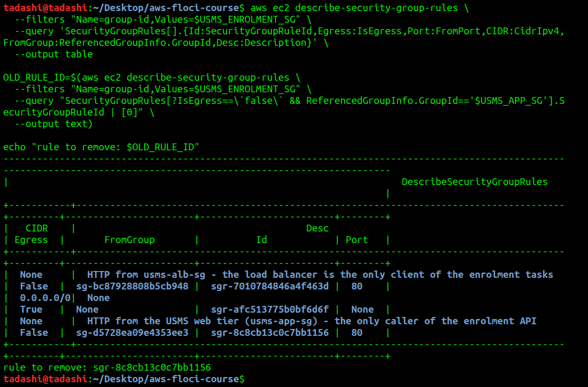

**Problem:** The revoke returned `True`, but the read-back still listed `usms-app-sg` as a source. A write that does not read back did not happen. Lab 04's script confirmed it, with no change in its result.

**Screenshot 21 - Revoke by rule ID returned True and removed nothing**

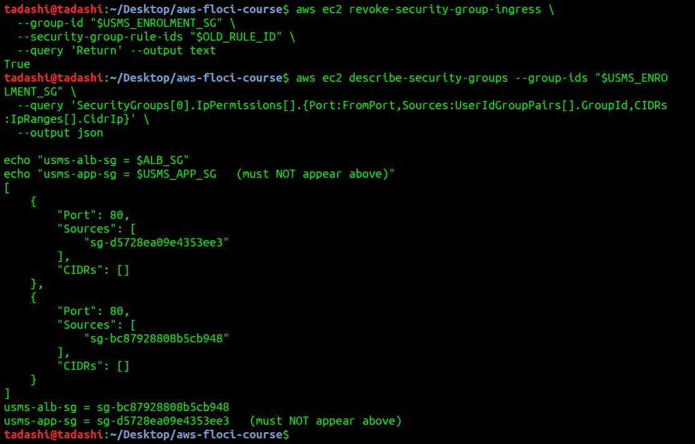

**Screenshot 22 - Lab 04's script unchanged, confirming the rule was still there**

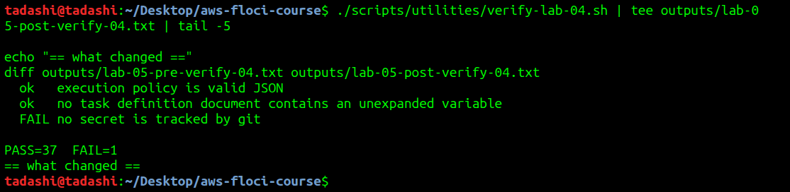

**Fix:** I removed the same rule by restating the permission from Lab 04's own policy file. This time the read-back shows `usms-alb-sg` as the only source.

```bash
aws ec2 revoke-security-group-ingress --group-id "$USMS_ENROLMENT_SG" \
  --ip-permissions file://policies/usms-enrolment-sg-ingress.json
```

**Note:** `describe-security-group-rules` still lists the old rule ID, while `describe-security-groups` no longer shows it. The two views disagree on Floci; the verification scripts read the second.

**Screenshot 23 - Revoked by permission: usms-alb-sg is the only source**

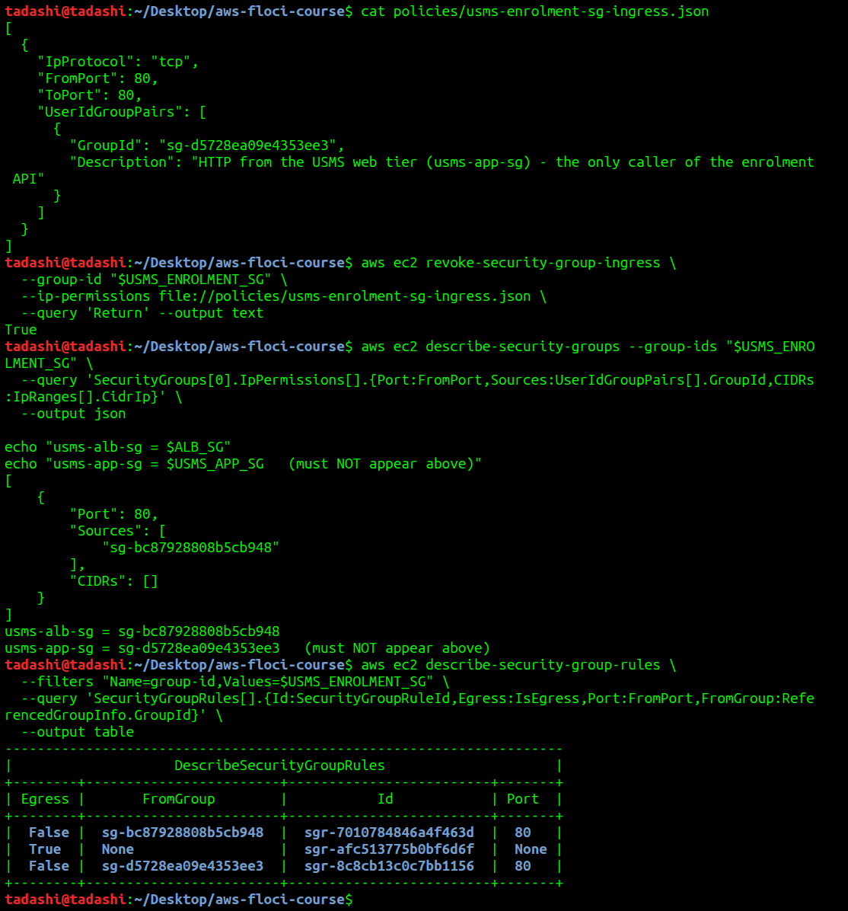

Lab 04's script now changes by exactly one check, from `PASS=37 FAIL=1` to `PASS=36 FAIL=2`. The script failed correctly, because the architecture changed on purpose. Exercise 2 updates it.

**Screenshot 24 - Exactly one check changed in verify-lab-04.sh**

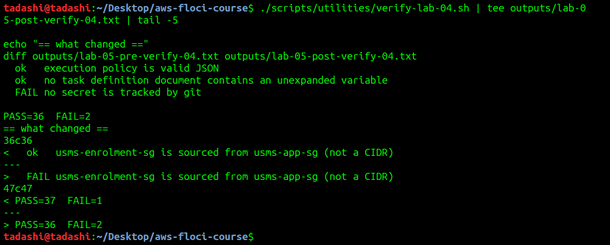

### Step 14 - Deploy behind a load balancer

**Purpose:** Show what a deployment does behind a load balancer: new tasks gated by health, and old tasks draining before they stop.

**What I did:** Recorded the state, forced a deployment, polled both sides, and compared before and after. Since the target list was always empty, I also compared task IDs.

```bash
aws ecs update-service --cluster "$USMS_ECS_CLUSTER" --service "$USMS_ENROLMENT_SERVICE" --force-new-deployment
```

**Result:** No `initial`, `healthy` or `draining` state appeared, and the task IDs were unchanged, so **no task was replaced and no draining was observed**. `list-tasks` listed three IDs because it includes a stopped task from the Step 11 scale-down.

**Lab typo:** The loop's `--query 'length(deployments)'` is missing `services[0].`, so it errors on every poll and runs to its limit.

**Screenshot 25 - Forced deployment: no task replaced, and the lab's query error**

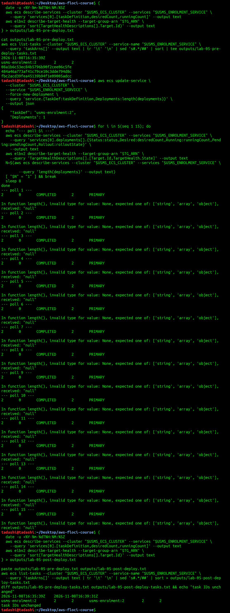

With the corrected query the service reports one deployment. `docker ps` shows the running containers, including the orphan left over from Lab 04's restart.

**Screenshot 26 - Corrected query, and the running containers**

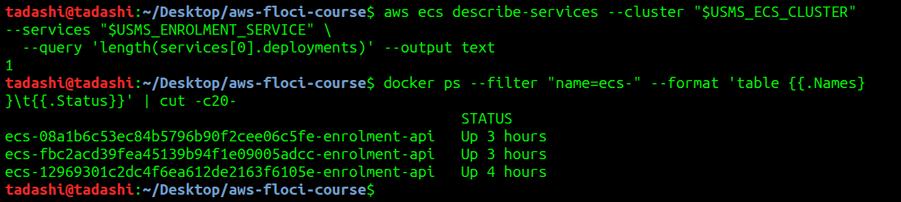

### Step 15 - Add a listener rule

**Purpose:** Anything beyond sending everything to one place is a rule. A fixed-response action shows the mechanism without a second target group.

**What I did:** Wrote the conditions and actions as JSON, created a rule at priority 10, read the rules back and tried it with `curl`.

```bash
aws elbv2 create-rule --listener-arn "$LISTENER_ARN" --priority 10 \
  --conditions file://templates/lab-05-rule-conditions.json \
  --actions file://templates/lab-05-rule-actions.json
```

**Result:** Two entries: priority 10 with a `fixed-response` 200, and the default forward. `curl` returned `000`, so the rule was stored but its evaluation was not observed.

**Screenshot 27 - Rule created and listed above the default action (Checkpoint 6)**

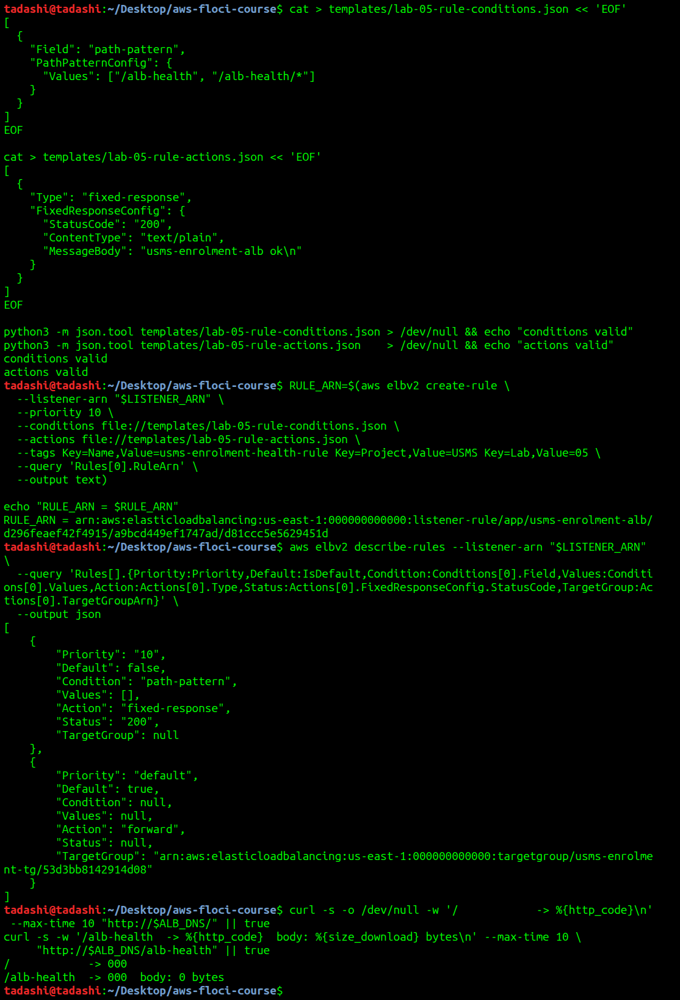

**Note:** `Values` read back empty, which looked like a failure. The values are stored under `PathPatternConfig.Values`, where the condition was written, so the rule is correct.

**Screenshot 28 - Path values stored under PathPatternConfig**

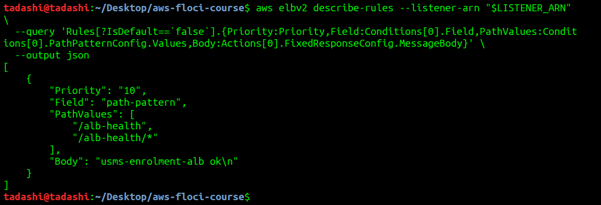

### Step 16 - Prove it survives a restart

**Purpose:** Prove the configuration is really stored. A build that persisted two of three services would leave dangling references.

**What I did:** Recorded seven facts across ELBv2, ECS and EC2, stopped and started Floci, derived every ARN again from the API, and compared.

```bash
./scripts/setup/floci-down.sh; sleep 3; ./scripts/setup/floci-up.sh
diff outputs/lab-05-pre-restart.txt outputs/lab-05-post-restart.txt && echo "PERSISTENCE PROVEN: ..."
```

**Result:** `PERSISTENCE PROVEN`. The load balancer, target group, listener, rule and both security groups were unchanged.

**Note:** The line printed by the lab also claims the `loadBalancers` entry and grace period are unchanged. That is only true in the sense that they read `None` before and after, so persistence of those two was not proven.

**Screenshot 29 - Every ARN re-derived, PERSISTENCE PROVEN (Checkpoint 7)**

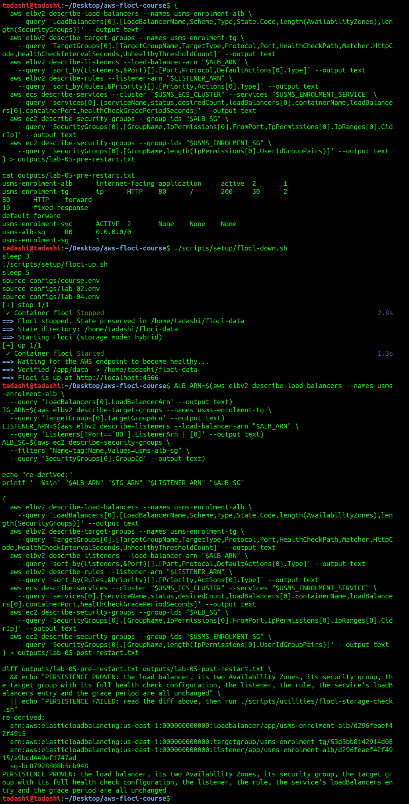

### Step 17 - Close the loop and audit

**Purpose:** Resolve both ends of the new chain to real objects, so the security posture is demonstrated and not only claimed.

**What I did:** Ran the lab's four audit blocks.

**Result:** Block 2 prints `CUTOVER CONFIRMED`: the only source on the tasks' group is `usms-alb-sg`. Block 4 shows the `Lab=05` tags on the security group, load balancer and target group.

**Problem:** Block 3 printed `NOTE` and listed seven instances, because this build does not apply the `instance.group-id` filter, as Lab 04 Exercise 5 also found.

**Screenshot 30 - CUTOVER CONFIRMED, and the filter returning seven instances**

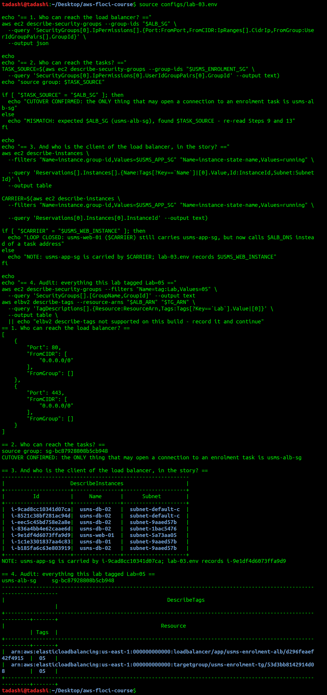

**Fix:** Filtering client-side on each instance's real `SecurityGroups` resolves `usms-app-sg` to exactly one instance, `usms-web-01`, which gives `LOOP CLOSED`.

**Screenshot 31 - Client-side filter: LOOP CLOSED**

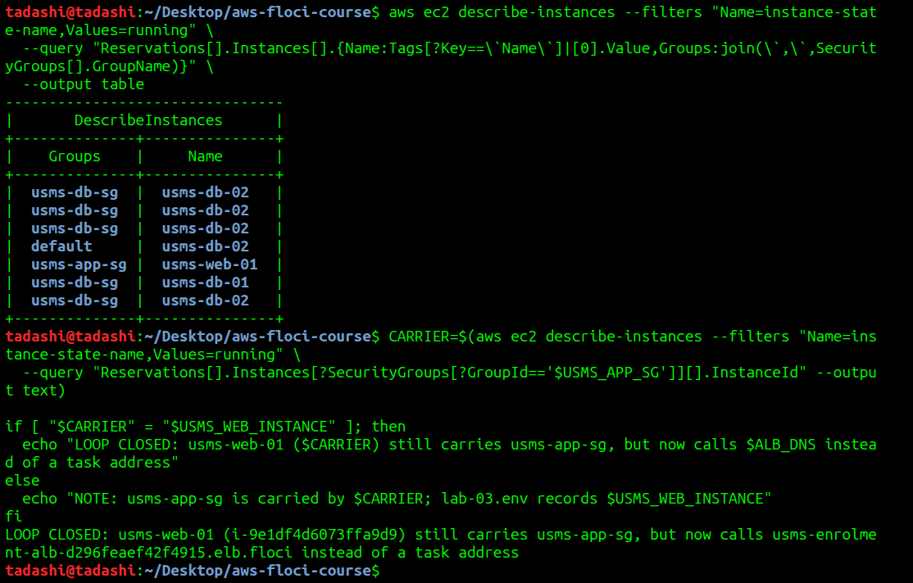

### Step 18 - Write `configs/lab-05.env`

**Purpose:** Record names, IDs and ARNs for Lab 06, looked up live so a value in the file proves the resource exists.

**What I did:** Generated the file with the lab's heredoc, then checked for empty values.

```bash
grep -n 'export .*=$\|None' configs/lab-05.env || echo "all values populated"
grep -c '^export' configs/lab-05.env
```

**Result:** 15 exports, but the check flagged four lines.

- `USMS_ALB_LISTENER_ARN` was empty, because of a lab error: the heredoc escapes the backticks inside `$(...)`, where the single quotes already protect them, so the query was invalid.
- `USMS_SVC_LB_CONTAINER`, `USMS_SVC_LB_PORT` and `USMS_SVC_GRACE_PERIOD` are `None`, because of the Step 10 limitation.

**Screenshot 32 - Env file written, with four values flagged**

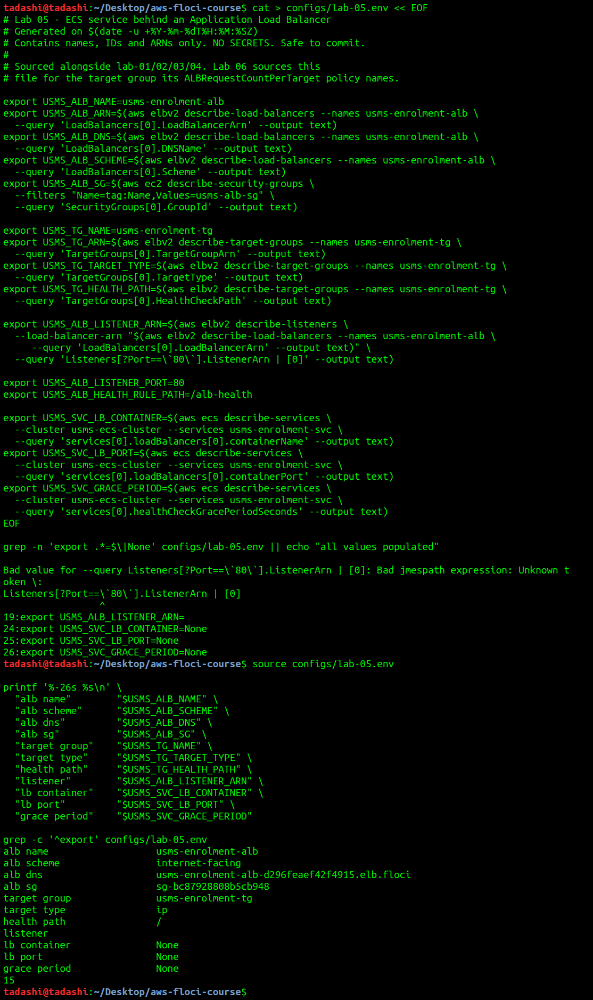

I looked the listener ARN up without the escaping and corrected that line. I left the three `None` values in place, because they truthfully record what Floci holds, and typing in the expected values would make the file claim something false.

**Screenshot 33 - Listener value corrected, three honest None values remain**

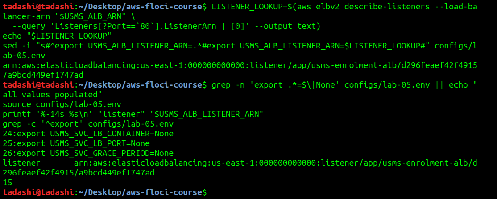

### Step 19 - Check what is safe to commit, then commit

**Purpose:** Keep credentials out of Git and commit by explicit path.

**What I did:** Reviewed `git status`, confirmed the ignore rules, staged each path by name and committed. The verification and cleanup scripts had to exist first, so I built them before this step (Section 6.1).

```bash
git status --short
git check-ignore -v outputs/lab-05-path-proof.txt
git ls-files outputs/
```

**Result:** The output file is ignored by `.gitignore:8`, and `outputs/.gitkeep` is the only tracked file there. The work was committed locally as `d798d74`.

**Note:** The lab's `git add` includes `configs/lab-05.env`, but line 42 of `.gitignore` (`configs/*.env`) excludes it, so it stays local, as in Lab 04.

**Screenshot 34 - Ignore rules checked before staging**

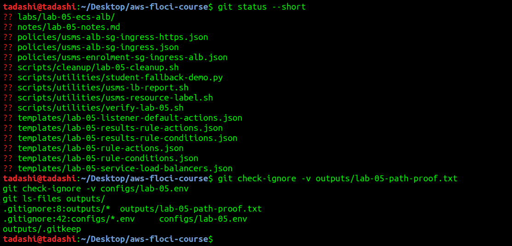

**Screenshot 35 - Explicit paths staged and committed**

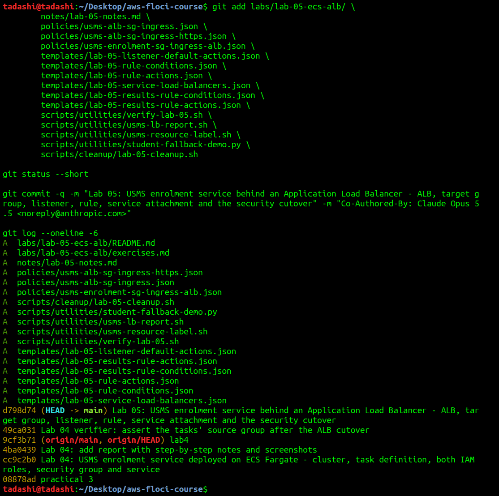

### Independent exercises

The full working, including the security review, the cost figures and the HTTPS plan, is in [exercises.md](exercises.md). The review questions are answered in [notes/lab-05-notes.md](../../notes/lab-05-notes.md). Section 13.1 of the lab is an in-class assessment that does not permit AI assistants, so it was not attempted here.

#### Exercise 1 - A second path through the same load balancer

**What I did:** Created `usms-results-tg` and a priority-20 rule forwarding `/results` and `/results/*` to it, using JSON documents and captured ARNs.

**Result:** Three entries in evaluation order (10, 20, default), and an empty target group attached to one load balancer. With no targets, a request to `/results` would receive HTTP 503.

**Screenshot 36 - Results target group and priority-20 rule**

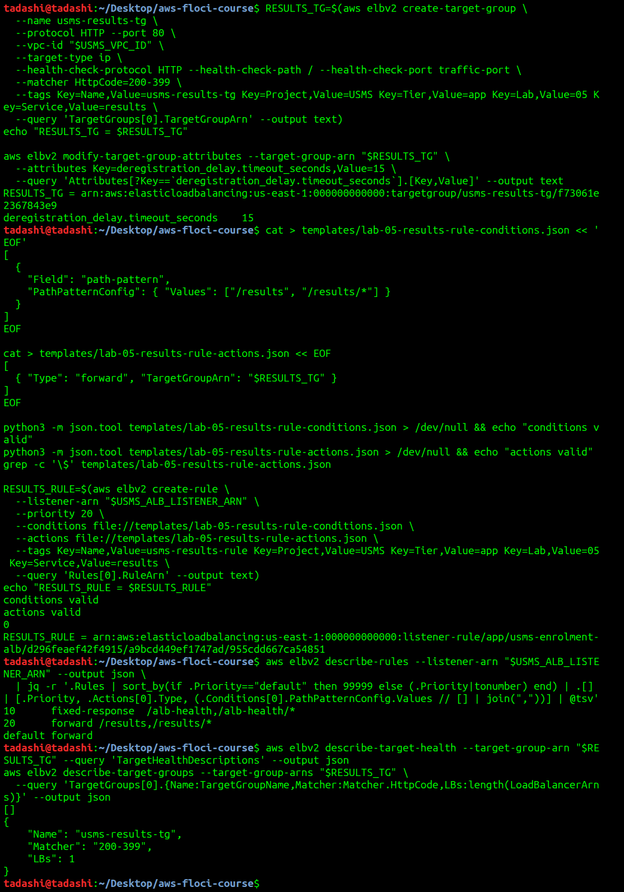

#### Exercise 2 - Repair the verification script

**What I did:** Changed `verify-lab-04.sh` to assert the property that still matters, that the tasks accept traffic only from a named group, now `usms-alb-sg`. I added a second check that `usms-app-sg` is no longer a source.

**Result:** Both new checks pass, and `verify-lab-04.sh` reports `PASS=38 FAIL=1`. The one failure is still the `.gitkeep` false positive, so the exercise's `FAIL=0` was not reached.

**Screenshot 37 - Script change, and results from both verification scripts**

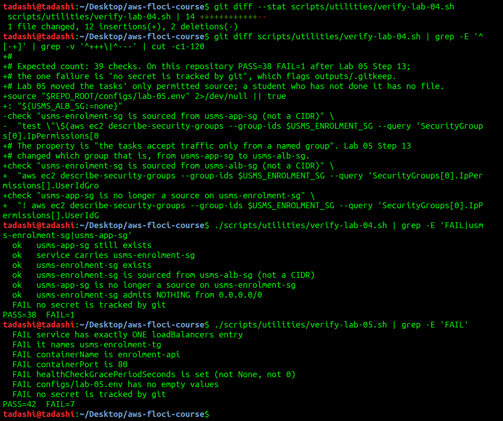

With `configs/lab-05.env` moved away and the variable removed, the script gives a readable failed check and runs to the end. My first attempt at this test passed for the wrong reason, because the variable was still exported in my shell.

**Screenshot 38 - Missing file handled with a readable failed check**

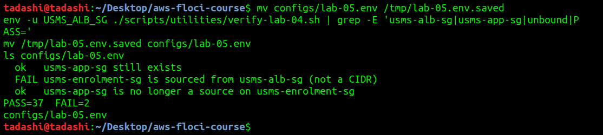

**Screenshot 39 - Commit explaining why the assertion changed**

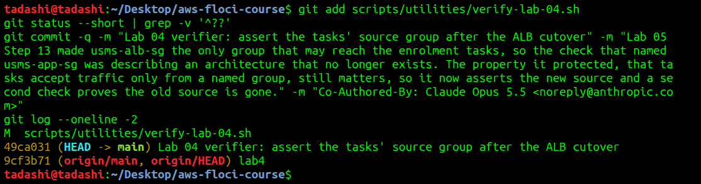

#### Exercise 3 - Load balancer report tool

**What I did:** Wrote `scripts/utilities/usms-lb-report.sh`, which prints each load balancer's decision table in evaluation order.

**Result:** The output was correct before Exercise 1, identical from two directories after it, and correct with the `/alb-health` rule temporarily deleted and then recreated.

**Screenshot 40 - Report before Exercise 1**

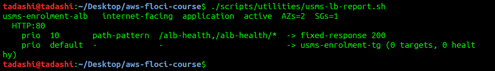

**Screenshot 41 - Identical from two directories**

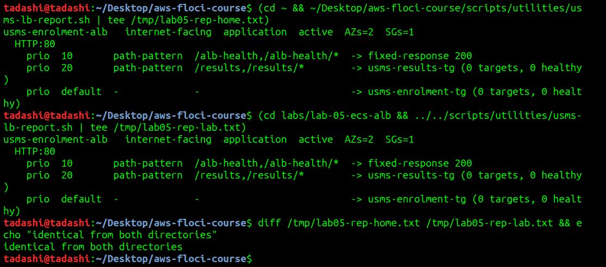

**Screenshot 42 - Rule temporarily deleted, then restored**

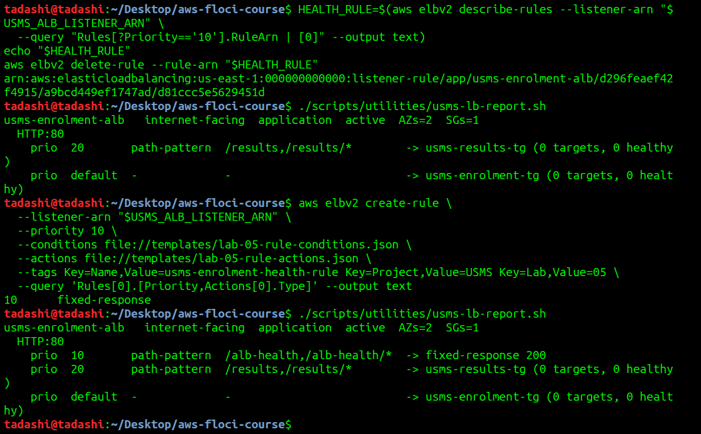

#### Exercise 4 - The exposure review

**What I did:** Wrote the security officer's review, then deleted the two practice objects in dependency order, rule before target group.

**Result:** I recommended `--scheme internal`, because the portal is the only client. The ALB costs USD 16.43 a month idle and about USD 23.44 under a stated pessimistic load, and new connections set the LCU charge. Only `usms-enrolment-tg` remains, and verification is unchanged at `PASS=42 FAIL=7`.

**Screenshot 43 - Practice objects removed in dependency order**

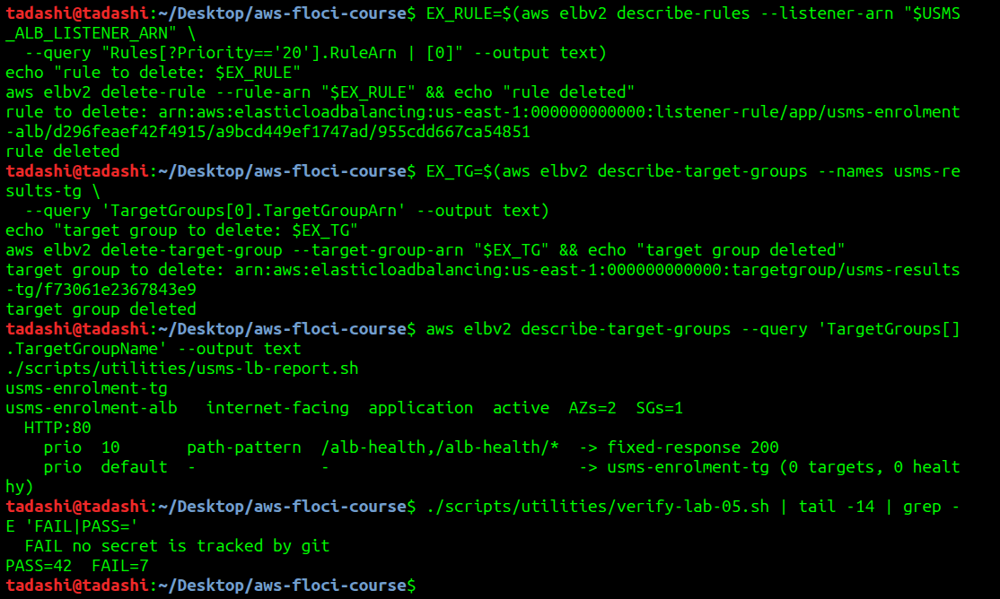

#### Exercise 5 - The ResourceLabel hand-off to Lab 06

**What I did:** Wrote `scripts/utilities/usms-resource-label.sh`, which derives the label from the API and validates it, appended it to the env file, and measured a forced deployment.

**Result:** The label has six segments, starts with `app`, and is recorded as the 16th export.

**Screenshot 44 - Label derived, validated, and appended**

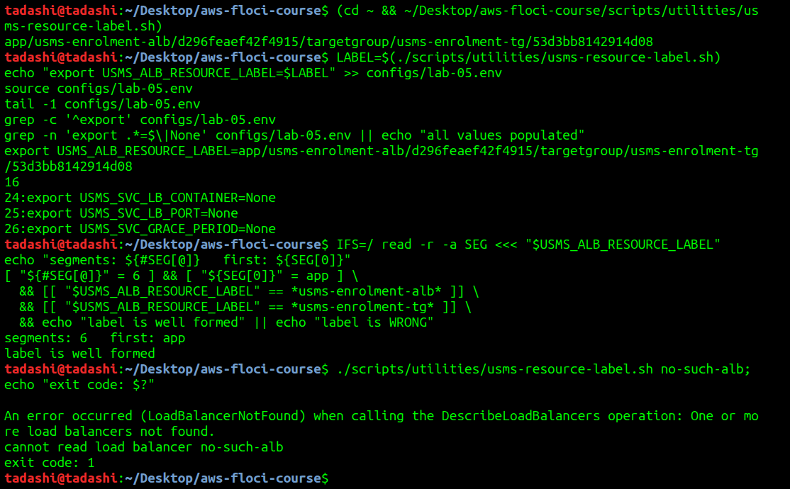

The deployment reported finished after 6 seconds, but the task IDs were identical, so the number says nothing about real replacement time. The readiness file says so and gives the AWS Batch figure instead.

**Screenshot 45 - Measurement, showing no task was replaced**

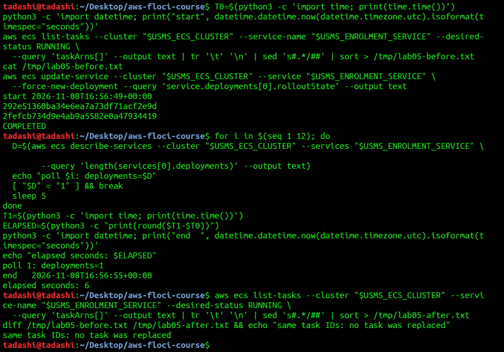

**Screenshot 46 - Readiness file for Lab 06**

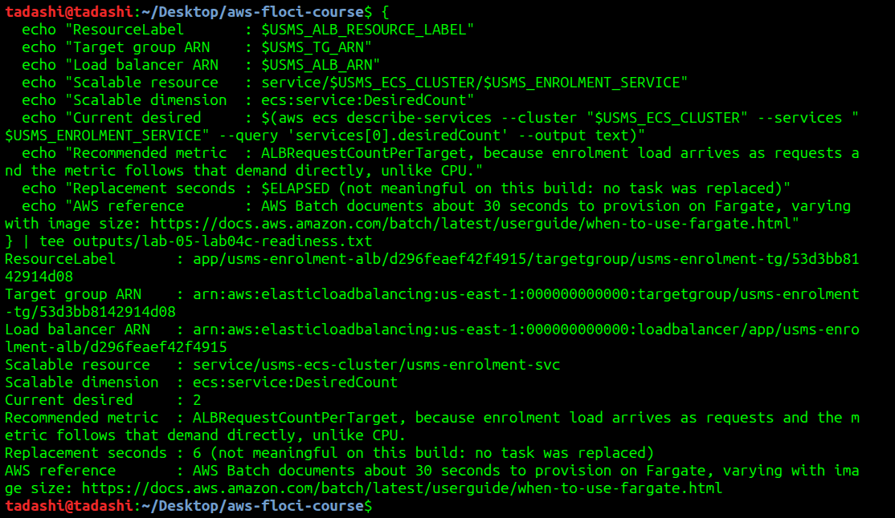

## 6. Results and Evidence

### 6.1 CLI Output

The command output for each build step is shown under that step in Section 5. This section shows the checks on the finished system.

**Lab verification script.** `verify-lab-05.sh` makes read-only checks of the environment, earlier labs, security groups, load balancer, target group, listener, service wiring and Git hygiene. It reports `PASS=42 FAIL=7`, where the lab expects `PASS=49 FAIL=0`. Section 7 explains each failure.

**Screenshot 47 - verify-lab-05.sh (PASS=42 FAIL=7)**

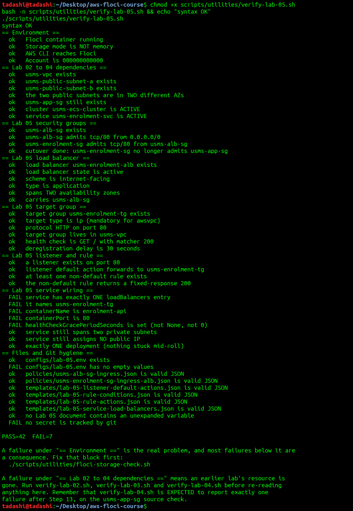

**Course alternative for routing.** The Known Issues page provides a local demonstration, because routing cannot be proven on this build. It starts temporary servers on `127.0.0.1` and shows one entry point sending `/enrolment` and `/results` to different backends. It proves path-based routing as a concept. It does not exercise ALB health checks, target registration, TLS, security groups or ECS integration.

**Screenshot 48 - Known Issues routing demonstration**

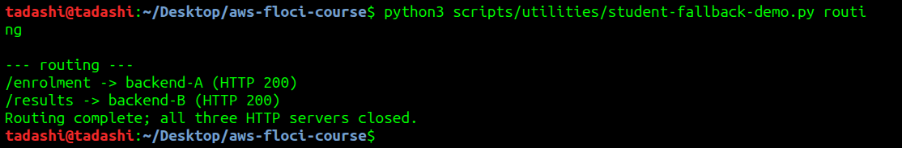

**Cleanup script.** `lab-05-cleanup.sh` is for the end of the course only, so I only checked its syntax and did not run it.

**Screenshot 49 - Cleanup script passes the syntax check and was not run**


**Storage check.** Floci is in `hybrid` mode, bind-mounted to `/home/tadashi/floci-data`, so state is written to disk.

**Screenshot 50 - Floci storage check**

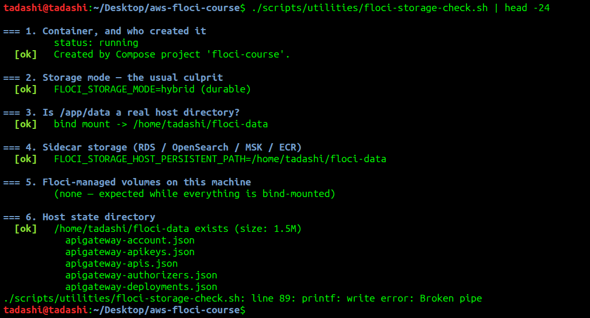

**End-of-lab backup.** `floci snapshot save` failed with HTTP 400 on this server version, so I used the lab's fallback: stop Floci, archive the data directory to `~/floci-data-lab-05.tar.gz`, and start Floci again.

**Screenshot 51 - Snapshot unavailable, and the filesystem fallback**


**Final readiness.** After the backup restart, Lab 04 reports `PASS=38 FAIL=1` and Lab 05 `PASS=42 FAIL=7`, the env file has 16 exports, the service has desired 2, running 2 and one deployment, and the target group is type `ip` and attached to one load balancer.

**Screenshot 52 - Final readiness**


### 6.2 AWS Management Console Verification

This course runs on Floci, so there is no AWS Management Console. The Floci UI at `http://localhost:4500` is the local equivalent.


*Floci Console Home confirms the local AWS runtime is reachable under account 0000-0000-0000.*

The Floci UI has no Elastic Load Balancing or ECS pages in this version, so the load balancer, target group, listener and service cannot be shown there. Their verification is the `describe` output in Section 5. The security groups are available to the console's backend:


*The Floci UI's own API lists the four USMS security groups, including `usms-alb-sg` created in this lab.*

## 7. Analysis and Discussion

**What was achieved.** The load balancer, security group, target group, listener and rule were all built and read back correctly, and they survived a restart. The cutover was completed, so the tasks' security group now sources only from `usms-alb-sg`. What was not achieved on this build is the link between the service and the target group: Floci accepted the attachment but did not keep it.

**Did the results match the expected outcome?** Partly. The lab expects `PASS=49 FAIL=0` from `verify-lab-05.sh`, and I got `PASS=42 FAIL=7`.

| Failing check | Cause | Is it a fault in the work? |
|---|---|---|
| service has exactly ONE loadBalancers entry | Floci does not retain the attachment | No, listed in Known Issues |
| it names usms-enrolment-tg | Same | No |
| containerName is enrolment-api | Same | No |
| containerPort is 80 | Same | No |
| healthCheckGracePeriodSeconds is set | Same; also listed as benign by the lab | No |
| configs/lab-05.env has no empty values | Three values are `None` because of the same missing fields | No |
| no secret is tracked by git | False positive on `outputs/.gitkeep`, which the lab requires to be tracked | No |

**Errors encountered and how they were resolved.**

| Problem | Cause | Resolution |
|---|---|---|
| `LB` and `Grace` read back `null` after Step 10 | Known Floci limitation | Recorded it and used the Known Issues alternative, and did not rebuild the service |
| Revoke by rule ID returned `True` but changed nothing | Floci did not act on `--security-group-rule-ids` | Revoked by `--ip-permissions` from the Lab 04 policy file, then confirmed by read-back |
| Step 14's loop errored on every poll | Lab query missing `services[0].` | Corrected the query |
| `USMS_ALB_LISTENER_ARN` was empty | Lab's escaped backticks inside `$(...)` | Looked it up unescaped and corrected the line |
| Step 17 printed `NOTE` | Floci ignores the `instance.group-id` filter | Filtered client-side, giving `LOOP CLOSED` |
| `floci snapshot save` failed with HTTP 400 | Snapshot API unavailable on this server | Used the lab's filesystem fallback |

**Observations: Floci compared with real AWS.**

| Observed in this lab | Reasoned about only |
|---|---|
| Every ELBv2 object created and read back | A request served through the listener |
| Target group attached to one load balancer | Health checks being executed |
| Rule listed above the default action | Rule evaluation and fixed responses |
| Security group chain and cutover in the configuration | Security groups enforced on packets |
| Lab 04's script changing by exactly one check | Service registering its targets |
| Running count following the desired count | Connection draining and rolling replacement |
| Configuration surviving a restart | Real cost, which Exercise 4 calculates from list prices |

The most useful lesson came from Step 13. The API reported success and the change did not happen, and I only knew because the lab reads the group back. The same applies in reverse in Step 16, where a passing comparison included two fields that were `None` on both sides.

## 8. Reflection

**What did you learn about this AWS service?** I learned that a load balancer is really four objects: the load balancer, a listener, rules, and a target group. The health check lives on the target group and not on the load balancer, and the target type is part of the group's identity. I also learned that in the real design the ECS service owns the target group's contents, so registering targets by hand would be undone.

**What challenges did you encounter?** The main challenge was deciding what I could honestly claim. Floci accepted the attachment and then lost it, so the target group stayed empty and no request was ever served. The revoke in Step 13 was harder, because it returned `True` while changing nothing. I now treat a successful response as a claim that still needs a read-back. I also found two errors in the lab's own commands by reading the error messages instead of assuming my setup was wrong.

**How would you apply this service in a real-world cloud environment?** I would put an ALB in front of any containerised web API, using HTTPS with an ACM certificate and redirecting port 80 to 443. I would use `internal` whenever only other services are the callers, and would size the deregistration delay and grace period from measured request and start-up times.

**What additional concepts or features would you like to explore?**

- Running this same stack on real AWS, to see target registration and draining
- HTTPS listeners and ACM certificates
- Weighted forwarding for canary and blue/green releases
- Auto scaling on `ALBRequestCountPerTarget` (Lab 06)
- AWS WAF in front of a public load balancer

## 9. Conclusion

The objectives were partly achieved on this emulator. The load balancer, target group, listener, rule and security cutover were built, verified and shown to survive a restart, and their identifiers are recorded for Lab 06. The service attachment was accepted but not retained by Floci, so target registration, health checks, draining and served requests remain unproven and are recorded above and not assumed.

I learned how the objects of an Application Load Balancer fit together, how to migrate traffic by building the new path before removing the old one, and why a read-back matters more than a success message. Load balancing matters because it separates a service's name from the temporary tasks behind it, which is what makes the scaling in the next lab possible.

## 10. Appendix

**Additional Files**

- [exercises.md](exercises.md) - the five independent exercises
- [notes/lab-05-notes.md](../../notes/lab-05-notes.md) - support path, Floci limitations, review questions
- [usms-alb-sg-ingress.json](../../policies/usms-alb-sg-ingress.json), [HTTPS rule](../../policies/usms-alb-sg-ingress-https.json), [usms-enrolment-sg-ingress-alb.json](../../policies/usms-enrolment-sg-ingress-alb.json)
- [listener default actions](../../templates/lab-05-listener-default-actions.json), [rule conditions](../../templates/lab-05-rule-conditions.json), [rule actions](../../templates/lab-05-rule-actions.json), [service load balancers](../../templates/lab-05-service-load-balancers.json)
- [verify-lab-05.sh](../../scripts/utilities/verify-lab-05.sh), [usms-lb-report.sh](../../scripts/utilities/usms-lb-report.sh), [usms-resource-label.sh](../../scripts/utilities/usms-resource-label.sh), [student-fallback-demo.py](../../scripts/utilities/student-fallback-demo.py)
- [lab-05-cleanup.sh](../../scripts/cleanup/lab-05-cleanup.sh) - not run, end of course only
- `configs/lab-05.env` and the `outputs/lab-05-*` files - kept locally because the repository's `.gitignore` excludes them
