# Lab 05 - Independent Lab Exercises

Commands were run from the repository root with `AWS_DEFAULT_REGION=us-east-1` set in the shell (see [notes/lab-05-notes.md](../../notes/lab-05-notes.md)).

## Exercise 1 - Basic: a second path through the same load balancer

Created `usms-results-tg` (target type `ip`, HTTP/80, health check `/`, matcher `200-399`, deregistration delay 15 seconds) and a priority-20 rule on the existing listener, matching `/results` and `/results/*` and forwarding to it. Every ARN was captured with `$(...)`, both objects carry `Project=USMS`, `Tier=app`, `Lab=05` and `Service=results`, and the conditions and actions are JSON documents in `templates/`.

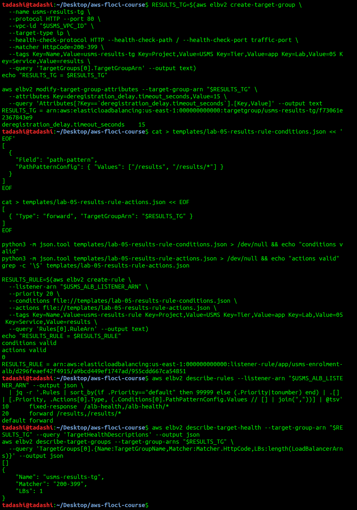

**Outcome:** three entries in evaluation order (10, 20, default). The target group is empty and attached to one load balancer.

`describe-rules` does not promise priority order and `Priority` is a string, so the listing sorts numerically and keeps `default` last.

**What a request to `/results` would receive:** with no targets registered, the load balancer has nowhere to forward it and returns HTTP 503 Service Temporarily Unavailable.

## Exercise 2 - Intermediate: repair the verification script you broke

**The property the failing check was asserting:** the enrolment tasks accept traffic only from a named security group, not from an address range.

The check now asserts that the group is `usms-alb-sg`, and a second check immediately after it asserts that `usms-app-sg` is no longer a source. A check that only confirmed the new state would still pass if both rules existed. The ID comes from `configs/lab-05.env`. That file is sourced with `2>/dev/null || true` and `USMS_ALB_SG` defaults to `none`, so a student who has only done Lab 04 gets a readable failed check and not an unbound-variable abort.

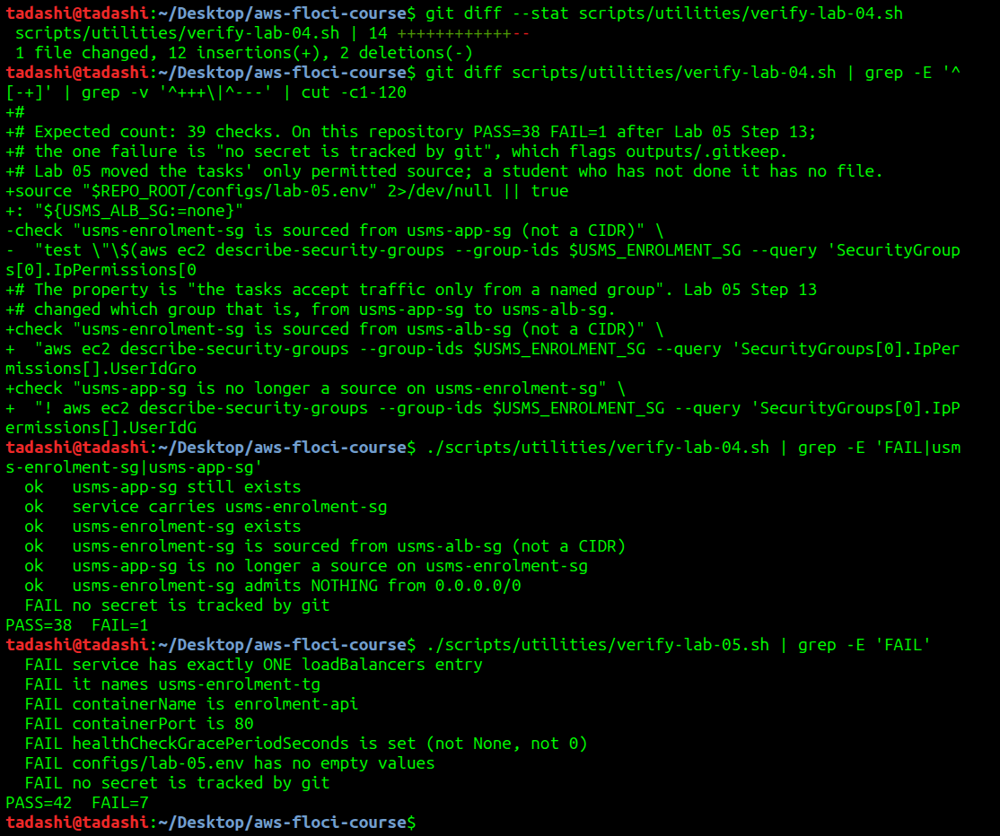

With the file moved away and the variable removed from the shell, the check fails with a readable line and the script runs to the end:

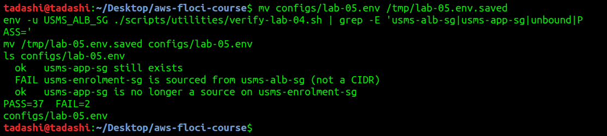

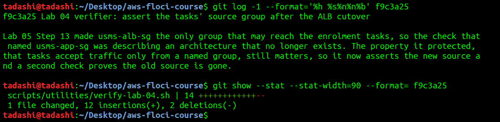

**New count:** 39 checks, reporting `PASS=38 FAIL=1`. It is stated in a comment at the top of the script. An undocumented count is worse than none, because a reader cannot tell whether a change in the number is progress or a check that silently stopped running.

**The exercise's FAIL=0 target was not reached.** The remaining Lab 04 failure is the `no secret is tracked by git` false positive on `outputs/.gitkeep`. `verify-lab-05.sh` has seven failures, explained in the report. Neither was caused by this change.

**When updating a verification script is right, and when it hides a regression:** updating is right when the architecture changed on purpose and the same property is still being tested, ideally in the same commit as the change. It hides a regression when the expected value is edited only to turn the script green, without anyone being able to say what property it protects or why the system should now behave differently.

## Exercise 3 - Problem solving: a load balancer report tool

Wrote [scripts/utilities/usms-lb-report.sh](../../scripts/utilities/usms-lb-report.sh). It walks every ALB named `usms-*`, then listeners, rules and target health. `Priority` is a string and the default's value is the word `default`, so the sort gives numbers their numeric value and `default` a key above the API's maximum of 50000. The reason for omitting `-e` is in a comment in the script. It also writes `outputs/lab-05-lb-report.json`.

Before Exercise 1:

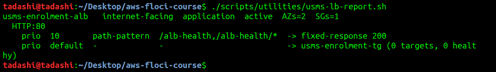

After Exercise 1, from `~` and from the lab folder, with identical output:

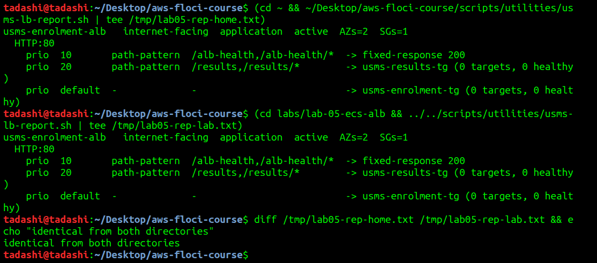

With the `/alb-health` rule temporarily deleted, then recreated from its templates:

> **DANGER**
> **What will be deleted:** the priority-10 `/alb-health` rule, temporarily.
> **What depends on it:** `verify-lab-05.sh` asserts it, so it must be back before verification.
> **Reversible?** Yes: `create-rule` with the Step 15 templates.
> **Effect on later labs:** none once recreated.

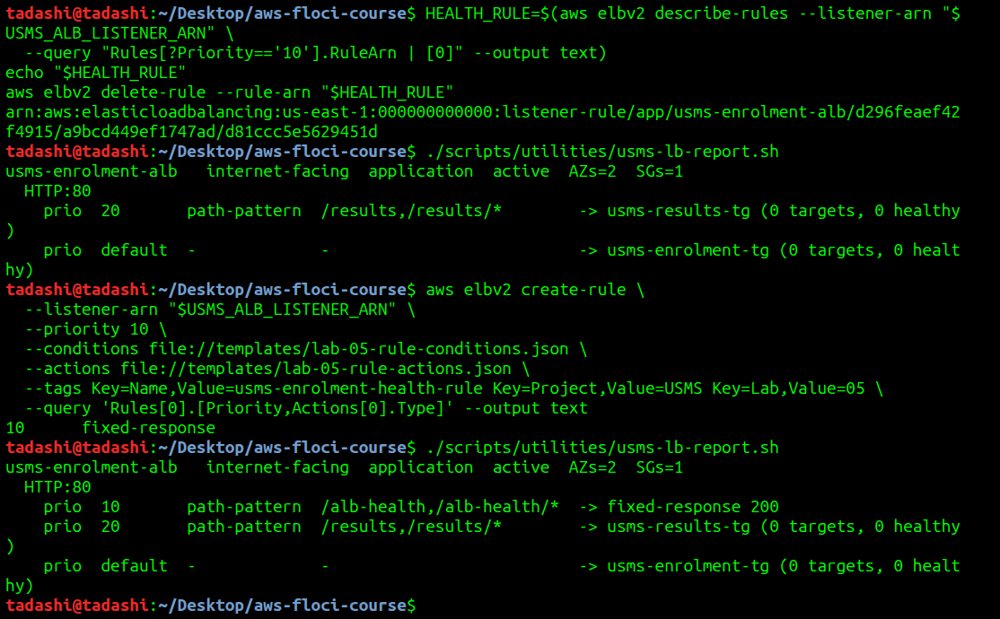

**Not tested:** a load balancer with no listeners and a listener with no non-default rules on a separate ALB. The script has code paths for both, and the rule-deleted run is the closest case I exercised.

## Exercise 4 - Challenge: the exposure review

### What changed

The enrolment service is now reached through an internet-facing load balancer in the public subnets, which forwards to tasks that remain in private subnets with no public address. The tasks' security group now accepts HTTP only from the load balancer's group, where it previously accepted it only from the web tier's group.

### Internal versus internet-facing

**The case for `--scheme internal`.** In Step 5 only `--scheme internal` would change, and the subnets would normally become the private ones. The DNS name would gain an `internal-` prefix and resolve only to private addresses. The listener, target group, rule and ECS configuration would not change, and `usms-alb-sg` would source from `usms-app-sg` and not from `0.0.0.0/0`. Scheme cannot be changed after creation, so moving means recreating the load balancer.

**Recommendation:** because the portal is the only client, I recommend `internal`: it removes the only `0.0.0.0/0` rule in the system without affecting any caller.

**The other side:** internet-facing is right if students' browsers or an external partner will call this API directly, or if a CDN or WAF in front needs a public origin. It also keeps one entry point if the portal later moves outside the VPC.

### The exposure delta

| Can reach | Before (Lab 04) | After (Lab 05) |
|---|---|---|
| The load balancer | Did not exist | Anyone on the internet on tcp/80; tcp/443 is open but nothing listens on it |
| The tasks, through the load balancer | Not applicable | Any client, but only by way of the listener's rules |
| The tasks directly | `usms-web-01` through `usms-app-sg` | Only `usms-alb-sg`; `usms-web-01` can no longer connect directly |

Floci does not enforce security groups, so this table reads the configured rules. It was not tested with packets.

### Monthly cost estimate

Sources: AWS Price List API, `AWSELB/current/us-east-1/index.json`, publication date 2026-11-05 (https://pricing.us-east-1.amazonaws.com/offers/v1.0/aws/AWSELB/current/us-east-1/index.json): **USD 0.0225 per ALB-hour** and **USD 0.008 per LCU-hour**. Fargate prices are the Lab 04 figures from `AmazonECS/current/us-east-1/index.json`. LCU dimensions are from https://aws.amazon.com/elasticloadbalancing/pricing/, which also states that you are charged only on the dimension with the highest usage.

| Item | Calculation | USD per month |
|---|---|---|
| ALB hourly charge, idle | 730 h x 0.0225 | 16.43 |
| LCU charge, idle | no traffic, so effectively 0 LCU | 0.00 |
| **ALB idle total** | | **16.43** |
| Two Fargate tasks at 256 CPU / 1024 MiB, for comparison | 2 x 730 h x (0.25 x 0.04048 + 1 x 0.004445) | 21.26 |

**Under load.** These are my assumptions, deliberately pessimistic, and need replacing with real traffic: 30 requests per second all month (the average from Lab 04 Exercise 4), no connection reuse, 10 KB per request and response, and connections lasting 1 second.

| LCU dimension | One LCU provides | This load | LCUs |
|---|---|---|---|
| New connections | 25 per second | 30 per second | **1.20** |
| Active connections | 3,000 per minute | about 30 | 0.01 |
| Processed bytes (IP targets) | 1 GB per hour | 30 x 10 KB x 3,600 s = 1.08 GB | 1.08 |
| Rule evaluations | 1,000 per second | 1 rule, within the 10 free | 0.00 |

New connections dominate for this small-response, low-traffic API, ahead of the processed bytes most people would guess. That gives 1.20 x 730 x 0.008 = USD 7.01, so **USD 23.44 per month** for the ALB under this load. Connection reuse would lower the new-connections figure, and then processed bytes would set the charge.

### The HTTPS plan

**What makes the port open:** the tcp/443 rule on `usms-alb-sg`, which already exists from Step 4's "Your turn". That alone serves nothing.

**What makes something listen on it,** in order:

1. A hostname in a domain the university controls. This comes from outside AWS.
2. A public certificate for it from AWS Certificate Manager. Public, non-exportable certificates for integrated services are at no cost (https://aws.amazon.com/certificate-manager/pricing/).
3. A CNAME record, provided by ACM, added to the domain's DNS to prove control. DNS validation is what ACM recommends (https://docs.aws.amazon.com/acm/latest/userguide/acm-public-certificates.html). This is one change outside AWS unless the zone is in Route 53.
4. An HTTPS:443 listener on `usms-enrolment-alb` with the certificate ARN, a security policy such as `ELBSecurityPolicy-TLS13-1-2-2021-06` and a default forward to `usms-enrolment-tg` (https://docs.aws.amazon.com/elasticloadbalancing/latest/application/create-https-listener.html).
5. A DNS record pointing the hostname at the load balancer's DNS name.

**Port 80 rule:** a rule on the HTTP:80 listener matching `/*`, with action type `redirect` and status 301, sending clients to HTTPS on port 443. `redirect` is one of the rule actions listed at https://docs.aws.amazon.com/elasticloadbalancing/latest/application/listener-rules.html.

### The tidy-up

Dependency order is rule first, because a target group cannot be deleted while a rule forwards to it.

> **DANGER**
> **What will be deleted:** the priority-20 `/results` rule on the HTTP:80 listener.
> **What depends on it:** nothing; it forwards to an empty practice target group.
> **Reversible?** Yes, by repeating Exercise 1.
> **Effect on later labs:** none. The priority-10 rule and the default action are untouched.

```bash
EX_RULE=$(aws elbv2 describe-rules --listener-arn "$USMS_ALB_LISTENER_ARN" \
  --query "Rules[?Priority=='20'].RuleArn | [0]" --output text)
aws elbv2 delete-rule --rule-arn "$EX_RULE"
```

> **DANGER**
> **What will be deleted:** the target group `usms-results-tg`.
> **What depends on it:** nothing, now that the rule is gone, and it holds no targets.
> **Reversible?** Yes, by repeating Exercise 1.
> **Effect on later labs:** none. `usms-enrolment-tg` is untouched.

```bash
EX_TG=$(aws elbv2 describe-target-groups --names usms-results-tg \
  --query 'TargetGroups[0].TargetGroupArn' --output text)
aws elbv2 delete-target-group --target-group-arn "$EX_TG"
```

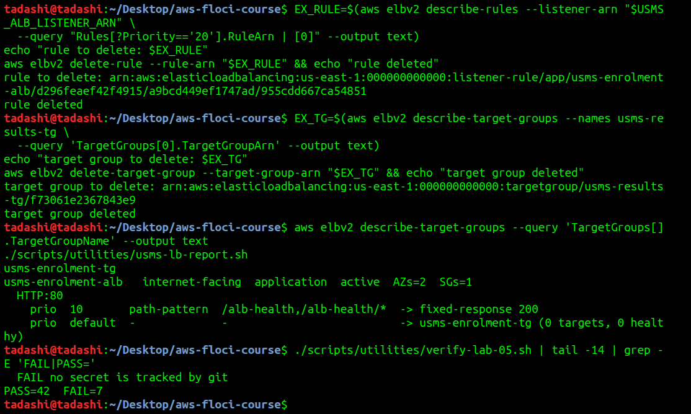

**Result:** only `usms-enrolment-tg` remains. `verify-lab-05.sh` is unchanged at `PASS=42 FAIL=7`, so the exercise's FAIL=0 target was not met, for the reasons in the report.

## Exercise 5 - Integration: the ResourceLabel hand-off to Lab 06

Wrote [scripts/utilities/usms-resource-label.sh](../../scripts/utilities/usms-resource-label.sh). It reads both ARNs from the API, uses shell parameter expansion for both suffixes, comments why they differ, and validates the result before printing it. It runs from any directory and does not read `configs/lab-05.env` for the ARNs.

The label is `app/usms-enrolment-alb/d296feaef42f4915/targetgroup/usms-enrolment-tg/53d3bb8142914d08`. It has six segments and its first is `app`, which is there because the ARN's load balancer type is part of the suffix; for a Network Load Balancer it would be `net`. `USMS_ALB_RESOURCE_LABEL` is appended to `configs/lab-05.env`, giving 16 exports.

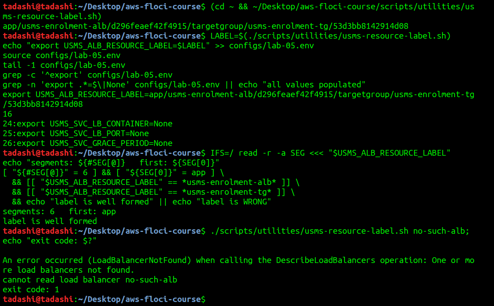

**The measurement.** A forced deployment took 6 seconds to report one deployment, but the running task IDs were identical before and after, so nothing was replaced and the number means nothing for capacity planning. AWS does not publish one figure for Fargate task start-up that I could find. The nearest documented figure is AWS Batch's "about 30 seconds" for Fargate provisioning, which varies with image size (https://docs.aws.amazon.com/batch/latest/userguide/when-to-use-fargate.html). Lab 04 Section 11 gives 20 to 60 seconds.

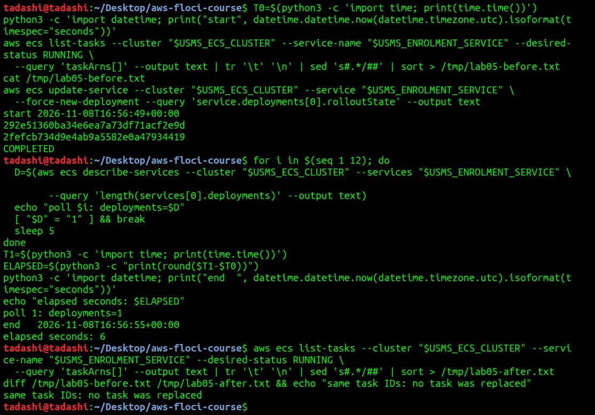

The readiness file records the label, both ARNs, the scalable resource and dimension, the current desired count, and the recommended metric. It is at `outputs/lab-05-lab04c-readiness.txt`, the name the exercise specifies, and is git-ignored.

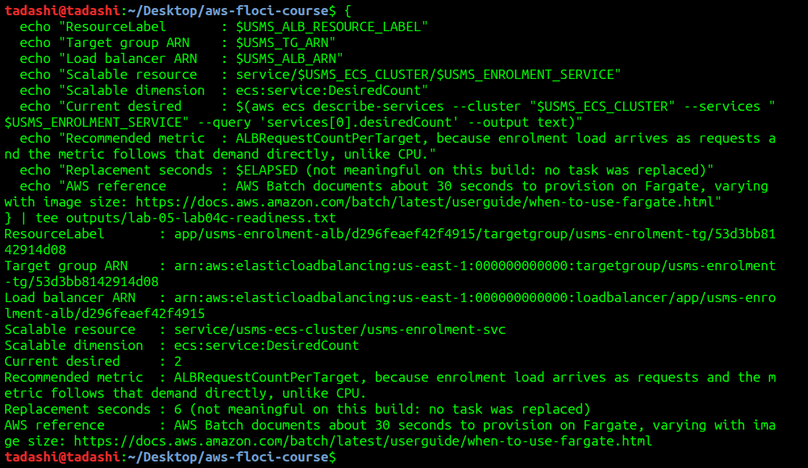
