# Lab 06: Auto Scaling for an ECS-Based Application

## 1. Aim / Objective

The aim of this practical is to let the USMS enrolment service from Labs 04 and 05 change its own size, using Application Auto Scaling to manage the ECS service's desired task count between a floor and a ceiling.

The objectives are:

1. Register `usms-enrolment-svc` as a scalable target (minimum 2, maximum 10), and read the service-linked role that writes `desiredCount` on my behalf.
2. Add two target tracking policies (CPU and `ALBRequestCountPerTarget`), a step scaling policy driven by my own CloudWatch alarm on a custom metric, and two scheduled actions.
3. Fire the alarm and prove what moved `desiredCount`, then suspend and resume scaling.
4. Prove the scaling configuration survives a restart, and record its names in `configs/lab-06.env` for later labs.

## 2. Introduction

Application Auto Scaling is the AWS service that adjusts the capacity of resources other than EC2 instances, such as ECS services, DynamoDB tables and Lambda provisioned concurrency. Its purpose is to keep enough capacity for the current load without paying for idle capacity. For an ECS service it changes exactly one number, the service's `desiredCount`, and ECS does the rest. Its key features are scalable targets, which hold a floor and a ceiling; target tracking policies, which keep a metric near a set value; step scaling policies, which respond to an alarm with fixed steps; scheduled actions, which change the bounds at set times; and suspension switches. It matters in cloud computing because demand is uneven, and paying for peak capacity all day is wasteful while running too little capacity drops requests. Typical applications are web APIs with daily peaks, batch workers that follow a queue, and seasonal events such as enrolment week.

### Key Features

- Scalable targets with minimum and maximum capacity
- Target tracking scaling on predefined metrics (CPU, memory, ALB requests per target)
- Step scaling driven by any CloudWatch alarm, including custom metrics
- Scheduled scaling with cron, rate and one-off `at()` expressions, in a chosen time zone
- Separate scale-out and scale-in cooldowns
- Suspend and resume switches for scale-in, scale-out and scheduled scaling
- A service-linked role, so the scaler acts with its own identity

## 3. Use Case

Enrolment at the College of Science and Technology is quiet most of the year, then very busy for a few weeks each semester. The USMS enrolment API runs two tasks normally. With Application Auto Scaling it can grow when requests or the work queue rise, shrink again afterwards, and raise its floor ahead of the morning rush.

Application Auto Scaling is commonly used for:

| Use case | Why it fits |
|---|---|
| Web APIs with daily peaks | Target tracking on requests per target follows load and releases capacity at night |
| Queue workers | Step scaling on queue depth adds more workers the further the backlog grows |
| Known events (enrolment, results night, sales) | Scheduled actions raise the floor before traffic arrives, which reactive scaling cannot do |
| DynamoDB tables and Lambda | The same scalable-target model scales read/write capacity and provisioned concurrency |

## 4. System Architecture / Design


*CloudWatch metrics feed two kinds of alarm: four managed by the target tracking policies, and `usms-enrolment-queue-high`, which I wrote. Alarms invoke policies, policies decide a capacity clamped to the scalable target's 2..10, and Application Auto Scaling writes that single integer to the ECS service through the service-linked role. ECS, the private subnets and the load balancer from Labs 02 to 05 do everything after that. The orange dashed arrows are the path this Floci build accepted but did not run. Source: own diagram of the resources built in this lab.*

## 5. Implementation Procedure

All commands were run from the repository root (`~/Desktop/aws-floci-course`) in one terminal session. Each step below records why it was done, what was done, what the output showed, and the screenshot of that output. Long flags are shortened in the code blocks; the screenshots show each command in full.

### Preparation - Lab folder and tools

**Purpose:** Create the lab's folder and confirm the tools and storage mode before building anything.

**What I did:** Created `labs/lab-06-ecs-autoscaling`, checked for `jq`, `python3` and `docker`, ran the storage check, and looked for the scale-out latency measured in earlier labs.

```bash
mkdir -p labs/lab-06-ecs-autoscaling
./scripts/utilities/floci-storage-check.sh | grep -E '===|\[ok\]|\[FAIL\]'
cat outputs/lab-04-scale-latency.txt 2>/dev/null || echo "not measured - use the cited figure"
```

**Result:** All three tools were found, and Floci is in `hybrid` storage mode, bind-mounted to `/home/tadashi/floci-data`. No scale-out latency had been measured: Lab 05's replacement time of 6 s is not meaningful because no task was replaced. So I used AWS's figure of about 30 s for Fargate start-up.

**Screenshot 1 - Lab folder, tools, storage mode and latency**

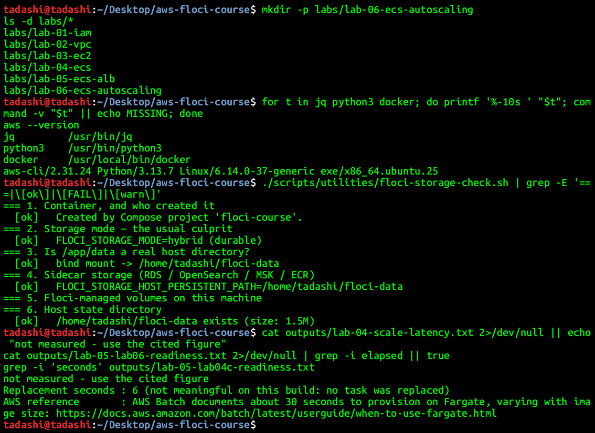

### Step 1 - Resume the environment and load six env files

**Purpose:** Start Floci and load what Labs 01 to 05 recorded. Step 9 needs the load balancer and target group ARNs.

**What I did:** Set the course region, started Floci, sourced `course.env` and the five lab env files, confirmed my identity, and printed fourteen values.

```bash
export AWS_DEFAULT_REGION=us-east-1
./scripts/setup/floci-up.sh
source configs/course.env; source configs/lab-0{1,2,3,4,5}.env   # one file at a time in the screenshot
./scripts/utilities/whoami.sh
```

**Result:** The identity is `arn:aws:iam::000000000000:root`, so the commands go to Floci. The baseline desired count is 2, and both ARNs are present. `grace period` reads `None`, because Floci did not keep Lab 05's service attachment, a limitation recorded in Lab 05.

**Screenshot 2 - Floci running, identity confirmed, fourteen values**

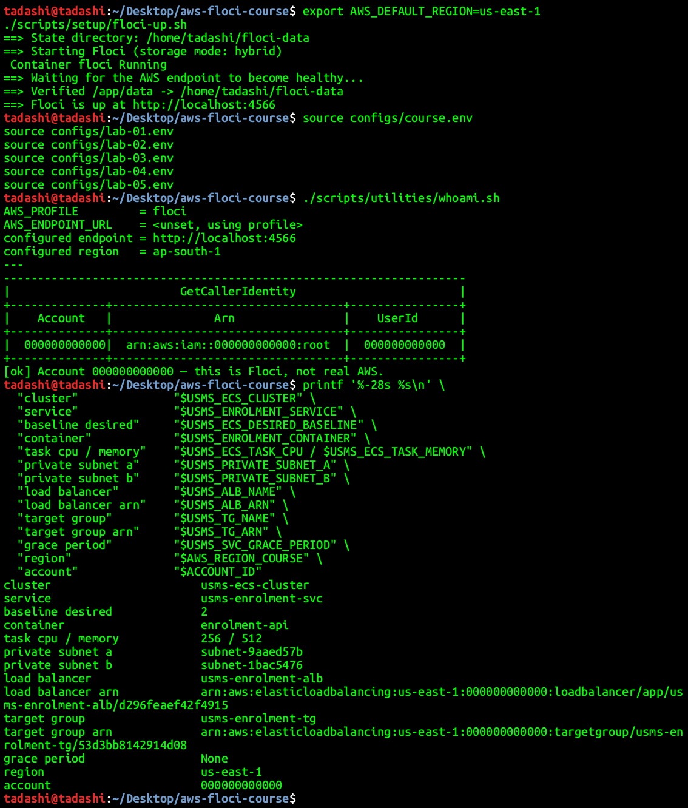

### Step 2 - Confirm Labs 02, 03, 04 and 05 are still intact

**Purpose:** Any fault in the service would show up as a fault in the scaling, so I checked the foundation first. I saved Lab 05's verification output so I could diff it at the end.

**What I did:** Ran the four verification scripts, saved Lab 05's output to `outputs/lab-06-pre-verify-05.txt`, and read the service's state.

```bash
./scripts/utilities/verify-lab-05.sh > outputs/lab-06-pre-verify-05.txt
aws ecs describe-services ... --query 'services[0].{Desired:desiredCount,...,LBs:length(loadBalancers)}'
```

**Result:** Lab 02 `PASS=32 FAIL=1`, Lab 03 `PASS=36 FAIL=0`, Lab 04 `PASS=38 FAIL=1`, and Lab 05 `PASS=42 FAIL=7`. These are exactly the results Lab 05 ended with. The service is at desired 2, running 2, with one deployment.

**Note:** The remaining failures are the ones explained in the Lab 05 report: Floci does not keep the service's `loadBalancers` entry, and the `no secret is tracked by git` check flags `outputs/.gitkeep`. That git check is also flaky. `git ls-files | grep -q` under `pipefail` sometimes fails on SIGPIPE, so the second Lab 04 run printed `PASS=39 FAIL=0`. The lab's own query fails with `length()` on `null`, because `loadBalancers` is null on this build, so I re-ran it reading the field directly.

**Screenshot 3 - Earlier labs verified, service at its baseline**

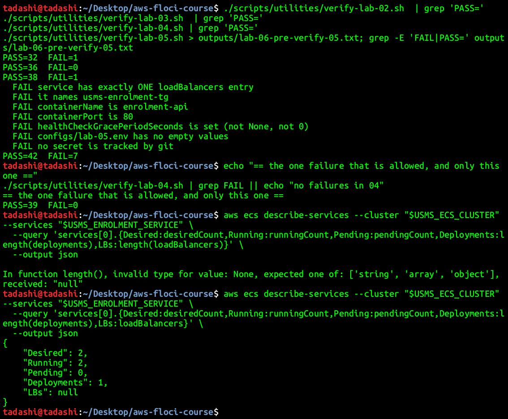

### Step 3 - Probe what this Floci build supports

**Purpose:** Find out which parts of Application Auto Scaling and CloudWatch this build implements, before Step 12 depends on them.

**What I did:** Ran the lab's `probe()` function, then ran the two failing calls directly to read their errors.

```bash
probe "describe-scheduled-actions" "aws application-autoscaling describe-scheduled-actions --service-namespace ecs"
aws application-autoscaling describe-scaling-activities --service-namespace ecs
```

**Result:** Twelve of fourteen calls are supported. `describe-scheduled-actions` and `describe-scaling-activities` return `UnsupportedOperation`, and the build is Floci 1.7.0. Later steps confirmed this is **path B, control plane only**: objects are created and can be read back, but nothing scales on its own. I recorded this at the top of `notes/lab-06-notes.md`.

**Screenshot 4 - The probe**

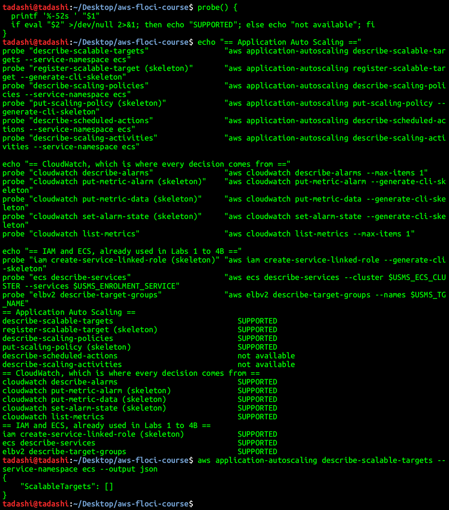

**Screenshot 5 - The two unsupported operations, and the Floci version**

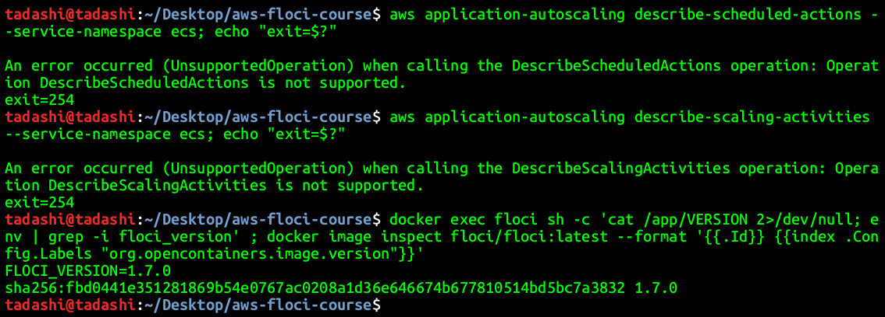

### Step 4 - Create the service-linked role that writes desiredCount

**Purpose:** Application Auto Scaling calls `ecs:UpdateService` through a service-linked role, a role whose name, trust and permissions AWS fixes. I only create it.

**What I did:** Created it for the service principal `ecs.application-autoscaling.amazonaws.com`, then read it back by its documented name.

```bash
aws iam create-service-linked-role --aws-service-name ecs.application-autoscaling.amazonaws.com ...
aws iam get-role --role-name AWSServiceRoleForApplicationAutoScaling_ECSService ...
```

**Result:** Floci created the role as `AWSServiceRoleForEcsApplicationAutoscaling`, so the read-back by the AWS name returned `NoSuchEntity`. I listed the roles under `/aws-service-role/` and read the one Floci created. Its path is `/aws-service-role/ecs.application-autoscaling.amazonaws.com/`, which marks it as owned by a service, and its trust names the right principal. No permissions policy is attached.

**Screenshot 6 - Role created under a different name, AWS name not found**

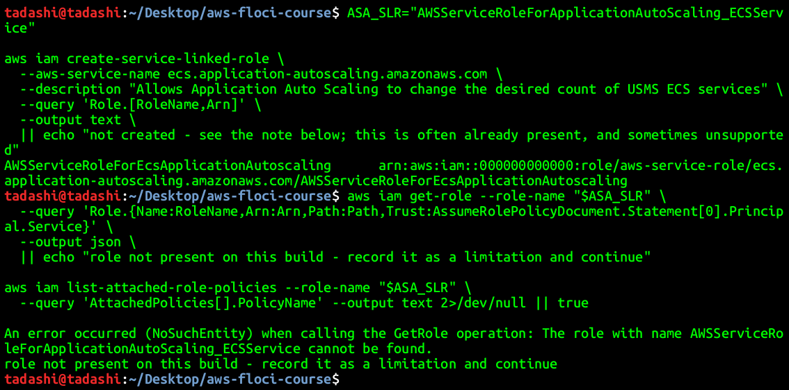

**Screenshot 7 - The role Floci created, read back**

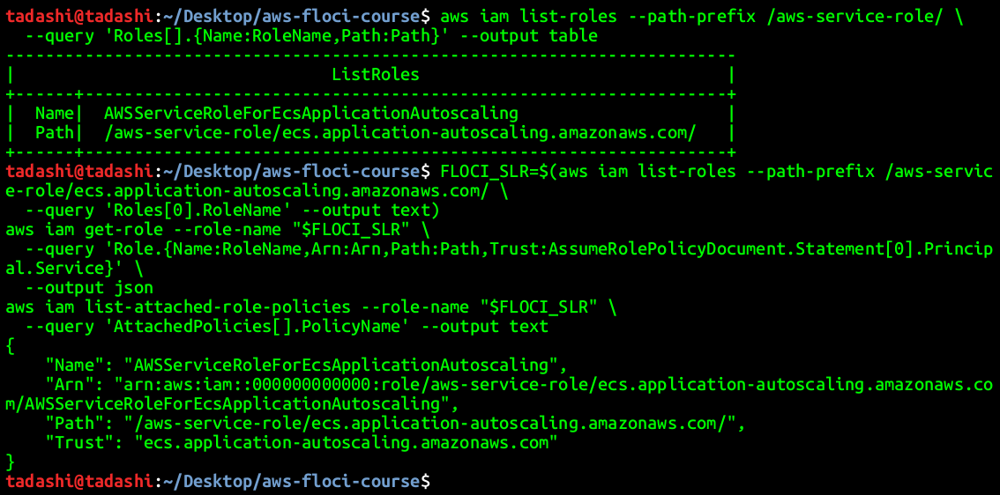

### Step 5 - Register the scalable target

**Purpose:** Create the object every policy attaches to, holding the floor of 2 and the ceiling of 10.

**What I did:** Built the resource ID from the service ARN (everything after the last colon), checked it had three segments starting with `service`, and registered it with tags.

```bash
SVC_ARN=$(aws ecs describe-services ... --query 'services[0].serviceArn' --output text)
RID="${SVC_ARN##*:}"; SDIM="ecs:service:DesiredCount"
aws application-autoscaling register-scalable-target --service-namespace ecs \
  --resource-id "$RID" --scalable-dimension "$SDIM" --min-capacity 2 --max-capacity 10 --tags ...
```

**Result:** The resource ID is `service/usms-ecs-cluster/usms-enrolment-svc`, and registration returned a `ScalableTargetARN`. Read back: namespace `ecs`, min 2, max 10, and three suspension switches, all false. The service is still at desired 2, because registration changes nothing when the service is already inside the bounds.

**Note:** `RoleARN` is filled in although I passed no `--role-arn`, but it names the AWS role `AWSServiceRoleForApplicationAutoScaling_ECSService`, which does not exist on this build (Step 4).

**Screenshot 8 - Resource ID derived and validated, target registered**

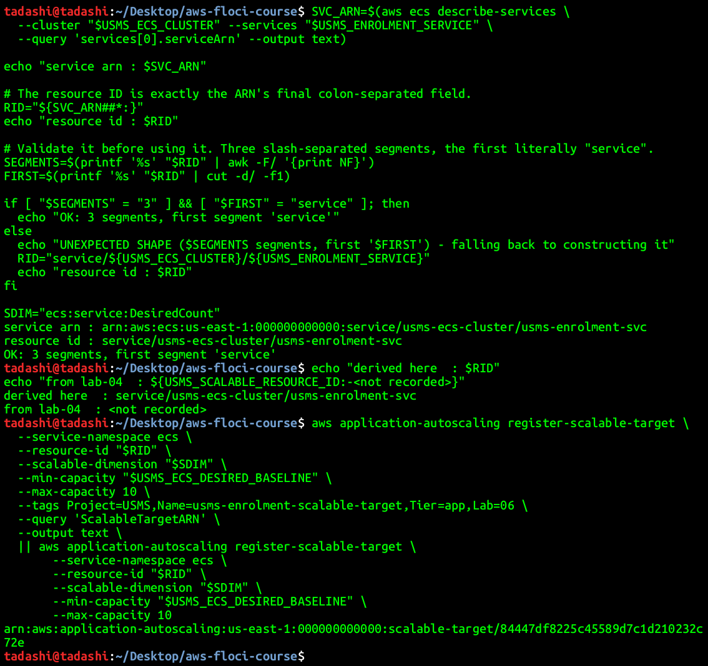

**Screenshot 9 - The scalable target read back**

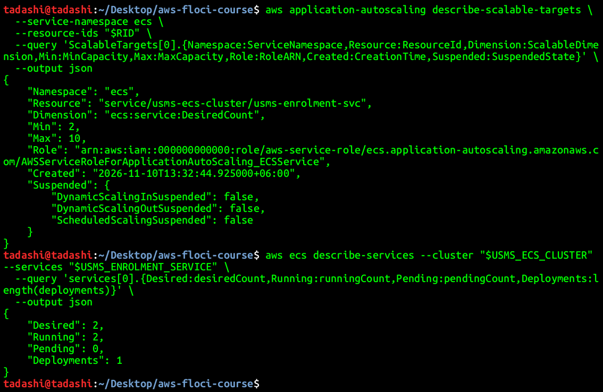

### Step 6 - Change the bounds, and learn what a re-registration is

**Purpose:** There is no update call. Registering again at the same address replaces the content, and any value I leave out stays as it was.

**What I did:** Re-registered with only `--max-capacity 12`, read it back, and put it back to 2..10. For the Your turn, I re-registered with `--min-capacity 5`, watched the service, and restored 2.

**Result:** `2 12`, so the minimum survived although I passed only the maximum. After restoring, there is exactly one target at 2..10. With the minimum at 5, Floci stored `5 10` but `desiredCount` stayed at 2 for three polls. On real AWS the registration would raise it to 5 at once. The answers to the Your turn questions are in `notes/lab-06-notes.md`.

**Screenshot 10 - Re-registration keeps omitted values**

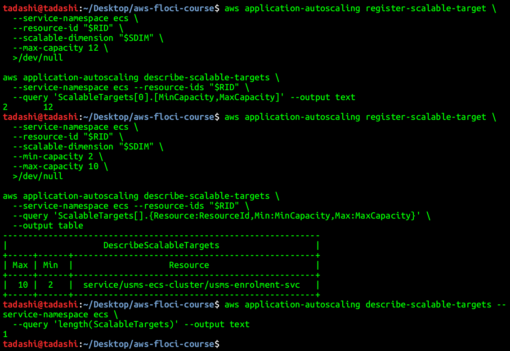

**Screenshot 11 - Your turn: MinCapacity 5 stored but not enforced, then restored**

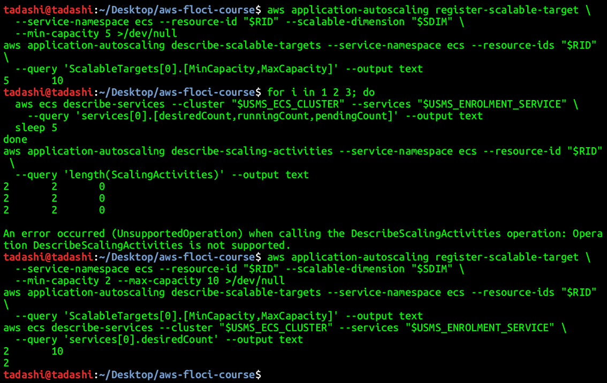

### Step 7 - Create the CPU target tracking policy

**Purpose:** The first policy keeps average CPU near 50 per cent of the task's reservation, scaling out after 60 s and in after 300 s.

**What I did:** Wrote `templates/lab-06-target-tracking-cpu.json` with a quoted heredoc (the document has no variables), validated it, and created the policy.

```bash
aws application-autoscaling put-scaling-policy ... --policy-name usms-enrolment-cpu-target-tracking \
  --policy-type TargetTrackingScaling \
  --target-tracking-scaling-policy-configuration file://templates/lab-06-target-tracking-cpu.json
```

**Result:** Valid JSON, with no `$` in the file. The policy ARN uses the `autoscaling` namespace and embeds the resource ID. The read-back shows target 50.0, out 60, in 300, `DisableScaleIn` false, and two alarms I did not create.

**Screenshot 12 - CPU target tracking policy**

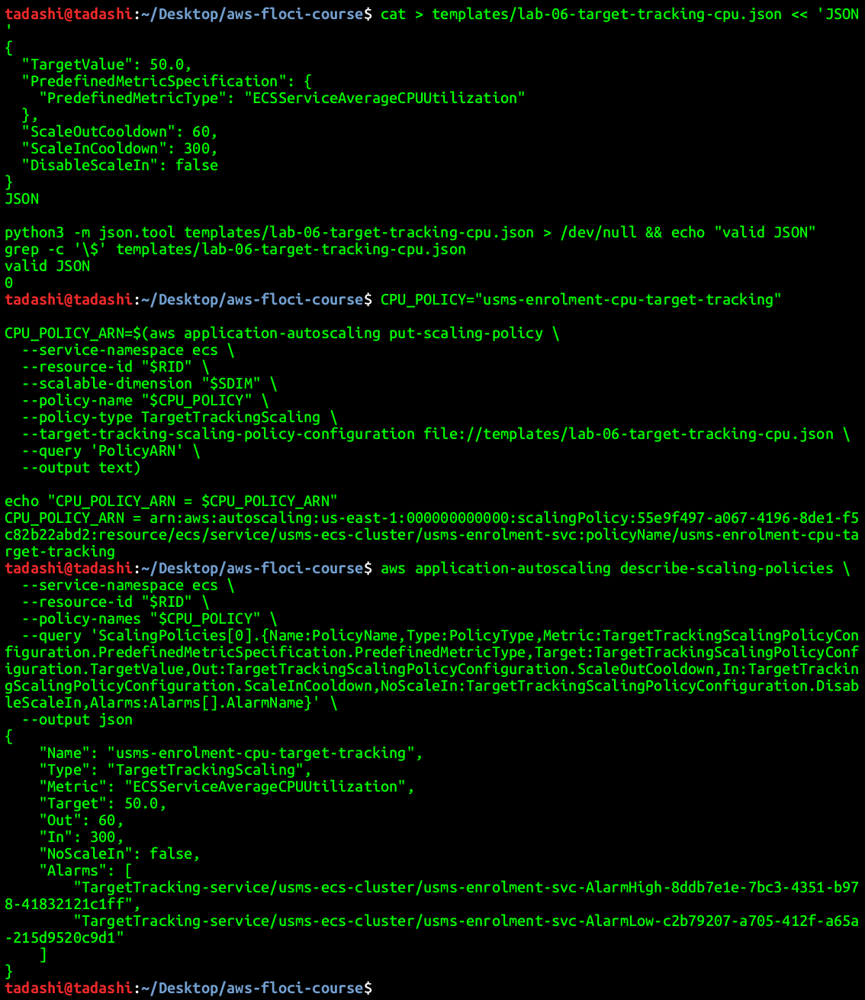

### Step 8 - Read the two alarms that target tracking created

**Purpose:** Recognise the managed alarms, so nobody deletes them.

**What I did:** Listed alarms with the prefix `TargetTracking-$RID`, checked that their actions name the CPU policy, and counted them.

**Result:** Two alarms: the high one with 3 evaluations of 60 s and the low one with 15, both with one action, which is the CPU policy's ARN, and both `INSUFFICIENT_DATA`. The prefix is derivable from the resource ID, and the count is 2. The Your turn arithmetic (about 270 s before a third task serves traffic) is in the notes.

**Note:** Floci differs from AWS in two ways. The metric name is `ECSServiceAverageCPUUtilization`, not `CPUUtilization`. Both alarms have threshold 50, so there is no dead band between the scale-out and scale-in thresholds.

**Screenshot 13 - The two managed alarms and their action**

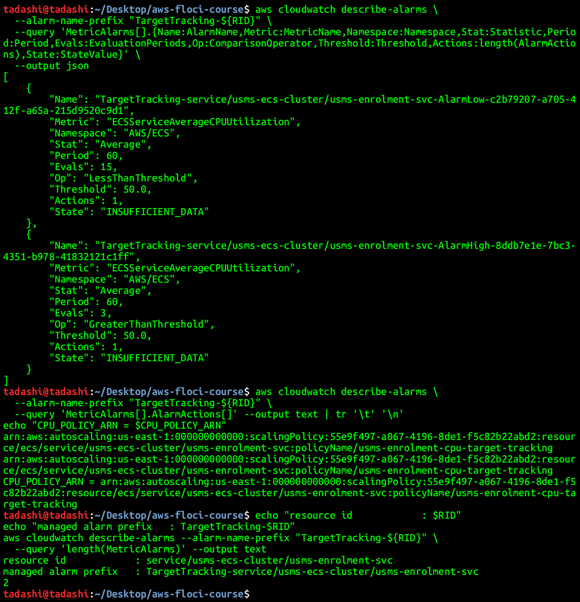

### Step 9 - Create the request-count policy

**Purpose:** `ALBRequestCountPerTarget` measures the cause of load (requests) rather than a symptom (CPU). It needs a `ResourceLabel` built from the load balancer ARN and the target group ARN.

**What I did:** Used the label Lab 05 Exercise 5 recorded, checked it against one derived from the API now, validated its shape, wrote the policy document with an unquoted heredoc so the label expands, and created the policy.

```bash
printf '%s' "$RESOURCE_LABEL" | awk -F/ '{ ... NF==6 && $1=="app" && $4=="targetgroup" ... }'
aws application-autoscaling put-scaling-policy ... --policy-name usms-enrolment-requests-target-tracking ...
```

**Result:** `app/usms-enrolment-alb/d296feaef42f4915/targetgroup/usms-enrolment-tg/53d3bb8142914d08` has six segments, `app` first and `targetgroup` fourth, and matches the API. The document has no unexpanded `$`. Two policies, each with two alarms.

**Screenshot 14 - ResourceLabel validated, document written**

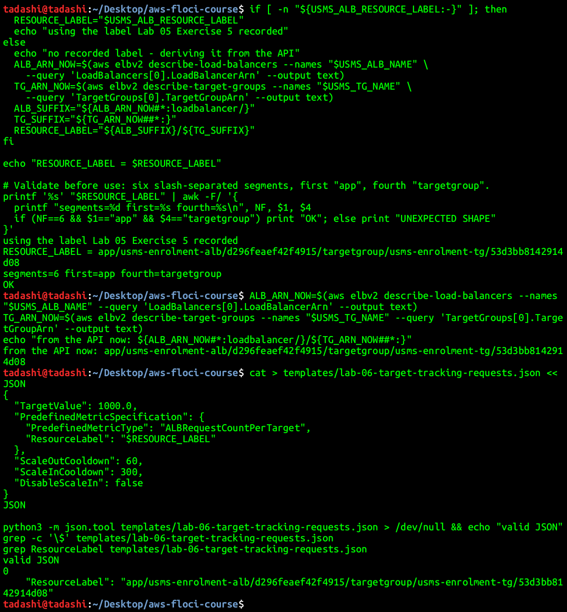

**Screenshot 15 - Two target tracking policies**

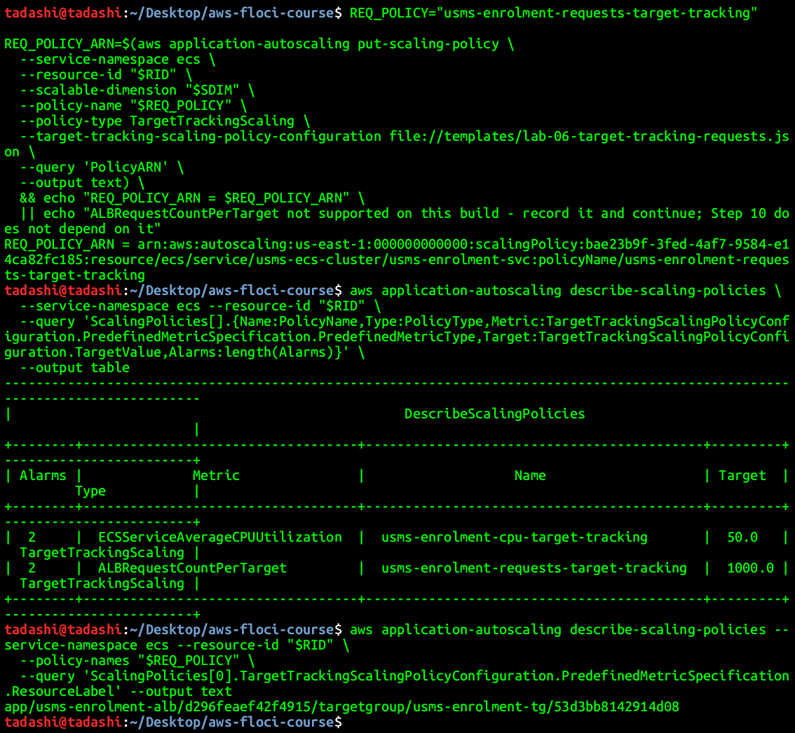

### Step 10 - Create a step scaling policy and the alarm that drives it

**Purpose:** "At a queue depth of 100 add one task; at 200 add three" is a piecewise rule with no set point, which target tracking cannot express. Owning the alarm also makes the chain visible.

**What I did:** Published three datapoints of the custom metric `USMS/Enrolment EnrolmentQueueDepth`, wrote the step table (breach 0 to 100 gives +1, breach 100 and above gives +3), created the policy, then created `usms-enrolment-queue-high` (`Average >= 100`, 1 x 60 s, `notBreaching`) with the policy's ARN as its action.

```bash
aws cloudwatch put-metric-data --namespace USMS/Enrolment --metric-name EnrolmentQueueDepth --value 3 ...
aws application-autoscaling put-scaling-policy ... --policy-type StepScaling --step-scaling-policy-configuration file://...
aws cloudwatch put-metric-alarm --alarm-name usms-enrolment-queue-high ... --alarm-actions "$STEP_POLICY_ARN"
```

**Result:** The metric is listed with its dimension. The policy has two steps, and the top one has no upper bound. The alarm reads back with the step policy ARN as its only action.

**Note:** The step policy's `Alarms` list is empty on Floci. On AWS it would list `usms-enrolment-queue-high`, although I only told the alarm about the policy.

**Screenshot 16 - Custom metric published, step table written**

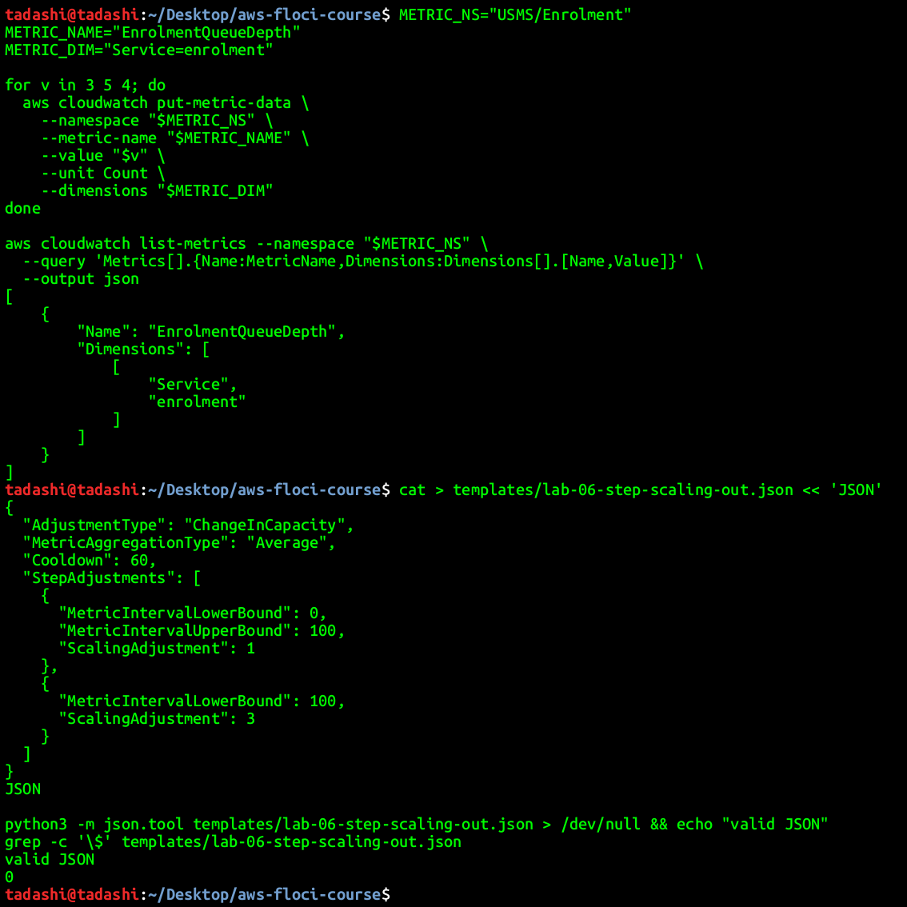

**Screenshot 17 - Step policy and its alarm**

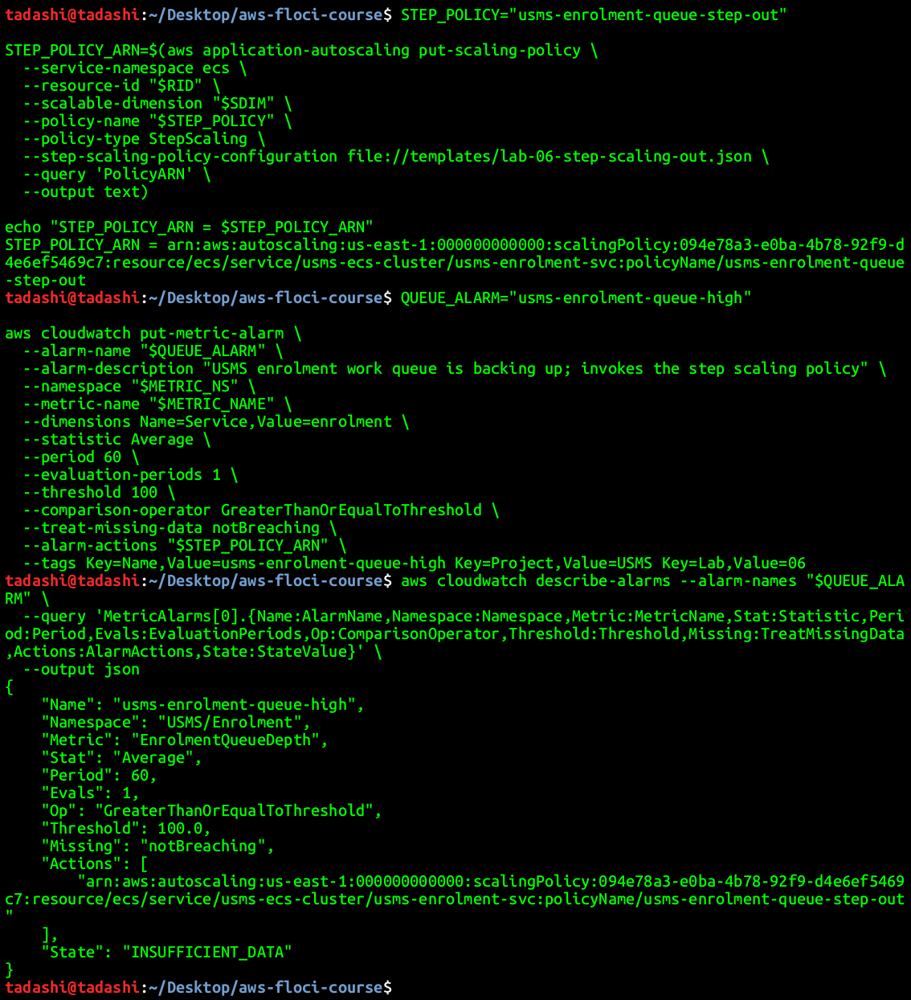

**Screenshot 18 - Step policy read back**

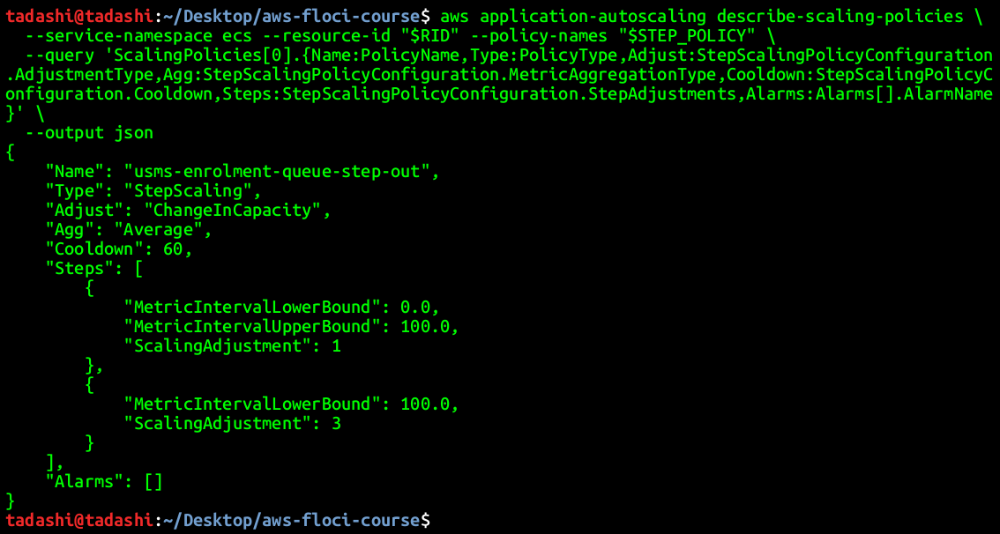

### Step 11 - Create two scheduled actions

**Purpose:** Scheduled scaling is the only kind that can be early. It raises the floor to 4 at 07:45 Bhutan time on weekdays and lowers it to 2 at 20:00.

**What I did:** Ran `put-scheduled-action` with `--timezone Asia/Thimphu`, then the lab's UTC fallback (01:45 and 14:00 UTC), and tried the Your turn's one-off `at()` action.

**Result:** Every call returned `UnsupportedOperation: Operation PutScheduledAction is not supported`, and so did `describe-scheduled-actions` and `delete-scheduled-action`. No action exists. The floor is still 2..10. This matches the course's Known Issues entry for Lab 06.

**Course alternative:** I ran the Known Issues local controller, `student-fallback-demo.py scaling`. Its worker processes went 3 -> 1 for the accelerated morning/evening schedule, then 3 -> 1 as a synthetic queue went from 20 to 0, then 0. It shows the idea of time-based and queue-based scaling. It uses synthetic inputs and no ECS autoscaler, so it does not prove that Application Auto Scaling schedules work.

**Screenshot 19 - PutScheduledAction unsupported, with timezone and in UTC**

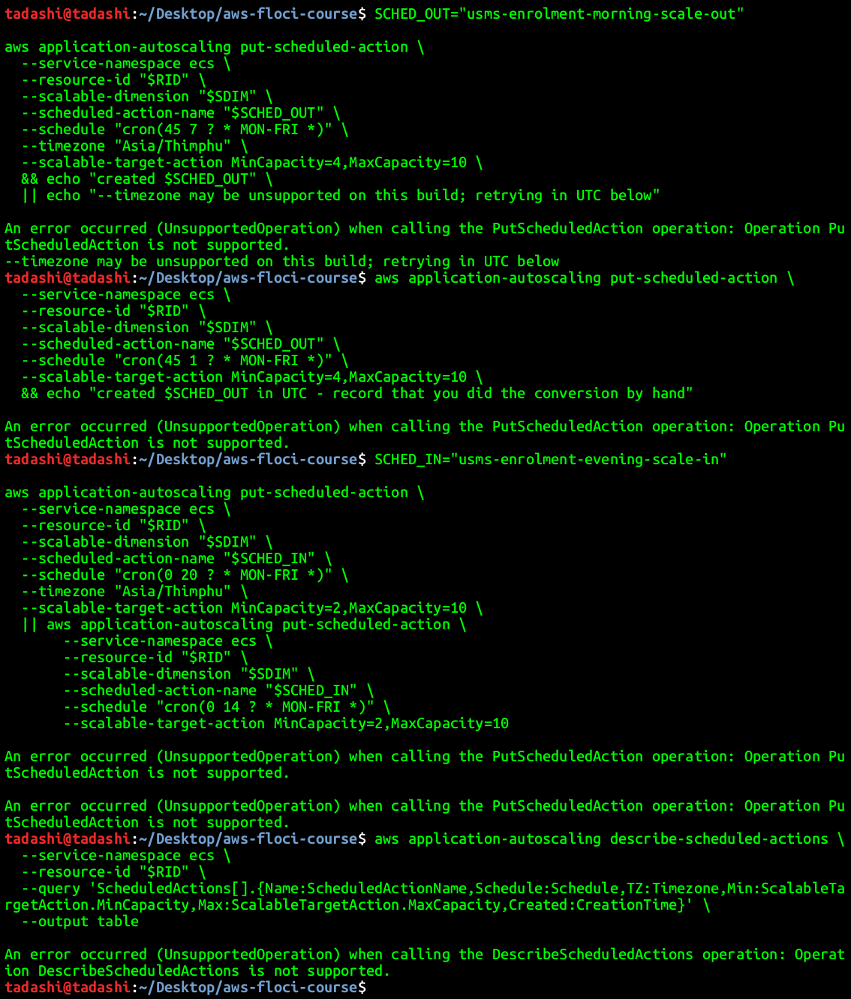

**Screenshot 20 - Your turn: the at() action, and putting the floor back**

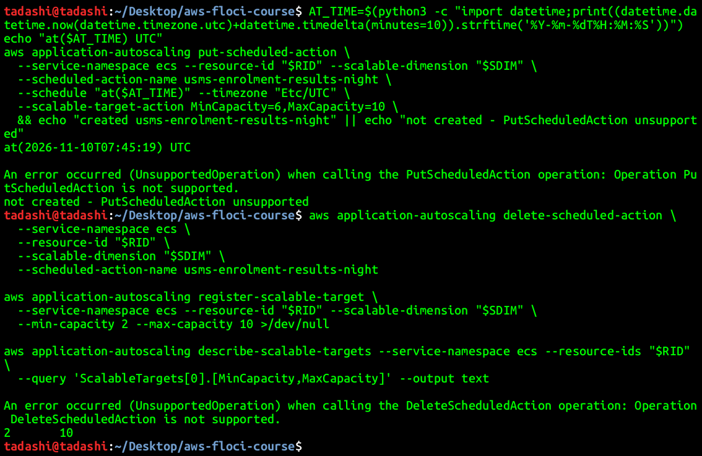

**Screenshot 21 - Known Issues alternative 1: the local controller**

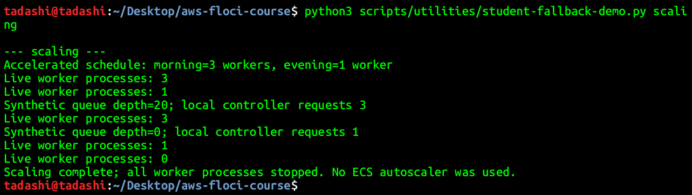

### Step 12 - Fire the alarm, and prove what moved the number

**Purpose:** This is the one step where `desiredCount` could change without me typing a number. The proof needs a number that moved and a record of who moved it.

**What I did:**

1. Recorded the time and the count (2 2 0) in `outputs/lab-06-pre-scale.txt`.
2. Published three datapoints of 260. A breach of 160 falls in the open-ended step, so I predicted +3, from 2 to 5.
3. Polled the alarm for two minutes.
4. Forced it to `ALARM` with `set-alarm-state`, then polled the service and asked for scaling activities.
5. Ran the six-block fallback proof into `outputs/lab-06-scaling-proof.txt`.

**Result:** `get-metric-statistics` shows the 260 datapoint, but the alarm stayed `INSUFFICIENT_DATA` with reason `Unchecked`, so Floci does not evaluate alarms. `set-alarm-state` worked: the alarm read `ALARM` with my reason. But `desiredCount` stayed at 2 for ten polls, and `describe-scaling-activities` is unsupported. **I did not observe a policy scaling the service, and I am not claiming one.**

The fallback proof is complete. The alarm watches `EnrolmentQueueDepth >= 100` and is in `ALARM`. Its action is the step policy's ARN, which belongs to `usms-enrolment-queue-step-out` on `service/usms-ecs-cluster/usms-enrolment-svc`, dimension `ecs:service:DesiredCount`. A breach of 160 selects +3, clamped to 2..10, so on AWS `desiredCount` would become 5. Block 6 says 2: the chain is proven, and the link this build did not connect is the alarm action invoking the policy.

**Screenshot 22 - Metric pushed to 260, alarm never evaluated**

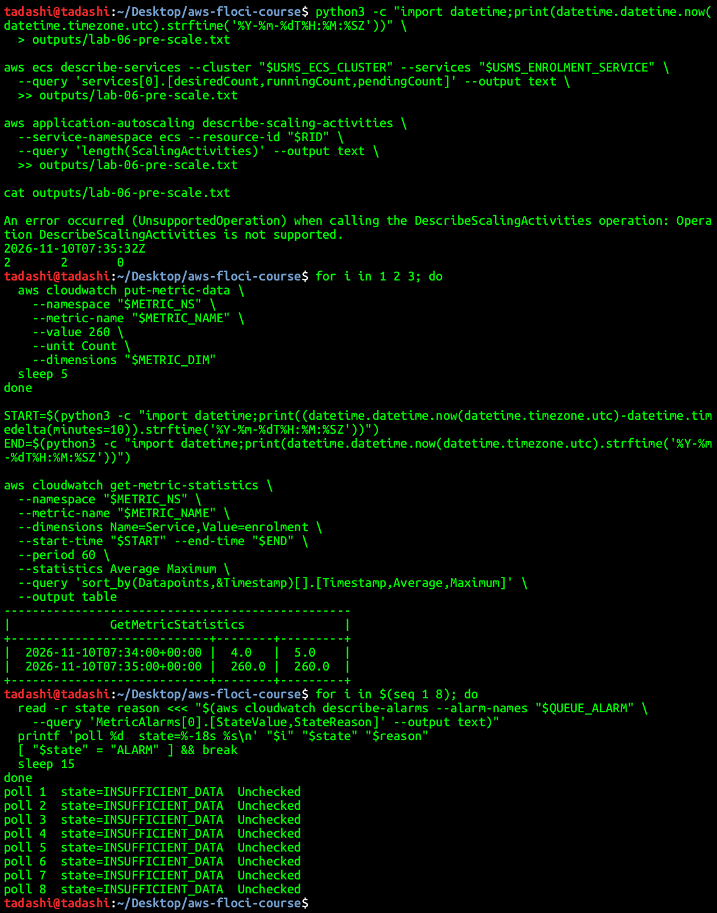

**Screenshot 23 - Alarm forced to ALARM, desiredCount unchanged, no activity log**

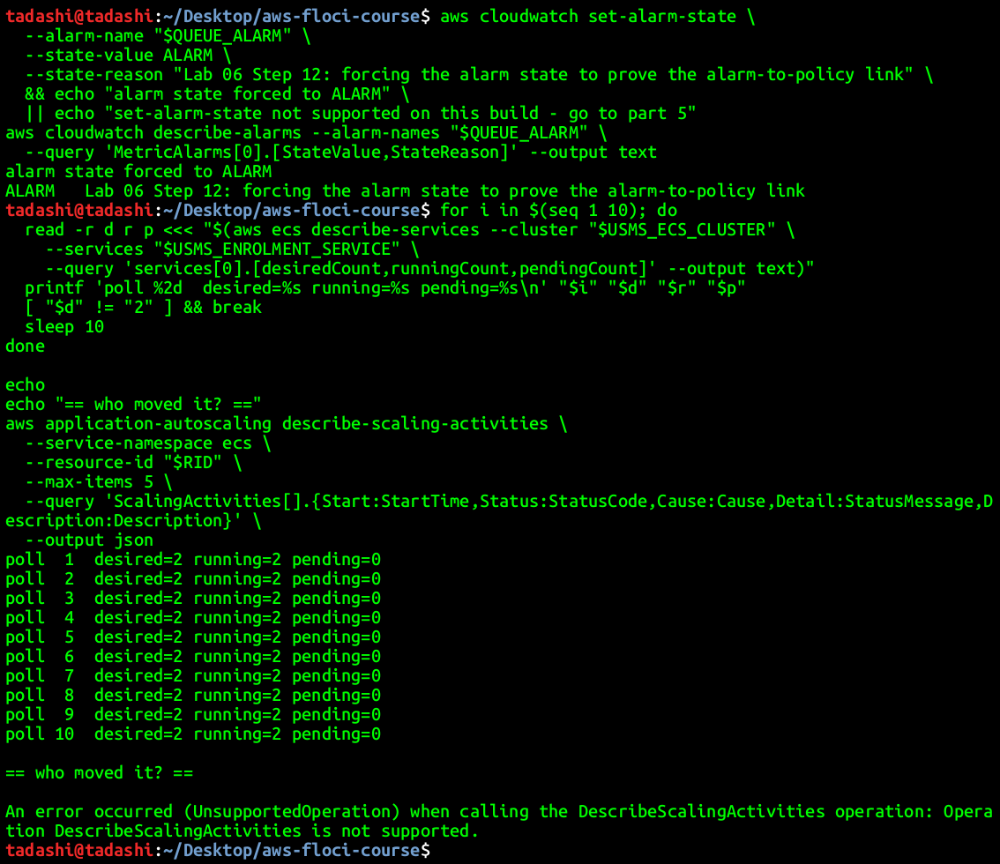

**Screenshot 24 - The six-block wiring proof**

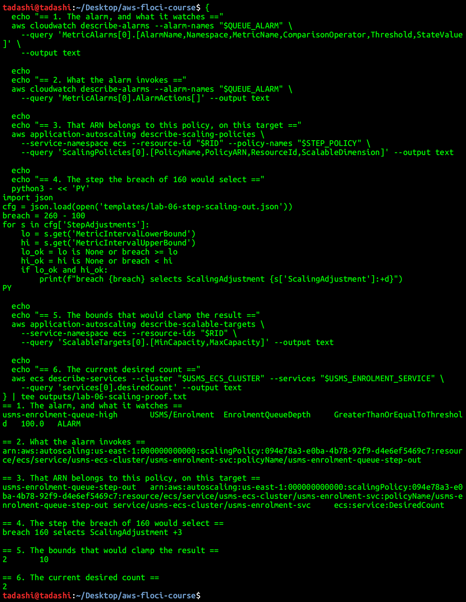

**Course alternative:** Known Issues alternative 2, a manual scale. I recorded the original count (2), set it to 5 (the count the policy would have chosen), and polled. The text output columns are `desired pending running`, and running reached 5 within about 5 s: the service converges on a new desired count. This is a manual scale, not a policy acting.

**Screenshot 25 - Known Issues alternative 2: manual scale to 5**

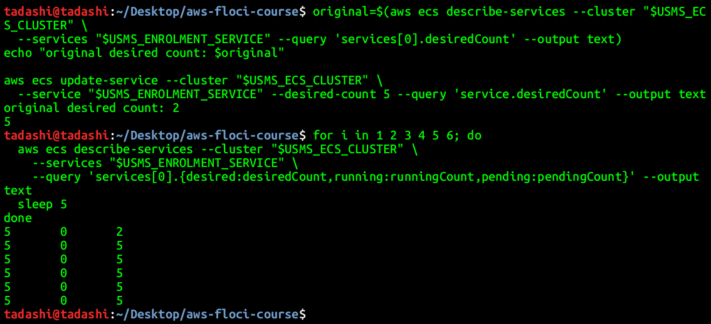

**Returning to the baseline:** I set the alarm back to `OK`, pushed the metric down (4, 3, 2) *first*, then set the count to 2, because a policy still watching a high metric would scale out again. Before and after both read `2 2 0`.

**Screenshot 26 - Back at the baseline**

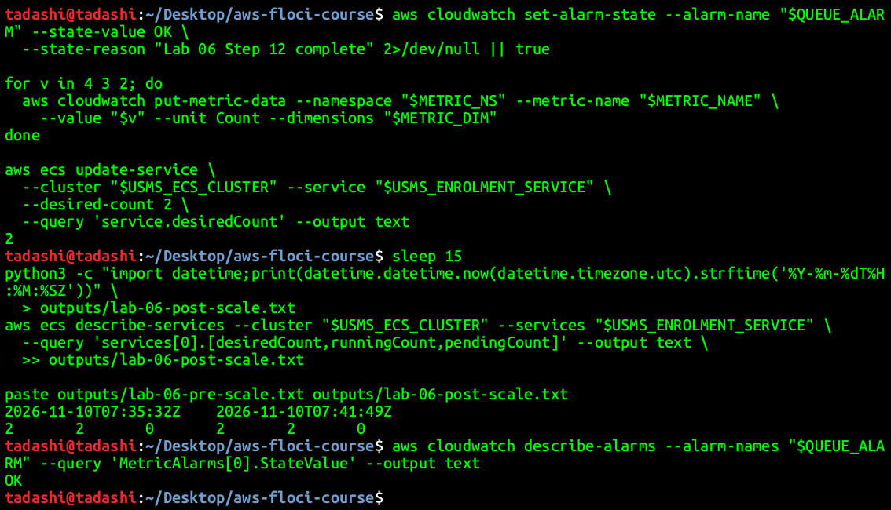

### Step 13 - Suspend and resume scaling

**Purpose:** Stop scaling without deleting it, for example during a deployment. Suspension is part of the scalable target, so one call covers every policy.

**What I did:** Wrote `templates/lab-06-suspended-state.json` (scale-in suspended, the other two not) and applied it by re-registering. Then I checked the policies were untouched, and resumed with the shorthand form.

```bash
aws application-autoscaling register-scalable-target ... --suspended-state file://templates/lab-06-suspended-state.json
aws application-autoscaling register-scalable-target ... \
  --suspended-state DynamicScalingInSuspended=false,DynamicScalingOutSuspended=false,ScheduledScalingSuspended=false
```

**Result:** While suspended: one `true`, two `false`, and bounds unchanged at 2..10. All three policies and the four managed alarms are unchanged. After resuming, the three values are `False False False`, and `grep -ci true` prints `0`. The capital `F` in the text output is why the `-i` matters.

**Screenshot 27 - Scale-in suspended, policies untouched**

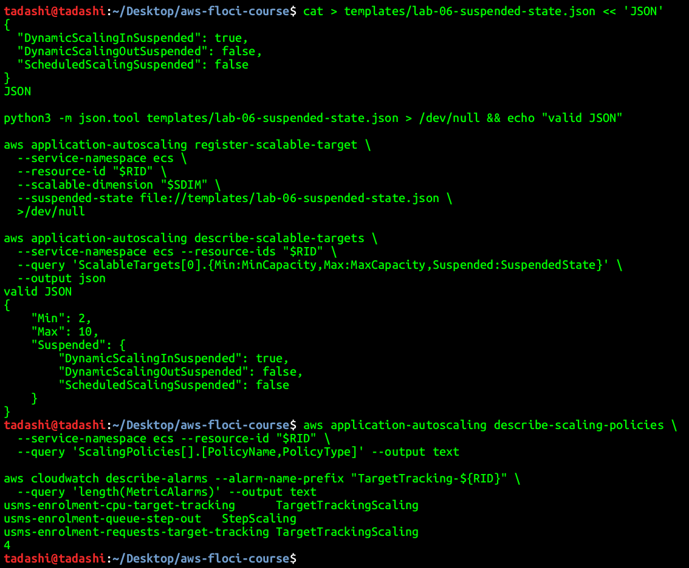

**Screenshot 28 - Resumed, zero switches true**

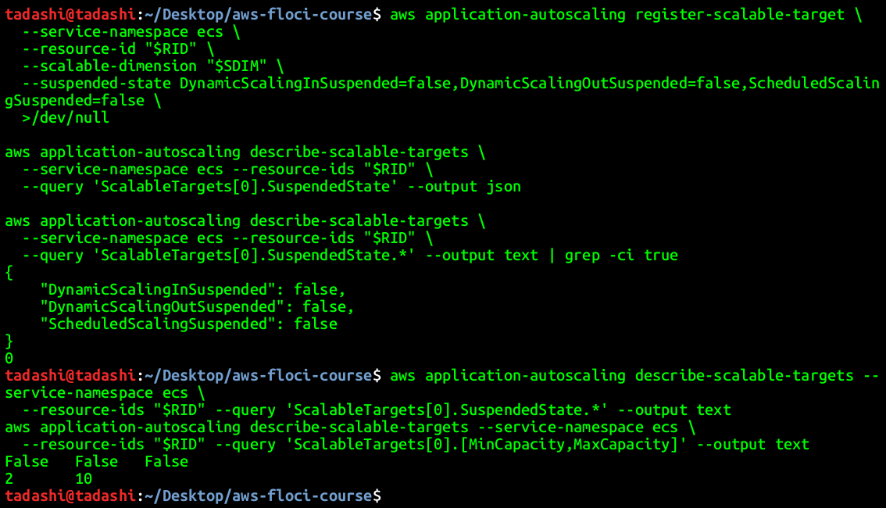

### Step 14 - Prove the scaling configuration survives a restart

**Purpose:** The configuration spans Application Auto Scaling, CloudWatch, ECS and IAM, and all of it must persist.

**What I did:** Recorded the target, its suspension state, the three policies, the CPU and step configurations, the scheduled actions and the custom alarm in `outputs/lab-06-pre-restart.txt`. Then I stopped and started Floci, re-derived every identifier from the API, recorded the same facts again, and compared the two files.

**Result:** `PERSISTENCE PROVEN`. Every identifier was re-derived (the step policy by its type, the CPU policy by part of its name). The scheduled-action line is empty in both files, because the call is unsupported, so that part of the line claims nothing.

**Problem on the first attempt:** `floci-up.sh` timed out after 180 s. `docker ps` showed the container as running and unhealthy, but it had 0 processes and had already exited. The state files on disk (`application-autoscaling-*.json`, `cwalarms.json`, `cwmetrics.json`) were intact. A second `floci-down.sh` / `floci-up.sh` brought it back, and I repeated parts 2 and 3. The screenshots are from that clean run.

**Screenshot 29 - Configuration recorded before the restart**

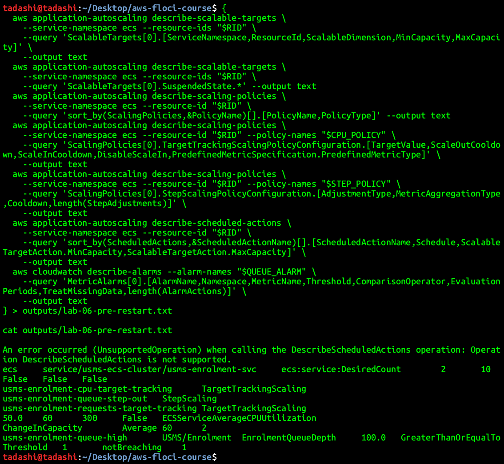

**Screenshot 30 - Floci stopped and started (state kept)**

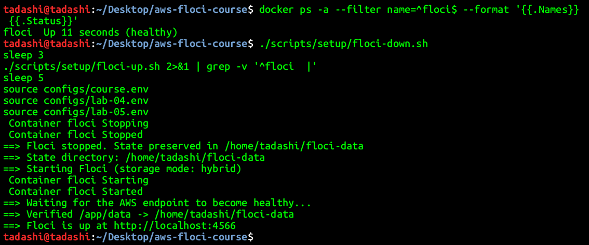

**Screenshot 31 - Identifiers re-derived, PERSISTENCE PROVEN**

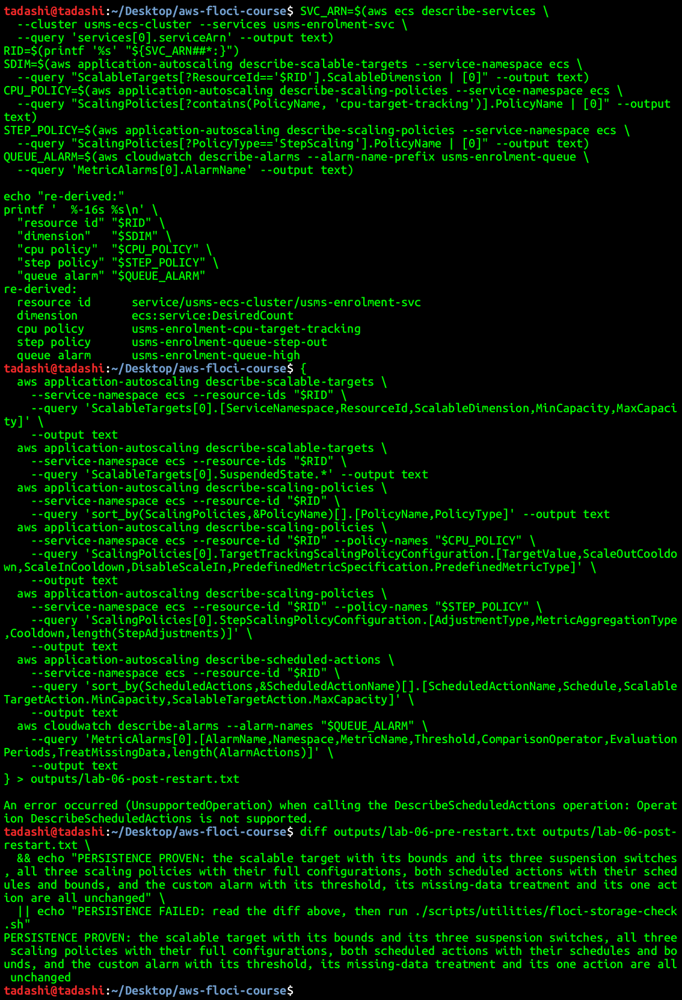

### Step 15 - Close the loop: from one request to one new task

**Purpose:** Trace the whole path from metric to serving task, and see how little of it this lab created.

**Result:** Blocks 1 to 3 are this lab: three alarms with their thresholds, three policies, and the one integer with its bounds 2..10. Block 4 is Lab 04's service on `usms-enrolment:2`, with the grace period `None` (the Lab 05 limitation). Block 5 is the two private subnets with no public IP. Block 6 is empty, because the attachment was not kept and no targets are registered. Block 7 errors on `length(null)` as in Step 2; with a null-safe query it reads `usms-enrolment:2  0  1`. The revision and the deployment count are what Lab 05 left. The nine-line chain is in the notes; this lab owns three lines of it.

**Note:** Floci files the request-count managed alarm under namespace `AWS/ECS`. On AWS it would be `AWS/ApplicationELB`.

**Screenshot 32 - The seven blocks**

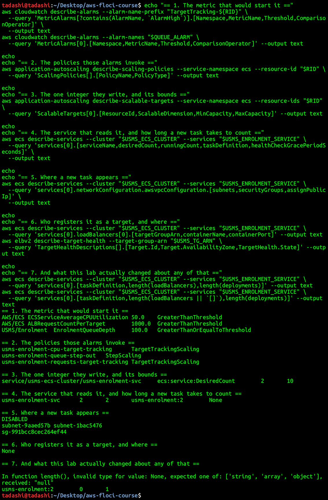

### Step 16 - Write configs/lab-06.env

**Purpose:** Record every name and ARN by lookup, so a populated value is evidence that the resource exists.

**What I did:** Wrote the file with the lab's unquoted heredoc, then sourced it and printed twelve values.

**Result:** 22 exports, bounds `2 .. 10`, and three policy ARNs. But `USMS_SCALABLE_RESOURCE_ID` was **empty**. The lab escapes `$NF` as `\$NF` inside `$(...)`, where the single quotes already protect it, so awk received the backslash and failed (`awk: 1: unexpected character '\'`). I filled in the value from the API with a small Python edit and confirmed that it matches `describe-scalable-targets`. The fix to the lab is to write `'{print $NF}'` without the backslash.

**Screenshot 33 - The env file written; the empty resource ID**

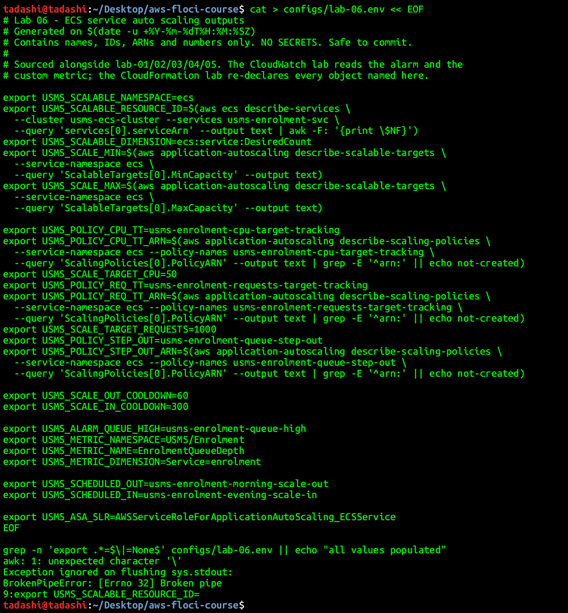

**Screenshot 34 - Twelve values read back (resource ID empty)**

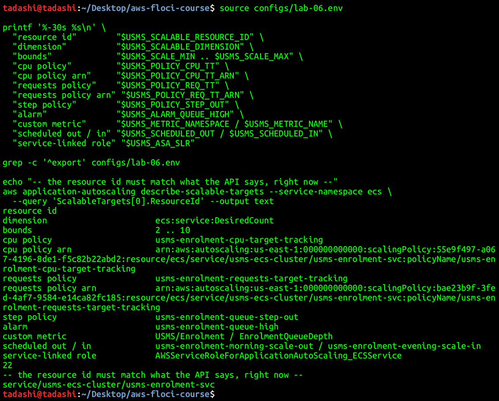

**Screenshot 35 - Resource ID filled in from the API, all values populated**

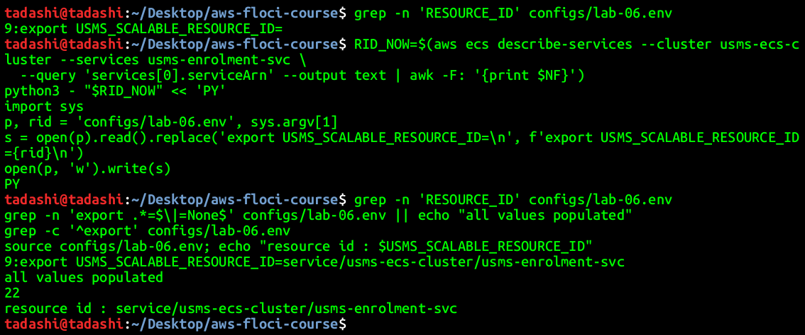

### Step 17 - Check what is safe to commit, then commit

**Purpose:** Repair the stale cleanup-order hint, look before adding, and commit with explicit paths.

**What I did:**

1. **Repaired the hint.** The lab's script replaces every `lab-04-cleanup.sh` in the Lab 04 and 05 cleanup scripts. `lab-04-cleanup.sh` has none. `lab-05-cleanup.sh` has five, but two of them are correct ("Run BEFORE lab-04-cleanup.sh" and "lab-04-cleanup.sh may now run"), so I replaced only the three that name the script to run first. I backed up the file and checked it with `bash -n`.
2. **Checked what git would see.** I ran `git status` and `git check-ignore -v`: nothing under `outputs/` is staged, and `outputs/lab-06-scaling-proof.txt` is ignored by `.gitignore:8: outputs/*`.
3. **Committed** the lab's files by explicit path. The commit is local and was not pushed.

**Note:** `configs/lab-06.env` is not in the commit. This repository's `.gitignore` has `configs/*.env` (line 42), which is why the Lab 01 to 05 env files are not tracked either. I kept that rule, rather than force-adding one file against it. The commit message is the one the lab gives, so it names the two scheduled actions, which are designed in the lab but could not be created on this build.

**Screenshot 36 - Hint strings repaired; only the "run first" lines changed**

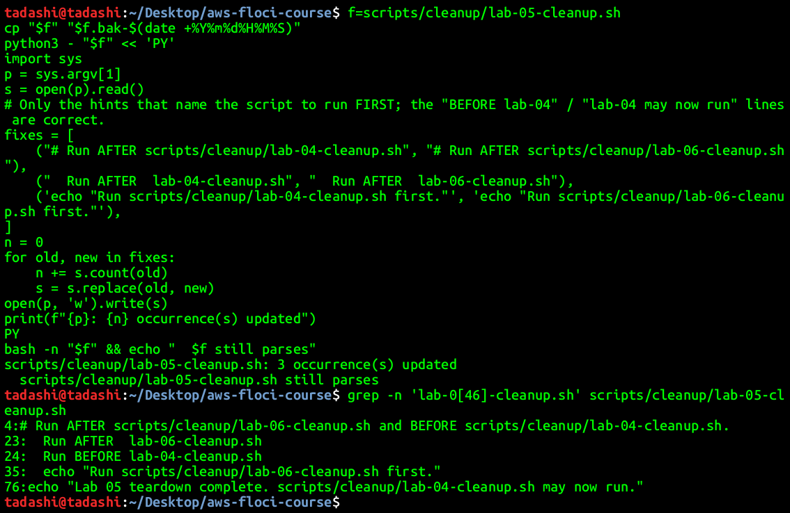

**Screenshot 37 - Look before adding**

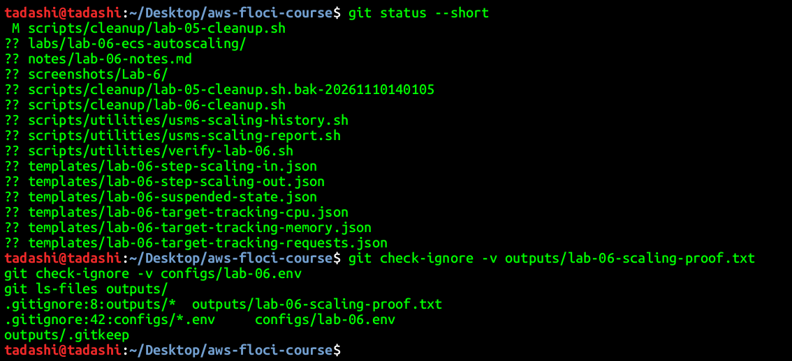

**Screenshot 38 - The Lab 06 commit**

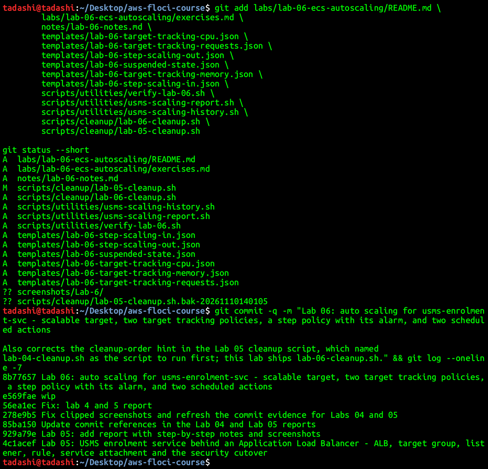

### Independent exercises

Full write-ups are in [exercises.md](exercises.md). In summary:

#### Exercise 1 - A memory policy, and a scale-out-only policy

`usms-enrolment-memory-target-tracking` (memory 70, in 600, `DisableScaleIn: true`). Floci created six managed alarms where AWS creates five: it also made the low alarm, which a scale-out-only policy does not need.

**Screenshot 39 - Exercise 1**

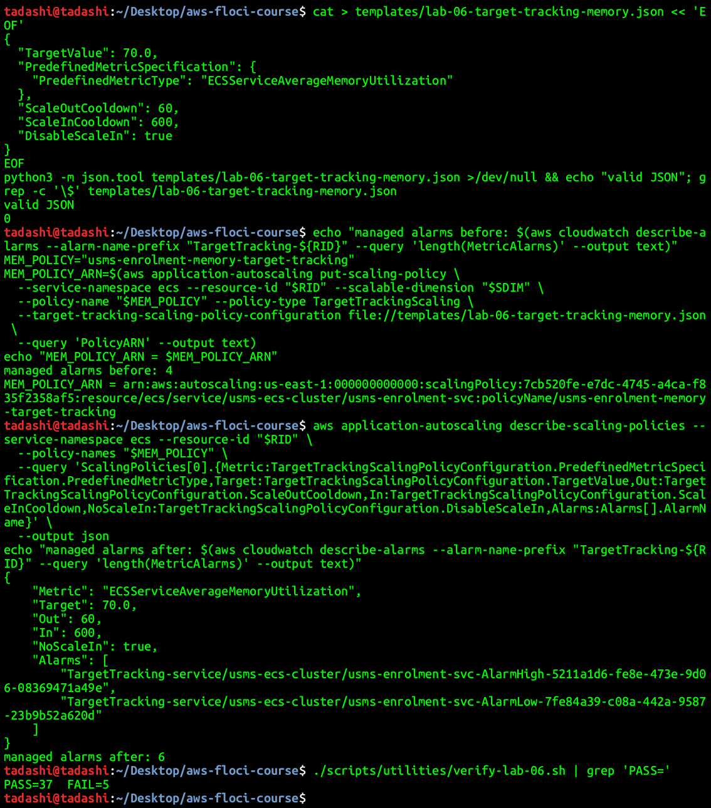

#### Exercise 2 - The scale-in half of step scaling

Scale-in steps with non-positive bounds and negative adjustments, cooldown 300, and an alarm at `< 20` for 3 x 60 s. Forcing it changed nothing, and the -2 step is unreachable from the floor of 2. I deleted the alarm first, then the policy.

**Screenshot 40 - Exercise 2 policy, alarm and forced state**

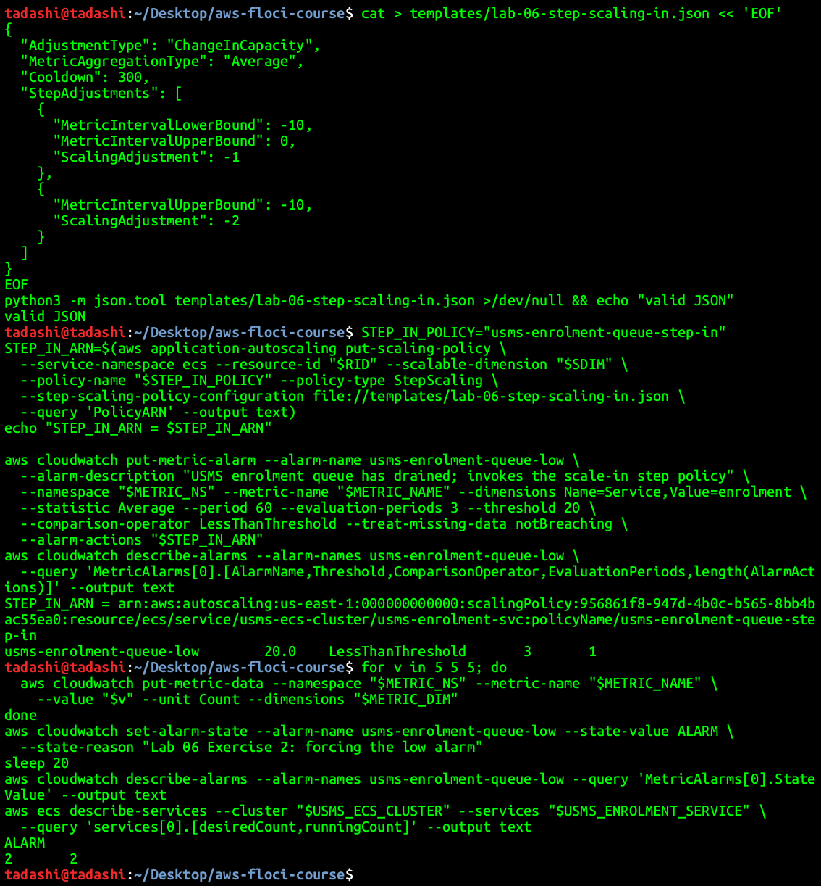

**Screenshot 41 - Exercise 2 deletions in dependency order**

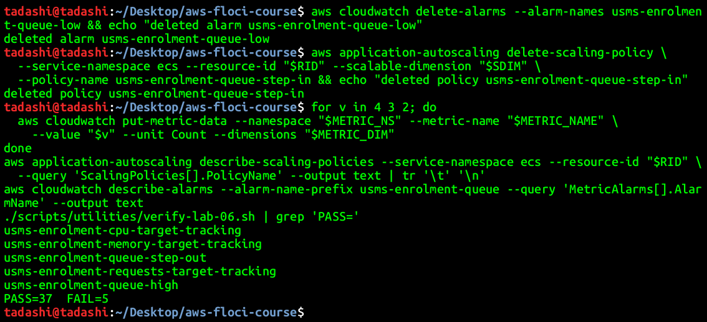

#### Exercise 3 - Scaling report tool

`scripts/utilities/usms-scaling-report.sh` prints the decision table and verdict for each `usms-` target, and its output is the same from any directory. The verdict was `AT-FLOOR` normally, `FROZEN` while suspended, and `PINNED` at 3/3.

**Screenshot 42 - Report identical from two directories**

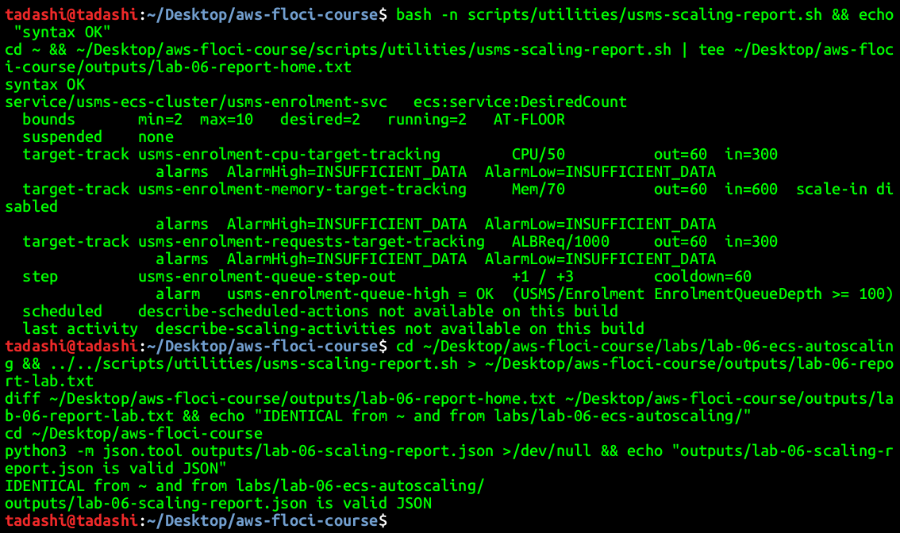

**Screenshot 43 - FROZEN, PINNED and back to AT-FLOOR**

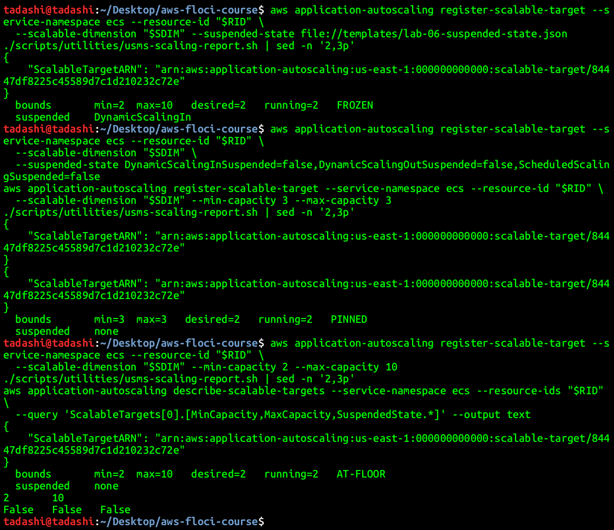

#### Exercise 4 - The enrolment-week capacity plan

The analysis covers reaching the ceiling in about 13.5 minutes, 10 tasks giving about 167 requests per second against a need of about 80 tasks, 251 usable addresses per /24, the scheduled-action plan, and about $26.80 of additional cost for the enrolment month. It also lists three things I need from the project lead. For the tidy-up I deleted the Exercise 1 policy, which leaves four managed alarms and three policies.

**Screenshot 44 - Exercise 4 tidy-up**

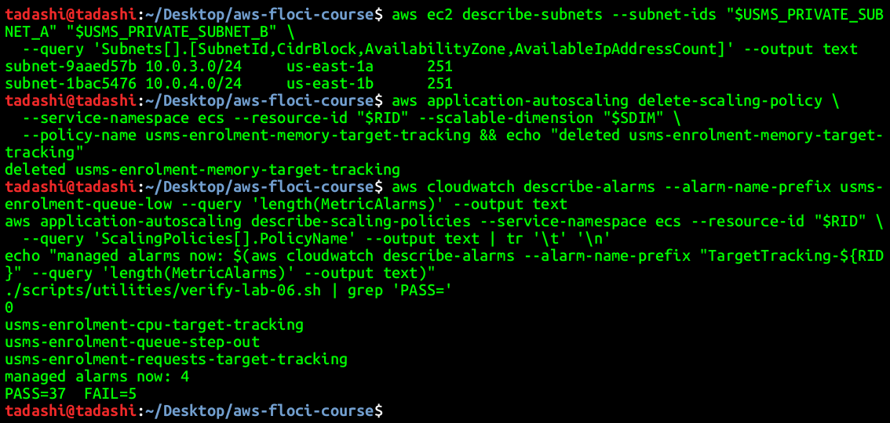

#### Exercise 5 - The hand-off to Lab 10

`scripts/utilities/usms-scaling-history.sh` writes `outputs/lab-06-scaling-history.json` (10,262 bytes). The latency could not be measured because the floor is not enforced, so I used the cited 30 s figure. The env file now has 24 exports. The bucket ARN was read from the policy document, and `head-bucket` returned 404 with exit code 254.

**Screenshot 45 - History export**

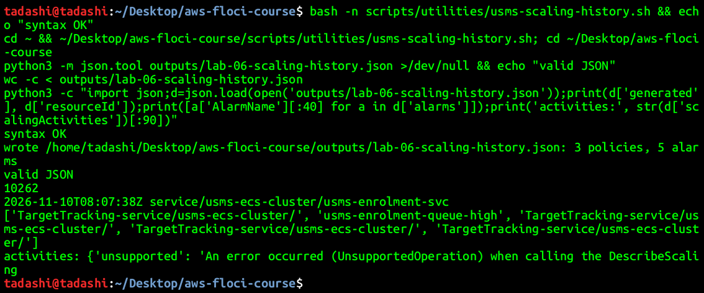

**Screenshot 46 - Latency attempt and cited figure**

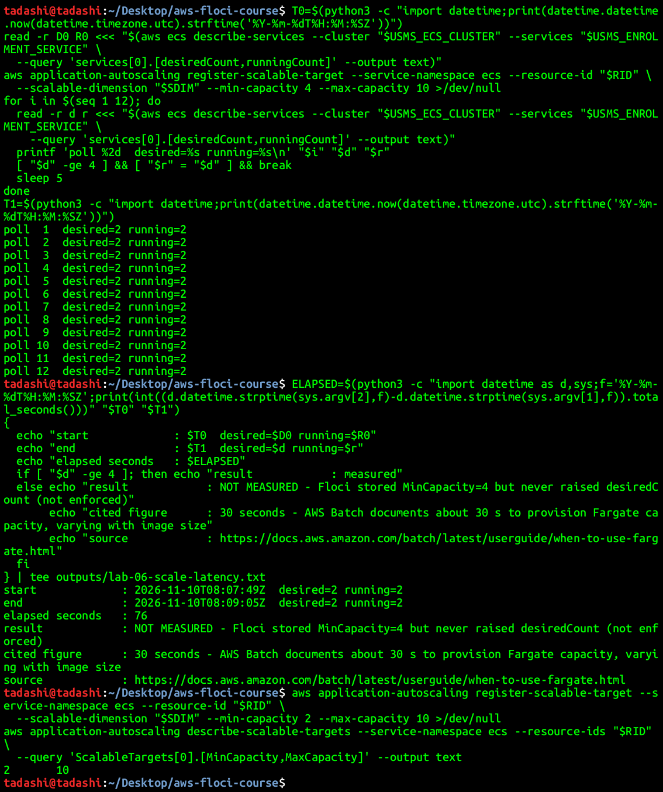

**Screenshot 47 - Env file extended, bucket ARN read from the policy**

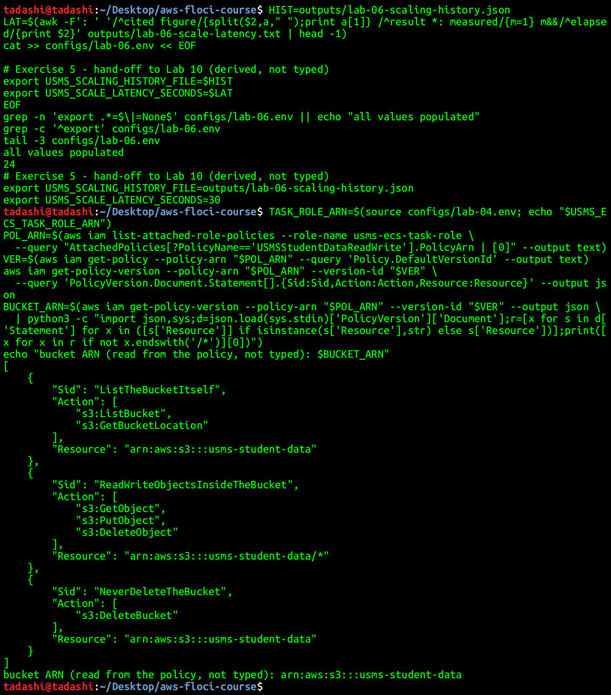

**Screenshot 48 - Readiness file for Lab 10**

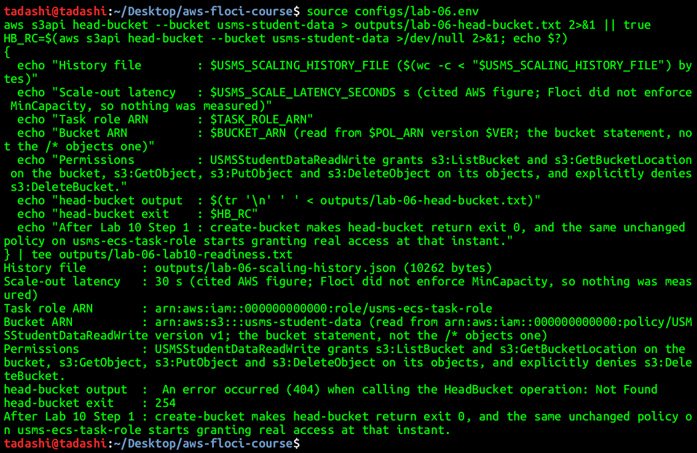

## 6. Results and Evidence

### 6.1 CLI Output

The command output for each build step is shown under that step in Section 5. This section shows the checks on the finished system.

**Lab verification script.** `verify-lab-06.sh` makes 42 read-only checks of the environment, the earlier labs, the scalable target, the policies, the alarms, the scheduled actions, the service state, the custom metric, and Git hygiene. It reports `PASS=37 FAIL=5`, where the lab expects `PASS=42 FAIL=0`. Section 7 explains each failure. The checks that exist to catch real hazards all pass: no suspension switch left on, `MinCapacity` at 2, and `desiredCount` back at the baseline.

**Screenshot 49 - verify-lab-06.sh (PASS=37 FAIL=5)**

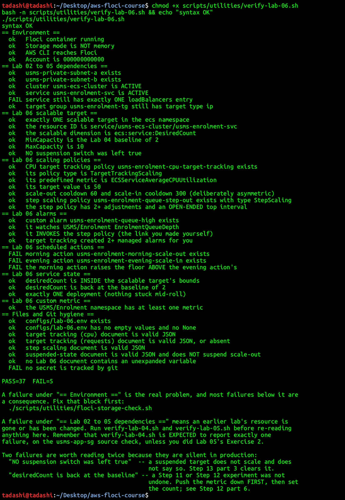

**Cleanup script.** `lab-06-cleanup.sh` is for the end of the course only, so I only checked its syntax and did not run it.

**Screenshot 50 - Cleanup script passes the syntax check and was not run**

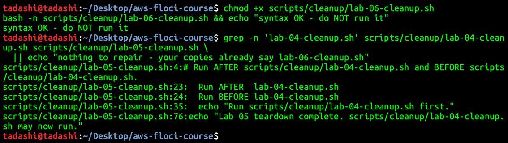

**Final readiness.** The Lab 05 verification output is identical to the one captured in Step 2 (an empty diff), so this lab changed nothing that Lab 05 checks. There is one scalable target at `2 10`, zero suspension switches on, desired 2 with one deployment on `usms-enrolment:2`, and 24 exports.

**Screenshot 51 - Final readiness**


**End-of-lab backup.** `floci snapshot save` failed with HTTP 400, as in Lab 05, so I used the lab's fallback: stop Floci, archive the data directory to `~/floci-data-lab-06.tar.gz` (111 KB), and start Floci again. `verify-lab-06.sh` still reported `PASS=37 FAIL=5` afterwards.

**Screenshot 52 - Snapshot unavailable, and the filesystem fallback**


### 6.2 AWS Management Console Verification

This course runs on Floci, so there is no AWS Management Console. The Floci UI at `http://localhost:4500` is the local equivalent.


*Floci Console Home confirms the local AWS runtime is reachable under account 0000-0000-0000.*

The Floci UI has no CloudWatch, IAM, ECS or Application Auto Scaling pages in this version, so the scalable target, policies and alarms cannot be shown there. Their verification is the `describe` output in Section 5. The console's own service list confirms which pages exist:


*The Floci UI's API lists ten AWS service pages, none of them CloudWatch, IAM or Application Auto Scaling.*

## 7. Analysis and Discussion

**What was achieved.** The whole scaling configuration was built and read back: the service-linked role (under Floci's name), the scalable target at 2..10, two target tracking policies with four managed alarms, the step policy with its own alarm on a custom metric, and the suspension switches. All of it survived a restart, and its names are recorded for later labs. What was not achieved on this build is any scaling: no alarm evaluated, no policy wrote `desiredCount`, and scheduled actions could not be created at all.

**Did the results match the expected outcome?** Partly. The lab expects `PASS=42 FAIL=0`, and I got `PASS=37 FAIL=5`.

| Failing check | Cause | Is it a fault in the work? |
|---|---|---|
| service still has exactly ONE loadBalancers entry | Floci does not keep the Lab 05 attachment | No, a Lab 05 Known Issue |
| morning action exists | `PutScheduledAction` unsupported | No, the Lab 06 Known Issue |
| evening action exists | Same | No |
| morning floor above evening floor | Both sides empty, so the comparison aborts; the lab lists this as benign | No |
| no secret is tracked by git | False positive on `outputs/.gitkeep`, which the lab requires to be tracked | No |

**Errors encountered and how they were resolved.**

| Problem | Cause | Resolution |
|---|---|---|
| `get-role` on the AWS role name returned `NoSuchEntity` | Floci names it `AWSServiceRoleForEcsApplicationAutoscaling` | Listed `/aws-service-role/` and read the role Floci created |
| `put-scheduled-action` failed with and without `--timezone` | Not implemented in Floci | Recorded it and ran the Known Issues local controller |
| Alarm stayed `INSUFFICIENT_DATA`; forcing it did not scale | Floci does not evaluate alarms or invoke alarm actions | Fallback six-block proof, plus a manual scale (Known Issues alternative 2) |
| `length(loadBalancers)` errored in Steps 2 and 15 | The field is `null` on this build | Read the field directly, or used `loadBalancers \|\| \`[]\`` |
| Floci did not come back after the Step 14 restart | The container exited during start-up while Docker reported it running | Stopped and started it again; all state was on disk |
| `USMS_SCALABLE_RESOURCE_ID` empty in `configs/lab-06.env` | Lab's `\$NF` inside `$(...)` in a heredoc | Filled in from the API; the fix to the lab is noted |
| Lab's hint repair would break two correct lines | Blind replace-all in Step 17 | Replaced only the three "run first" hints |
| `floci snapshot save` returned HTTP 400 | Snapshot API unavailable on this server | Used the lab's filesystem fallback |

**Observations: Floci compared with real AWS.**

| Observed in this lab | Reasoned about only |
|---|---|
| The service-linked role, as a record | The role being assumed, and CloudTrail naming it |
| Scalable target, bounds and the re-registration model | Registration enforcing the floor (stored, not enforced) |
| Three policies, four managed alarms, and the ResourceLabel | Target tracking's capacity calculation and cooldowns |
| Custom metric datapoints read back | Alarms evaluating every period |
| The alarm-to-policy wiring, and step selection (+3) | A scaling activity whose cause names the alarm and the policy |
| Suspension switches stored and cleared | Suspension blocking a scaling action |
| Restart persistence of every object | Scheduled actions firing (not even creatable) |
| A manual scale converging to 5 and back | Fargate start-up time and the grace period delaying capacity |

The main lesson matches Lab 05's: a successful response is not evidence. `set-alarm-state` printed success and the alarm read `ALARM`, but nothing scaled. `register-scalable-target --min-capacity 5` succeeded, but the service stayed at 2. Only reading the service back showed the difference. I also found that a check can pass for the wrong reason: the persistence diff passes on the scheduled-action line because that line is empty in both files.

## 8. Reflection

**What did you learn about this AWS service?** I learned that Application Auto Scaling changes exactly one number on an ECS service and nothing else. ECS, the subnets and the load balancer do all the work after that. I also learned how the parts fit together: the scalable target holds the bounds and the suspension state, the policies decide the number, and every reactive decision comes from a CloudWatch alarm. Target tracking creates and owns its alarms, while a step policy needs an alarm I write myself. And the target is addressed by a constructed resource ID, not an ARN.

**What challenges did you encounter?** The main challenge was being honest about what I could claim. Floci accepted every scaling object and then never acted on any of them, so I had to prove the wiring instead of the behaviour, and say clearly which one I had. The Floci restart that silently failed was harder to diagnose, because Docker reported the container as running. Checking the process count and the files on disk showed what had really happened. I also found two errors in the lab's own commands (the escaped `$NF`, and the replace-all in Step 17) by reading the output instead of assuming my setup was wrong.

**How would you apply this service in a real-world cloud environment?** I would put request-count target tracking on any web API behind a load balancer, with a floor of one task per Availability Zone and a ceiling checked against subnet sizes and quotas. Known peaks such as enrolment or results night would get scheduled actions. I would suspend only scale-in during deployments, and monitor `MinCapacity` and the suspension state, because both are invisible when left changed.

**What additional concepts or features would you like to explore?**

- Running this lab on real AWS, to see an alarm invoke a policy and the scaling activity log
- Load testing a task to find the real target value
- `--include-not-scaled-activities` and other ways to diagnose scaling decisions
- EC2 Auto Scaling and predictive scaling, the other "auto scaling"
- Kubernetes' HorizontalPodAutoscaler (Lab 07), to compare the same three numbers

## 9. Conclusion

The objectives were partly achieved on this emulator. The scalable target, three scaling policies, managed and custom alarms, custom metric, and suspension switches were built, verified, and shown to survive a restart, and their identifiers are recorded for later labs. Scheduled actions are not supported by this Floci build, and alarms neither evaluate nor invoke their policies. So actual scaling was demonstrated only through the wiring proof, a manual scale and the course's local controller, and those gaps are recorded above, not assumed.

I learned how Application Auto Scaling decides one integer for an ECS service, why reactive scaling is always a few minutes late, and why known peaks need scheduled capacity. I also practised building identifiers from the API, writing request documents safely with heredocs, and proving a configuration by reading it back. Auto scaling matters because it lets the USMS enrolment service follow real demand without paying for peak capacity all year.

## 10. Appendix

- Lab notes, Floci limitations and review questions: [notes/lab-06-notes.md](../../notes/lab-06-notes.md)
- Exercises: [exercises.md](exercises.md)
- Policy and state documents: `templates/lab-06-target-tracking-cpu.json`, `templates/lab-06-target-tracking-requests.json`, `templates/lab-06-step-scaling-out.json`, `templates/lab-06-suspended-state.json`, `templates/lab-06-target-tracking-memory.json`, `templates/lab-06-step-scaling-in.json`
- Scripts: `scripts/utilities/verify-lab-06.sh`, `scripts/utilities/usms-scaling-report.sh`, `scripts/utilities/usms-scaling-history.sh`, `scripts/cleanup/lab-06-cleanup.sh` (not run)
- Local evidence (git-ignored): `outputs/lab-06-scaling-proof.txt`, `outputs/lab-06-pre-restart.txt`, `outputs/lab-06-post-restart.txt`, `outputs/lab-06-scaling-history.json`, `outputs/lab-06-lab10-readiness.txt`, and `configs/lab-06.env` (ignored by `configs/*.env`)
