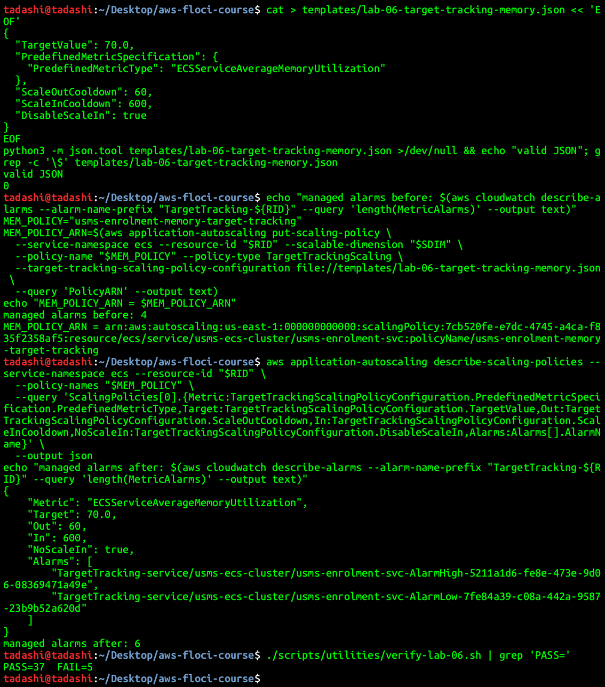
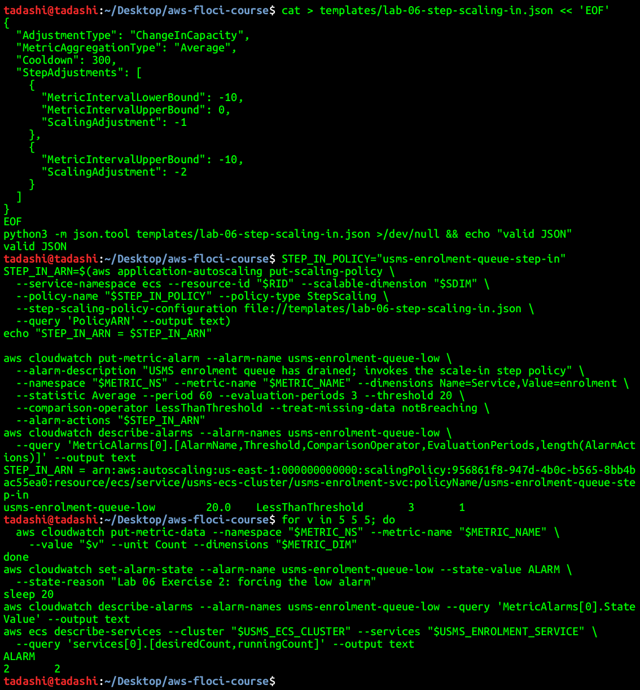
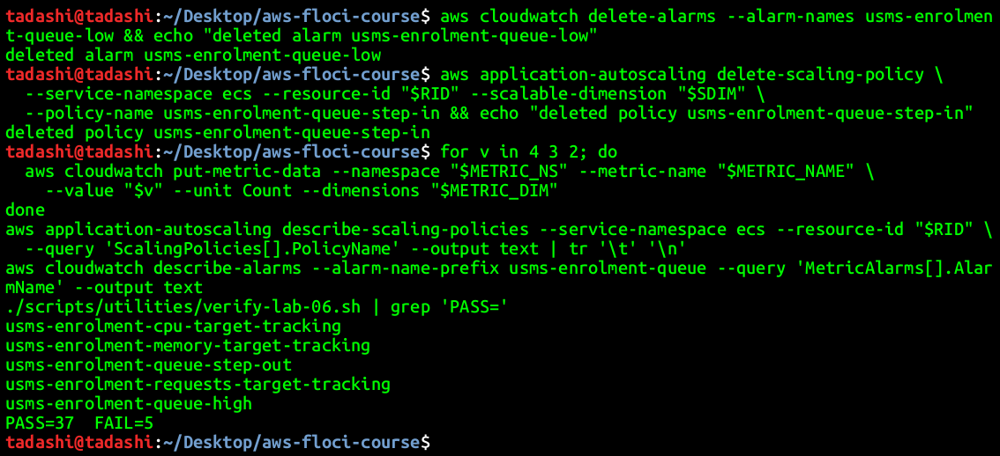
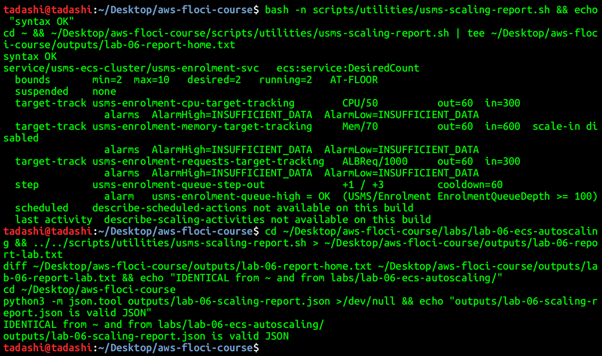
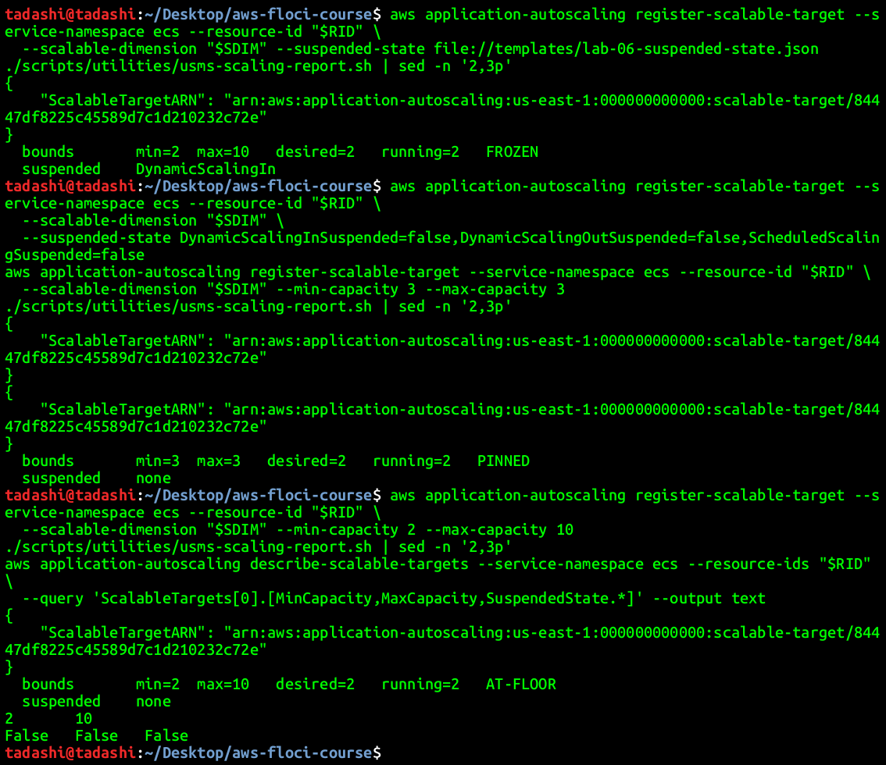
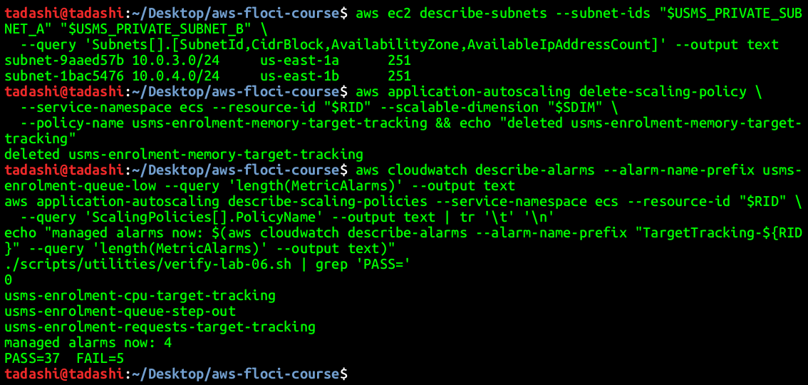
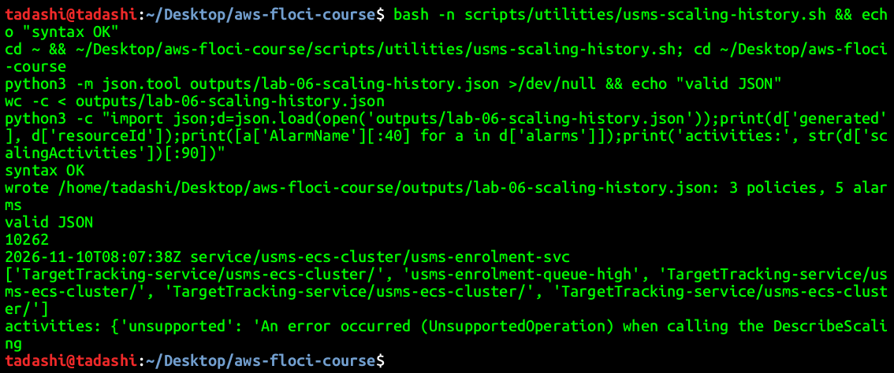
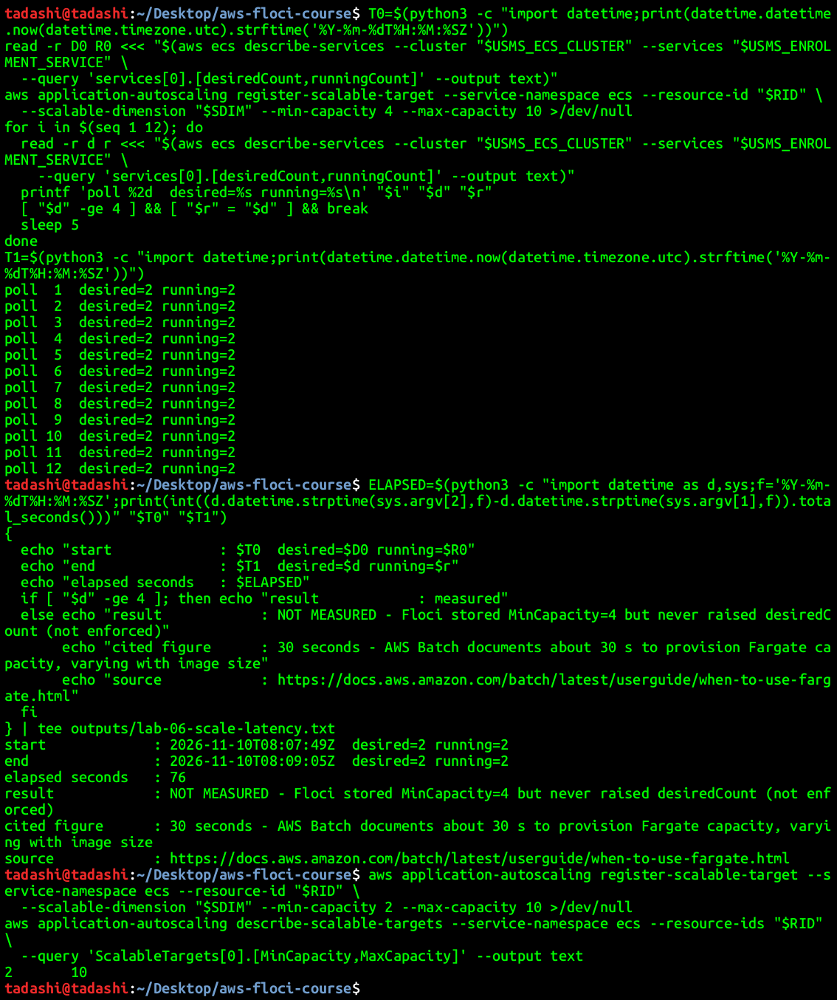
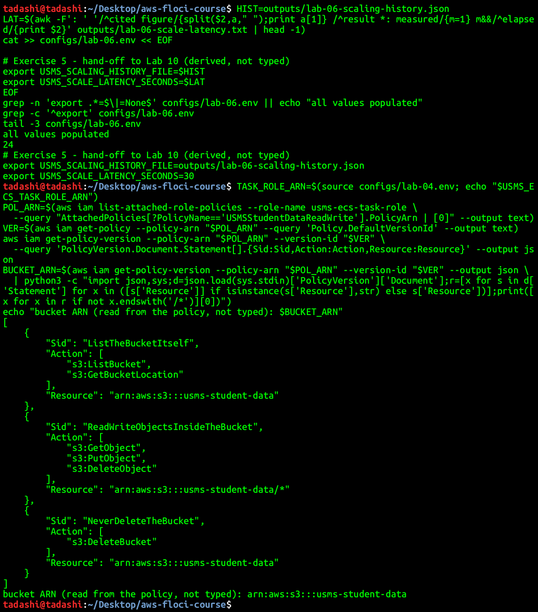
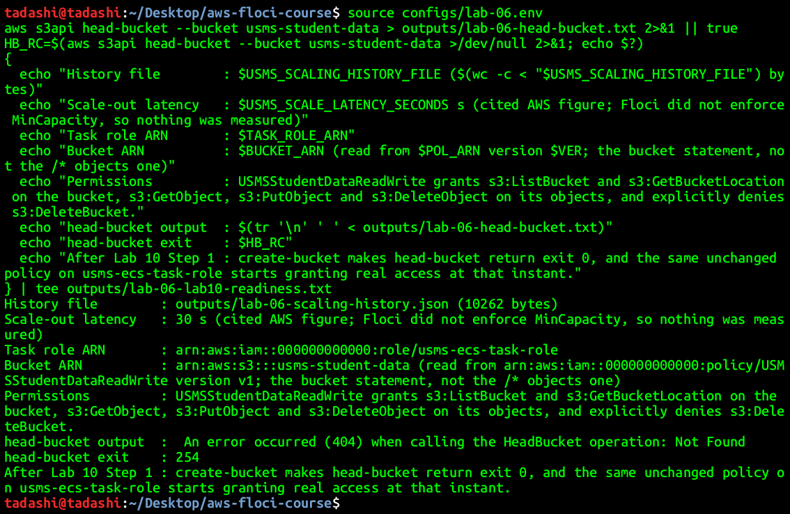

# Lab 06 - Independent Lab Exercises

Commands were run from the repository root with `AWS_DEFAULT_REGION=us-east-1` set in the shell (see [notes/lab-06-notes.md](../../notes/lab-06-notes.md)). Floci 1.7.0 is on support path B, so every exercise records what was observed separately from what would happen on real AWS.

## Exercise 1 - Basic: a memory policy, and a scale-out-only policy

Created `usms-enrolment-memory-target-tracking` on the same target from `templates/lab-06-target-tracking-memory.json`: `ECSServiceAverageMemoryUtilization`, target 70, scale-out cooldown 60, scale-in cooldown 600 and `DisableScaleIn: true`. The document has no variables, so it was written with a quoted heredoc (`<< 'EOF'`), and `grep -c '\$'` prints 0. The policy is not recorded in `configs/lab-06.env`, and the bounds were not touched.



**Outcome:** three target tracking policies and one step policy on one target, and the new policy shows `DisableScaleIn: true`. The managed alarm count went from 4 to **6**, not 5. Floci created an `AlarmLow` for the scale-out-only policy as well. That is a Floci limitation, recorded in the notes.

**Prediction for Section 8:** it still reports `PASS=37 FAIL=5`, the same as before, because no check counts policies exactly. The managed-alarm check is "2 or more", and every policy check is by name. That was confirmed.

- **Why five and not six?** With scale-in disabled, target tracking has no use for the low alarm, so on AWS only the `AlarmHigh` is created. Its absence means this policy can never remove a task.
- **Memory 70 against CPU 50: which scales out first?** Whichever metric reaches its own target first under real load. To answer properly I would need a load test showing how memory and CPU grow with requests for this container.
- **Does a scale-out-only policy change scale-in for the other two?** No. Scale-in happens when every policy *with scale-in enabled* agrees, and a policy with `DisableScaleIn` does not take part in that vote. So the CPU and request policies scale in exactly as before.

## Exercise 2 - Intermediate: the scale-in half of step scaling, and a fight to avoid

`templates/lab-06-step-scaling-in.json` (`ChangeInCapacity`, `Average`, cooldown 300):

| MetricIntervalLowerBound | MetricIntervalUpperBound | ScalingAdjustment | Metric value (threshold 20) |
|---|---|---|---|
| -10 | 0 | -1 | 10 to 20 |
| (none) | -10 | -2 | below 10 |

**Signs.** The bounds are relative to the alarm threshold, and a scale-in alarm fires when the metric is *below* the threshold, so every breach is negative. The bounds are therefore zero or negative, and the adjustments are negative because they remove capacity. `MetricIntervalUpperBound: 0` with `ScalingAdjustment: -1` means "from just below the threshold, down to the lower bound, remove one task". The upper bound is exclusive, so a metric of exactly 20 is not a breach.

**Cooldown 300 against 60.** Scale in reluctantly. A new task takes about 90 s (start-up plus grace) to carry load, so removing capacity on a one-minute view would undo a scale-out before it had helped, and the service would flap.

**The unreachable step.** From the baseline, 2 + (-2) = 0, which is below `MinCapacity 2`, so the -2 step can never take full effect. It is clamped to 2, the same result as doing nothing. The -1 step is also clamped while the service is at the floor. Either step only acts once the service has scaled out to 3 or more.

`usms-enrolment-queue-low` watches the same custom metric: `Average < 20` for 3 periods of 60 s, with the step-in policy as its only action. I published three datapoints of 5 (a breach of -15, which selects the -2 step) and forced the alarm with `set-alarm-state`.



**What happened: nothing.** The alarm read `ALARM`, and `desiredCount` stayed `2 2`. It would have stayed at 2 on real AWS as well, because of the floor.

**Deletion, in dependency order.** The alarm points at the policy, so the alarm goes first. Deleting the policy first would leave an alarm whose only action names nothing.

> **Read before running any delete command**
> **What will be deleted:** the CloudWatch alarm `usms-enrolment-queue-low`.
> **What depends on it:** nothing; it is Exercise 2 practice.
> **Reversible?** Yes, one `put-metric-alarm`. **Effect on later labs:** none.

> **Read before running any delete command**
> **What will be deleted:** the step policy `usms-enrolment-queue-step-in`.
> **What depends on it:** nothing, once its alarm is gone.
> **Reversible?** Yes, one `put-scaling-policy` from `templates/lab-06-step-scaling-in.json`. **Effect on later labs:** none.



After the deletions, the metric was pushed back down, and `verify-lab-06.sh` reports the same `PASS=37 FAIL=5`.

**A step policy on CPU at 60 alongside target tracking at 50.** Target tracking computes a capacity in proportion to how far CPU is from 50 and owns both directions. A step policy at 60 adds a fixed number of tasks whenever CPU passes 60. Those extra tasks push average CPU below target tracking's low threshold, so target tracking scales back in, CPU rises again, and the step alarm fires again. The two policies take turns correcting each other, and the service oscillates. I would keep the target tracking policy: it is proportional, it handles both directions with its own dead band, and AWS maintains its alarms. A second opinion on CPU should be a different metric, not a second policy on the same one.

## Exercise 3 - Problem solving: a scaling report tool

`scripts/utilities/usms-scaling-report.sh` discovers every scalable target in the `ecs` namespace whose cluster begins `usms-`. It then gets that target's policies, the alarms those policies list (in one batched `describe-alarms --alarm-names` call), the alarms whose actions name a step policy, the scheduled actions, the last activity, and the ECS service. It resolves `configs/` from `${BASH_SOURCE[0]}`, takes no arguments, hard-codes no names beyond the `usms-` prefix, and writes `outputs/lab-06-scaling-report.json`.

- `set -uo pipefail` without `-e`: two of the reads are unsupported on this build, and one unsupported read must not stop the report for the rows that work. Every call that can fail has its own fallback.
- It handles a target with no policies, an empty `Alarms` list (this build's step policy), and unimplemented scheduled-action and activity calls, printing a labelled line instead of a blank row.
- Step adjustments are printed as a signed list (`+1 / +3`) derived from the configuration.

**Verdict order** (a comment in the script explains it): `PINNED` first, because if min equals max nothing else matters. Then `FROZEN`, before `AT-CEILING`: a suspended target at its ceiling also cannot scale in, and the suspension switch is the hidden hazard an operator must see first, while being at the ceiling is visible from the numbers alone. Then `AT-CEILING`, `AT-FLOOR` and `ELASTIC`.



The output is identical when run from `~` and from `labs/lab-06-ecs-autoscaling/`, and the JSON file is valid. With the three Lab 06 policies plus Exercise 1's, the verdict is `AT-FLOOR` (desired 2 equals min 2, with more than one policy).



With scale-in suspended the verdict is `FROZEN`, and with min and max both 3 it is `PINNED`. After restoring 2..10 with nothing suspended it is `AT-FLOOR` again.

## Exercise 4 - Challenge: the enrolment-week capacity plan

**Is it solved?** Reactive scaling is good at following load that rises over tens of minutes, such as the doubled traffic of the three-week window, and at releasing capacity afterwards. It is bad at sudden steps, because every scale-out decision waits for an alarm to evaluate and for new tasks to start before it helps. The first twenty minutes of a cohort day are exactly such a step, so auto scaling on its own does not solve last year's problem: the capacity has to be in place before the doors open.

**Why forty times traffic is not a scaling problem.** With the CPU policy, one round of scale-out is about 180 s for the alarm, 30 s for start-up and 60 s of grace, or **270 s**. The 60 s cooldown overlaps with that. Target tracking computes capacity as current x metric / target, and CPU cannot exceed 100 per cent, so each round can at most double the count (100 / 50 = 2): 2 -> 4 -> 8 -> 10. That is three rounds, about **13.5 minutes** to reach the ceiling, during which most requests fail. At the ceiling, Step 9's target of 1000 requests per target per minute gives 10 x 1000 = 10,000 requests per minute, or about **167 requests per second**. If 2 tasks carry normal traffic at their target, forty times normal needs about 80 tasks. A ceiling of 10 is one eighth of that, so even instant scaling could not absorb the spike.

**The ceiling, checked against Lab 02.** Each private subnet is a /24, 256 addresses, of which AWS reserves 5 (the first four and the last one in every subnet; [VPC subnet sizing](https://docs.aws.amazon.com/vpc/latest/userguide/subnet-sizing.html)). That leaves 251 usable, and Floci reports 251 available in each. Existing occupants are `usms-db-01` in subnet a (1 address) and the two running tasks, one ENI each. That leaves about 250 + 251 - 2 = **499** addresses for tasks, since each `awsvpc` task takes one. The largest supportable ceiling from addressing alone is therefore about 490, keeping a few spare for replacements. In practice the account's Fargate vCPU quota would bind first.

**Capacity plan** (dates assume enrolment opens 14 December 2026, with cohort days on the 14th, 21st and 28th; replace them with the registrar's dates):

| Action | Schedule (time zone `Asia/Thimphu`) | Bounds | Reversible in one command |
|---|---|---|---|
| Raise the ceiling for the window | one `register-scalable-target` on 13 Dec | min 2, max 100 | yes (`register-scalable-target --max-capacity 10`) |
| Cohort day pre-warm, x3 | `at(2026-12-14T07:15:00)`, `at(2026-12-21T07:15:00)`, `at(2026-12-28T07:15:00)` | min 80, max 100 | yes (`delete-scheduled-action`) |
| Cohort day release, x3 | `at(2026-12-14T09:30:00)` and the same for the 21st and 28th | min 4, max 100 | yes |
| Window weekday floor (double traffic) | `cron(45 7 ? * MON-FRI *)`, existing action, changed to min 4 | min 4, max 100 | yes (`put-scheduled-action` is create-or-replace) |
| Window evening | `cron(0 20 ? * MON-FRI *)`, existing action | min 2, max 100 | yes |
| End of window | `at(2027-01-05T00:00:00)`: restore max 10 | min 2, max 10 | yes |

Change the request target only after the load test. If one task serves more than 1000 requests per minute at acceptable latency, raise it; if less, lower it. The `at()` actions stay behind after they fire, so the runbook deletes all six afterwards.

**Monthly cost estimate** (us-east-1, Linux/x86 Fargate list prices: $0.04048 per vCPU-hour and $0.004445 per GB-hour; [Fargate pricing](https://aws.amazon.com/fargate/pricing/); CloudWatch: $0.10 per standard alarm-month, $0.30 per custom metric-month, $0.01 per 1,000 `PutMetricData` requests; [CloudWatch pricing](https://aws.amazon.com/cloudwatch/pricing/)). The task size in `configs/lab-04.env` is 256 CPU units (0.25 vCPU) and 512 MiB (0.5 GB), so one task-hour costs 0.25 x 0.04048 + 0.5 x 0.004445 = **$0.01234**.

| Item | Assumption | Task-hours | Cost |
|---|---|---|---|
| Doubled traffic for three weeks | +2 tasks, 24 h, 21 days | 1,008 | $12.44 |
| Cohort-day pre-warm | +78 tasks for 2.25 h, 3 days | 527 | $6.50 |
| Normal-month morning floor | +2 tasks, 12.25 h, 22 weekdays | 539 | $6.65 |
| CloudWatch alarms | 4 managed + 1 custom | - | $0.50 |
| Custom metric | 1 metric | - | $0.30 |
| `PutMetricData` | 1 per minute, 30 days = 43,200 requests | - | $0.43 |
| **Enrolment month total (additional)** | | | **about $26.80** |

The total is an upper bound: the morning-floor row and the three-week row overlap on window weekdays. An ordinary month costs about $7.88 (the morning floor plus CloudWatch). This excludes the load balancer's LCU charges, data transfer, and NAT gateway processing for image pulls.

**What I need from the project lead.**
1. A load test measuring how many requests per minute one task serves at an acceptable latency. Section 11 says nobody has taken this measurement, and every number above (target 1000, ceiling, 80 tasks) depends on it.
2. The exact cohort dates and the times eligibility opens, in Bhutan time.
3. Approval of the ceiling raise and the budget, plus a Fargate vCPU quota check or increase for 80+ concurrent tasks.

**Tidy-up.** Exercise 2's alarm and policy were already deleted in its own point 5. What remained was Exercise 1's policy:

> **Read before running any delete command**
> **What will be deleted:** the scaling policy `usms-enrolment-memory-target-tracking`, and with it its two managed alarms.
> **What depends on it:** nothing; it is Exercise 1 practice and is not in `configs/lab-06.env`.
> **Reversible?** Yes, one `put-scaling-policy` from `templates/lab-06-target-tracking-memory.json`. **Effect on later labs:** none.

```bash
aws application-autoscaling delete-scaling-policy \
  --service-namespace ecs --resource-id "$RID" --scalable-dimension "$SDIM" \
  --policy-name usms-enrolment-memory-target-tracking
```



Three policies remain, the managed alarm count is back to 4, no `usms-enrolment-queue-low` exists, and `verify-lab-06.sh` reports `PASS=37 FAIL=5`. Those five failures are the documented ones (Section 7 of the report), not `FAIL=0`.

## Exercise 5 - Integration: the hand-off to Lab 10

`scripts/utilities/usms-scaling-history.sh` derives the resource ID from the service ARN and exports the scalable target, every policy, every alarm the policies list or whose actions name a policy, the scheduled actions and the scaling activities (with `--include-not-scaled-activities`). It writes them to `outputs/lab-06-scaling-history.json` with a top-level `generated` UTC timestamp from `python3`. An unsupported call is recorded as `{"unsupported": "<error>"}` rather than dropped.



Valid JSON, **10,262 bytes**, with 3 policies and 5 alarms (4 managed and the queue alarm).

**Scale-out latency.** I recorded a timestamp, raised `MinCapacity` to 4, and polled for 76 s. `desiredCount` never moved, because Floci does not enforce the floor, so nothing was measured. `outputs/lab-06-scale-latency.txt` says so and cites AWS's figure of about 30 seconds to provision Fargate capacity ([AWS Batch: when to use Fargate](https://docs.aws.amazon.com/batch/latest/userguide/when-to-use-fargate.html)). The floor was put back to 2.



`USMS_SCALING_HISTORY_FILE` and `USMS_SCALE_LATENCY_SECONDS` (30, read from the latency file) were appended to `configs/lab-06.env`. The empty-value check still passes, and the export count is now **24**. The bucket ARN was read from `USMSStudentDataReadWrite` with `get-policy` and `get-policy-version`. The policy has two Resource values, the bucket and `usms-student-data/*` for its objects; I recorded the bucket one, `arn:aws:s3:::usms-student-data`.



`outputs/lab-06-lab10-readiness.txt` records the history file and its size, the latency, the task role ARN, the bucket ARN, the permissions, and the `head-bucket` result, captured with `|| true` and then `$?`. The result is `404 Not Found`, exit code 254, because the bucket does not exist yet. After Lab 10's Step 1, `create-bucket` makes `head-bucket` exit 0, and the unchanged policy on `usms-ecs-task-role` starts granting real access at that moment.


