# Lab 07: Deploying a Microservices Application on Amazon EKS

## 1. Aim / Objective

The aim of this practical is to run the USMS application as three microservices on Kubernetes, using an Amazon EKS cluster created inside Lab 02's VPC, and to learn how Kubernetes keeps services running, connected and recoverable.

The objectives are:

1. Create an EKS cluster and a managed node group in Lab 02's VPC, each with its own IAM role.
2. Point kubectl at the cluster and deploy three microservices (`usms-gateway`, `usms-enrolment`, `usms-results`) from declarative manifests.
3. Prove the services find each other by DNS name, then perform a rolling update, a rollback and three deliberate failure diagnoses.
4. Use a ConfigMap and a Secret, and show what a Secret does not protect.
5. Prove the cluster survives a restart, and save its identifiers to `configs/lab-07.env` for Lab 08.

## 2. Introduction

Amazon Elastic Kubernetes Service (EKS) is AWS's managed Kubernetes service. Its purpose is to run the Kubernetes control plane (the API server, etcd, the scheduler and the controllers) for you, while your applications run as pods on worker nodes in your own VPC. Its key features are a managed, highly available control plane, managed node groups that supply and upgrade EC2 worker nodes, IAM integration for both the cluster and the pods, and the standard Kubernetes API, so the same manifests and kubectl work as on any other Kubernetes. It matters in cloud computing because Kubernetes has become the common way to run containers across clouds, and EKS removes the hardest part to operate yourself. Typical applications are microservice platforms, teams that need the same deployment model on several clouds or on-premises, and workloads that need Kubernetes features such as custom controllers, service discovery by DNS or fine-grained deployment controls.

### Key Features

- Managed control plane across several Availability Zones
- Managed node groups with min, max and desired sizes
- Separate IAM roles for the control plane and the nodes
- Standard Kubernetes objects: Deployments, ReplicaSets, Services, ConfigMaps and Secrets
- Cluster DNS (CoreDNS) for service discovery
- Rolling updates and instant rollback to a kept ReplicaSet
- IRSA / EKS Pod Identity to give individual pods their own IAM role

## 3. Use Case

The USMS portal is made of small services: a gateway that receives student requests, an enrolment service and a results service. On EKS each runs as a Deployment behind its own Service name. The gateway forwards `/enrolment/` and `/results/` by DNS name, so any backend can be scaled, restarted or rolled back without the gateway changing.

EKS is commonly used for:

| Use case | Why EKS fits |
|---|---|
| Microservice platforms | Every service gets a stable DNS name, and services are deployed and rolled back independently |
| Multi-cloud or hybrid teams | The same manifests run on EKS, other clouds and on-premises clusters |
| Platform teams serving many apps | Namespaces, RBAC and quotas separate teams on one cluster |
| Workloads needing the Kubernetes ecosystem | Helm charts, operators, service meshes and autoscalers are built for Kubernetes |

## 4. System Architecture / Design

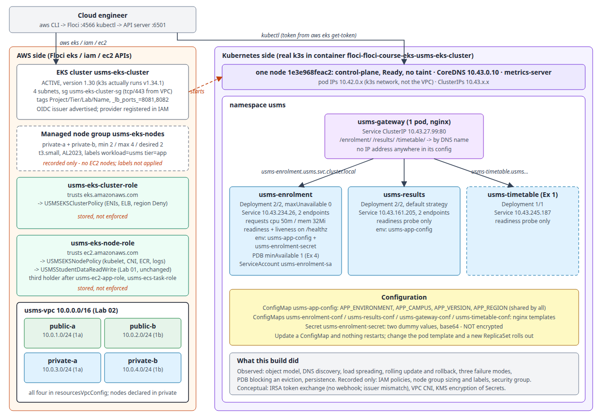

*The AWS CLI talks to Floci's EKS, IAM and EC2 APIs, which created the cluster, the node group record, the two IAM roles and the cluster security group in Lab 02's VPC. Floci started a real k3s cluster in a container, and kubectl talks to its API server directly. Inside namespace `usms`, the gateway reaches the backends only by their Service DNS names. Dashed boxes are records or exercise additions; orange text marks what this build stores but does not act on. Source: own diagram of the resources built in this lab.*

## 5. Implementation Procedure

All commands were run from the repository root (`~/Desktop/aws-floci-course`) in one terminal session. Each step below records why it was done, what was done, what the output showed, and the screenshot of that output. Long flags are shortened in the code blocks; the screenshots show each command in full. Because the commands ran in a non-interactive shell, `kubectl run --rm -it` was run as `--rm -i` (no TTY).

### Preparation - Lab folders and tools

**Purpose:** Create the lab's folders and confirm the tools, including kubectl, the one new tool in this lab.

**What I did:** Created `labs/lab-07-eks` and the new top-level `manifests/lab-07` folder, and printed the versions of Docker, the AWS CLI, kubectl, Python and jq.

```bash
mkdir -p labs/lab-07-eks manifests/lab-07
kubectl version --client
```

**Result:** Docker 29.2.1, AWS CLI 2.31.24 and kubectl 1.36.3. `kubectl version --client` returned without hanging. k3d is missing, which only matters on Path B.

**Screenshot 1 - Folders and tools**

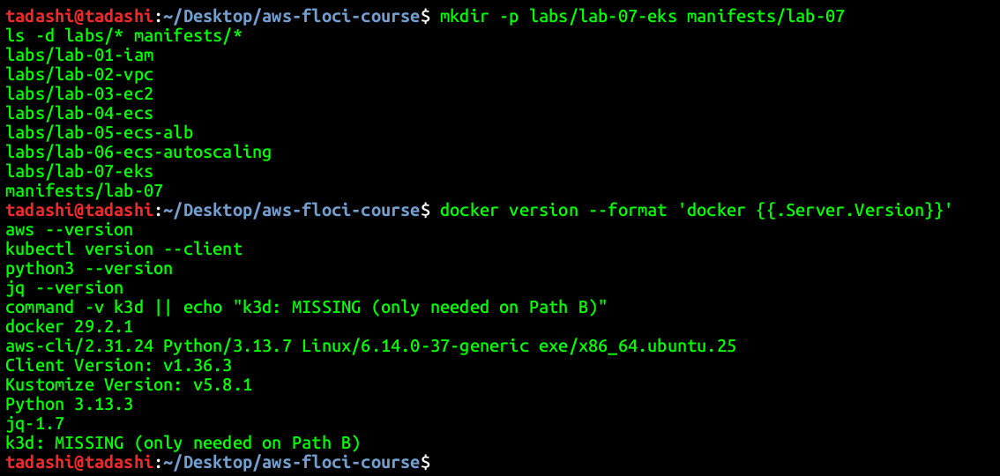

### Step 1 - Start the environment and confirm the ground

**Purpose:** Nothing is worth starting if Lab 02's subnets are missing or Floci is in memory mode.

**What I did:** Set the course region, started Floci, sourced `course.env` and the Lab 01 to 04 env files, confirmed my identity, and ran the storage check. Then I checked Labs 02 and 04 and listed the four subnets.

```bash
export AWS_DEFAULT_REGION=us-east-1
./scripts/setup/floci-up.sh
source configs/course.env; source configs/lab-0{1,2,3,4}.env   # one at a time in the screenshot
./scripts/utilities/whoami.sh
./scripts/utilities/floci-storage-check.sh
```

**Result:** Account `000000000000`, storage mode `hybrid`. Lab 02 reports `PASS=32 FAIL=1`, and Lab 04 `PASS=38 FAIL=1`. In both, the failure is the known `no secret is tracked by git` false positive on `outputs/.gitkeep`, as in Labs 05 and 06. There are four subnets in two Availability Zones: public 10.0.1.0/24 and 10.0.2.0/24, private 10.0.3.0/24 and 10.0.4.0/24.

**Screenshot 2 - Floci up, identity and storage mode**

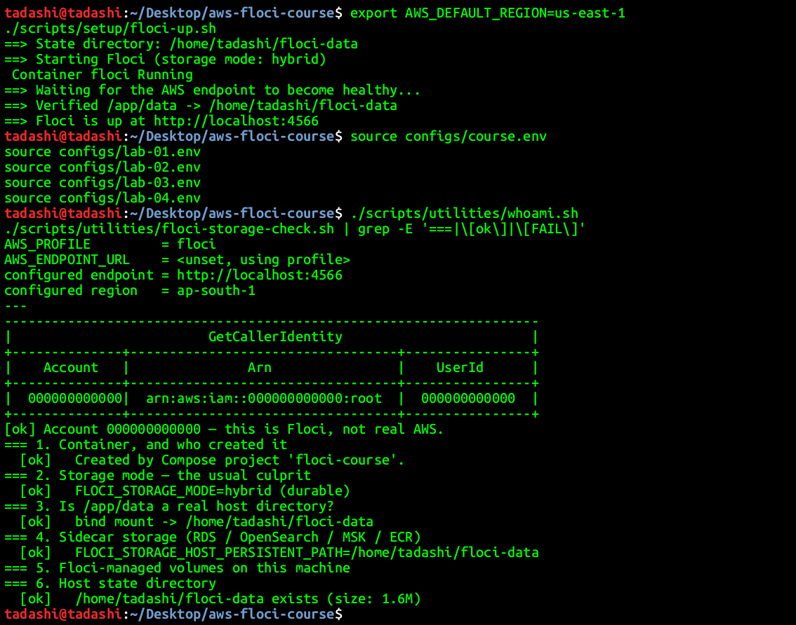

**Screenshot 3 - Earlier labs and the four subnets**

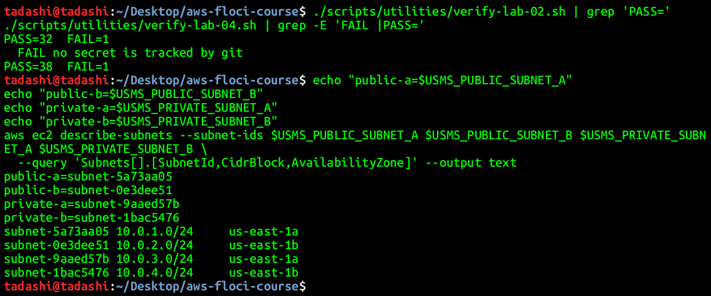

### Step 2 - Probe what the build supports

**Purpose:** Kubernetes support is the least uniform part of Floci, so I decided the support path before creating anything.

**What I did:** Wrote `scripts/utilities/eks-support-probe.sh` from the lab, ran it into `outputs/lab-07-support-probe.txt`, and recorded the verdict in `notes/lab-07-notes.md`.

**Result:** `eks list-clusters: OK`, so the verdict is **PATH A - use aws eks throughout**. Floci starts a real k3s cluster when `create-cluster` is called.

**Screenshot 4 - Support probe and recorded verdict**

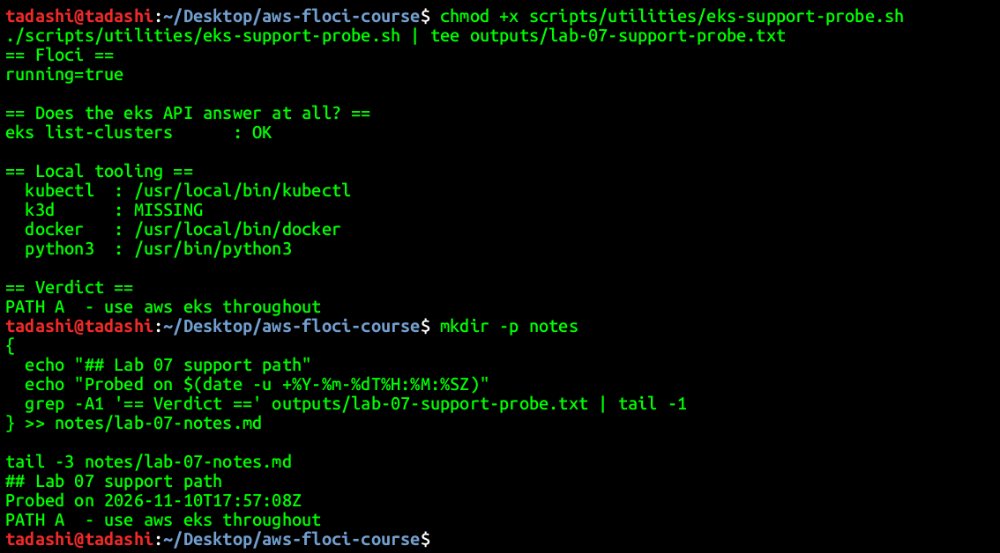

### Step 3 - Control plane and data plane

**Purpose:** Every later command acts on either the control plane, which AWS runs, or the data plane, which I run.

**What I did:** Read the split and answered the Your turn ("EKS is just ECS with different names") in the notes. The statement is false because EKS has a data plane I run, with its own node role. It is nearly true because the objects match one-to-one in purpose.

### Step 4 - Write the two trust policies

**Purpose:** Each role needs a trust policy saying who may assume it.

**What I did:** Wrote `policies/trust-eks-cluster.json` (principal `eks.amazonaws.com`) and `policies/trust-eks-node.json` (principal `ec2.amazonaws.com`) with quoted heredocs, and validated both.

**Result:** Both are valid JSON. The cluster trust names `eks.amazonaws.com` and the node trust names `ec2.amazonaws.com`, each with `sts:AssumeRole`.

**Screenshot 5 - Trust policies**

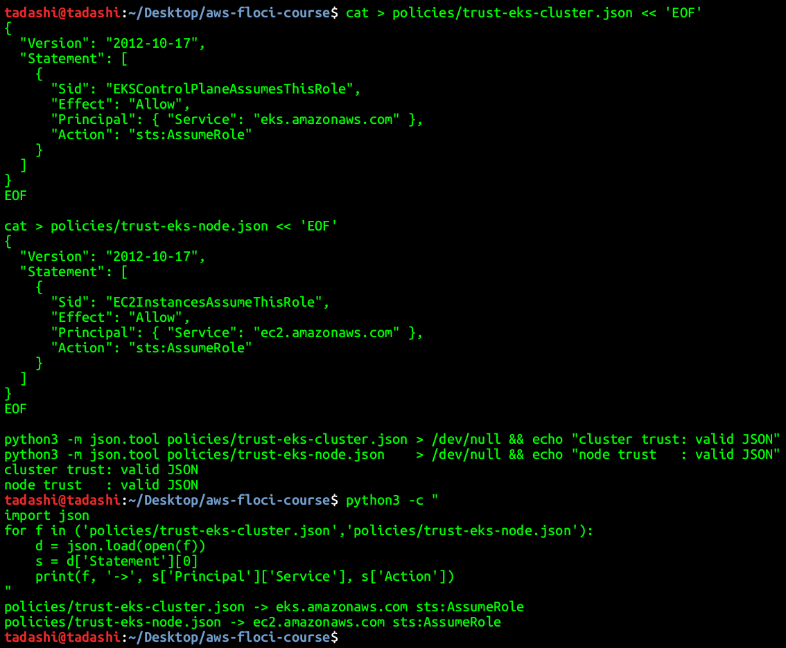

### Step 5 - Write the two permissions policies

**Purpose:** Floci may not carry the AWS managed EKS policies, so I wrote local equivalents and read what they allow.

**What I did:** Wrote `USMSEKSClusterPolicy` (ENI and load balancer actions) and `USMSEKSNodePolicy` (kubelet describe, VPC CNI ENI actions, ECR pull, and logs scoped to `/usms/eks/*`). Both end with a region Deny.

**Result:** Both are valid JSON. The cluster policy has three statements (8, 7 and 1 actions) and the node policy has five (3, 11, 4, 4 and 1), each ending with the Deny. `"Resource": "*"` is used only where the ARNs cannot be known in advance (ENIs that do not exist yet).

**Screenshot 6 - Permissions policies and their statements**

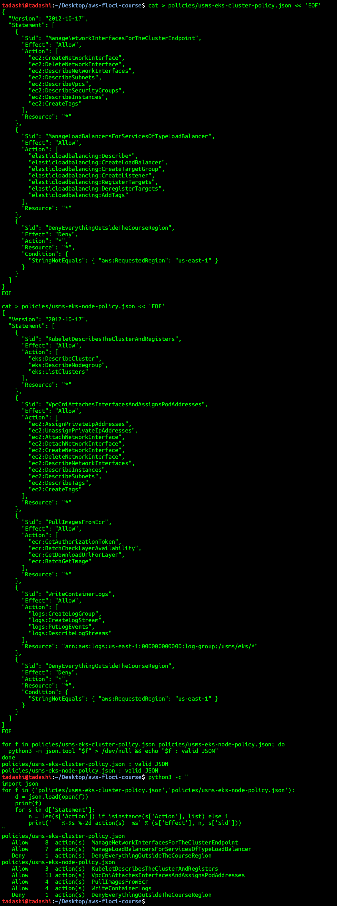

### Step 6 - Create the cluster role and the cluster security group

**Purpose:** The control plane needs an identity in my account, and its endpoint needs a firewall.

**What I did:** Created `usms-eks-cluster-role`, created and attached `USMSEKSClusterPolicy` (with a fallback lookup so the step can be re-run), and created `usms-eks-cluster-sg` in `usms-vpc` with tcp/443 from 10.0.0.0/16 only.

```bash
aws iam create-role --role-name usms-eks-cluster-role --assume-role-policy-document file://policies/trust-eks-cluster.json ...
aws ec2 create-security-group --group-name usms-eks-cluster-sg --vpc-id "$USMS_VPC_ID" ...
aws ec2 authorize-security-group-ingress --group-id "$EKS_CLUSTER_SG" --protocol tcp --port 443 --cidr "$USMS_VPC_CIDR"
```

**Result:** The role trusts `eks.amazonaws.com` and carries `USMSEKSClusterPolicy`. The security group `sg-4ddd9fddcaa8d8bbe` is in `vpc-772ae38b` with port 443.

**Screenshot 7 - Cluster role and security group**

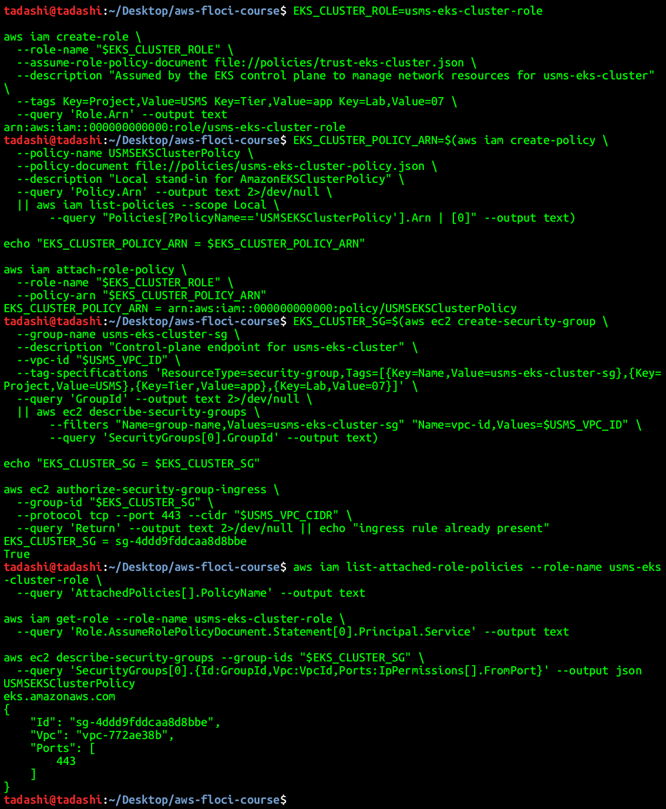

### Step 7 - Create the node role, and attach Lab 01's policy

**Purpose:** The nodes need their own identity, and Lab 01's `USMSStudentDataReadWrite` gains its third holder.

**What I did:** Created `usms-eks-node-role`, attached `USMSEKSNodePolicy`, looked up `USMSStudentDataReadWrite` by name, attached it unchanged, and listed everyone who carries it.

**Result:** The role trusts `ec2.amazonaws.com` and carries both policies. `USMSStudentDataReadWrite` is now on `usms-ec2-app-role`, `usms-ecs-task-role` and `usms-eks-node-role`: one policy, never edited, on three kinds of compute.

**Screenshot 8 - Node role and the three holders of Lab 01's policy**

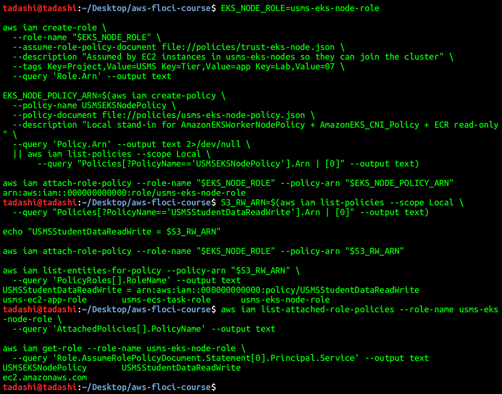

### Step 8 - Create the cluster

**Purpose:** This is what the previous seven steps were for. The request body goes in a file so it is reviewable and repeatable.

**What I did:** Wrote `templates/lab-07-create-cluster.json` with an unquoted heredoc, so the real subnet, security group and role values are written into it. It includes the `_lb_ports_=8081,8082` tag that Lab 08 needs. Then I assumed `usms-developer-role`, called `create-cluster`, and restored my normal identity.

```bash
CREDS=$(aws sts assume-role --role-arn "arn:aws:iam::${ACCOUNT_ID}:role/usms-developer-role" ...)
aws eks create-cluster --cli-input-json file://templates/lab-07-create-cluster.json ...
unset AWS_ACCESS_KEY_ID AWS_SECRET_ACCESS_KEY AWS_SESSION_TOKEN
```

**Result:** The body contains four real subnet IDs, the security group and the role ARN. `get-caller-identity` showed `assumed-role/usms-developer-role`, and after `unset` it was back to the root identity. `create-cluster` printed `ResourceInUseException: Cluster already exists ... (reached max retries: 2)`.

**Note:** `list-clusters` had been empty a minute earlier. Floci's first attempt created the cluster but took longer than the CLI's read timeout while it started k3s, so the CLI retried, and the retries found the cluster it had just made. Straight afterwards there was exactly one cluster, `CREATING`, and one k3s container.

**Screenshot 9 - The request body with real IDs**

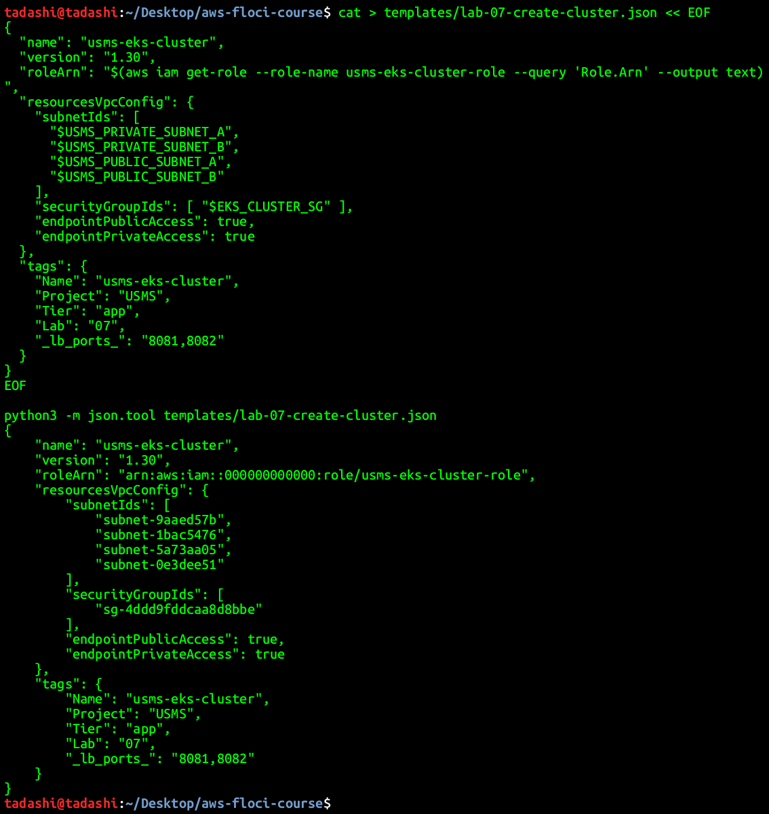

**Screenshot 10 - Assumed role, create-cluster, identity restored**

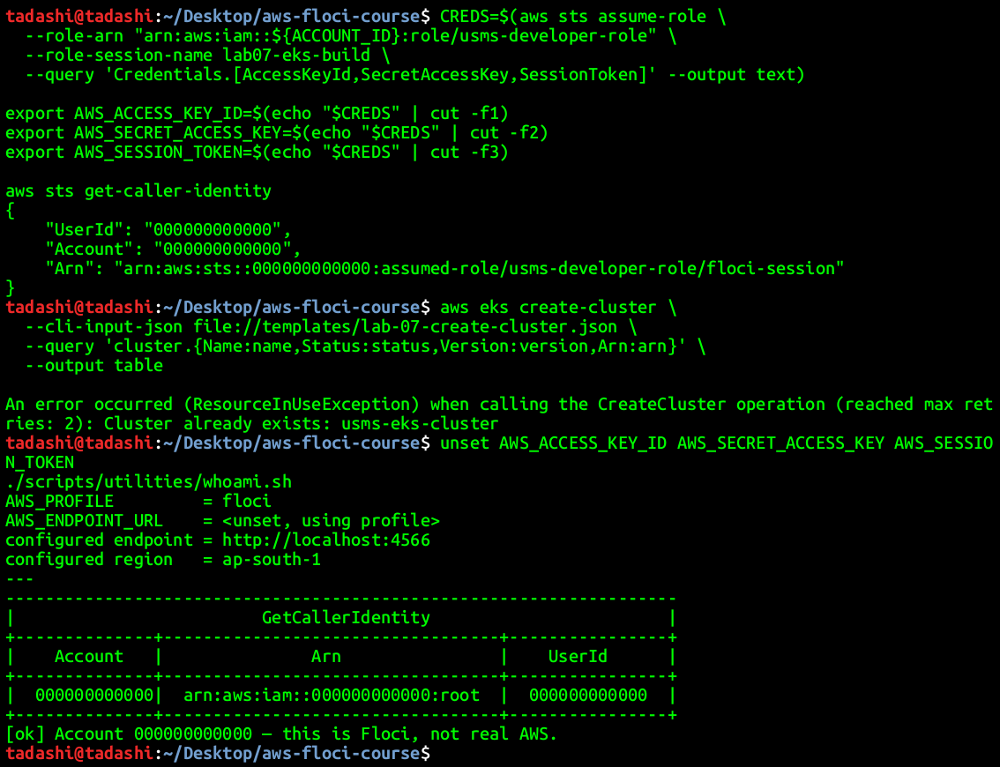

### Step 9 - Wait for the cluster, and read what it says

**Purpose:** Cluster creation is asynchronous, so I waited for `ACTIVE` before using it.

**What I did:** Confirmed the single cluster and its k3s container, ran the waiter (with the lab's polling fallback), described the cluster into `outputs/lab-07-cluster.json`, read the `_lb_ports_` tag, and did the Your turn (version and OIDC issuer in one query).

**Result:** `ACTIVE`, version `1.30`, endpoint `https://localhost:6501` (not 6443), four subnets in `vpc-772ae38b`, the security group, and all five tags including `_lb_ports_ = 8081,8082`. The Your turn printed `1.30` and an OIDC issuer URL. This build advertises one, which the lab says most builds do not.

**Screenshot 11 - One cluster, its k3s container, ACTIVE**

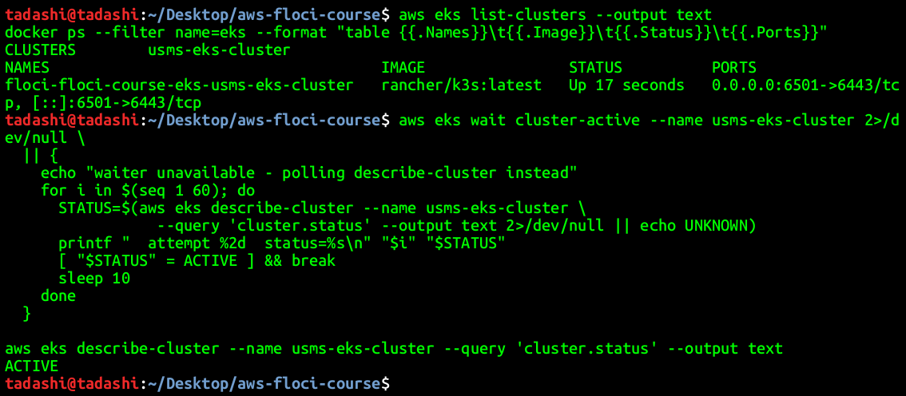

**Screenshot 12 - Cluster description, the tag, and the Your turn**

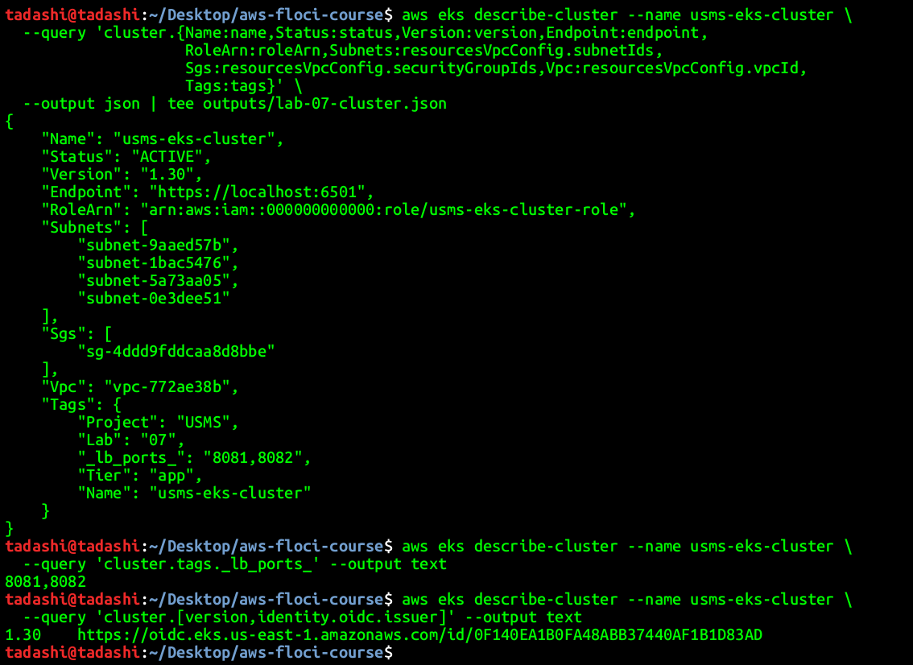

### Step 10 - Create the managed node group

**Purpose:** A control plane with no data plane runs nothing, so this step supplies the nodes.

**What I did:** Wrote `templates/lab-07-create-nodegroup.json` (private subnets only, min 2 / max 4 / desired 2, `t3.small`, `AL2023_x86_64_STANDARD`, the node role, labels `workload=usms` and `tier=app`), created the group, and described it.

**Result:** The node group is `ACTIVE` at once, with exactly the two private subnets, the node role, 2/4/2 and the labels. On Floci this is a record: no `t3.small` instances exist (Step 11 shows what does).

**Screenshot 13 - Node group created and described**

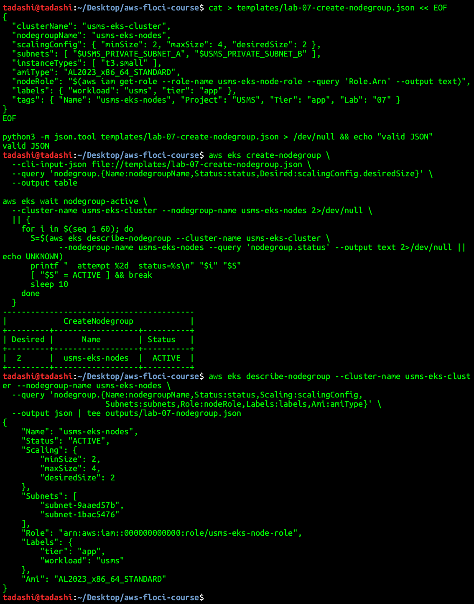

### Step 11 - Point kubectl at the cluster

**Purpose:** From here on the tool is kubectl. `update-kubeconfig` writes a context whose user entry runs `aws eks get-token`, so no long-lived secret is stored.

**What I did:** Ran `aws eks update-kubeconfig --name usms-eks-cluster --alias usms-eks`, then `kubectl cluster-info` and `kubectl get nodes -o wide`.

**Result:** The context `usms-eks` was added and made current. The first calls hit TLS handshake timeouts while k3s finished starting, and a second run worked. There is **one node**, `1e3e968feac2`: role `control-plane`, `Ready`, k3s **v1.34.1** (not the 1.30 the cluster reports), no taint, and no `workload` label. `auth can-i create deployments` says `yes`, and the user entry runs `aws eks get-token`, which works on this build. CoreDNS and metrics-server are running.

**Problem: the API server was starved.** Docker Desktop's VM has 3.5 GiB. My separate `dso202` kind cluster (three nodes, about 3 GB, high CPU) was running too, and the first namespace apply was lost to timeouts. With permission, I stopped (not removed) the three `dso202` containers. After that, `kubectl get ns` answered in about one second, and k3s had about 415 MiB.

**Screenshot 14 - update-kubeconfig, and the first calls timing out**

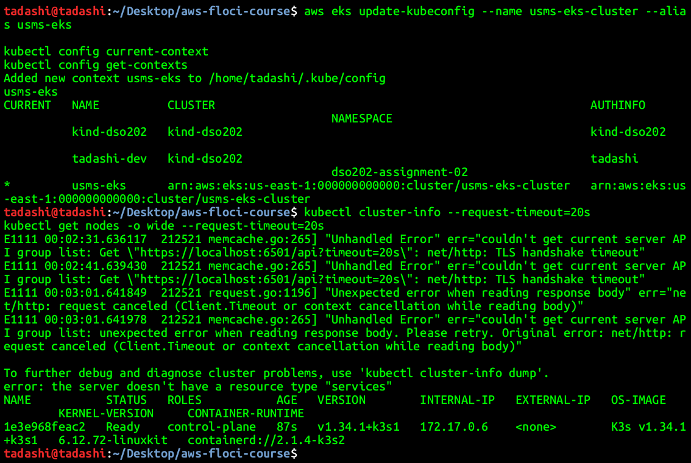

**Screenshot 15 - API reachable, one node, permissions, exec credential**

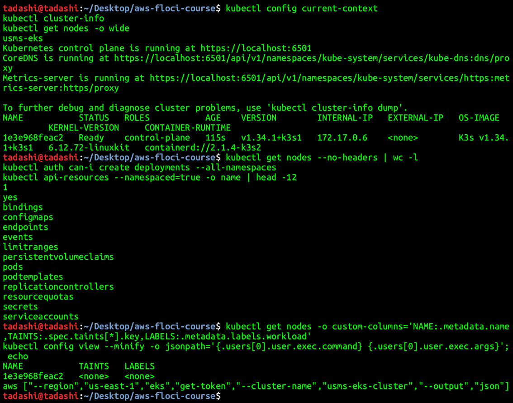

### Step 12 - Create the namespace, and make it the default

**Purpose:** Everything from here on lives in `usms`. Making it the context's default stops objects landing elsewhere.

**What I did:** Wrote `manifests/lab-07/00-namespace.yaml`, applied it, and set it as the namespace of the current context.

**Result:** `usms` is `Active` with the labels `project`, `tier` and `lab=07`, and `kubectl get all` finds no resources yet.

**Screenshot 16 - Namespace created and set as default**

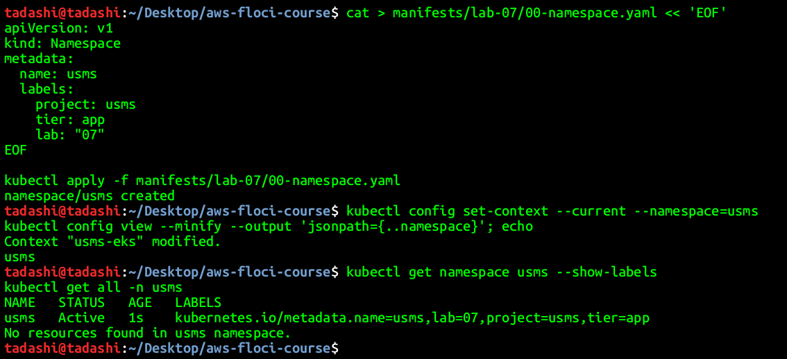

### Step 13 - Deploy the first microservice: usms-enrolment

**Purpose:** The largest manifest, covering the shared ConfigMap, requests and limits (which Lab 08's autoscaler needs), and separate readiness and liveness probes.

**What I did:** Applied `10-configmap-app.yaml` (four `APP_*` keys) and `20-enrolment.yaml`: a ConfigMap holding an nginx template, a Deployment with 2 replicas, `maxUnavailable 0 / maxSurge 1`, requests `50m / 32Mi`, readiness and liveness on `/healthz`, and a ClusterIP Service. Then I checked the rollout and fetched the service from a busybox pod.

**Result:** The Deployment rolled out 2/2, with one ReplicaSet, two pods on `10.42.0.x`, a ClusterIP `10.43.234.26` with no external address, and two endpoints. The response named its own pod and node: `{"service":"usms-enrolment","pod":"usms-enrolment-6965b8dbbb-cqj6m","node":"1e3e968feac2","env":"laboratory","version":"1.0.0"}`.

**Screenshot 17 - Shared ConfigMap**

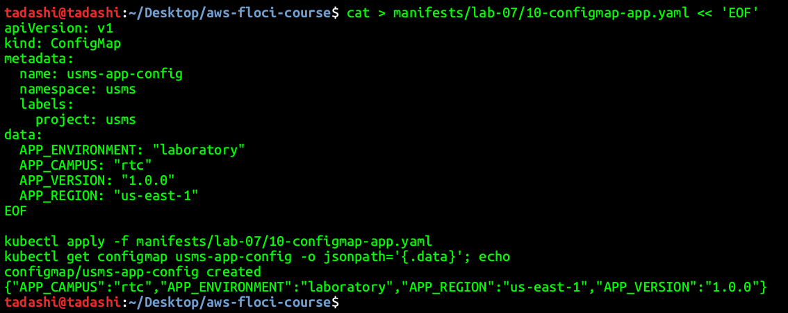

**Screenshot 18 - Enrolment manifest applied**

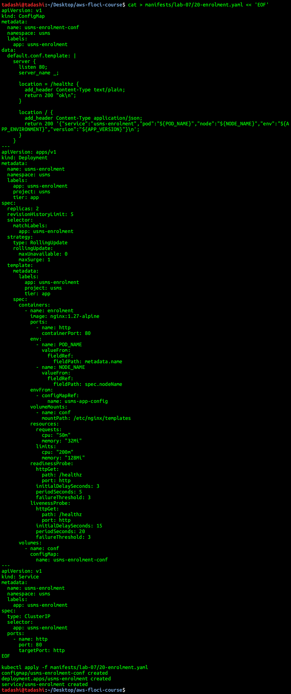

**Screenshot 19 - Rolled out, two endpoints, serving JSON**

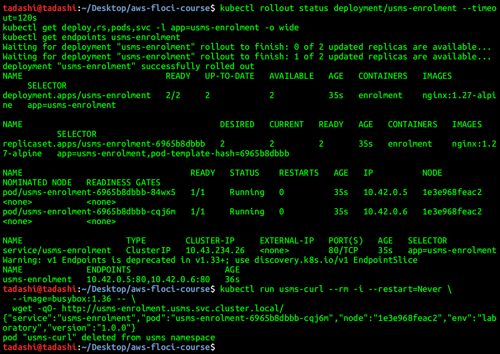

### Step 14 - Deploy the second microservice: usms-results

**Purpose:** The gateway needs a second destination, and this checks I can read a manifest's differences.

**What I did:** Applied `30-results.yaml`, which differs deliberately: readiness probe only, the default strategy, and `APP_CAMPUS` in the response.

**Result:** Both Deployments are 2/2, `usms-enrolment` with `MAXUNAVAIL 0` and `usms-results` with `25%`, and each Service has two endpoints.

**Screenshot 20 - Results manifest applied and rolled out**

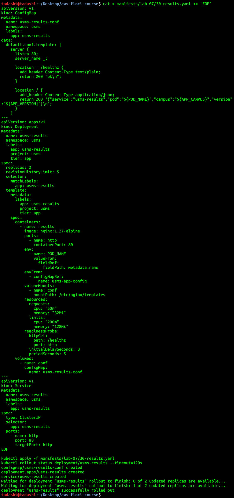

**Screenshot 21 - Strategies and endpoints side by side**

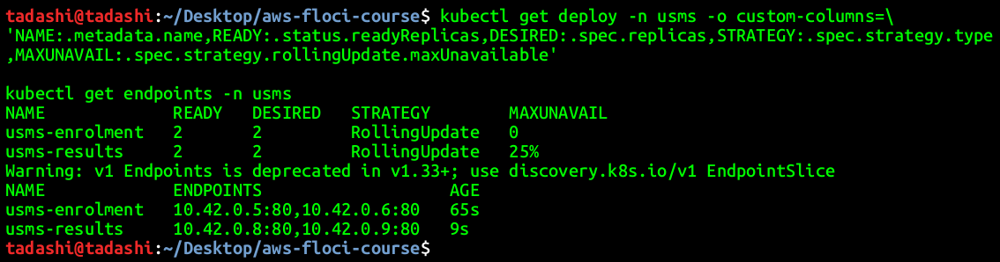

### Step 15 - Deploy the gateway, and meet cluster DNS

**Purpose:** The gateway's configuration holds two hostnames and no addresses.

**What I did:** Applied `40-gateway.yaml`, whose nginx template proxies `/enrolment/` and `/results/` to `usms-<svc>.usms.svc.cluster.local`, after the backends existed.

**Result:** Five pods are running (2 enrolment, 2 results, 1 gateway). The gateway log shows normal start-up and `200` health checks, with no `emerg` lines.

**Screenshot 22 - Gateway manifest applied**

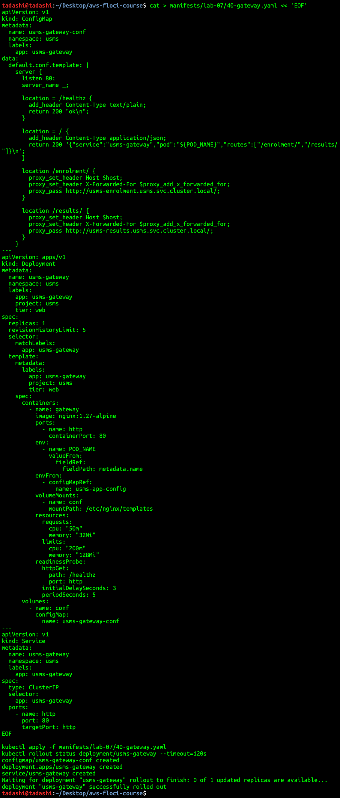

**Screenshot 23 - Five pods running, clean gateway log**

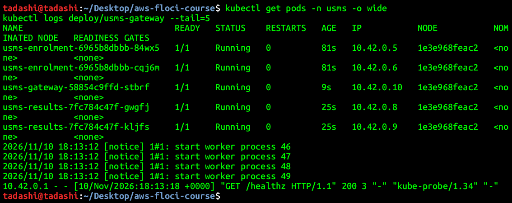

### Step 16 - Prove service discovery from inside the cluster

**Purpose:** Exercise the property rather than assume it.

**What I did:** From busybox pods: resolved both names, fetched the three gateway routes, and sent twelve requests through `/enrolment/`, tallying which pod answered.

**Result:** CoreDNS (`10.43.0.10`) resolved the names to the **ClusterIPs** `10.43.234.26` and `10.43.161.205`, not to pod addresses. The gateway root and both routes answered. The twelve requests split 5/7 across two different enrolment pods.

**Screenshot 24 - Names resolve to ClusterIPs; routes work**

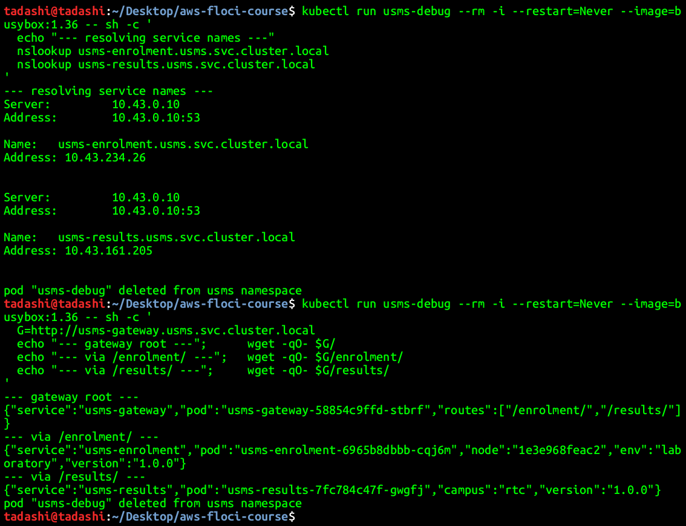

**Screenshot 25 - Twelve requests spread across two pods**

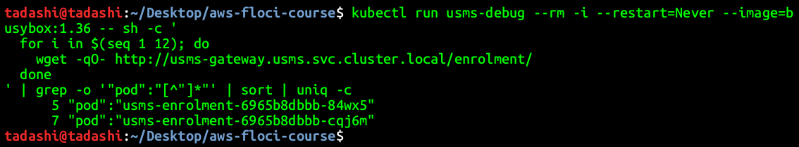

**Your turn:** I deleted `usms-enrolment-6965b8dbbb-84wx5`. Within seconds `...-lckg9` appeared, created by the **ReplicaSet** (`SuccessfulCreate` from `replicaset/usms-enrolment-6965b8dbbb`), not by the Deployment and not by me. The first tally in that session printed nothing: the busybox pod finished before kubectl attached to it, which happened whenever that command was not the first in a run. The re-run shows 12 of 12 requests succeeding, including the new pod.

**Screenshot 26 - Pod deleted, replacement created by the ReplicaSet**

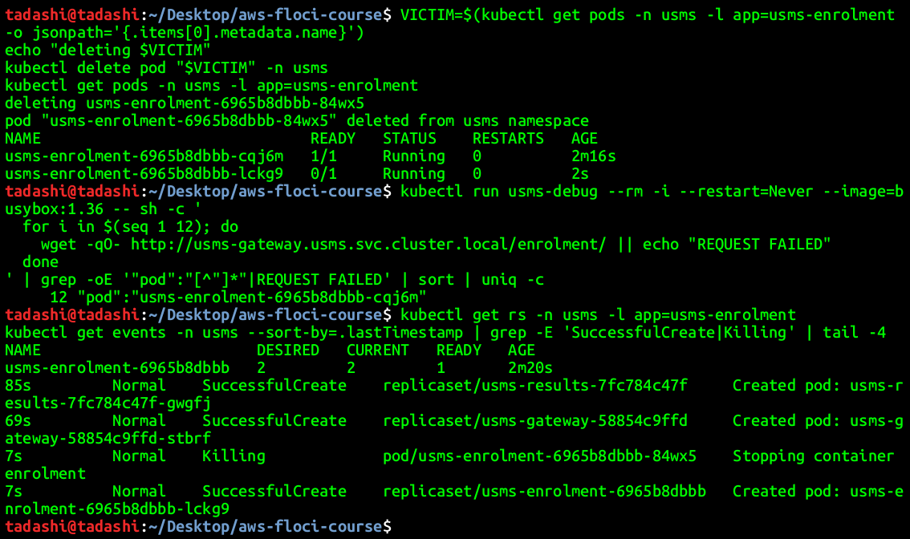

**Screenshot 27 - No failed requests; the new pod is answering**

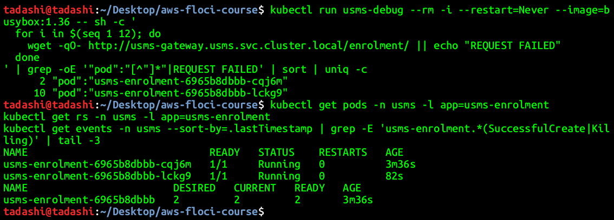

### Step 17 - ConfigMaps and Secrets, and what a Secret is

**Purpose:** Show that a Secret is base64, an encoding and not encryption.

**What I did:** Generated `manifests/lab-07/50-secret.yaml` with `--dry-run=client` from two deliberately dummy values and applied it. Then I read the stored value and decoded it, added it to the enrolment Deployment with `kubectl set env --from=secret/...`, and printed the container's environment.

**Result:** The stored value `ZmxvY2ktZHVtbXktdG9rZW4tbm90LWEtcmVhbC1zZWNyZXQ=` decodes to `floci-dummy-token-not-a-real-secret` with no key. The change to the pod template rolled a new ReplicaSet, and inside the container all four `APP_*` keys and both `ENROLMENT_*` keys are plain text.

**Note:** kubectl 1.36 adds the Secret as two `secretKeyRef` variables, not an `envFrom.secretRef`, so the lab's `envFrom` print shows only the ConfigMap. `describe` shows both sources. The Secret manifest contains dummies only; in a real repository I would generate it into `outputs/` or not at all.

**Screenshot 28 - The Secret decoded, then consumed in plain text**

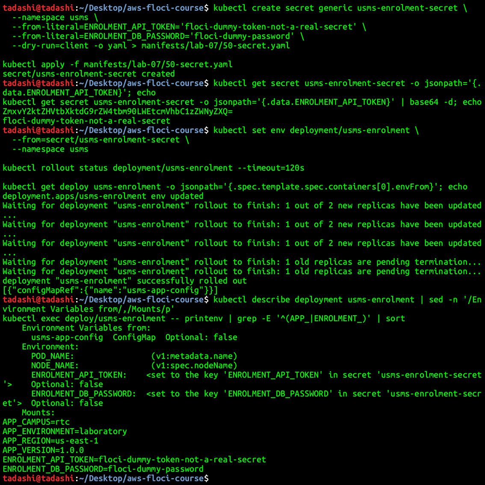

### Step 18 - Roll out a change, then roll it back

**Purpose:** See a rolling update create a new ReplicaSet, and see what rollback does and does not restore.

**What I did:**

1. Changed `APP_VERSION` to `1.1.0` in the ConfigMap and applied it. The pods still said `1.0.0`.
2. Ran `kubectl annotate`, which did not roll, as the lab warns, then `kubectl rollout restart`, which did.
3. Read the history and ran `rollout undo`.
4. Restored the ConfigMap to `1.0.0` and restarted.

**Result:** After the restart the response said `1.1.0` from a pod with a new hash (`6c5c9484d4`). The history shows revisions 1 to 3, with only revision 3 at 2 replicas. `rollout undo` went back to revision 2, and the response **still said 1.1.0**: undo restores the pod template, not the ConfigMap it references. Restoring the ConfigMap and restarting brought it back to 1.0.0.

**Screenshot 29 - ConfigMap change ignored until the pods restart**

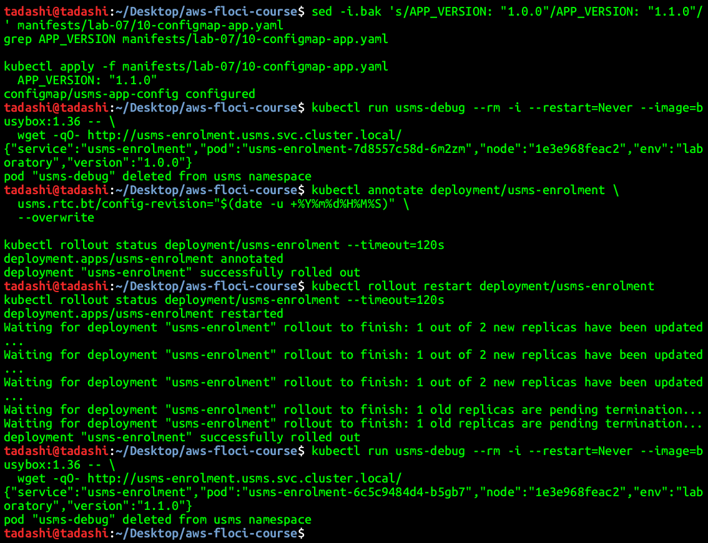

**Screenshot 30 - History, undo, and the version that did not revert**

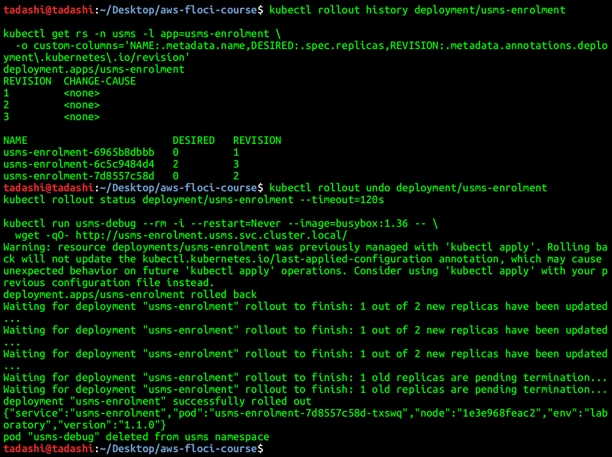

**Screenshot 31 - ConfigMap restored**

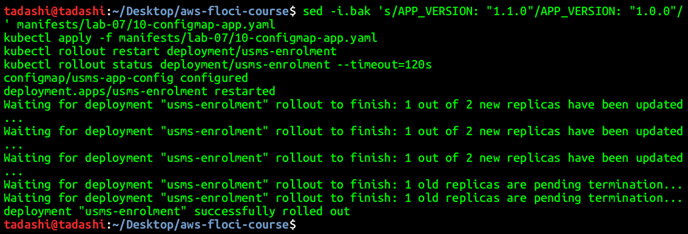

**Your turn:** I changed `usms-results`' image to `nginx:1.27`, let the roll finish, then rolled back. It peaked at **3 pods** and finished in about 11 s, and the history then lists **two revisions** (4 and 5), back on `nginx:1.27-alpine`. With two replicas, the default 25% rounds to a surge of 1 and 0 unavailable, so the roll had the same shape as `usms-enrolment`'s explicit `0/+1`. My first attempt was rolled back before the slower image finished pulling, so I repeated it.

**Screenshot 32 - Image roll, peak pod count, rollback and history**

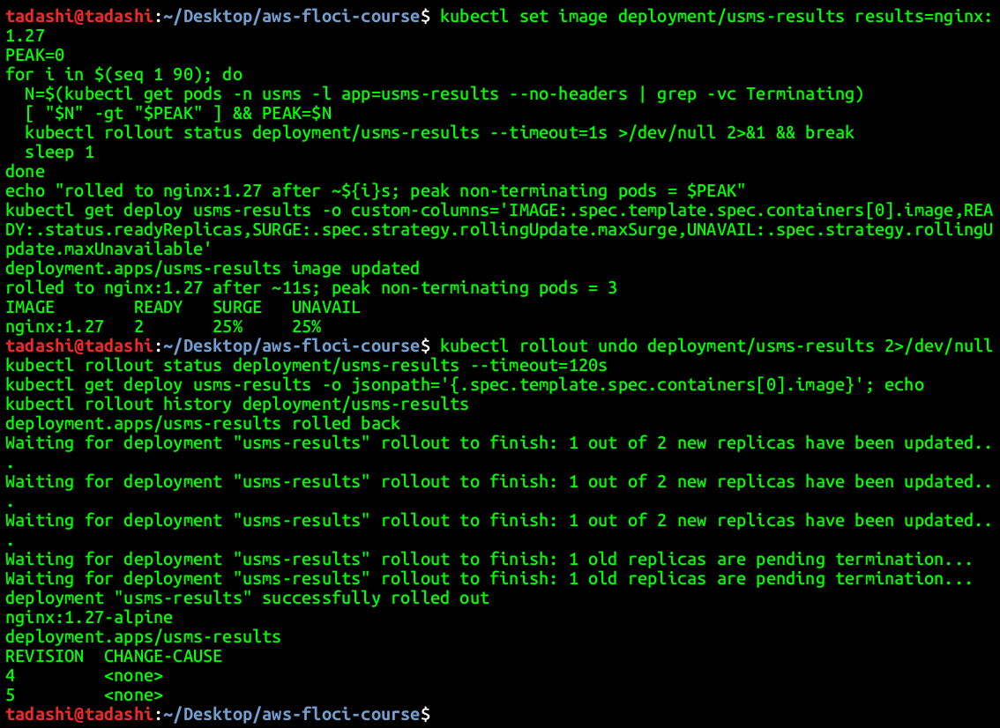

### Step 19 - Break a pod deliberately, and diagnose it

**Purpose:** See the three most common failures on purpose, before meeting them under pressure.

**What I did:** Ran the lab's three failures:

1. An image tag that does not exist.
2. A pod requesting 64 CPUs and 256 Gi of memory.
3. A container that exits 1.

Each was diagnosed with `get`, `describe` and `logs`, in that order.

**Result:**
- **ImagePullBackOff:** the new pod could not pull (`not found`, `ErrImagePull`, then `ImagePullBackOff`), while the **two old pods kept serving**. `rollout undo` fixed it. The lab's `describe -l ... | tail -15` landed on a healthy pod, so I described the failing pod by name.
- **Pending / FailedScheduling:** `0/1 nodes are available: 1 Insufficient cpu, 1 Insufficient memory`. The pod was deleted.
- **CrashLoopBackOff:** `Error` with 2 restarts at the moment of `get`. `logs` and `logs --previous` show `fatal: no database configured`, and `Last State` shows exit code 1. The pod was deleted. Here `logs` was the right second command, because the container did start.

**Screenshot 33 - ImagePullBackOff, with the old pods still serving**

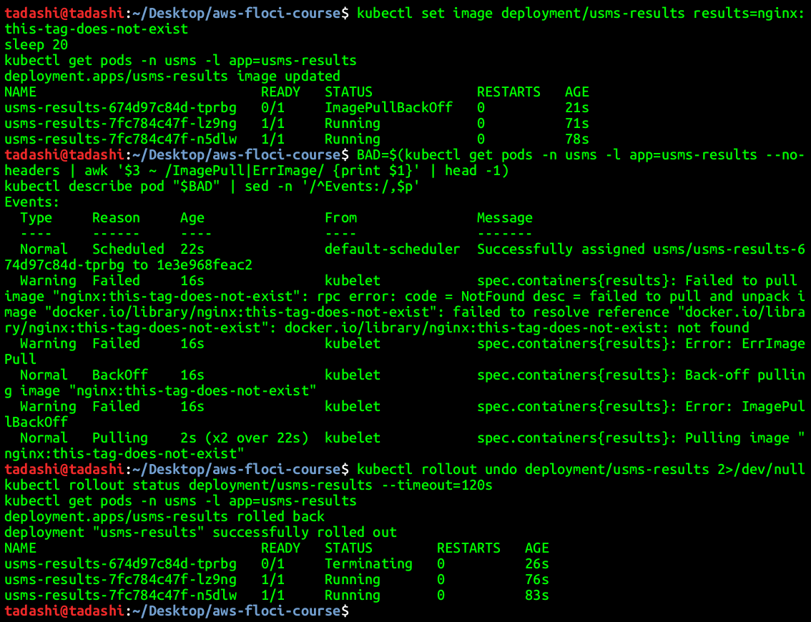

**Screenshot 34 - Pending with FailedScheduling**

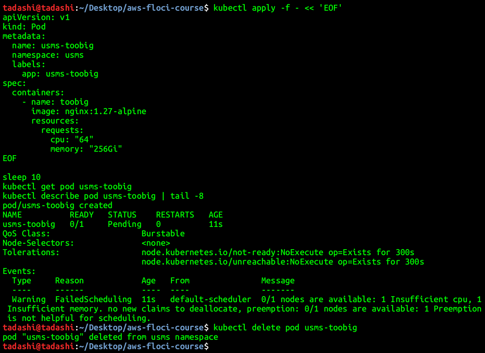

**Screenshot 35 - CrashLoop: logs, logs --previous, Last State**

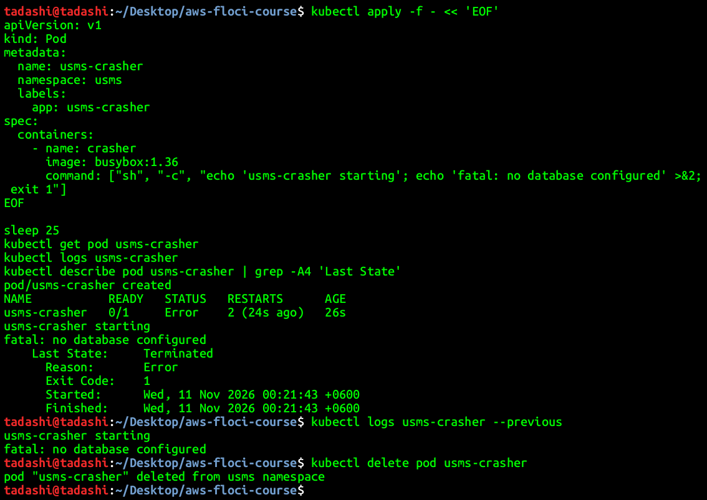

**Screenshot 36 - Events, in time order**

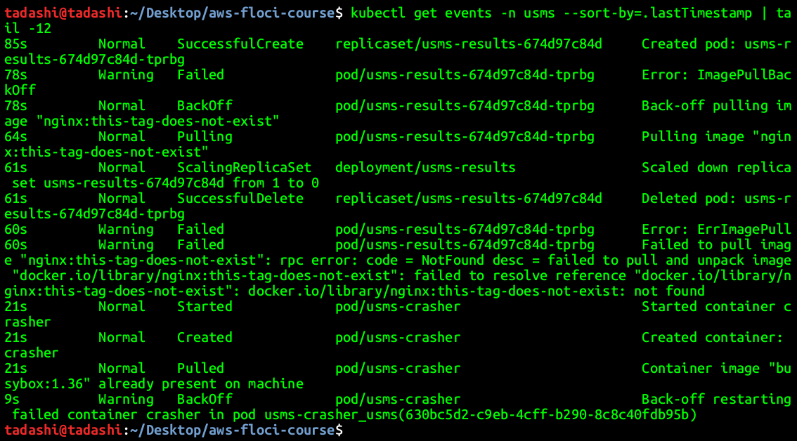

### Step 20 - The ECS comparison, with both running

**Purpose:** Check the comparison against both platforms while they are running.

**What I did:** Printed the Lab 04 ECS service and the EKS Deployments and Services side by side, and filled in the eight-row table in the notes.

**Result:** ECS: desired 2, running 2, `usms-enrolment:2`, one deployment, 0 load balancers (the lab's query fails on `length(null)`, so I added a null-safe version). EKS: three Deployments, three ClusterIP Services. The table and my choice for USMS (ECS on Fargate) are in `notes/lab-07-notes.md`.

**Screenshot 37 - ECS and EKS side by side**

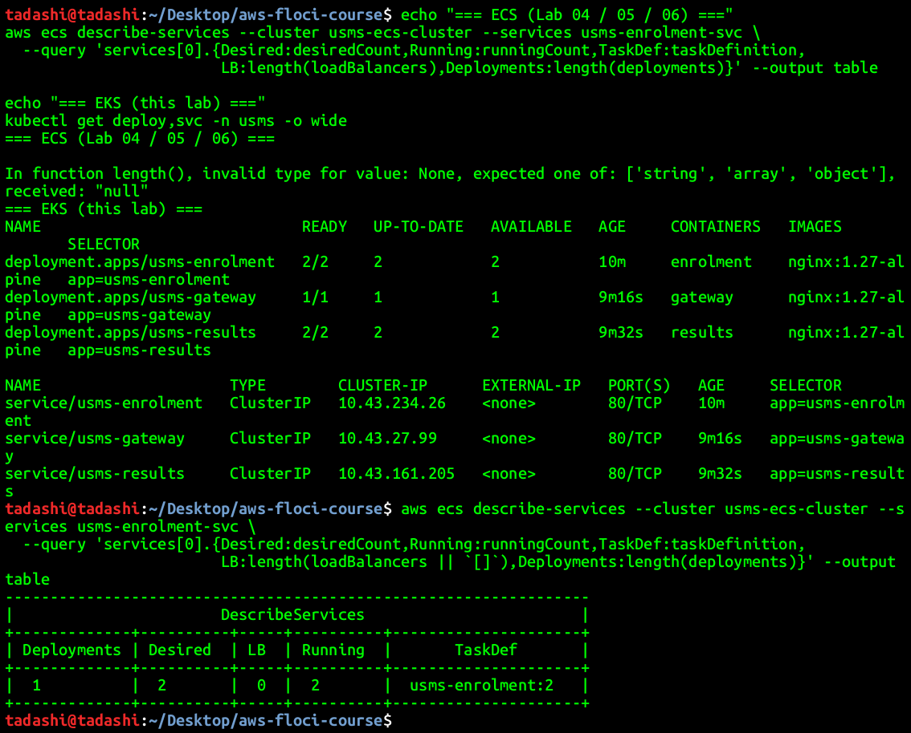

### Step 21 - IRSA, and why it stops here

**Purpose:** Step 7 gave every pod on the node the S3 policy. IRSA is the fine-grained alternative, so I recorded how far this build gets.

**What I did:** Read the OIDC issuer, registered it in IAM as an OpenID Connect provider (part 2 runs only when an issuer exists), created the ServiceAccount `usms-enrolment-sa`, then checked for the IRSA webhook and compared issuers.

**Result:** The provider was registered, `arn:aws:iam::000000000000:oidc-provider/oidc.eks.us-east-1.amazonaws.com/id/0F14...`, and the ServiceAccount exists. But there are **no mutating webhooks**, and the k3s API server signs tokens as `https://kubernetes.default.svc.cluster.local`, not the advertised URL. So IRSA steps 1, 2 and 4 exist as records, and steps 3, 5 and 6 cannot work here. **I did not configure IRSA.** I traced the chain and recorded where it stops.

**Screenshot 38 - Issuer, OIDC provider, ServiceAccount**

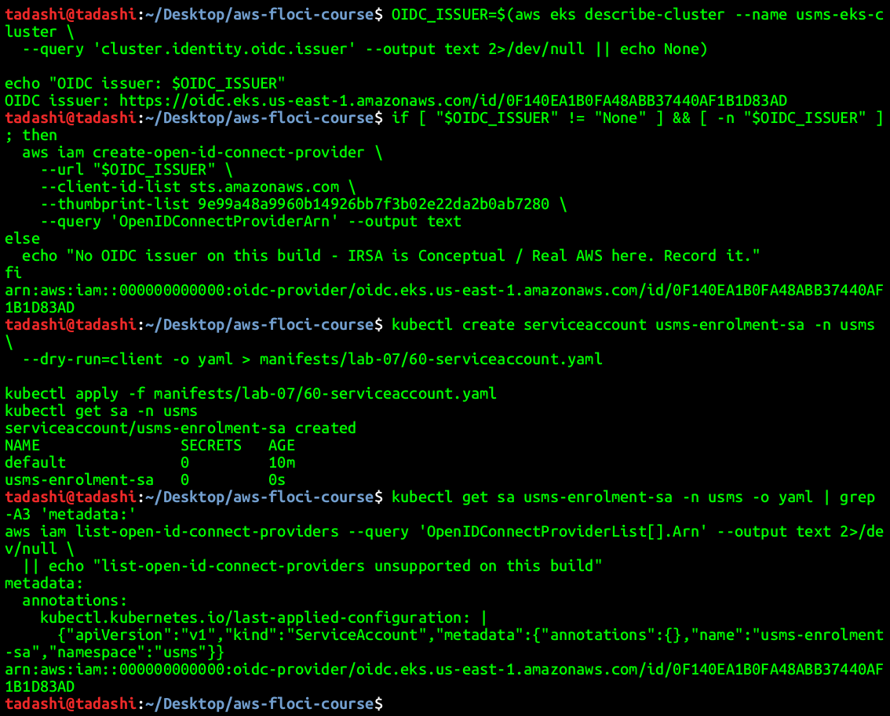

**Screenshot 39 - No webhook, and the issuer mismatch**

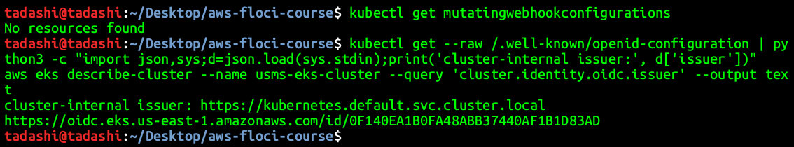

### Step 22 - Prove that all of this survives a restart

**Purpose:** Create, perturb, read back, re-deriving names from the API.

**What I did:** Recorded the cluster, node group, Deployments and Service IPs. Then I stopped and started Floci, re-derived the cluster from `list-clusters` and the node group from `list-nodegroups`, and compared.

**Result:** Floci restarted cleanly, and the k3s container stayed up throughout ("Up 22 minutes"), because stopping Floci does not stop the cluster it started. Both names were re-derived, all three Deployments were ready and five ConfigMaps were present. The lab's own diff reported differences, but its two blocks record different fields: "before" has the node group line and the Service IPs, "after" has the namespace and ConfigMaps. Re-reading the same fields after the restart gave an empty diff: **PERSISTENCE PROVEN**, with ClusterIPs unchanged and the Secret and ServiceAccount present.

**Screenshot 40 - Before the restart**

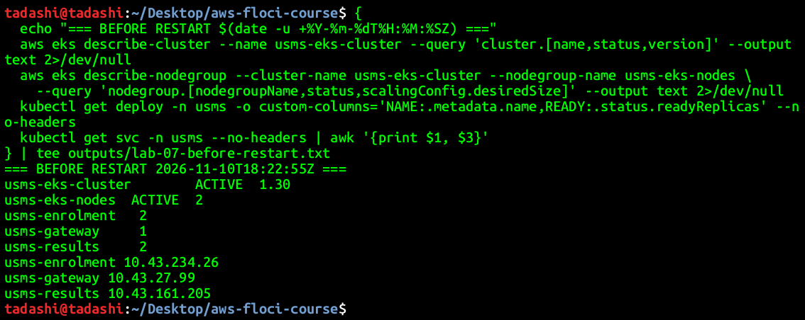

**Screenshot 41 - Floci stopped and started; the cluster container kept running**

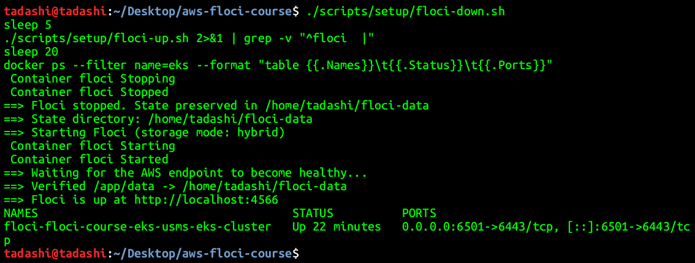

**Screenshot 42 - Re-derived after the restart, and the lab's mismatched diff**

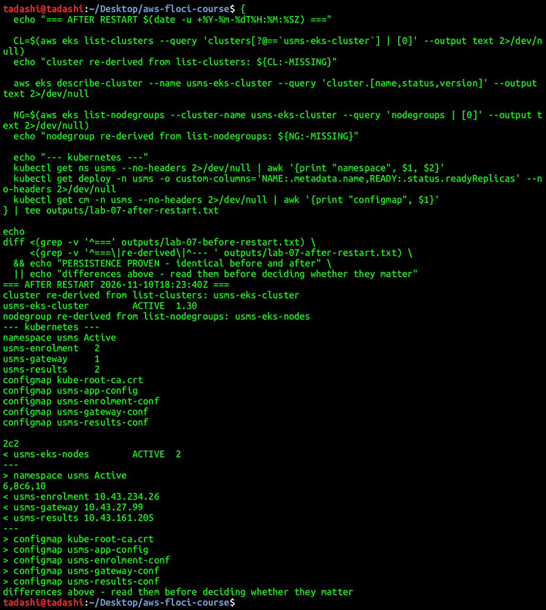

**Screenshot 43 - Like-for-like comparison: identical**

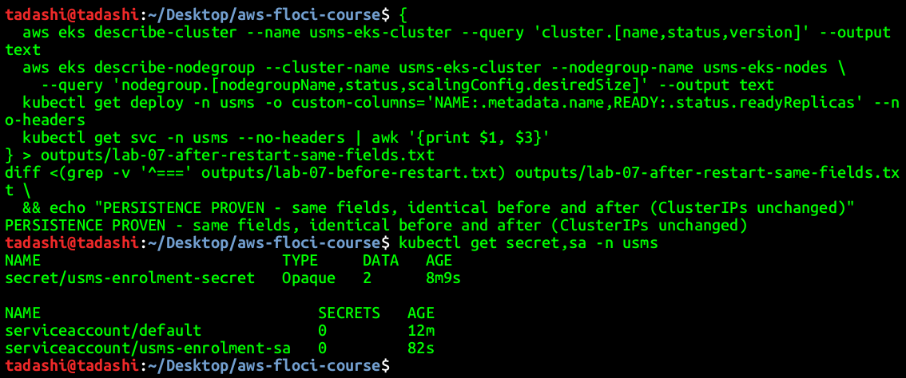

### Step 23 - Write configs/lab-07.env

**Purpose:** Lab 08 needs these identifiers after the terminal is gone.

**What I did:** Wrote the file with the lab's unquoted heredoc. The AWS values are looked up from the API; the Kubernetes names are literal.

**Result:** All values are populated and there are 21 exports. `lb_ports=8081,8082`, and the endpoint `https://localhost:6501` is recorded.

**Screenshot 44 - Env file written and checked**

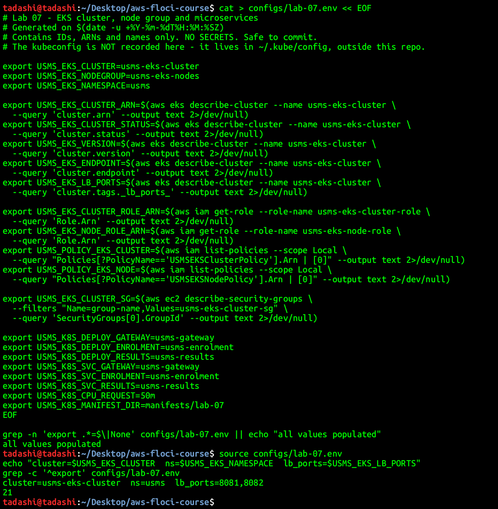

### Step 24 - Check what is safe to commit

**Purpose:** Check, rather than trust, that no secret is about to be committed.

**What I did:** Ran `git status --short`, `git check-ignore -v` on an outputs file and on the env file, and `git ls-files outputs/`. **I did not run `git add` or `git commit`**, because committing is left to me.

**Result:** Nothing under `outputs/` appears, and `outputs/lab-07-support-probe.txt` is ignored by `.gitignore:8: outputs/*`. Only `outputs/.gitkeep` is tracked. `configs/lab-07.env` is ignored by `.gitignore:42: configs/*.env`, this repository's rule for every lab's env file, so it will not be in a commit unless added with `-f`. `manifests/lab-07/50-secret.yaml` would be committed: it holds dummy values only.

**Screenshot 45 - Look before adding**

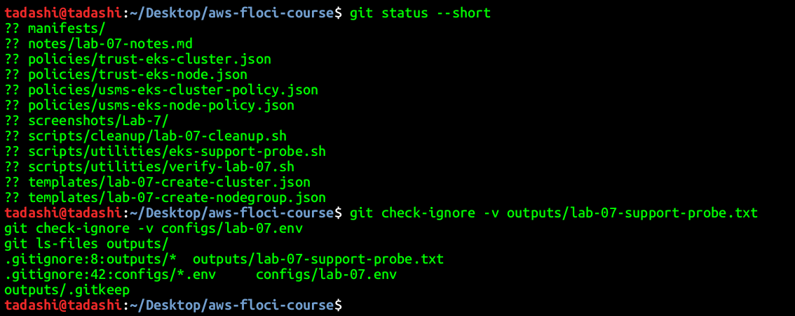

### Independent exercises

Full write-ups are in [exercises.md](exercises.md). In summary:

#### Exercise 1 - A fourth microservice

`manifests/lab-07/70-timetable.yaml` (ConfigMap, Deployment, Service), validated with `--dry-run=client` and applied. The cluster now has four Deployments and four Services, and `usms-timetable` answers with its pod name.

**Screenshot 46 - Exercise 1 manifest**

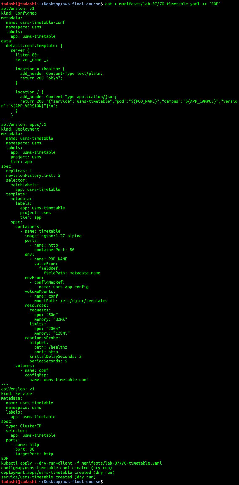

**Screenshot 47 - Exercise 1 result**

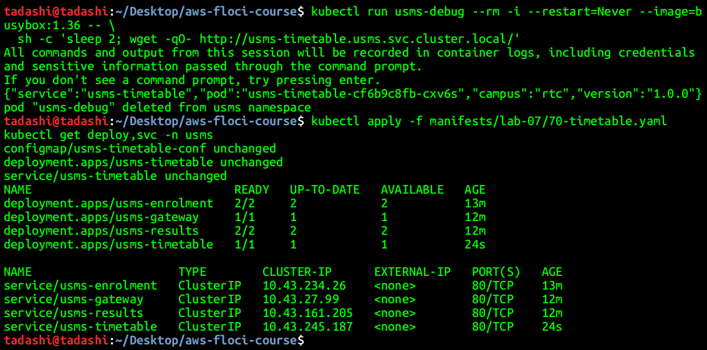

#### Exercise 2 - Route to it, and prove the route

I added a `/timetable/` location to `40-gateway.yaml`. Applying it changed only the ConfigMap, so `kubectl rollout restart` made the new ReplicaSet. All three routes answered in one command.

**Screenshot 48 - Route added, gateway restarted**

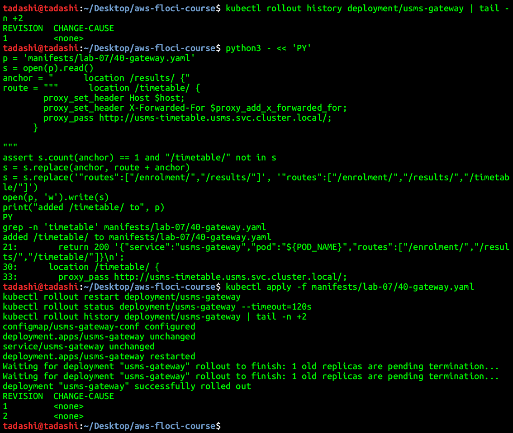

**Screenshot 49 - Three services through one gateway**

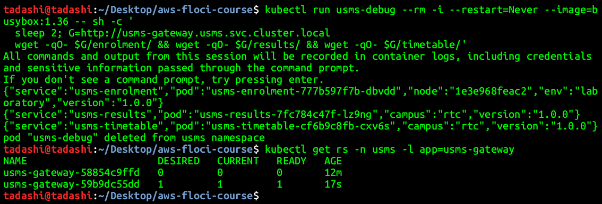

#### Exercise 3 - Find the misconfiguration

There were two faults. The Service selected `version: v2` while the pods were `v1`, and the readiness probe on `/healthz` got 404 from stock nginx. One line was changed for each, giving two endpoints, and `usms-broken` was then deleted.

**Screenshot 50 - Accepted, but no endpoints**


**Screenshot 51 - Diagnosis with commands**


**Screenshot 52 - The fix: two endpoints**


**Screenshot 53 - usms-broken deleted**


#### Exercise 4 - Survive a node going away

I added an advisory `topologySpreadConstraints` (hostname, `ScheduleAnyway`) and an enforced `PodDisruptionBudget` (`minAvailable: 1`). On this single-node cluster, a drain evicted one pod and the PDB refused the second, while the remaining pod answered every request.

**Screenshot 54 - Spread constraint and PDB applied**


**Screenshot 55 - Drain blocked by the PDB, still serving**


#### Exercise 5 - Prepare what Lab 08 needs

`kubectl top` works: the enrolment pods use 7m and 1m of CPU, which is 14% and 2% of the 50m request. `USMSStudentDataReadWrite` has three holders, and the bucket ARN and object ARN were read from its document. The bucket does not exist yet (404). The Lab 08 variable list is in the notes.

**Screenshot 56 - CPU baseline**


**Screenshot 57 - Policy, holders, bucket readiness**


## 6. Results and Evidence

### 6.1 CLI Output

The command output for each build step is shown under that step in Section 5. This section shows the checks on the finished system.

**Lab verification script.** `verify-lab-07.sh` checks the environment, the earlier labs, the IAM and EC2 objects, the EKS cluster and node group, the Kubernetes Deployments and endpoints, and Git hygiene. It reports **`PASS=29 FAIL=1`**, where the lab expects `PASS=30 FAIL=0`. The one failure is the `no secret is tracked by git` false positive on `outputs/.gitkeep`, which the lab requires to be tracked. All three EKS checks pass, as Path A should.

**Screenshot 58 - verify-lab-07.sh (PASS=29 FAIL=1)**


**Smoke test.** One busybox pod fetched the gateway root, `/enrolment/` and `/results/`, and printed `SMOKE TEST PASSED`.

**Screenshot 59 - Smoke test**


**Cleanup script.** `lab-07-cleanup.sh` is for the end of the course only, so I only checked its syntax and did not run it.

**Screenshot 60 - Cleanup script syntax check, not run**


**Final state.** Four Deployments (2/1/2/1 ready), one PDB, four ClusterIP Services, and six pods running on the one node. `verify-lab-07.sh` still reports `PASS=29 FAIL=1`.

**Screenshot 61 - Final state of namespace usms**


### 6.2 AWS Management Console Verification

This course runs on Floci, so there is no AWS Management Console. The Floci UI at `http://localhost:4500` is the local equivalent, and unlike in Labs 05 and 06 it has a page for this lab's service.


*Floci Console Home: the local AWS runtime is reachable, with EKS listed as an available service.*


*The EKS page in Cloud Explorer lists `usms-eks-cluster` as ACTIVE, version 1.30, created in this lab.*

## 7. Analysis and Discussion

**What was achieved.** Everything the lab asks for on Path A ran: both IAM roles with their policies, the cluster security group, an EKS cluster in Lab 02's VPC with the `_lb_ports_` tag, the node group record, and three (then four) microservices discovered by DNS. I also completed a rolling update and rollback, three diagnosed failures, a Secret shown to be readable, and persistence across a restart. The Kubernetes half is real k3s, so its behaviour is what a real cluster would do.

**Did the results match the expected outcome?** Mostly. `verify-lab-07.sh` gives `PASS=29 FAIL=1` against an expected 30/0, and the one failure is the known `.gitkeep` false positive. Where the build differed from real EKS, the difference is in the AWS-side records, not in Kubernetes behaviour.

**Errors encountered and how they were resolved.**

| Problem | Cause | Resolution |
|---|---|---|
| `create-cluster` reported `ResourceInUseException` | The first attempt created the cluster but exceeded the CLI read timeout, and the retries found it | Confirmed one cluster and one k3s container, then waited for ACTIVE |
| TLS handshake timeouts; the namespace apply was lost | Docker Desktop VM (3.5 GiB) shared with the `dso202` kind cluster | Stopped (not removed) the `dso202` containers with permission |
| Tallies through `kubectl run -i` sometimes printed nothing | The pod finished before kubectl attached, when it was not the first command | Re-ran it as the first command; recorded both outputs |
| `length(loadBalancers)` errored | The ECS field is `null` on this build | Used `length(loadBalancers \|\| \`[]\`)` |
| `describe -l ... \| tail -15` showed no events | It described all three pods and the tail landed on a healthy one | Described the failing pod by name |
| Gateway `wget localhost` was refused in Exercise 4 | `localhost` resolved to IPv6 `::1`, where nginx does not listen | Used `127.0.0.1` and repeated the demonstration |
| The lab's Step 22 diff always shows differences | The before and after blocks record different fields | Compared the same fields: identical |

**Observations: Floci compared with real AWS.**

| Observed | Recorded only | Conceptual |
|---|---|---|
| Kubernetes object model: Deployments, ReplicaSets, Services, ConfigMaps, Secrets | IAM roles and policies (stored, never evaluated) | IRSA token exchange (no webhook; issuer mismatch) |
| DNS discovery and load spreading | Node group sizing, `t3.small`, AMI type and labels | VPC CNI pod addresses from Lab 02's subnets |
| Rolling update, rollback, revision history | Cluster security group | KMS envelope encryption of Secrets |
| Three failure modes, PDB blocking an eviction | Cluster version 1.30 (k3s runs 1.34.1) | EKS access entries, control plane logging, upgrades |
| Persistence across a Floci restart | | Cost per cluster-hour and per node |

The most useful observation came from Step 18. Rolling back the Deployment did not roll back the configuration, so a release has to version its ConfigMaps with the workload. The second was Exercise 3: `kubectl apply` accepted a manifest with two faults that only showed up as an empty endpoint list. A Service with no endpoints is the first thing I would check next time.

## 8. Reflection

**What did you learn about this AWS service?** I learned that EKS is two things: an AWS-managed control plane with its own IAM role, and a data plane of nodes I own, with a separate role. I saw how the Kubernetes objects divide the work. A Deployment manages ReplicaSets, a ReplicaSet keeps the pod count (it, not me or the Deployment, replaced the pod I deleted), and a Service gives a stable virtual IP and DNS name, so the gateway never needs an address. I also learned that a Secret is only base64, and that rollback restores the template but not the ConfigMaps it names.

**What challenges did you encounter?** The first challenge was resources: the k3s API server timed out until I stopped another project's cluster, which taught me to check the platform before suspecting my own commands. The second was telling what the emulator did from what Kubernetes did. The node group reported ACTIVE with two `t3.small` nodes, but `kubectl get nodes` showed one k3s node on a different version, and the advertised OIDC issuer was not the one the cluster uses. I also met small tooling surprises, such as kubectl attaching too late to a short pod, IPv6 `localhost` in an alpine image, and kubectl 1.36 writing Secret variables differently from the lab, and worked each one out from its output.

**How would you apply this service in a real-world cloud environment?** I would use EKS when a team runs many services or needs Kubernetes portability. I would create managed node groups across two Availability Zones in private subnets, use IRSA or EKS Pod Identity instead of a broad node role, enable KMS encryption of Secrets, and give every service readiness probes, resource requests and a PodDisruptionBudget. For a small, seasonal system like USMS, ECS on Fargate is simpler.

**What additional concepts or features would you like to explore?**

- Running the same manifests on a real EKS cluster with two Availability Zones
- Horizontal Pod Autoscaler and exposing the gateway (Lab 08)
- EKS Pod Identity and IRSA end to end
- Helm or Kustomize to version configuration with the workload
- NetworkPolicies, because a namespace is not an isolation boundary

## 9. Conclusion

The objectives were achieved on support Path A. Floci created the EKS cluster and its node group record, and started a real k3s cluster, on which three USMS microservices were deployed from manifests. They discovered each other by DNS, rolled forward and back, failed in three diagnosed ways, and survived a restart; their identifiers are recorded for Lab 08. The AWS-side IAM roles, node group details and IRSA were recorded or traced rather than enforced, and that is stated above.

I learned the control plane / data plane split, how Kubernetes keeps services alive and reachable, and why configuration must be versioned with the workload. I also practised reading Kubernetes output with `get`, `describe`, `logs` and events. EKS matters because it brings the standard Kubernetes model to AWS, letting teams run portable microservices on a managed control plane.

## 10. Appendix

- Lab notes, review questions, ECS comparison and Floci limitations: [notes/lab-07-notes.md](../../notes/lab-07-notes.md)
- Exercises: [exercises.md](exercises.md)
- Manifests: `manifests/lab-07/00-namespace.yaml`, `10-configmap-app.yaml`, `20-enrolment.yaml`, `25-enrolment-pdb.yaml`, `30-results.yaml`, `40-gateway.yaml`, `50-secret.yaml` (dummy values), `60-serviceaccount.yaml`, `70-timetable.yaml`
- IAM documents: `policies/trust-eks-cluster.json`, `policies/trust-eks-node.json`, `policies/usms-eks-cluster-policy.json`, `policies/usms-eks-node-policy.json`
- Request bodies: `templates/lab-07-create-cluster.json`, `templates/lab-07-create-nodegroup.json`
- Scripts: `scripts/utilities/eks-support-probe.sh`, `scripts/utilities/verify-lab-07.sh`, `scripts/cleanup/lab-07-cleanup.sh` (not run)
- Local evidence (git-ignored): `outputs/lab-07-support-probe.txt`, `outputs/lab-07-cluster.json`, `outputs/lab-07-nodegroup.json`, `outputs/lab-07-before-restart.txt`, `outputs/lab-07-after-restart.txt`, `outputs/lab-07-cpu-baseline.txt`, `outputs/lab-07-lab06-readiness.txt`, and `configs/lab-07.env` (ignored by `configs/*.env`)
