# Lab 07 - Independent Lab Exercises

Commands were run from the repository root with `AWS_DEFAULT_REGION=us-east-1` set, against the Path A cluster (one k3s node). See [notes/lab-07-notes.md](../../notes/lab-07-notes.md).

## Exercise 1 - Basic: a fourth microservice

`manifests/lab-07/70-timetable.yaml` holds three objects: the ConfigMap `usms-timetable-conf` (an nginx template returning JSON with the service, pod, campus and version), the Deployment `usms-timetable` (one replica, `nginx:1.27-alpine`, readiness probe on `/healthz`, requests `cpu 50m / memory 32Mi`, limits `200m / 128Mi`), and a ClusterIP Service on port 80. It uses the lab's label scheme (`app`, `project`, `tier`) and the structure of `30-results.yaml`. It was written by hand, not generated with `kubectl create deployment`, and validated with `--dry-run=client` first.

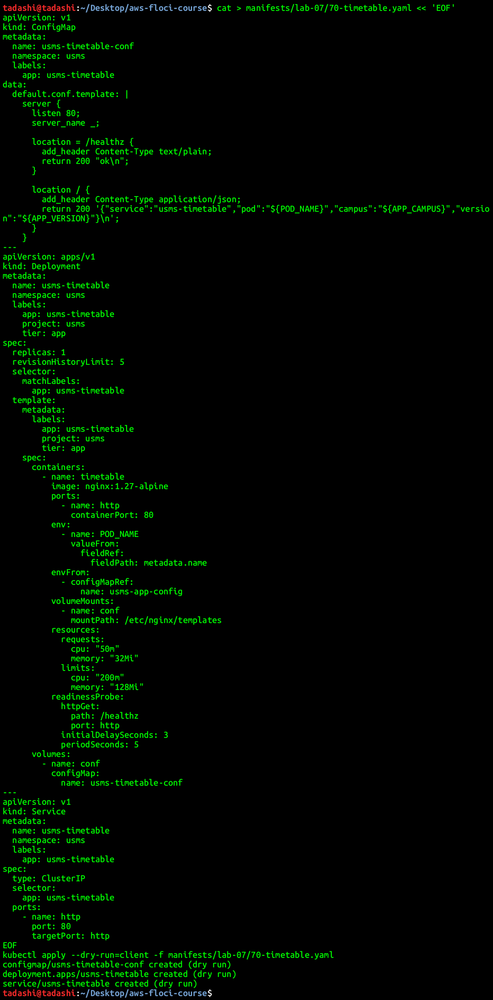

**Outcome:** four Deployments and four Services in `usms`. A busybox pod fetching `http://usms-timetable.usms.svc.cluster.local/` got `{"service":"usms-timetable","pod":"usms-timetable-cf6b9c8fb-cxv6s","campus":"rtc","version":"1.0.0"}`.

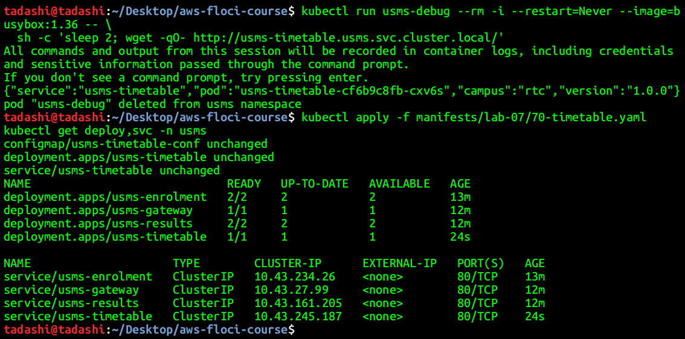

## Exercise 2 - Intermediate: route to it, and prove the route

I added a `location /timetable/` block (with the same proxy headers as the other two routes) to the gateway's ConfigMap in `manifests/lab-07/40-gateway.yaml`, and added `/timetable/` to the root response's route list. The edit was made in the file, with no `kubectl edit`, and re-applied.

`kubectl apply` reported `configmap/usms-gateway-conf configured` but `deployment.apps/usms-gateway unchanged`. Updating a ConfigMap does not restart pods, and the pod template had not changed, so `kubectl annotate` on the Deployment would not roll it either. **`kubectl rollout restart deployment/usms-gateway`** is the command that caused the new ReplicaSet: it writes a timestamp into the pod template.

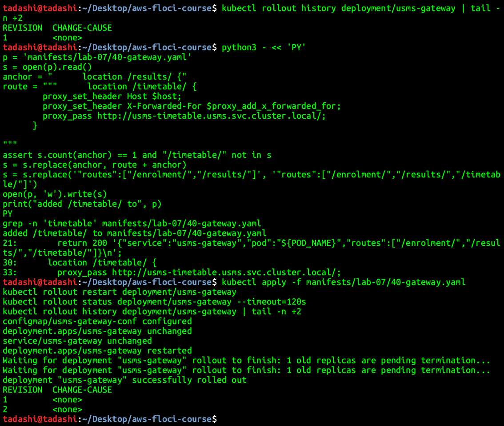

**Outcome:** one busybox command fetched `/enrolment/`, `/results/` and `/timetable/` through the gateway and got three JSON documents from three services. The gateway moved from ReplicaSet `58854c9ffd` (now 0) to `59b9dc55dd` (1), and `rollout history` went from one revision to two.

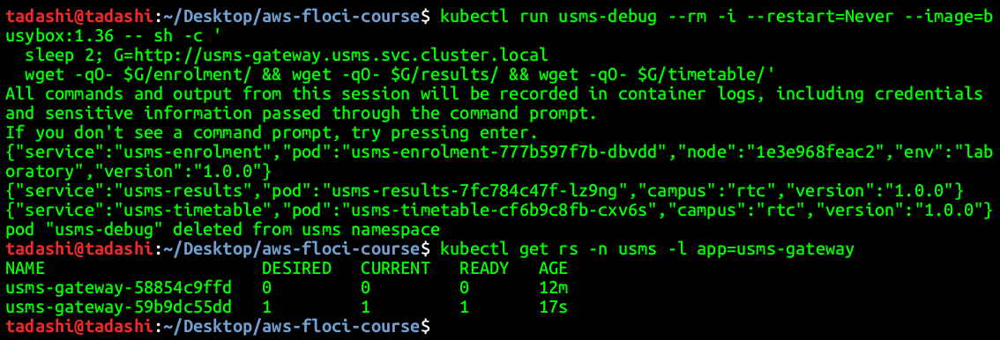

## Exercise 3 - Problem solving: find the misconfiguration

I applied the manifest exactly as given (kept in `outputs/lab-07-broken.yaml`, because it is throwaway). `kubectl apply` accepted it, and the Service had **no endpoints** while both pods were `Running` but `0/1` ready.

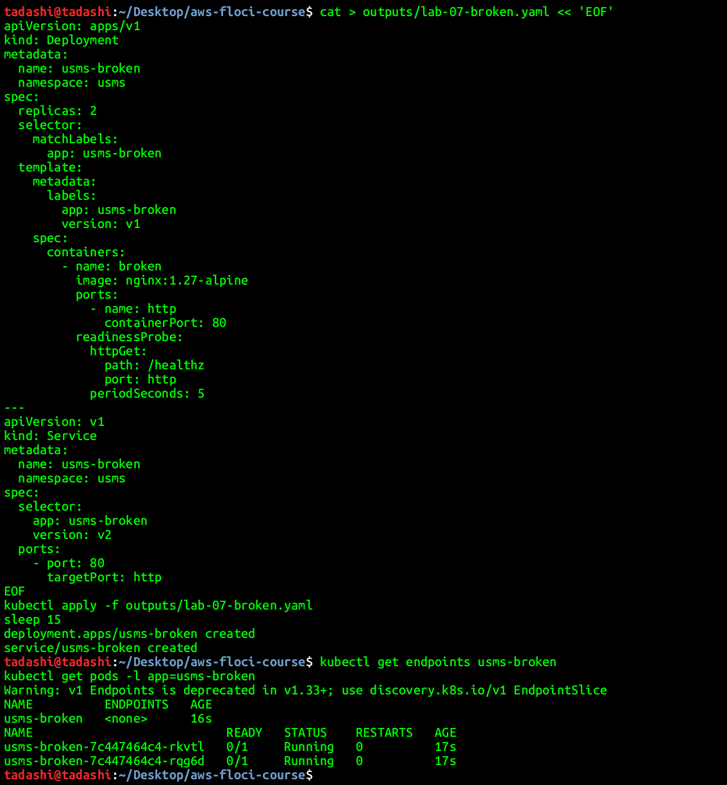

Diagnosis, in order:

1. `kubectl get endpoints usms-broken` showed `<none>`, so the Service selects nothing usable.
2. `kubectl get svc usms-broken -o jsonpath='{.spec.selector}'` returned `{"app":"usms-broken","version":"v2"}`, and `kubectl get pods --show-labels` showed the pods carry `version=v1`. **Fault 1:** the Service selector asks for `version: v2`, and no pod has that label.
3. `READY False` on both pods, and `kubectl get events --field-selector reason=Unhealthy` showed `Readiness probe failed: HTTP probe failed with statuscode: 404`. `wget` inside the pod confirmed it: `/healthz` returns `404 Not Found`, while `/` serves the nginx welcome page. **Fault 2:** the stock nginx image has no `/healthz`, so the readiness probe fails forever, and unready pods are never added to a Service.

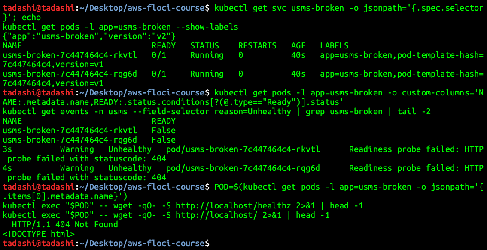

**Cause in one sentence:** the Service selects a label value no pod carries, and even pods that matched would be kept out because their readiness probe checks a path the base image does not serve.

**Fix:** one changed line per fault. `version: v2` became `version: v1` in the Service selector (deleting that line would also work), and the probe `path: /healthz` became `path: /`. The exercise says the fix must change exactly one line, but fixing one fault alone does not make the Service work, so the minimum is one line for each fault. After applying, the Service has two endpoints.

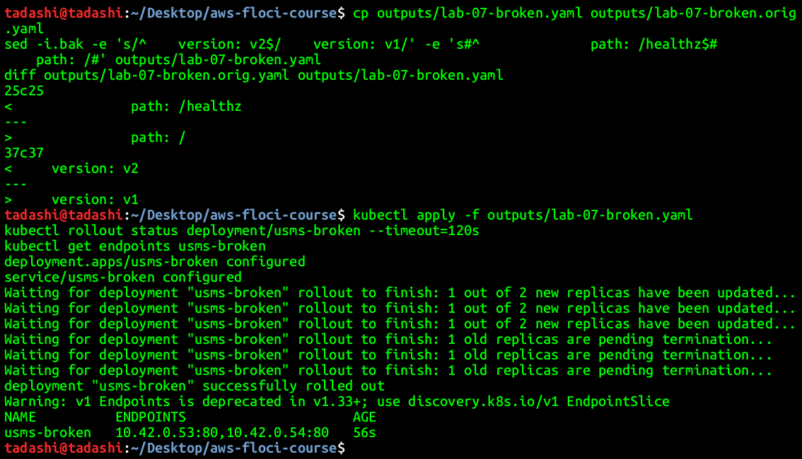

`usms-broken` was then deleted (a CLEAN UP item).

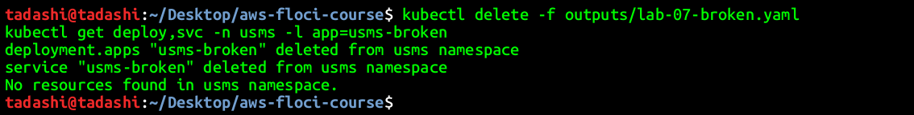

## Exercise 4 - Challenge: survive a node going away

This cluster has **one schedulable node** (`1e3e968feac2`), so "pods on more than one node" cannot be shown. I applied the configuration I would use on a multi-node cluster and demonstrated the part a single node allows: the enforced budget during a voluntary disruption.

**Changes:**

1. **`topologySpreadConstraints`** in `manifests/lab-07/20-enrolment.yaml`: `maxSkew: 1` over `kubernetes.io/hostname`, `whenUnsatisfiable: ScheduleAnyway`, selecting `app: usms-enrolment`. This is the **advisory** half. With two or more nodes the scheduler places the two replicas on different nodes, so losing one node removes half the capacity, not all of it. `ScheduleAnyway` (not `DoNotSchedule`) means that on a single node, or while a node is being replaced, pods still schedule instead of going Pending; I would rather run doubled up than not at all. On real EKS I would add a second constraint on `topology.kubernetes.io/zone`, so the replicas also land in different Availability Zones, matching Lab 02's two private subnets.
2. **`PodDisruptionBudget usms-enrolment-pdb`** (`minAvailable: 1`), a new object in `manifests/lab-07/25-enrolment-pdb.yaml`. This is the **enforced** half. The eviction API refuses any voluntary disruption, such as `kubectl drain`, a node-group upgrade or the cluster autoscaler, that would leave fewer than one ready enrolment pod. It does not protect against a node crashing; that is what the spread is for. `minAvailable: 1` rather than `maxUnavailable: 0` means a drain can still make progress one pod at a time, instead of blocking forever.
3. **Which node each pod is on** comes from the cluster itself, not from my memory: `kubectl get pods -l app=usms-enrolment -o custom-columns=POD:.metadata.name,NODE:.spec.nodeName` (or `-o wide`). The pods also report their node in every response through the downward API (`NODE_NAME`).

Re-applying the manifest rolled the Deployment, and the Secret's two variables set in Step 17 were kept (the count is still 2).

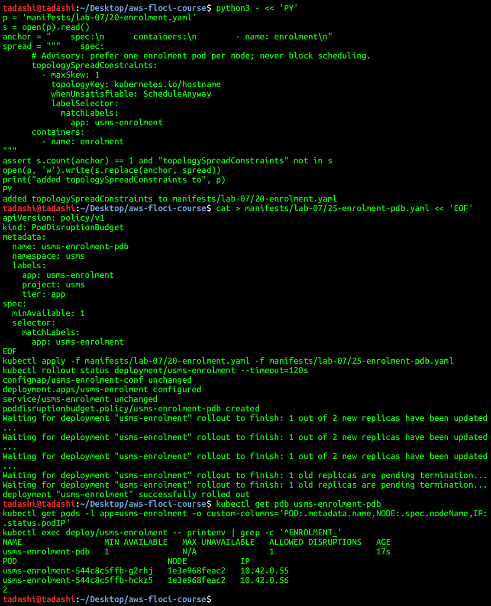

**Demonstration:** I ran `kubectl drain` on the node, limited to the enrolment pods. The first eviction succeeded. Its replacement stayed `Pending`, because the node was cordoned and there was nowhere else to go. The second eviction was **refused by the PDB** (`ALLOWED DISRUPTIONS 0`), and the drain timed out after 30 s instead of taking the service down. During this the Service still had one endpoint, and six requests through the gateway were all answered by the surviving pod. After `kubectl uncordon`, the Pending pod was scheduled and the Deployment returned to 2/2.

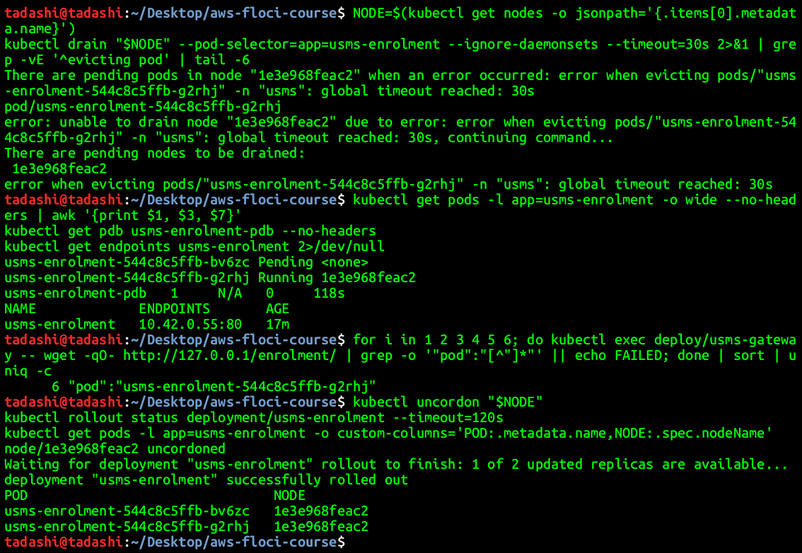

**What I would have shown with two nodes:** draining one node would evict its enrolment pod, the replacement would schedule on the other node, and the drain would complete, while the smoke test never failed. Deleting every pod on one node at once would leave the other node's replica serving while the ReplicaSet replaced the lost one.

## Exercise 5 - Integration: prepare what Lab 08 needs

**Part 1:** the metrics API exists (`metrics.k8s.io/v1beta1`, k3s ships metrics-server), so `kubectl top` works. The two `usms-enrolment` pods used 7m and 1m of CPU, which is **14.0% and 2.0% of the 50m request**, and 6-7 Mi of memory, measured idle. The figures are in `outputs/lab-07-cpu-baseline.txt`.

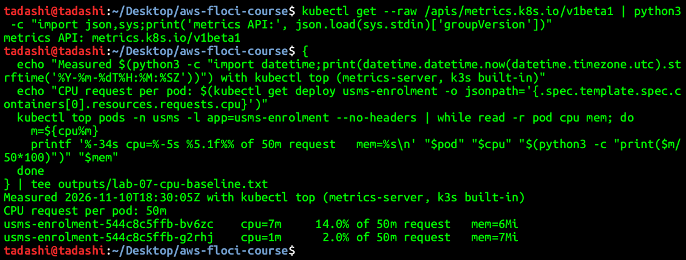

**Part 2:** `USMSStudentDataReadWrite` (`arn:aws:iam::000000000000:policy/USMSStudentDataReadWrite`, version v1) is carried by `usms-ec2-app-role`, `usms-ecs-task-role` and `usms-eks-node-role`. Read from the policy document: the bucket ARN `arn:aws:s3:::usms-student-data` (List/GetBucketLocation, DeleteBucket denied) and the object ARN `arn:aws:s3:::usms-student-data/*` (Get/Put/DeleteObject). They are separate entries, which Lab 10 depends on. `head-bucket` returned 404 with exit code 254: the bucket does not exist yet. Written to `outputs/lab-07-lab06-readiness.txt`. Both files are ignored by `.gitignore:8: outputs/*`.

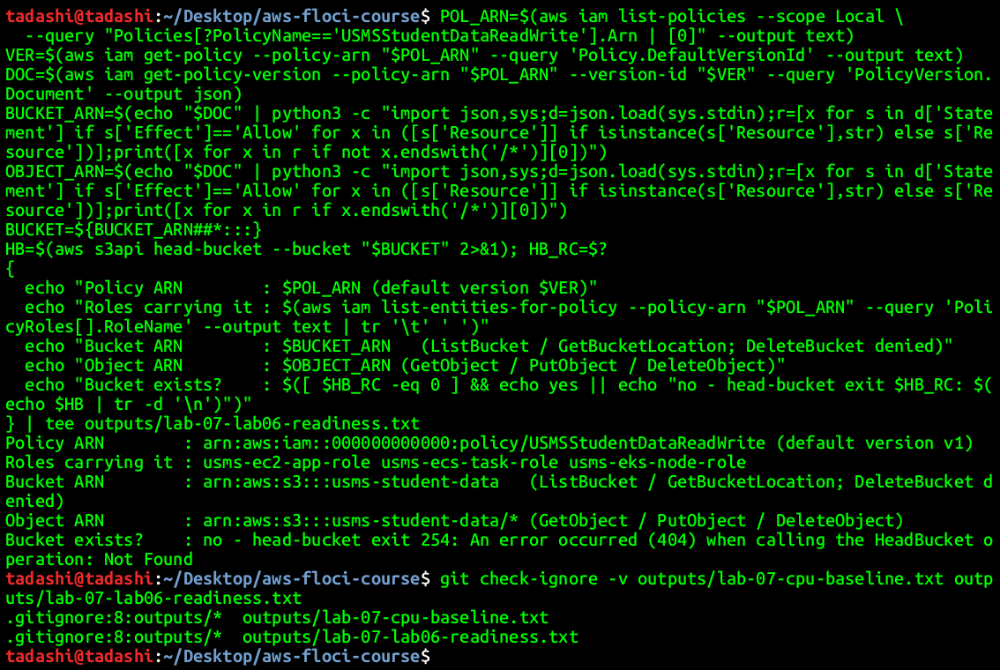

**Part 3:** the Lab 08 variable list is in [notes/lab-07-notes.md](../../notes/lab-07-notes.md), under "Exercise 5 part 3".
